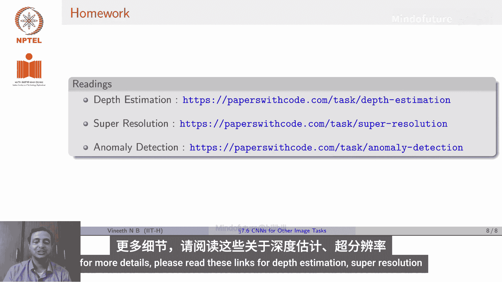

# 051：用于其他图像任务的CNN

在本节课中，我们将简要了解深度卷积神经网络（CNN）在几个其他图像任务中的应用，包括深度估计、超分辨率和异常检测。我们将探讨这些任务的基本概念和实现方法。

## 深度估计

上一节我们介绍了CNN在分类和检测等任务中的应用。本节中，我们来看看如何利用CNN从单张2D图像中估计深度。

深度估计的目标是确定场景中每个像素点距离相机的距离。传统方法（包括人类视觉系统）通常依赖双目立体视觉。然而，研究试图仅从单张图像中获取深度信息。

以下是使用CNN进行深度估计的两种方法：

**1. 早期方法（Eigen et al., 2014）**
该方法使用一个**粗糙级CNN**对输入图像进行前向传播，在最后一层输出每个像素的深度估计值。这与姿态估计等任务类似。为了提高精度，该方法引入了一个**细化步骤**：将原始图像以不同分辨率和滤波器处理后，输入到一个**精细深度估计网络**。同时，粗糙网络的估计结果也会在中间层与精细网络的输入进行**拼接**，共同生成更精确的细化深度估计。

**公式表示**：
*   粗糙估计：`Depth_coarse = CNN_coarse(Image)`
*   细化估计：`Depth_refined = CNN_fine(Image, Depth_coarse)`

训练时，使用像素级真实深度图，通过**均方误差（L2损失）** 作为损失函数进行优化。

**2. 当代方法（Genet）**
一个更现代的方法是Genet，它在一个联合框架中同时进行深度估计、相机运动估计和姿态估计。我们主要关注其深度估计部分。

该方法假设可以从一个**图像序列**（例如自动驾驶中连续的视频帧）中更好地估计深度，而非单张图像。网络将不同时间点的帧作为输入**体积（Volume）** 的不同通道，类似于之前将RGB作为不同通道。

*   **深度网络**估计每个时间通道的深度图。
*   这些时序深度图之间的相互作用产生了**刚性流**的估计，即场景中静止物体的运动。
*   同时，一个**非刚性运动定位器**使用**光流**方法来处理场景中的动态内容。
*   最后，结合刚性流和非刚性运动定位器的信息，预测整个场景的最终深度/光流，并进行一致性检查以处理遮挡和非朗伯表面等问题。

## 超分辨率

接下来，我们探讨CNN在超分辨率任务中的应用。超分辨率旨在从低分辨率图像中恢复出高分辨率图像。

这在电视等领域有广泛应用，例如通过AI增强技术将内容提升至更高分辨率显示。

以下是使用CNN进行超分辨率的一种方法：

**基于CNN的超分辨率网络**
该方法将低分辨率图像输入一系列卷积层。其核心思想是，利用像素周围的**图像块（Patch）** 信息，来提升输出图像中该像素区域的分辨率。

**网络结构详解**：
1.  输入低分辨率图像 `y`。
2.  第一卷积层生成 `N1` 个特征图：`F1(y) = W1 * y + B1`
3.  第二卷积层基于 `F1(y)` 生成 `N2` 个特征图：`F2(y) = ReLU(W2 * F1(y) + B2)` （假设使用ReLU激活函数）
4.  最后一层通过线性加权重建出高分辨率图像：`HR_Output = W3 * F2(y) + B3`

**训练**：如果有成对的低分辨率-高分辨率图像数据，可以使用**像素级损失函数**（如L1或L2损失）来训练整个CNN。

**工作流程**：以蝴蝶翅膀图像为例，第一层卷积提取边缘、纹理等基础特征图；这些特征传递到第二层，被组合成更复杂的特征；最终，所有特征信息被整合，重建出细节更丰富、感知质量更高的输出图像。

## 异常检测

最后，我们介绍异常检测任务。目标是从给定数据分布中找出**异常样本**或**分布外图像**。

例如，在训练好的猫狗分类CNN中，输入一张汽车图片，网络需要识别出这不是它见过的类别。

直接使用分类网络的Softmax输出概率来判断并不可靠。一种2018年提出的方法引入了两个关键改进：

**1. 温度缩放（Temperature Scaling）**
修改Softmax激活函数，引入温度参数 `T`：

`Softmax(z_i) = exp(z_i / T) / Σ_j exp(z_j / T)`

**温度 `T` 的作用**：缩放输入到指数函数的逻辑值 `z_i`。降低 `T` 可以放大类间差异，使得输出概率分布更“尖锐”，有助于区分分布内和分布外样本。

**2. 输入扰动（Input Perturbation）**
对于输入图像 `x`，假设模型预测其为“狗”：
*   计算损失函数相对于输入的梯度符号：`sign(-∇_x L)`
*   根据该符号，对原始输入添加一个小的扰动 `ε`：`x_perturbed = x + ε * sign(-∇_x L)`

**直觉**：
*   如果 `x` 确实是狗，添加扰动后，网络应更确信其是狗（对应类的Log-Softmax输出会增大）。
*   如果 `x` 是分布外图像，添加扰动后，网络的输出会变得更加不确定或混乱（Log-Softmax输出可能减小）。

**检测步骤**：
1.  将扰动后的图像 `x_perturbed` 再次输入网络。
2.  获取其Log-Softmax输出值。
3.  若输出值大于某个阈值，则判定为正常（分布内）图像。
4.  若输出值小于阈值，则判定为异常（分布外）图像。

这种方法无需改变网络架构或重新训练，即可有效检测异常。

## 总结

本节课中我们一起学习了CNN在三个重要图像任务中的应用：
1.  **深度估计**：学习了从单目图像估计深度图的方法，包括早期的多级细化网络和利用时序信息的现代联合估计框架。
2.  **超分辨率**：了解了基于CNN的超分辨率网络如何通过卷积层提取特征并重建高分辨率图像。
3.  **异常检测**：掌握了一种利用**温度缩放**的Softmax函数和**输入扰动**技术，来检测分布外图像的实用方法。

这些应用展示了CNN在解决超越简单分类的复杂视觉问题上的强大能力和灵活性。

🎼