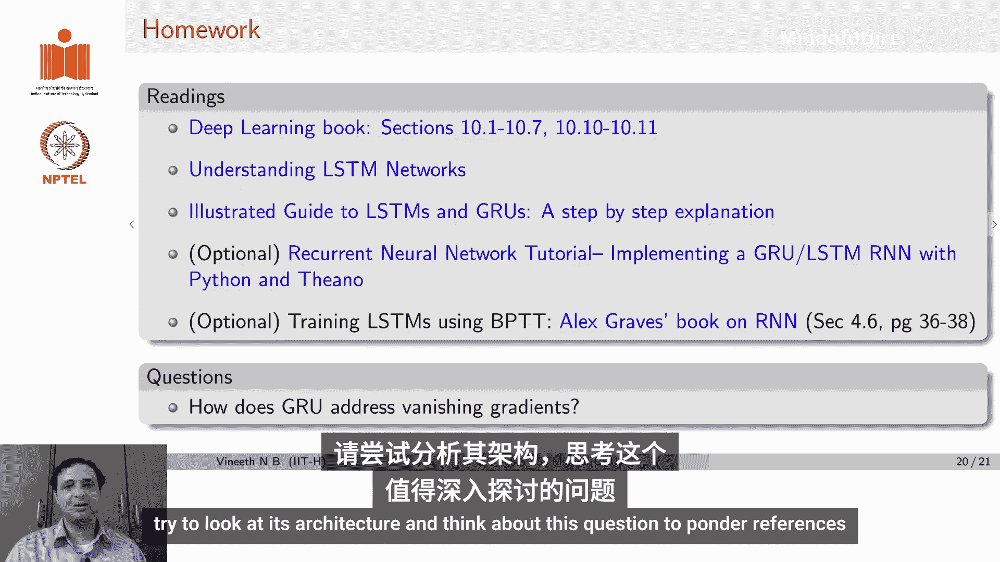
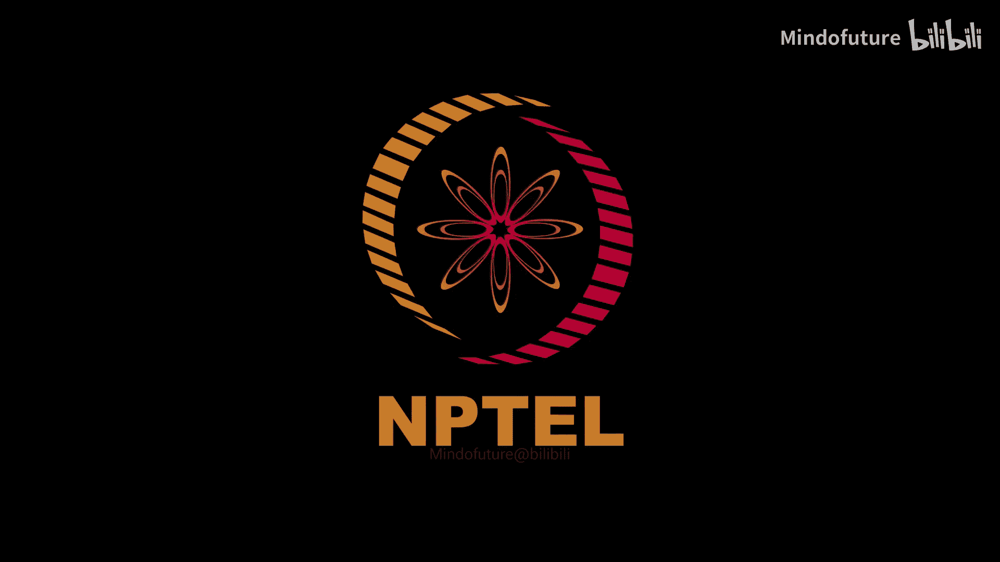

# 054：LSTM与GRU 🧠

在本节课中，我们将学习如何通过改进循环神经网络（RNN）的架构来解决梯度消失问题。我们将重点介绍两种重要的变体：长短期记忆网络（LSTM）和门控循环单元（GRU）。这两种结构通过引入门控机制，有效地捕捉序列数据中的长期依赖关系。

## 回顾RNN的梯度问题

上一节我们介绍了RNN及其训练方法。本节中，我们来看看RNN面临的核心挑战：梯度消失问题。

RNN通过时间反向传播进行训练。这种方法的局限性在于梯度消失和梯度爆炸。梯度爆炸可以通过梯度裁剪来处理。然而，梯度消失问题则需要通过改变RNN的架构来解决。

一个关键问题是长期依赖。在某些任务中，当前输出可能依赖于很久之前的输入。例如，在句子“I grew up in France. I speak fluent French.”中，单词“French”依赖于前面出现的“France”。由于梯度在反向传播过程中会逐渐减弱，标准RNN难以捕捉这种长期依赖关系。

## LSTM：长短期记忆网络

为了解决长期依赖问题，研究者提出了长短期记忆网络。LSTM在1997年被首次提出，其核心思想是引入一个“细胞状态”来充当信息传输的高速公路。

LSTM的每个时间步包含一个模块，该模块比标准RNN单元更复杂。它包含四个交互的层和三个门控机制，用于控制信息的流动。

### LSTM的核心组件

以下是LSTM单元内部的主要组成部分及其功能：

*   **细胞状态**：这是LSTM的关键，它像一条传送带，贯穿整个时间序列。信息可以相对不变地流过它。
*   **遗忘门**：决定从上一个细胞状态中丢弃哪些信息。它查看当前输入 `x_t` 和上一个隐藏状态 `h_{t-1}`，并通过一个Sigmoid层输出一个介于0和1之间的向量，该向量与上一个细胞状态 `C_{t-1}` 逐元素相乘。
*   **输入门**：决定将哪些新信息存入细胞状态。它包含两部分：一个Sigmoid层决定更新哪些值，一个Tanh层创建新的候选值向量 `\tilde{C}_t`。
*   **输出门**：基于细胞状态，决定下一个隐藏状态（即输出）是什么。隐藏状态包含了用于下一时间步和当前输出的信息。

### LSTM的工作流程

LSTM在每个时间步的计算可以通过以下公式清晰描述：

1.  **遗忘门**：`f_t = \sigma(W_f \cdot [h_{t-1}, x_t] + b_f)`
2.  **输入门**：`i_t = \sigma(W_i \cdot [h_{t-1}, x_t] + b_i)`
3.  **候选细胞状态**：`\tilde{C}_t = \tanh(W_C \cdot [h_{t-1}, x_t] + b_C)`
4.  **更新细胞状态**：`C_t = f_t * C_{t-1} + i_t * \tilde{C}_t`
5.  **输出门**：`o_t = \sigma(W_o \cdot [h_{t-1}, x_t] + b_o)`
6.  **最终隐藏状态**：`h_t = o_t * \tanh(C_t)`

### LSTM如何解决梯度消失？

LSTM解决梯度消失问题的关键在于细胞状态 `C_t` 的更新公式。从 `C_{t-1}` 到 `C_t` 的路径上，主要的操作是逐元素相乘（`*`）和相加（`+`）。梯度在通过这条路径反向传播时，主要受遗忘门 `f_t` 的控制，而 `f_t` 本身是一个向量，不涉及会导致梯度指数级衰减的权重矩阵连乘。这使得梯度能够在更长时间步上保持流动，从而学习长期依赖关系。

## GRU：门控循环单元

在了解了LSTM之后，我们来看看一个更简洁的变体——门控循环单元。GRU在2014年被提出，它将LSTM中的三个门简化为两个，并合并了细胞状态和隐藏状态。

### GRU的核心组件

GRU单元包含以下两个门：

*   **更新门**：它决定了有多少过去的信息需要传递到未来。它融合了LSTM中遗忘门和输入门的功能。
*   **重置门**：它决定了有多少过去的信息需要被忽略，用于计算新的候选隐藏状态。

### GRU的工作流程

GRU的计算过程可以用以下公式表示：

1.  **更新门**：`z_t = \sigma(W_z \cdot [h_{t-1}, x_t] + b_z)`
2.  **重置门**：`r_t = \sigma(W_r \cdot [h_{t-1}, x_t] + b_r)`
3.  **候选隐藏状态**：`\tilde{h}_t = \tanh(W \cdot [r_t * h_{t-1}, x_t] + b)`
4.  **最终隐藏状态**：`h_t = (1 - z_t) * h_{t-1} + z_t * \tilde{h}_t`

### LSTM与GRU的对比

以下是LSTM和GRU的主要区别：

*   **门数量**：LSTM有三个门（遗忘、输入、输出），GRU有两个门（更新、重置）。GRU参数更少，训练可能更快，在数据量较少时可能表现更好。
*   **内部状态**：LSTM有独立的细胞状态 `C_t` 和隐藏状态 `h_t`。GRU则将二者合并，只有一个隐藏状态 `h_t`。
*   **输出控制**：LSTM通过输出门控制从细胞状态到隐藏状态的暴露程度。GRU的隐藏状态则是全部暴露。
*   **应用选择**：通常，在处理具有明显长期依赖关系或拥有大量训练数据时，LSTM是更常见的选择。而当追求更快的训练速度、更少的参数或面对较小数据集时，GRU是一个值得尝试的优秀替代方案。

## 总结与展望

本节课中，我们一起学习了如何通过改进RNN架构来解决梯度消失问题。我们详细探讨了LSTM和GRU的结构、门控机制以及它们的工作流程。LSTM通过引入细胞状态和三个门控，有效地建立了梯度传播的“高速公路”。GRU则提供了一个更简洁的架构，通过两个门实现了类似的功能。

尽管LSTM和GRU在序列建模领域取得了巨大成功并成为过去几年的默认选择，但当前（课程录制时）最热门的趋势是基于“自注意力”机制的Transformer模型。它在机器翻译等任务上已经显著超越了基于RNN的模型。

为了巩固理解，请思考：GRU是如何解决梯度消失问题的？（提示：观察其隐藏状态的更新公式中，从 `h_{t-1}` 到 `h_t` 的路径。）

---

**参考文献与扩展阅读**

*   Deep Learning Book, Chapter 10
*   Understanding LSTM Networks (colah‘s blog)
*   Alex Graves’s book on RNN
*   LSTM Code Tutorial