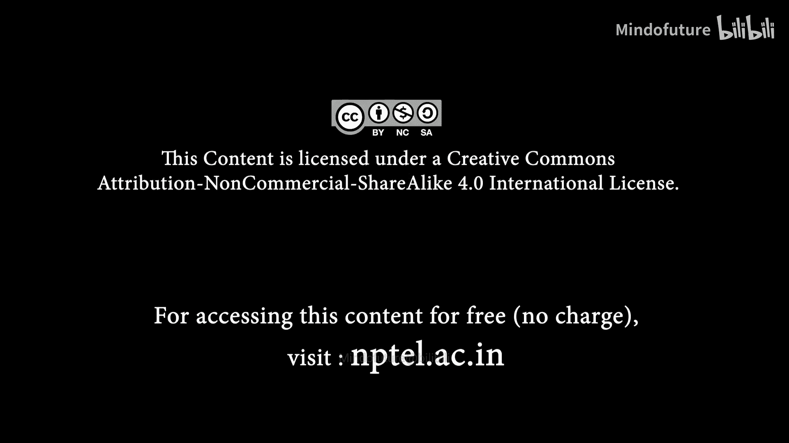
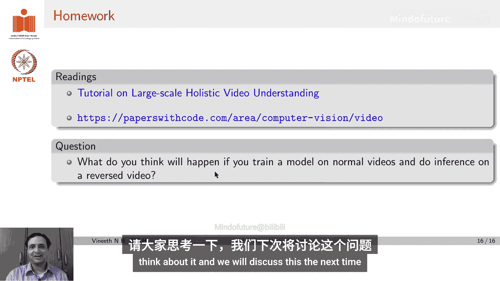

# 055：使用CNN和RNN进行视频理解 🎥

在本节课中，我们将学习如何利用卷积神经网络和循环神经网络来处理和理解视频数据。视频是包含时间维度的视觉序列，理解视频需要模型能够捕捉帧与帧之间的动态变化和时序关系。

上一节我们介绍了处理时序数据的RNN，本节中我们来看看如何将CNN和RNN应用于视频理解。

## 为什么需要理解视频？🤔

以下是几个需要理解视频而非单帧图像的场景示例：

*   **棒球击球**：要预测棒球被击中后的飞行方向，需要观察击球动作的完整序列，单帧图像无法提供足够信息。
*   **拧螺丝**：要判断螺丝的旋转方向，必须观察多个连续帧才能确定其运动趋势。

因此，视频理解的核心在于**结合多帧信息**进行决策。

## 视频理解的深度学习方法 🧠

考虑到本课程聚焦于深度学习，我们将探讨基于深度学习的视频理解方法。总体而言，主要有两种思路：

1.  **仅使用CNN**：通过扩展卷积操作或特殊设计来处理视频。
2.  **结合CNN与RNN**：利用CNN提取空间特征，再用RNN处理时序关系。

即使在仅使用CNN的方法中，也存在两种主要方式。

## 3D卷积神经网络 📦

一种直观的思路是将时间视为另一个维度。图像是二维信号，视频则是三维信号（宽、高、时间）。因此，我们可以将卷积操作扩展到三维。

**3D卷积**：卷积核在三个维度（宽、高、时间）上滑动。这与之前处理RGB图像的2D卷积不同，在2D卷积中，卷积核的深度（通道数）是固定的，我们只在宽和高两个维度上滑动。

以下是3D CNN的一个早期经典架构示例（用于人体动作识别）：

*   **输入**：7帧60x40分辨率的灰度图像。
*   **第一层（硬编码滤波器）**：使用5种非学习的滤波器（如灰度、x方向梯度、x/y方向光流）生成33个特征图。
*   **后续层（3D卷积）**：执行7x7x3的3D卷积。注意，卷积操作在每种滤波器生成的特征图组内独立进行（如图中不同颜色所示），以保持特征的一致性，同时也引入不同权重的卷积核以增加多样性。
*   **其他操作**：包含子采样（2x2, 3x3）、全连接层等标准CNN组件。
*   **学习方式**：使用交叉熵损失，通过反向传播训练所有可学习参数。

使用这种方法，模型能够识别如“打电话”、“遗留物品”、“指向他人”等动作。

## 双流卷积网络 🌊

另一种思路是使用标准的2D卷积，但将时间信息作为独立的实体进行处理。双流网络是这一思路的经典代表。

该方法包含两个并行的“流”：

1.  **空间流**：处理单个RGB帧，通过一个标准的2D CNN（如AlexNet）提取空间外观特征，并输出动作分类分数。
2.  **时间流**：处理多帧之间的**光流**（optical flow）图像。光流描述了像素在连续帧间的运动（x和y方向分量）。将多个光流帧堆叠成一个“体积”，然后送入另一个2D CNN中提取时序运动特征，并输出动作分类分数。

最后，将两个流的分类分数进行**融合**（如平均或投票），得到最终的动作预测结果。

**核心要点**：此方法中的所有卷积操作仍是**2D卷积**。

## 结合CNN与RNN 🧬

我们还可以将擅长空间特征提取的CNN与擅长时序建模的RNN（如LSTM）结合起来。

以下是结合方式：

1.  **特征提取**：将视频的每一帧输入到同一个CNN中（例如使用AlexNet的倒数第二层），得到每一帧的视觉特征向量。
2.  **序列建模**：将这些按时间顺序排列的特征向量序列，输入到一个RNN（如堆叠的LSTM）中。
3.  **输出预测**：RNN可以在每个时间步输出预测（如每帧的标签），也可以只在最后一个时间步输出整个视频的预测（如整体动作分类）。

**学习方式**：由于CNN和RNN都是可微分的，我们可以定义一个损失函数（例如，对整个序列或最终输出的交叉熵损失），并通过**反向传播**算法同时训练CNN和RNN的所有参数。

## 视频理解的应用场景 🚀

利用上述方法，我们可以解决多种视频理解任务：

*   **动作识别**：识别视频中人物或物体的行为，如“做俯卧撑”、“攀岩”、“跳蹦床”（UCF101数据集）。
*   **活动理解**：识别更复杂的日常活动，如“对着书微笑”（Hollywood in Homes数据集）。
*   **视频描述生成**：为整个视频生成文字描述（字幕）。
*   **动作预测**：根据已观察到的视频序列，预测接下来可能发生的动作（例如，在篮球比赛中预测传球目标）。
*   **目标跟踪**：在视频中持续定位特定物体。
*   **动态场景理解**：对包含动态变化的视频场景进行分类（而不仅仅是静态图像）。

## 总结与思考 💡

本节课中我们一起学习了视频理解的几种核心深度学习方法：

1.  **3D CNN**：通过扩展卷积维度，直接在时空体积上进行特征学习。
2.  **双流网络**：分别用2D CNN处理外观（空间流）和运动（时间流）信息，再进行融合。
3.  **CNN+RNN**：用CNN提取每帧特征，再用RNN建模帧间的时序依赖关系。

这些方法为动作识别、视频描述等任务提供了强大的解决方案。

**课后思考**：如果一个模型在正常顺序的视频上训练，但在测试时输入一个**倒放**的视频，模型还能正确工作吗？为什么？我们将在下次讨论这个问题。

**扩展阅读**：建议阅读关于大规模整体视频理解的教程，以了解更多任务和架构的适配方法。相关链接也提供了该领域的重要论文列表。