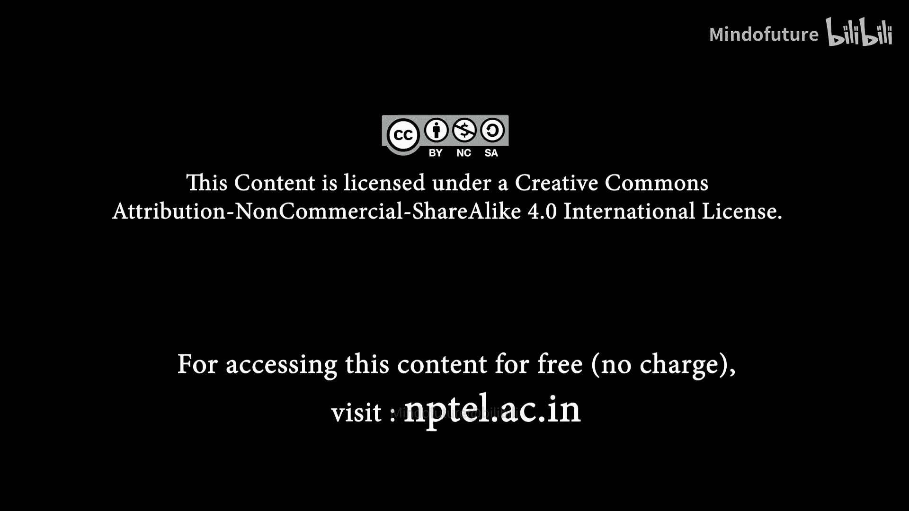
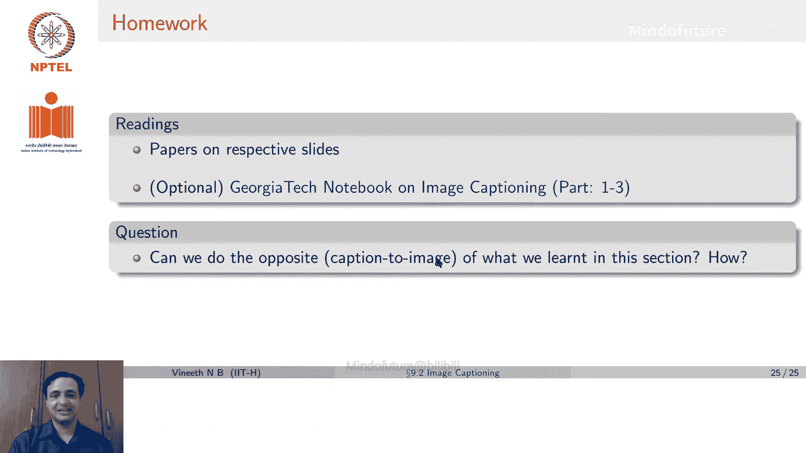

# 057：视觉与语言 - 图像字幕

在本节课中，我们将要学习图像字幕任务。我们将首先解答上一节课留下的关于自编码器与PCA关系的问题，然后深入探讨如何让计算机为图像生成描述性文字，并介绍几种先进的图像字幕方法。

## 自编码器与PCA的联系

上一节我们介绍了自编码器作为一种降维技术。本节中我们来看看它与主成分分析（PCA）之间的具体联系。

答案是肯定的，自编码器在特定条件下等价于PCA。让我们来理解这个联系。如果你对数据进行特定的归一化处理，使得归一化后的数据 **x̂** 满足以下公式：

**x̂ = (1/√m) * (x - μ)**

这里的归一化操作使得每个维度的均值为零，这是一个标准的归一化步骤。进行这种归一化后，协方差矩阵由 **x̂ᵀx̂** 给出，即 **Cov = (1/m) * x̂ᵀx̂**。

给定这个预处理，我们来看自编码器的损失函数。自编码器的损失（参数为 **θ**）是重建输出与原始输入之间的均方误差。我们也可以将其写为：

**Loss = ||x - hW*||²_F**

其中，**||·||²_F** 表示Frobenius范数的平方（即矩阵所有元素的平方和）。**h** 是自编码器中间层（瓶颈层或上下文向量）的表示，**W*** 是解码器的权重，因此 **W* h** 是从中间表示重建的输出，**x** 是原始输入。

为什么这样写呢？我们进一步分析。我们知道，对于这样写的损失函数，**hW*** 可以通过奇异值分解（SVD）表示为 **UΣVᵀ**，其中我们只考虑 **U** 和 **Vᵀ** 中前 **k** 个具有非零奇异值的列。这来自于 **x** 的SVD分解。

如果这确实是解，那么一种可能的因子分解是：令 **h = UΣ**（仅取前k列），**W* = V**（仅取前k列）。基于这个假设，我们可以推导出 **h** 是 **x** 的一个线性变换，变换矩阵 **W** 在这里是 **V** 的前k列。

从SVD中我们知道，给定矩阵 **x** 及其分解 **x = UΣVᵀ**，**V** 是 **xᵀx** 的特征向量矩阵。这意味着我们自编码器的编码器权重 **V** 正是协方差矩阵的特征向量。这应该让你联想到PCA，因为PCA的投影矩阵就是协方差矩阵的特征向量。

那么，自编码器总是PCA的变体吗？并非如此。只有当你的编码器和解码器都是线性的（即没有使用任何激活函数），并且按照上述方式对输入进行归一化，并使用均方误差作为损失函数时，自编码器学习到的编码映射才确实等同于主成分分析的投影矩阵。

## 图像字幕任务简介

解答了上述问题后，让我们回到本节课的主题：图像字幕。假设我们想描述一张图像，例如你在这里看到的图片。作为人类，我们能够用文字描述这些图像。我们如何确保计算机或机器学习模型也能做到同样的事情？

理想情况下，我们需要一种能够处理图像并输出描述的方法。因此，给定一些图像及其对应的描述字幕，我们将它们作为输入提供给某个方法。这个方法现在可以接收一张新图像并输出描述，例如“狗正在望向窗外”。

我们如何构建这种方法？我们需要结合视觉和语言模型：
*   处理图像部分，使用基于视觉的深度学习模型（如CNN）。
*   处理文本部分，使用基于自然语言处理的深度学习模型（如RNN）。

然后将它们结合起来，得到最终的输出字幕。

## 基础图像字幕模型

让我们详细看看这些组件。假设我们处于此类模型的训练阶段。我们有一张图像，并且知道对应的字幕是“草帽”。

以下是训练相关模型的步骤：
1.  **图像处理**：将图像输入到一个卷积神经网络（CNN）中。
2.  **文本处理**：使用对应的文本来训练一个循环神经网络（RNN）。
3.  **模型结合**：为了学习CNN和RNN之间（即图像和文本之间）的交互，我们丢弃CNN最后的分类层，将CNN的输出表示（例如FC7层特征）也作为输入提供给RNN。

对于RNN，其隐藏状态 **h_n** 的更新公式（如果使用线性层加ReLU激活）通常是：
**h_n = max(0, W_xh * x_n + W_hh * h_{n-1})**
但现在，我们将其修改为同时接收图像特征 **v**：
**h_n = max(0, W_xh * x_n + W_hh * h_{n-1} + W_ih * v)**
其中 **v** 向量来自CNN的输出。

在测试时，给定一张新图像，我们将其输入CNN，并将CNN的FC7表示与一个“开始标记”一起作为输入给RNN的第一个时间步。RNN接收开始标记和图像特征，产生一个输出 **y_0**。**y_0** 然后被用作下一个时间步的输入 **x_1**，以生成新词 **y_1**，如此循环，直到生成“结束标记”，表示字幕生成完成，例如“草帽”。

在实践中，RNN并不直接“生成”单词。我们有一个词汇表（例如包含1000个词）。RNN预测的是词汇表上的一个softmax分布，我们选择概率最高的词作为输出。开始标记和结束标记是词汇表中额外添加的两个特殊词。当输入开始标记时，我们使用一个独热向量来表示它，即在该标记对应的位置设为1，其他位置设为0。

以下是这种基础方法的一些结果示例：
*   成功案例：模型能够生成“一群人站在房间里拿着遥控器”、“一个小男孩拿着棒球棒”、“一头牛站在街道中央”等相当准确的描述。
*   失败案例：模型可能会生成“一个男人站在墙上的钟旁边”（实际图片可能没有钟），或“一只猫坐在沙发上拿着遥控器”（实际图片可能没有猫或遥控器）。有些错误可以理解（被图像中某些元素误导），有些则更难以解释。

## 引入注意力机制

那么，我们如何超越简单的CNN+RNN组合来提升图像字幕的性能呢？答案我们已经知道：使用注意力机制。

现在让我们更详细地了解注意力如何用于改进这类方法。这种方法基于一篇名为《Show, Attend and Tell》的2015年ICML论文，是一个非常流行的图像字幕方法。

在该方法中：
1.  输入图像，提取特定的特征图（保留空间信息，例如一个14x14的特征图，而不是FC7层）。
2.  使用一个带有注意力机制的RNN来处理这个特征图。
3.  最终进行逐词生成。

具体流程如下：
*   给定输入图像（尺寸 H x W x 3），通过CNN得到特征图，其维度为 L x D，其中 L = H x W，代表空间位置数。
*   RNN的第一个隐藏状态 **h_0** 接收开始标记和该特征图作为输入，并输出一个在 **L** 个可能位置上的分布 **a₁**（一个softmax向量）。
*   使用 **a₁** 对特征图中每个位置的特征进行加权，得到加权组合特征 **z₁ = Σ (a₁_i * v_i)**，其中 **v_i** 是每个网格位置的特征。
*   **z₁** 和第一个词（或开始标记）一起作为输入，得到下一个隐藏状态 **h₁**。
*   **h₁** 产生两个输出：新的位置分布 **a₂** 和词汇表分布 **d₁**（预测的词）。
*   **a₂** 用于计算新的加权特征 **z₂**，**d₁** 预测的词作为下一个输入（或在训练时使用真实的下一个词）。
*   此过程重复进行，生成整个字幕。

注意力模型有两种主要类型：
*   **软注意力**：权重向量 **a** 是一个softmax向量，用于对所有网格位置的特征进行软加权求和。这是可微的，可以通过反向传播学习。
*   **硬注意力**：根据softmax向量 **a**，选择一个得分最高的位置，仅使用该网格位置的特征。这涉及argmax操作，不可微，通常需要使用强化学习方法来训练。

注意力机制的可视化显示，在生成“鸟”这个词时，模型注意力集中在鸟的区域；而在生成“水体”时，注意力则转移到图像的其他部分。

基于《Show, Attend and Tell》论文的注意力模型结果示例如下：
*   图像描述为“一个女人在公园里扔飞盘”，生成“飞盘”时注意力完全集中在飞盘上。
*   图像描述为“一只狗站在硬木地板上”，生成“狗”时注意力集中在狗身上。
*   图像描述为“一个停车标志在带有山景背景的路上”，生成“停车标志”时注意力集中在标志上。

## 近期图像字幕方法进展

《Show, Attend and Tell》发表于2015年，后续研究从不同角度探索了图像字幕。我们来看几个例子。

**1. 结合属性的LSTM（2017年工作）**
该研究尝试用属性提升图像字幕性能。给定图像 **I** 和字幕词序列 **W**。
*   **基础方法（Vanilla）**：图像经过变换 **T_v** 后输入LSTM第一步，每个时间步输入对应字幕词的变换。
*   **变体A1**：不使用原始图像，而是使用从图像中提取的属性向量（如“船、水、人、骑、狗、小个子、河”及其概率）作为LSTM的初始输入。
*   **变体A2**：将图像表示和属性向量依次输入LSTM（先图像，后属性）。
*   **变体A3**：交换A2的输入顺序（先属性，后图像）。
*   **变体A4**：初始输入为属性，每个时间步同时输入图像和字幕词。
*   **变体A5**：初始输入为图像，每个时间步同时输入属性和字幕词。

研究结论表明，使用高级属性（A1）优于基础LSTM。结合图像和属性（A2）能进一步提升。先属性后图像（A3）优于A2。但将图像在每个时间步输入（A4）效果不佳，可能因为图像噪声在RNN中累积。而交换后的A5（图像初始输入，属性每个时间步输入）效果最好，说明图像表示和属性具有互补性。

**2. StyleNet：改变字幕风格**
该方法旨在改变字幕的语调。例如，将事实性描述“一个男人在石墙旁的岩石山坡上”改为浪漫版“一个男人用攀岩来征服陡坡”，或幽默版“一个男人像蜥蜴一样爬岩石”。

其核心是在LSTM的权重矩阵 **W_x** 上使用因子分解，类似于SVD分解：**W_x = U S_x V**。
*   训练时，对于不同风格（事实、浪漫、幽默）的字幕，学习不同的风格矩阵 **S_F**， **S_R**， **S_H**，而 **U** 和 **V** 共享。
*   测试时，给定图像，通过切换 **S_x** 矩阵（如使用 **S_R**）即可生成相应风格的字幕。

**3. Neural Baby Talk（2018年CVPR）**
该方法尝试结合目标检测来提升字幕生成。思路介于传统计算机视觉方法（如可变形部件模型、条件随机场）和纯深度神经网络方法之间。

流程如下：
1.  给定图像，使用目标检测器（如Faster R-CNN）获取一系列区域提议及其特征。
2.  将区域特征和字幕的词嵌入一起输入一个带注意力的RNN。
3.  RNN一方面生成文本输出（字幕），另一方面通过注意力决定当前关注字幕中的哪个词，并结合所有区域特征，预测该词对应的图像区域的标签。

最终生成的字幕可能包含如“一个[黄色框]戴着[红色框]坐在[蓝色框]旁，上面有[绿色框]”的占位符，然后根据检测结果将这些占位符替换为具体的物体标签（如“小狗”、“领带”、“桌子”、“蛋糕”），形成最终字幕“一只戴领带的小狗坐在放有蛋糕的桌子旁”。

## 总结与思考

本节课中我们一起学习了图像字幕任务。我们从自编码器与PCA的关系入手，然后介绍了基础的CNN+RNN图像字幕模型。为了提升性能，我们深入探讨了引入注意力机制的《Show, Attend and Tell》方法。最后，我们还了解了近期的一些进展，包括结合属性、改变字幕风格以及融合目标检测的先进方法。

本讲的课后作业是阅读幻灯片中提到的相关论文。如果你希望获得一些实践经验，除了课程作业外，还可以参考佐治亚理工学院发布的一个关于图像字幕的优秀Notebook。

本节课留下的思考问题是：我们现在能否做相反的事情？能否从文字描述生成图像？与我们本节课所学的内容相比，这该如何实现？请思考一下，我们下次课将继续讨论。

