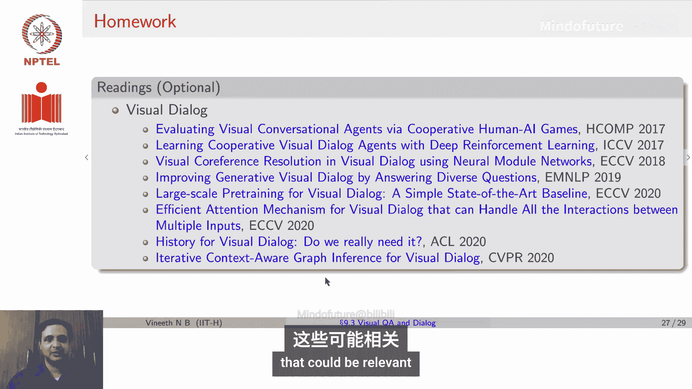

# 058：超越字幕 - 视觉问答与视觉对话

在本节课中，我们将要学习计算机视觉与语言结合领域中的两个重要任务：视觉问答和视觉对话。我们将探讨循环神经网络和注意力模型在这些任务中的关键作用，了解相关的数据集，并学习几种解决这些问题的经典模型架构。

## RNN与注意力模型在视觉语言任务中的重要性

当我们关注视觉与语言相结合的问题时，RNN模型和注意力模型在计算机视觉中的相关性就变得尤为突出。

这种结合产生了许多序列学习问题。我们在上一讲中看到了其中一个例子：图像字幕生成。

现在，我们将更进一步，讨论诸如视觉问答和视觉对话这样的任务。

我们之前遗留的一个问题是：我们能否做与图像字幕生成相反的事情？即，能否从字幕生成图像？

使用我们目前见过的任何模型，我们可以做到，但并非使用我们迄今为止见过的模型。我们很快将看到生成模型，并了解如何通过它们实现从字幕到图像的生成。

## 视觉问答概述

在视觉问答任务中，你可以将其视为图像字幕生成任务的扩展。

任务概述如下：给定一张图像（例如你在此处看到的图像）和一个问题（例如“胡子是由什么做的？”），我们的系统（一个深度学习模型）的目标是给出答案“香蕉”。

因此，你需要理解问题，也需要理解图像，以及该问题与图像特定部分的相关性，然后才能给出合理的答案。

这是一个演示视觉问答任务如何工作的例子：给定一张图像和问题“孩子坐在哪里？”，如果你有一个针对此任务训练良好的模型，你会得到“水槽”这个答案，置信度为99%，如果你观察图像，这实际上是正确的。

这个演示来自一个名为Cloud CV的网站，由佐治亚理工学院的Dr. Bara和David Para开发。欢迎你访问此链接，在你自己的图像上尝试视觉问答。

## 视觉问答数据集

在我们继续讨论可以使用哪些模型来解决视觉问答问题之前，显然，我们将关注句子、循环神经网络和注意力的组合。当我们说循环神经网络时，我们也将其中的LSTM和GRU包含在同一术语中。

在讨论这些模型之前，让我们先讨论解决视觉问答问题所需的数据集类型。

到目前为止，我们需要图像分类数据集、目标检测数据集、图像分割数据集，以及某种程度上我们在上一讲中看到的图像字幕数据集。对于其中每一项，训练模型所需的数据集是显而易见的。

对于视觉问答任务，情况则更为复杂，因此让我们看看为解决此问题而开发的几个数据集。

**VQA数据集**

这是第一个数据集，称为VQA数据集，于2015年开发。该数据集包含图像和问题，例如你在此处图像上看到的：给定一张图像，有两个问题：“她的眼睛是什么颜色？”、“胡子是由什么做的？”；对于第二张图像：“有多少片披萨？”、“这是素食披萨吗？”；第三张图像：“这个人是在等人吗？”、“树下有什么？”；最后一张：“看起来在下雨吗？”、“这个人视力是2.0吗？”。

如你所见，对于每个问题，模型都需要理解问题以及图像，以及图像与问题之间的关系。

在这个VQA数据集中，答案是开放式的，同时也是多项选择题。这意味着模型的任务再次变成了分类。给定一组选项，模型必须输出一个在选项集上的softmax概率向量，概率最高的选项是模型的预测输出。

这个VQA数据集大约有25万张图像，这些图像来自一个名为MS COCO的数据集。MS COCO代表Microsoft Common Objects in Context。该数据集是为图像字幕任务开发的。VQA数据集扩展了该数据，外加约5万张抽象图像。总共有大约75万个问题，以及大约1000万个答案，因为每个问题都需要从多个答案中选择，每个问题由10个人工标注者回答。

**COCO-QA数据集**

另一个在2015年开发的数据集称为COCO-QA数据集。它同样使用了Microsoft COCO数据。Microsoft COCO数据集是一个图像字幕数据集。因此，COCO-QA数据使用这些字幕来自动生成问答对。

例如，给定这张图像，如果有一个字幕，该字幕现在被转换成一个问题和答案。问题可能是：“红色自行车上还剩下多少个甜甜圈？”，答案是“三个”。“这件T恤是什么颜色？”，答案是“蓝色”。“灰色的猫坐在哪里？”，答案是“窗户”。

你可以看到，可以从一个字幕中获得问答对。这里唯一的限制是答案是单个单词，这在许多VQA数据集中都是如此。

该数据集在12.3万张图像上有11.8万个问答对。有四种类型的问题：什么物体、多少、什么颜色和在哪里。

**Visual 7W数据集**

随后在2016年开发了另一个流行的数据集，称为Visual 7W。该数据集包含图像和问题，例如你在此处看到的：“这张图片中卡车上展示的濒危动物是什么？”，答案是“白头鹰”，其他选项是“麻雀”、“蜂鸟”和“乌鸦”。同样，“如果右转，司机会去哪里？”。

标题中的“7W”代表：什么、哪里、何时、谁、为什么、如何，以及最后的“哪一个”。与其他数据集相比，这是一种不同类型的问题。“哪一个”问题如下：给定左下角的图像，问题可能是“哪个枕头离窗户更远？”，答案将是此处黄色框中的内容。“哪一级台阶通向浴缸？”，答案同样是此处的黄色框。“哪个是角落里的小电脑？”，答案同样是此处的黄色框。

这就是它被称为Visual 7W的原因。该数据集在约4.7万张图像上有大约32.8万个问答对。正如我们刚才看到的，有两种任务：描述任务（我们在顶行看到的）和指向任务（我们必须指向图像的特定部分来回答问题）。

**CLEVR数据集**

另一个近年来更受欢迎的数据集称为CLEVR，于2017年开发。这是一个半合成的数据集，有助于回答推理问题，因此问题可能有点复杂。例如，给定左上角的图像，问题是：“在紫色球左侧的大金属物体后面的大闪亮物体后面的灰色橡胶物体有多大？”

这听起来像一个复杂的问题，但经过推理，我们谈论的是后面这个灰色物体。理想情况下，需要理解问题的几个子部分才能回答此类推理问题。

因此，CLEVR数据有大约10万张渲染图像和100万个自动生成的问题。这些问题的答案是单个单词，但要得到答案，需要非常仔细地解析问题。问题确实很复杂，需要推理能力。

## 视觉问答模型

在了解了用于视觉问答的几个数据集之后，现在让我们看看为解决视觉问答问题而开发的几个模型。

**基线模型：LSTM + CNN特征**

一个显而易见的用于视觉问答的基线模型是LSTM和从CNN获得的图像特征的组合。

给定一张图像，你有一个CNN（在此案例中是VGG网络）。在CNN的末端，你得到一个全连接层表示，在此案例中是1024维。类似地，对于问题，你通过LSTM的不同时间步传递每个单词。LSTM的输出是一个向量，同样是1024维。

你可以将这两个向量连接起来，并通过几个全连接层发送，以对答案应该是什么做出最终预测。如果你的答案在一组选项中，你将使用交叉熵损失以及你在此处看到的所有内容。

你可以通过反向传播该交叉熵损失来学习你在此处看到的网络每个部分的所有参数。因此，希望你能理解如何训练这些架构。尽管我们正在添加我们迄今为止学到的抽象概念（CNN、RNN、注意力），并尝试混合它们来解决这些问题，但希望你能理解，这些组件中没有一个违反了你如何使用反向传播来学习网络权重的方法。使用反向传播和梯度下降在所有这类架构中保持不变。

**2015年的简单基线模型**

另一个在2015年为视觉问答开发的基线模型是一个简单的方法，其中给定一张图像，从CNN某一层的输出中提取图像特征。对于问题，使用简单的词袋频率直方图作为文本输入。然后，将这两者连接起来，并使用一个简单的神经网络，模型预测在一组选项中哪个是正确答案。

**堆叠注意力网络**

在了解了这些简单的基线模型之后，现在让我们尝试看看是否可以通过更复杂的模型来改进这些基线模型。

这方面的一个努力是2016年CVPR上发表的“用于图像问答的堆叠注意力网络”。

在这个特定模型中，给定一张图像，你从CNN获得一个表示。与我们在CNN之上讨论的注意力模型非常相似，你取某个卷积层的特征图，然后能够将其映射到原始图像中的空间位置。现在，你拥有对应于图像每个部分的特征向量。

现在，你获取问题并通过LSTM传递它（如果你愿意，也可以进行卷积，我们将在几页幻灯片后看到）。LSTM的输出为你提供了问题的表示。

这个问题的表示被传递给图像不同部分的特征向量。在图像的特征向量和问题表示之间，模型在图像的不同部分上给我们一个特定的注意力图。

基于这个注意力图和问题的表示，在图像不同部分的特征向量上再次执行另一层注意力。这导致了一个不同的表示，我们期望这是最终的解决方案，该表示最终被送到输出层，在答案选项上的softmax给出最终结果。

让我们看一个可视化示例。在这种情况下，如果你有原始图像，堆叠注意力网络所做的第一层注意力层专注于问题中提到的所有概念。

因此，我们在上一张幻灯片中看到，第一层注意力层决定关注图像的哪些部分，它关注的是问题中存在的概念所在的任何部分。所以，在这种情况下，可能是“自行车”、“篮子”和“篮子里的物体”。这里的问题是“自行车篮子里坐着什么？”

第二层注意力层，基于你在第一层注意力层中获得的注意力，选择只关注包含答案的图像部分。这最终帮助我们预测结果。因此，在第二步中，你将注意力的焦点缩小到仅包含答案的图像部分，因此，模型可以在选项集中将答案预测为“狗”。

**分层协同注意力模型**

这引出了一个后续问题：在我们刚刚看到的模型中，我们只对图像执行了注意力。我们将问题表示视为既定，并尝试基于注意力使用问题表示与图像不同部分之间的关系。

因此，即使在我们刚刚在上一张幻灯片中使用的注意力中，它也是软注意力，通过学习的某些权重对不同部分进行加权，这可以促进反向传播。

但现在我们问一个问题：我们是否也可以在问题中引入注意力？这在一个称为“分层协同注意力模型”的模型中完成，该模型于2016年在ECCV上发表。

在这个特定模型中，我们具有协同注意力，这意味着我们同时关注图像的部分以及问题的部分。分层部分来自于我们首先获得问题在单词级别的嵌入，然后在短语级别，最后在整个问题本身。

让我们更详细地看看这一点。给定一个问题，我们提取其单词级别嵌入、短语级别嵌入和问题级别嵌入。此时，你可以假设这是通过某些神经网络传递得到的。

那么，这些情况下的输入是什么？你真的将文本作为输入吗？不完全是。请记住，对于所有涉及文本的问题，在很大程度上，你有一个词汇表，问题中的每个单词对应于词汇表上的一个独热向量，你在该单词所属的词汇表索引处放置一个1，其他地方为0。这将是特定单词的输入。

因此，你提取单词级别、短语级别和问题级别的嵌入。在每个级别，你应用协同注意力。所以，对于一个单词级别的嵌入，你对问题以及相应的图像应用注意力。类似地，对于短语级别和问题级别。

最终答案基于所有协同注意的图像和问题特征。

因此，如果你仔细看这里，当我们说“红绿灯上哪个灯亮着？”时，你可以看到这里是问题，你期望的理想答案是“绿色”。你首先取单词级别的嵌入，并关注其中的一部分，在这种情况下，你可以看到注意力集中在“stop”上。同时，图像上的注意力也似乎集中在交通灯周围的某个地方。

在层次结构的下一个更高级别，注意力集中在问题中的不同短语上，在这种情况下，你可以看到最大权重给了短语“the stop light”。再一次，你可以看到图像现在更有信心，完全集中在红绿灯上。

然后，在问题层次结构的最高级别，注意力图告诉我们我们关注的是“light”，在那个阶段，图像上的注意力只集中在交通信号灯内的灯上，从而得出答案“绿色”。

让我们更详细地理解一下问题层次结构。在单词级别，你获得单词级别的嵌入，正如我们刚才看到的。我们如何获得短语级别和问题级别的嵌入？为了获得短语级别的嵌入，你可以取字幕每个单词的嵌入，用不同宽度的多个滤波器对这些输入执行卷积，你会得到向量表示，这就是我们所说的短语级别嵌入。然后，我们在卷积层上执行最大池化，然后通过LSTM将最大池化输出传递给我们，从而获得问题级别的嵌入。这为我们提供了问题级别的表示。

这里有一些结果。你在这里看到的图像和问题是：“那个拿着滑雪板站在雪覆盖的什么上面的男人？”，答案是“山”。另一个例子是：“鸟是什么颜色？”，答案是“白色”。

这里是单词级别的协同注意力图。在这种情况下，问题中被关注的部分是“snowboard”、“top”、“snow covered”，而图像焦点在那一刻有点在滑雪板上，有点在人身上。在这个例子中，焦点是“colour of bird”，模型建议关注图像中鸟的部分。

对于短语级别的协同注意力，在这种情况下，焦点是“holding snowboard”、“snowboard on top of snow covered”，图像中的焦点（红色表示高，蓝色表示低，类似于我们看到的解释方法中的热图），所以你可以看到模型关注的是人物以外的图像其他部分。同样，对于“鸟是什么颜色？”，模型似乎关注鸟周围的区域，以便能够分离颜色。

最后，当模型达到问题级别的注意力图时，“那个拿着滑雪板站在雪覆盖的什么上面的男人？”，模型观察人物以外的一切，以便得到答案“山”。在另一个例子中，“鸟是什么颜色？”，模型准确地观察鸟以给出答案“白色”。

## 视觉对话

现在我们将继续讨论本讲中计划讨论的第二个任务，你可以将其视为视觉问答的扩展，即视觉对话。

任务概述在此处的插图中给出，这首次在2017年完成。给定这张图像和给定的字幕“一只猫从咖啡杯中喝水”，视觉对话就像一个聊天机器人，但这是一个根据图像提问和回答问题的聊天机器人，而不是简单的自由文本。

让我们看一个例子：“杯子是什么颜色？”机器人回答“白色和红色”，所以你可以看到那里的杯子。“上面有图案吗？”“没有，有东西，但看不清是什么。”“杯子和猫在桌子上吗？”“是的，它们在。”“桌子上还有其他物品吗？”“是的，有杂志、书、烤面包机和篮子和一个盘子。”如你所见，背景中有一个烤面包机，有一个篮子，这对于一台机器来说是一个相当全面的答案列表。

这是一个演示视觉对话如何工作的例子：给定这张图像，机器人说“一个男人和一个女人拿着伞”。人类可以问的问题：“他的伞是什么颜色？”机器人回答“他的伞是黑色的。”“她的呢？”这是一个棘手的问题，因为模型必须理解问题是关于伞的，其次问题是关于她的伞，这意味着模型需要知道有两个人，一个是男性，一个是女性，然后才能回答这个问题，机器人确实说“她的伞是彩色的。”“图像中还有多少人？”“我想是三个，他们被遮挡了。”再次说明，这个演示来自Cloud CV，由佐治亚理工学院的Dr. Bara和David Para开发。欢迎你访问此链接，尝试视觉对话，并亲自看看它是如何工作的。

## 视觉对话任务定义与评估

现在让我们正式定义如何解决这个任务。这不像传统的分类问题，甚至不像传统的序列学习问题，在那里你为图像输出一个字幕。那么，你将如何形式化并解决它？

给定一张图像 `I`，一个对话历史，包含问答对 `(Q1, A1), (Q2, A2), ..., (Q_{t-1}, A_{t-1})`，这些是你之前的问答对。你有一个后续问题，即当前时间的问题 `Q_t`（在这个例子中，问题是“另一个拿着什么东西吗？”）。这里的任务是产生一个自由形式的自然语言答案 `A_t` 来回答这个当前问题 `Q_t`。

那么，这里的一个问题是：你如何评估答案？这里的评估可能很棘手。自然语言处理中常用的分数，如BLEU（我们之前见过）、METEOR、ROUGE等（我们现在不深入讨论），但众所周知，这些分数通常与人类判断相关性较差。例如，你可以有以不同方式表达的多个答案来回答一个问题，但并非所有答案都能与一个单一的真实答案的分数相关联。

那么，如何研究这个问题？你可能需要进行所谓的“人类图灵测试”，即给出一个生成的句子，然后让一群人阅读句子的质量。这可能有效，因为基于人类的判断，这被称为人类图灵测试，以检查人类是否能分辨出答案是由机器生成的还是由人类生成的。因此，除了评估答案的质量外，你还可以将其作为询问人类的问题之一引入。

这里的挑战在于，这种评估可能变得昂贵，因为你可能需要补偿人类参与评估。而且，根据评估系统的人类不同，它也可能是主观的，不同的人类可能对不同的答案有不同的评价。

那么，我们如何评估这样的系统呢？让我们现在来看看。给定一张图像、对话历史和当前问题，视觉对话数据集所做的是给出大约100个答案选项。这些答案选项可能是：50个最相似问题的答案、30个热门答案，以及可能20个随机答案。你挑选这100个答案，并要求你的模型对所有答案进行排序。因此，模型的任务是给定这100个答案，你可以再次拥有一个softmax，它在这100个选项上给你一个概率向量。但使用该概率向量，你现在可以对选项进行排序：最高概率将是第一排名，第二高概率将是第二排名，依此类推。

但你如何判断这种排序的好坏呢？你可以做几件事来衡量性能：
1.  你可以检查相对于真实答案的平均排名。你期望模型将第一个答案作为真实答案，但这可能并不总是发生。在一种情况下，你可能得到排名第三的答案是真实答案；在另一种情况下，你可能得到排名第七的答案是真实答案；在一种情况下，你排名的第41个答案可能是真实答案，这将是一个糟糕的结果。因此，在所有测试样本中，相对于真实答案的平均排名可能是你可以使用的一个性能指标。
2.  另一个也使用的指标称为平均倒数排名。平均倒数排名可以这样计算：对于一个特定的测试问题，如果你预测了一组选项的排名，并且你预测的第三个位置是正确答案，这意味着你的正确排名是3。假设对于另一个问题，你的第二个排名选项是正确答案；对于另一个问题，你的第一个排名选项是正确答案。那么你的平均倒数排名将由 `(1 + 1/2 + 1/3) / 3` 给出，因为这是你拥有的总问题数，计算结果约为0.61。当你的第一个排名选项总是真实答案时，平均倒数排名将为1。当你的最后一个排名选项是你的真实答案时，它将为0。因此，平均倒数排名是另一个你可以实际用来研究性能的性能指标。

## 视觉对话模型

现在让我们来看看可以用来执行视觉对话任务的模型类型。它再次是编码器-解码器框架，其中编码器可以是晚期融合编码器、分层循环编码器或记忆网络编码器，解码器可以是生成式的或判别式的。我们将在接下来的几张幻灯片中看到其中一些例子。

**晚期融合编码器**

这是一个晚期融合编码器的例子。在这种情况下，图像是你在此处看到的这张。你有先前的问题和答案历史：“那个男人正在人行道上骑自行车。”“那个男人戴着头盔吗？”“不，他没有戴头盔。”“附近有人吗？”“是的，有一个女人走在他后面。”这是对话历史。当前问题 `Q_t` 是：“你认为那个女人是和他一起的吗？”所以我们现在必须给出这个问题的答案 `A_t`。

因此，你将图像提供给CNN，将当前问题提供给LSTM，并将整个历史连接起来作为单个文本输入提供给另一个LSTM。你融合或连接这些模型（CNN、当前问题LSTM和历史LSTM）的输出。然后，你可以在它们之后添加层以减少该最终表示的维度，并将其提供给解码器以获得最终答案。我们稍后将讨论解码器，但此刻我们正在讨论用于视觉对话的模型的编码器。这是一种称为晚期融合编码器的模型。

**分层循环编码器**

另一种编码器是分层循环编码器。你再次将图像通过CNN获得表示，将当前问题传递给LSTM。但现在这个LSTM也将图像表示作为输入。然后，对于对话历史的每一轮，你通过LSTM的一个实例发送它，并为历史中的每个步骤获得不同的表示。现在你有另一个LSTM，它结合了来自先前对话历史、当前问题和图像的这些输入。该下一层LSTM的输出被传递给解码器以获得输出。因此，这被称为分层循环编码器，因为你有一个LSTM来获取图像、当前问题和对话的输入，并且你有另一个LSTM在传递给解码器之前结合这些输入。

**记忆网络编码器**

第三种编码器是记忆网络编码器，它使用注意力思想。再次将图像通过CNN，问题通过LSTM，连接表示，压缩表示，这是第一部分。再次，历史中的每个对话都通过同一LSTM的不同实例，你为对话历史中的每个问答获得不同的表示。现在，你还引入当前图像-问题表示以及历史的表示，你现在在这里查看一个注意力步骤：你看到对历史的注意力，以决定对话的哪个部分与回答当前问题相关。请记住，对于一个长对话，你可能需要引用三个回合前陈述的一个句子来回答当前问题，使用注意力思想给了我们这种方法。因此，你取当前问题和图像的内积，这给了你对齐的概念（还记得我们在讨论注意力时谈到对齐，在编码器-解码器模型中，我们讨论了解码器中隐藏状态与编码器中隐藏状态的对齐）。我们说过，你可以通过对齐的一种方式是通过点积或内积。所以，你在这里看到的是检查当前图像和问题与历史之间对齐的注意力，以获得历史上的注意力图，这是一个加权和。然后，你将其与图像和当前问题的当前特征向量结合，然后将其传递给解码器以获得最终答案。

再次提醒你，你在此处看到的每个组件都是可微分的，你可以通过反向传播步骤学习所有这些。即使是注意力或历史，也仅仅是输入的加权组合，可以通过反向传播。

**解码器：生成式与判别式**

谈到此类模型的解码器部分，正如我们所说，解码器可以是生成式的或判别式的。

在生成式解码器中，例如，在训练期间，你将最大化真实答案序列的对数似然。你希望你的解码器生成正确的答案序列。在训练期间，你最大化生成该真实答案序列的对数似然。再次说明，当你实际实现它们时，这些将被实现为：如果你有一个解码器LSTM，在每个步骤你将输出一个单词，该单词将在词汇表上给出交叉熵，你将在LSTM中有多个时间步，这些交叉熵的总和将是你的损失。或者在这种情况下，是对数似然。请记住，最小化交叉熵等同于在这种情况下最小化负对数似然。在测试或评估时，你使用模型在词汇表上的对数似然分数对你的候选答案进行排序。

而在判别式解码器中，你获取输入编码，并计算输入编码与每个答案选项的LSTM编码之间的点积相似度（你可以在此处使用任何编码方法，我们不会深入讨论，你可能需要一些NLP知识来理解如何获取文本编码，但让我们现在假设你可以获得一些编码，有诸如Word2Vec、GloVe等嵌入，你可以使用它们来获取答案选项和输入编码的编码）。现在你计算点积，并将该点积输入softmax以计算所有答案选项的后验概率。在训练期间，你将最大化正确选项的对数似然。在测试或评估时，选项仅根据其后验概率（你将作为softmax的输出获得）进行排序。

这就是你如何为编码器-解码器模型建模解码器以解决视觉对话任务。

让我们看几个例子。这里有一张图像。初始字幕是“滑雪者站在山顶上”，然后你有对话：“有多少滑雪者？”“数百人。”“他们准备好了吗？他们准备下山了吗？”“我想是的，我的视角在队伍的末尾。”“在下雪吗？”“不，不过有很多雪。”“你能看到有人下山吗？”“不，我的视角显示人们穿着滑雪板走上小山，我看不到那里发生了什么。”等等，如你所见，这是一个有意义的对话。

这是另一个供你闲暇时观看的视觉对话示例。如果你想了解更多，可以阅读这些论文，其中一些是最近的，我们在本讲中没有机会涵盖，我们涵盖了最基本的方法，但如果你想了解更多，可以关注其中一些最近的论文。

我们将在这里留下一个问题：你能想出更好的方法来评估视觉对话系统吗？思考一下，这可能不是一个简单的答案，思考一下，我们下次再讨论。

## 总结

在本节课中，我们一起学习了计算机视觉与自然语言处理交叉领域的两个高级任务：视觉问答和视觉对话。我们了解了RNN和注意力模型在这些任务中的核心作用，探讨了VQA、COCO-QA、Visual 7W和CLEVR等关键数据集。我们学习了从简单的LSTM+CNN基线模型到更复杂的堆叠注意力网络和分层协同注意力模型等多种VQA解决方案。对于视觉对话，我们理解了其任务定义、独特的评估挑战（如平均排名和平均倒数排名），并学习了晚期融合、分层循环和记忆网络等编码器架构，以及生成式和判别式解码器。这些内容展示了如何将我们已学的CNN、RNN和注意力机制组合起来，解决需要同时理解视觉内容和自然语言的复杂问题。

以下是一些参考文献。