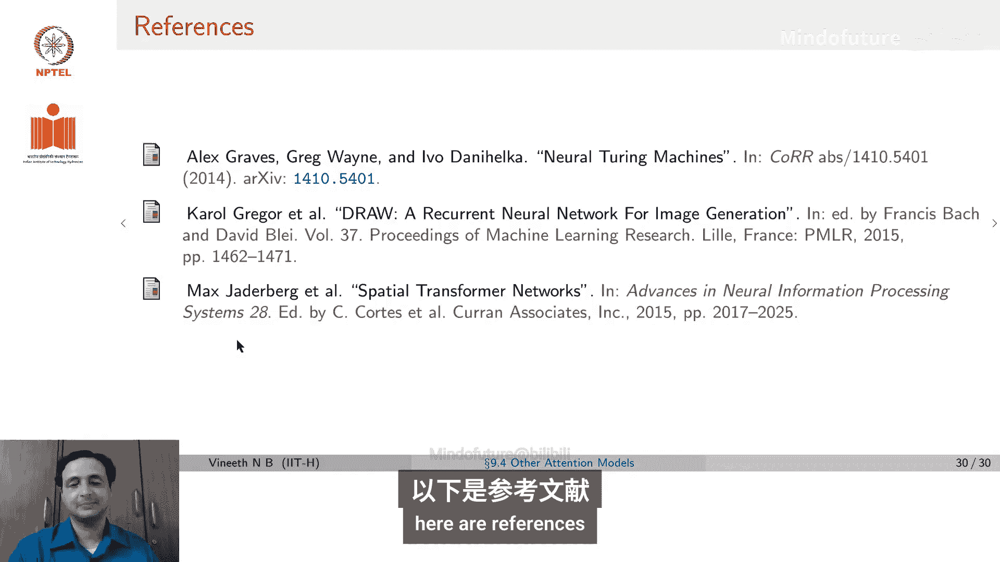

# 059：其他注意力模型 🧠

在本节课中，我们将学习注意力机制在深度学习中的其他几种重要应用。我们将探讨三种不同的模型：神经图灵机、深度循环注意力写入器和空间变换网络。这些模型以非常不同的方式使用或实现了注意力机制，并对计算机视觉领域产生了深远影响。

---

## 神经图灵机 🧠

上一节我们介绍了视觉问答和视觉对话中的注意力应用。本节中，我们来看看注意力机制如何被建模并用于其他任务，首先从神经图灵机开始。

神经图灵机是一类旨在执行类似于图灵机任务的神经网络。与图灵机类似，NTM 拥有一个内存，并通过读写操作来访问内存以执行后续任务。然而，与图灵机不同，NTM 需要固定大小的内存，以便将其视为神经网络并学习操作。

下图是神经图灵机的高层可视化。它包含一个控制器和一个内存矩阵。控制器通过读写头来访问内存，进行读取和写入操作。

控制器是一个神经网络，它执行对内存的读写操作。内存本身是一个 `R x C` 的矩阵，包含 R 行，每行有 C 维。

现在，我们提出一个问题：能否通过反向传播端到端地训练一个像图灵机那样通过指定行和列索引（例如，读取第三行第十列）来执行读写操作的 NTM？答案是否定的。因为无法对索引进行求导，这类似于硬注意力机制中的“硬选择”问题。

为了解决这个问题，NTM 采用了与软注意力非常相似的思想。它使用一个软加权函数作用于内存矩阵的所有位置，而不是选择一个特定的索引。这使得 NTM 可以通过反向传播和梯度下降进行训练。

以下是 NTM 核心组件的详细说明：

*   **内存矩阵**：在时间步 t 表示为 `M_t`，维度为 `R x C`。
*   **归一化注意力向量**：用于从内存中读取，由一组权重 `w_t(i)` 给出，所有权重之和为 1，且每个权重在 0 到 1 之间。
*   **读头操作**：读头获取的内容是内存矩阵各行的加权和。如果内存的第 i 行是 `M_t(i)`，对应的注意力权重为 `w_t(i)`，那么读头读取的内容 `r_t` 为：
    `r_t = Σ_i w_t(i) * M_t(i)`
*   **写头操作**：写操作分为两步。首先，使用擦除向量 `e_t` 擦除部分旧内存。然后，添加一个由加向量 `a_t` 加权后的新内容。更新公式为：
    `M_t(i) = M_{t-1}(i) * [1 - w_t(i) * e_t] + w_t(i) * a_t`

那么，如何获得注意力向量 `w_t` 呢？NTM 使用了两种寻址方式：基于内容的寻址和基于位置的寻址。

以下是获取注意力向量的步骤：

1.  **基于内容的寻址**：每个读写头在时间步 t 有一个关键向量 `k_t`。通过计算 `k_t` 与内存矩阵 `M_t` 每一行的余弦相似度，得到一个相似度分数。最终的注意力权重通过 softmax 函数计算，并引入一个键强度因子 `β_t` 来控制权重的集中程度。
    `w_t^c(i) = exp(β_t * cosine_sim(k_t, M_t(i))) / Σ_j exp(β_t * cosine_sim(k_t, M_t(j)))`
2.  **插值**：将当前基于内容的注意力权重 `w_t^c` 与上一时间步的注意力权重 `w_{t-1}` 进行插值，插值参数为 `g_t`。
    `w_t^g = g_t * w_t^c + (1 - g_t) * w_{t-1}`
3.  **卷积移位（基于位置的寻址）**：对插值后的权重向量 `w_t^g` 执行一个循环卷积操作，卷积核为 `s_t`。这允许模型根据控制器的需要，在内存中移动注意力焦点。
    `w_t^s = circular_convolution(w_t^g, s_t)`
4.  **锐化**：最后，使用一个标量 `γ_t` 对权重进行锐化，使高权重更高，低权重更低，从而得到最终的注意力向量 `w_t`。
    `w_t(i) = (w_t^s(i))^{γ_t} / Σ_j (w_t^s(j))^{γ_t}`

总结来说，神经图灵机的工作流程是：首先进行基于内容的寻址，然后与上一步注意力权重插值，接着进行基于位置的卷积移位，最后锐化权重以决定在特定时间步关注内存的哪一部分。这是一种与我们之前所见不同的注意力应用方式。

---

## 深度循环注意力写入器 🎨

接下来，我们看看本讲座要讨论的第二种方法：深度循环注意力写入器。这项 2015 年的工作基于一个直观想法：人类生成图像（如绘画和素描）是循序渐进的，先勾勒轮廓，再迭代添加细节。

DRAW 使用了一种称为变分自编码器的模型（我们将在后续课程中详细学习），来模拟这种逐步生成图像的方法。我们在这里讨论它，是因为它使用了一种独特的注意力机制。

下图展示了 DRAW 方法的工作原理。图像是逐步生成的，而不是一次性生成。每一行代表一次迭代生成。初始步骤是一张空白画布。模型通过一个红色方块所示的注意力区域聚焦于画布的特定部分，在该区域绘制内容，然后更新画布。在下一个时间步，模型聚焦于图像的另一个区域并绘制。经过多次迭代，模型最终生成了完整的图像（这里是一个 MNIST 手写数字）。

DRAW 的编码器和解码器都是循环神经网络。其整体架构图类似于自编码器。图像在 T 个时间步内绘制在一个画布矩阵 `C` 上。DRAW 受 NTM 启发，也包含读写头，用于聚焦图像的特定部分进行读取和写入。

以下是 DRAW 框架的主要组件和工作流程：

*   **编码器 RNN**：接收四个输入：输入图像 `x`、残差图像 `x̂`、上一时间步编码器的隐藏状态、上一时间步解码器的隐藏状态。其中，`x̂ = x - σ(C_{t-1})`，`σ` 是 sigmoid 函数，`C_{t-1}` 是上一时间步的画布。`x̂` 代表了画布尚未关注到的图像部分。
*   **读取模块**：读取模块 `r_t` 接收 `x`, `x̂` 和解码器上一时间步的隐藏状态 `h_{t-1}^{dec}`，决定在当前时间步读取图像的哪一部分。
*   **解码器 RNN 与写入**：从编码器产生的瓶颈层采样一个向量，传递给解码器 RNN。解码器 RNN 使用其上一时间步的隐藏状态和采样向量。写入模块的输出被添加到画布上：`C_t = C_{t-1} + write_output_t`。

现在，让我们深入了解作为该框架注意力机制的读写模块是如何工作的。

DRAW 的目标是聚焦于图像的特定区域。由于不能只聚焦于一个单一区域（会导致不可微分的问题），它采用了两步法来将权重分布在整个图像上。

以下是 DRAW 注意力机制的关键步骤：

1.  **预测网格参数**：模型预测一组滤波器参数，这些参数定义了一个覆盖在图像上的网格。网格的中心坐标 `(g_x, g_y)`、网格点之间的步长 `δ` 都是通过学习得到的。
2.  **放置高斯滤波器**：在每个网格点位置上，放置一个高斯滤波器。高斯滤波器的方差 `σ^2` 以及一个强度因子 `γ` 也是通过学习得到的。

具体来说，模型预测的是归一化的值 `(g̃_x, g̃_y, δ̃)`，然后将它们转换到实际图像坐标 `(A x B)` 上：
*   `g_x = (A + 1)/2 * (g̃_x + 1)`
*   `g_y = (B + 1)/2 * (g̃_y + 1)`
*   `δ = max(A, B) * δ̃ / (N - 1)`，其中 N 是网格大小（如 3x3 网格则 N=3）。

网格中第 `(i, j)` 个点的位置 `(μ_x(i), μ_y(j))` 由下式给出：
*   `μ_x(i) = g_x + (i - N/2 - 0.5) * δ`
*   `μ_y(j) = g_y + (j - N/2 - 0.5) * δ`

在这些位置放置高斯滤波器 `f_x, f_y`（方差为 `σ^2`）。强度因子 `γ` 控制绘制或读取的浓淡程度。

*   **读取操作**：最终，读取函数实现为高斯滤波后的输入图像与残差图像的拼接，并乘以强度因子 `γ`。
*   **写入操作**：写入操作是读取的互补形式，其顺序是转置的，以确保维度匹配和互补性。

在每个时间步，通过学习到的网格位置、步长和高斯滤波器，模型决定了关注图像的哪个区域。解码器的输出被绘制在画布的对应区域上。通过多个时间步的迭代，最终生成完整的图像。

---

## 空间变换网络 🔄

本讲座要讨论的第三种方法是空间变换网络。这又是一种非常不同的利用注意力的方法，旨在为 CNN 带来注意力机制的价值。

其核心思想是：CNN 本身可能缺乏空间不变性。如果一个物体以不同方式旋转或位于不同角落，CNN 可能无法很好地处理。最大池化操作在一定程度上有所帮助，但主要是在网络深层处理小邻域内的变化。空间变换网络是一个完全可微分的模块，可以插入到任何 CNN 中，通过注意力机制来解决特定问题。

下图展示了空间变换网络的工作原理。第一列是包含各种变换（缩放、旋转、平移）和噪声的输入图像。第二列显示了空间变换网络学习到的注意力区域（红色框和方向）。第三列是经过空间变换网络校正后的图像，数字被居中并标准化。第四列展示了经过校正后，CNN 能够进行更好的分类。

空间变换网络架构包含三个可微分模块，因此可以集成到任何 CNN 中（例如，插入在 Conv4 和 Conv5 之间）。

以下是三个模块的详细说明：

1.  **定位网络**：输入一个特征图 `U`（维度 `H x W x C`），输出一组变换参数 `θ`。例如，对于仿射变换，`θ` 是一个 6 维向量。定位网络本身可以是一个小型 CNN 或全连接网络。
2.  **网格生成器**：利用变换参数 `θ`，建立输出特征图 `V`（维度 `H' x W' x C`）中每个点 `(x_i^t, y_i^t)` 与输入特征图 `U` 中对应采样点 `(x_i^s, y_i^s)` 之间的映射关系。对于仿射变换，关系为：
    `(x_i^s, y_i^s)^T = A_θ * (x_i^t, y_i^t, 1)^T`
    其中 `A_θ` 是由 `θ` 参数化的 2x3 仿射变换矩阵。
3.  **采样器**：这是实现可微性的关键步骤。对于输出 `V` 中的每个位置，根据网格生成器计算出的采样坐标 `(x_i^s, y_i^s)`，从输入 `U` 中采样值。由于 `(x_i^s, y_i^s)` 通常是浮点数，需要可微的采样方法。常用的是双线性采样：
    `V_i^c = Σ_n^H Σ_m^W U_{nm}^c * max(0, 1 - |x_i^s - m|) * max(0, 1 - |y_i^s - n|)`
    这个核函数只在 `(m, n)` 接近 `(x_i^s, y_i^s)` 时才有非零值，并且关于 `U` 和 `(x_i^s, y_i^s)` 都是可微的，从而允许梯度在整个网络中反向传播。

通过这三个模块，空间变换网络能够学会对输入特征图进行适当的空间变换（如裁剪、旋转、缩放），将感兴趣的区域标准化，从而提升后续 CNN 层的处理效果。

---

## 总结 📚

本节课我们一起学习了注意力机制在三种不同模型中的应用：
1.  **神经图灵机**：将软注意力机制应用于外部内存的读写，实现了可微分的基于内容与位置的寻址。
2.  **深度循环注意力写入器**：使用可学习的高斯滤波网格作为注意力机制，逐步、迭代地生成图像，模仿人类的绘画过程。
3.  **空间变换网络**：通过一个完全可微分的模块（定位网络、网格生成器、采样器）实现对输入特征图的空间变换，使 CNN 能够主动“关注”并标准化图像中的关键区域。

这些模型展示了注意力机制的灵活性和强大能力，它不仅能用于序列到序列的任务，还能与内存交互、指导图像生成，以及增强 CNN 的空间不变性。

**扩展阅读建议**：
*   Lilian Weng 关于注意力的博客。
*   Jonathan Hui 关于 DRAW 的简介和概述。
*   Sik-Ho Tsang 关于空间变换网络的综述。