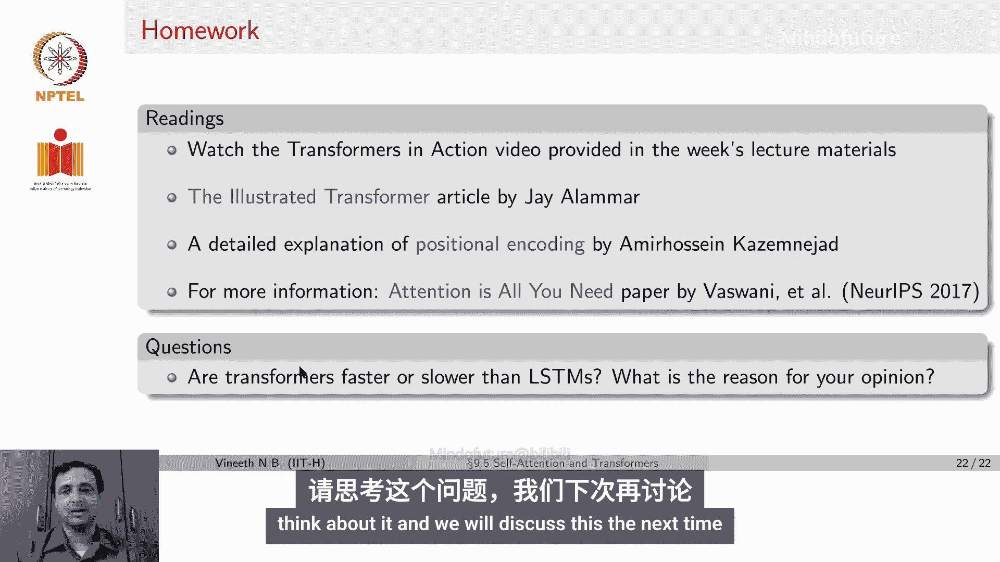

# 060：自注意力与Transformer 🧠

在本节课中，我们将学习一个近年来变得极其热门的话题：自注意力机制与Transformer模型。我们将探讨它们如何克服传统循环神经网络（RNN）的局限性，并理解其在序列建模，乃至计算机视觉任务中的核心工作原理。

## 概述

上一节我们讨论了视觉对话系统的评估方法。本节中，我们将目光转向一种全新的序列建模架构——Transformer。它完全摒弃了循环结构，仅依靠注意力机制，在并行计算和长序列依赖建模方面展现出巨大优势。

## 为什么需要超越RNN？🤔

在深入Transformer之前，我们首先需要理解其诞生的动机。传统的RNN或LSTM在处理序列时存在两个主要问题：

1.  **顺序计算阻碍并行化**：RNN必须按时间步顺序处理输入。在一个由线性层、LSTM层交替组成的深度架构中，这种顺序性使得整个处理流程无法并行化，限制了计算效率。
2.  **有限的长程依赖建模能力**：尽管GRU和LSTM通过门控机制缓解了梯度消失问题，但它们仍然难以在非常长的序列（如一整章书）中维持所有关键信息。实际上，在许多任务（如视觉问答）中，我们已经引入了注意力机制来聚焦于序列的相关部分。

既然注意力机制本身就能告诉我们生成特定输出时应关注输入序列的哪个部分，那么我们是否还需要RNN来维护一个压缩的隐藏状态呢？这就是Transformer提出的核心假设：**仅用注意力就足够了**。

## Transformer核心架构 🏗️

Transformer首次在2017年的论文《Attention Is All You Need》中提出。它是一个完全基于注意力机制的编码器-解码器框架，用于序列到序列的建模。其关键组件包括：
*   自注意力机制
*   多头注意力
*   位置编码
*   编码器-解码器堆叠结构

下图展示了Transformer的整体架构，我们将在后续逐一解析其组成部分。

### 自注意力机制详解

自注意力是Transformer的独特之处。考虑两个句子：
1.  “The animal didn't cross the street because it was too tired.”（动物没有过马路，因为它太累了。）
2.  “The animal didn't cross the street because it was too wide.”（动物没有过马路，因为它太宽了。）

对人类而言，第一个“it”指代“animal”，第二个“it”指代“street”。但对基于RNN的模型来说，捕捉这种指代关系是困难的。自注意力机制允许模型在处理某个词时，评估序列中所有其他词的重要性。

之所以称为“自”注意力，是因为当处理序列中的一个元素时，模型会关注**同一序列**中的其他部分。这消除了对RNN那种压缩整个序列历史信息的隐藏状态的需求。

以下是自注意力计算的具体步骤：

**第一步：创建查询、键、值向量**
给定输入词嵌入向量 `x`（例如，“thinking”和“machines”分别对应 `x1` 和 `x2`），我们通过三个可学习的权重矩阵 `WQ`、`WK`、`WV` 将其线性变换为三组向量：
*   **查询向量 (Query)**: `q = x * WQ`
*   **键向量 (Key)**: `k = x * WK`
*   **值向量 (Value)**: `v = x * WV`

在原始论文中，`x` 的维度是512，而 `q`、`k`、`v` 被设计为64维，这主要是为了后续多头注意力计算的便利，并非强制要求。

**第二步：计算注意力分数**
以处理第一个词“thinking”为例，我们计算其查询向量 `q1` 与序列中所有词（包括自身）的键向量 `k` 的点积，得到一组分数。这些分数衡量了其他词对当前词的重要性。
`分数 = q1 · k_i` （`i` 为序列中词的索引）

**第三步：缩放与归一化**
将上一步得到的分数除以键向量维度 `d_k` 的平方根（本例中 `sqrt(64)=8`），然后应用Softmax函数，将分数转化为概率分布（权重）。这一步称为**缩放点积注意力**。
`缩放后分数 = (q1 · k_i) / sqrt(d_k)`
`权重_i = Softmax(缩放后分数_i)`
缩放操作有助于稳定梯度，防止点积结果过大或过小导致训练不稳定。

**第四步：加权求和输出**
将每个词的权重与其对应的值向量 `v_i` 相乘，然后将所有结果求和，得到当前词“thinking”经过自注意力处理后的输出向量 `z1`。
`z1 = Σ (权重_i * v_i)`

同理，我们可以计算出序列中每个词的输出向量 `z`。

### 多头注意力机制 🎯

上一节我们介绍了单一的自注意力计算。然而，只使用一组 `WQ`、`WK`、`WV` 可能限制模型从不同角度关注信息的能力。Transformer引入了**多头注意力**来解决这个问题。

其核心思想是：使用多组不同的 `WQ`、`WK`、`WV` 矩阵（即多个“头”），并行地进行多次自注意力计算。每个头都可以学习关注输入序列的不同方面（例如语法结构、语义关联等）。

以下是多头注意力的流程：
1.  输入序列 `X` 分别与 `h` 组（例如8组）不同的 `{WQ, WK, WV}` 矩阵相乘，得到 `h` 组 `{Q, K, V}`。
2.  对每一组 `{Q, K, V}`，独立进行上一节所述的自注意力计算，得到 `h` 个输出矩阵 `Z_i`。
3.  将这 `h` 个输出矩阵在特征维度上拼接（Concatenate）起来。
4.  将拼接后的结果通过一个可学习的线性层进行投影，最终得到多头注意力的输出。

通过这种方式，模型能够同时从多个表示子空间捕获信息，从而获得更丰富、更强大的序列表示。

### 位置编码 📍

自注意力机制本身是**排列不变**的，即打乱输入词的顺序，其输出的加权和结果可能不变。但这对于语言理解是致命的，因为词序至关重要。

为了将序列的顺序信息注入模型，Transformer使用了**位置编码**。具体做法是：为输入序列中的每个位置（第1个词，第2个词...）生成一个唯一的、与词嵌入维度相同的向量。这个位置编码向量会与对应的词嵌入向量**相加**，作为自注意力层的实际输入。

原始论文使用正弦和余弦函数来生成位置编码：
`PE(pos, 2i) = sin(pos / 10000^(2i/d_model))`
`PE(pos, 2i+1) = cos(pos / 10000^(2i/d_model))`
其中 `pos` 是位置，`i` 是维度索引，`d_model` 是模型维度（如512）。这种周期性函数设计使得模型能够轻松学习到相对位置关系。

### 编码器与解码器结构 🧩

现在，让我们将这些组件组合起来，看看完整的Transformer架构。

**编码器**：由 `N` 个（原文中 `N=6`）完全相同的层堆叠而成。每一层包含两个子层：
1.  **多头自注意力层**：即我们刚讨论的多头注意力机制，其输入是上一层的输出（第一层为词嵌入+位置编码）。
2.  **前馈神经网络层**：一个简单的全连接网络（例如两层线性变换加激活函数）。
每个子层周围都应用了**残差连接**和**层归一化**。即：`输出 = LayerNorm(x + Sublayer(x))`。这有助于缓解深度网络中的梯度消失问题，加速训练。

**解码器**：同样由 `N` 个相同的层堆叠而成。每层包含**三个**子层：
1.  **掩码多头自注意力层**：与编码器类似，但加入了掩码。在训练时，为了确保解码器在预测第 `t` 个输出时只能看到 `1` 到 `t-1` 时刻的已知输出，需要将未来时刻的注意力分数掩蔽（设为负无穷大），使其Softmax权重为0。
2.  **多头注意力层**：这一层的 `K` 和 `V` 来自**编码器的最终输出**，而 `Q` 来自解码器第一子层的输出。这使得解码器可以关注输入序列的相关部分。
3.  **前馈神经网络层**。
解码器的每个子层同样使用了残差连接和层归一化。

最终，解码器最后一个层的输出会通过一个线性层和Softmax函数，转化为目标词汇表上的概率分布，从而生成翻译结果。

## Transformer在计算机视觉中的应用 👁️

Transformer最初为NLP设计，但其强大的序列建模能力迅速被引入计算机视觉领域。

**目标检测（DETR, ECCV 2020）**：该工作用Transformer简化了目标检测流程。CNN提取的图像特征图被展平为一组特征向量，并加上空间位置编码。这些向量送入Transformer编码器。解码器接收一组可学习的“对象查询”向量，并通过与编码器输出的交互，并行地预测出一组边界框和类别标签（或“无对象”）。它省去了Faster R-CNN中生成候选区域、非极大值抑制等复杂后处理步骤，实现了端到端训练。

**图像识别（ViT, ICLR 2021）**：该工作将图像分割成固定大小的图像块，每个块被线性投影为向量（类似词嵌入）。加上位置编码后，这些向量序列被直接送入标准的Transformer编码器。同时，在序列开头添加一个可学习的“[CLS]”分类令牌，其编码器输出用于最终的图像分类。ViT表明，在大规模数据上预训练后，纯Transformer架构在图像分类任务上可以超越最先进的CNN模型。

## 总结

本节课我们一起深入学习了Transformer模型的核心思想与架构。我们从RNN的局限性出发，理解了自注意力机制如何通过计算序列内部元素间的关联来建模依赖关系。我们详细剖析了**自注意力**的计算步骤、**多头注意力**如何扩展模型的表示能力、**位置编码**如何引入序列顺序信息，以及**编码器-解码器**的堆叠结构与残差连接等细节。最后，我们看到了Transformer如何从NLP领域成功跨界，在目标检测和图像识别等计算机视觉任务中引发新的革命。Transformer以其并行高效和强大的建模能力，正在重塑我们对深度学习模型的设计思路。

## 课后思考与作业 💡

**思考题**：你认为Transformer比LSTM更快还是更慢？为什么？（提示：从并行计算和序列长度角度考虑）

**作业**：
1.  观看本周课程资料中提供的“Transformers in action”视频，直观理解其工作原理。
2.  阅读Jay Alammar的经典文章《The Illustrated Transformer》。
3.  若想深入理解位置编码，可参考相关专题文章。
4.  阅读原始论文《Attention Is All You Need》。

