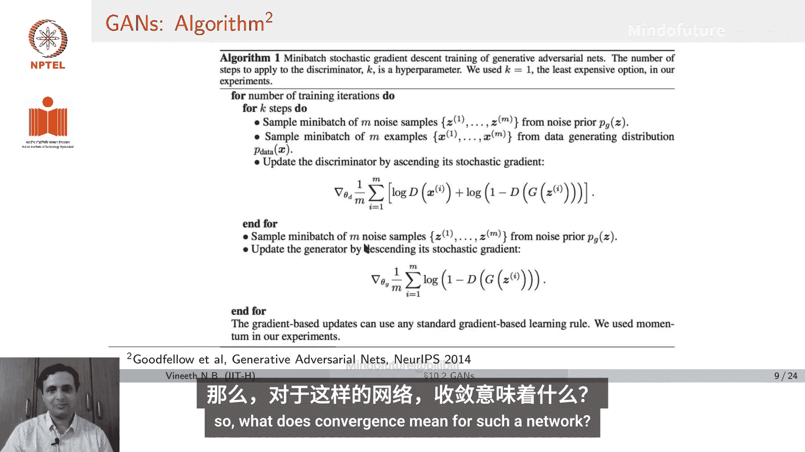

# 062：生成对抗网络 - 第一部分

## 概述
在本节课中，我们将要学习一种非常流行的深度生成模型——生成对抗网络。我们将从回顾上节课的内容开始，然后深入探讨GAN的核心思想、目标函数、训练策略以及其背后的原理。

---

## 回顾：生成模型与密度估计
上一节我们介绍了生成模型的基本概念，本节中我们来看看生成对抗网络的具体实现。

生成模型旨在学习给定训练图像数据集 **X** 上的概率密度函数 **P(x)**。如果该分布被参数化为高斯分布，那么 **P(x)** 会根据图像由该分布生成的概率，为每个可能的图像分配一个正数。它告诉我们图像 **x** 在该分布 **P(x)** 下的可能性有多大。

生成模型的应用包括：
*   **采样和生成新数据**
*   **似然估计**：可用于异常值检测。如果你有一个分布，并且一个数据点属于该分布的可能性很低，那么该点很可能是异常值。
*   **特征学习**：我们将在本讲座中进一步讨论。

我们还讨论了从**显式**和**隐式**角度进行概率分布的密度估计，这也定义了深度生成模型的不同方法。

**显式密度估计方法**尝试为概率分布写出一个显式函数。例如，你可以说 **P(x) = f(x; θ)**，其中 **f** 可以是一个高斯函数。在这种情况下，输入是图像 **x**，输出 **P(x)** 是图像 **x** 的似然值，参数是定义该密度函数的权重 **θ**。显式密度估计方法在异常值检测方面表现很好，但有时在生成高质量图像方面会遇到困难，生成速度也可能较慢。

**隐式密度估计方法**并不试图为 **P(x)** 分配一个函数形式。相反，它们只旨在确保给定一个模型，你可以从该模型中采样图像，而无需担心为每个这样的样本分配显式的似然值。这类方法最终为更好的样本生成和更快的采样速度提供了途径。

---

## 生成对抗网络的核心思想
带着上述回顾，让我们进入本讲座的重点——生成对抗网络。这些网络由Goodfellow等人于2014年提出。

GAN的目标是构建一个良好的**采样器**，允许从 **P_model(x)** 中抽取高质量样本，其中 **P_model(x)** 定义了通过该算法学习到的模型所生成的样本的分布。正如我们刚才提到的，没有为 **P(x)** 计算特定的函数形式。我们唯一的目标是确保从模型中采样的任何图像，其样本分布（我们称之为 **P_model(x)**）看起来与原始数据分布相似。我们并不为每个样本分配似然值。

因此，我们理想地希望输出样本与训练数据相似，但又不完全相同。为什么这么说？因为如果我们得到的样本与训练数据完全相同，首先，神经网络可能只是在记忆，而没有真正学到什么。其次，你可能就不再需要这样的模型了。你只需要一个能够生成超出你已有数据的多样化样本的模型。

那么如何实现这个目标呢？生成对抗网络的关键思想是引入一个**潜变量 z**。这是一个具有简单先验（例如高斯先验）的潜变量。一旦你从该高斯分布中采样出这个随机变量，你就将其通过一个称为**生成器**的模块（在我们的例子中，生成器可以是一个神经网络）。你向这个生成器神经网络输入 **z**，网络输出一个图像 **x̂**。因此，这个模块的输出是一个图像本身，我们将其定义为来自生成器的分布，记作 **P_G**。

现在，我们想要什么？我们希望确保，如果我们有一个由 **P_data** 给出的训练数据分布，那么分布 **P_G** 必须接近 **P_data**。请注意，我们并不是试图为每个数据点 **x̂** 甚至 **x** 分配似然值。我们希望分布 **P_G** 接近分布 **P_data**。

实现这一点的挑战在于，我们没有对 **P_G** 或 **P_data** 施加任何特定的参数化。因此，我们必须在不知道它们是什么分布的情况下，找到一种方法来确保 **P_G** 变得接近 **P_data**。请记住，这里的高斯分布仅用于输入向量 **z**；我们并没有假设你的 **P_data** 和 **P_G** 分布是高斯分布或任何其他参数化形式。

那么，我们如何确保 **P_G** 大致接近 **P_data** 呢？为此，该方法的创始人Goodfellow等人提出了一个有趣的想法：他们引入了一个称为**判别器**的分类器（在本讲座中记为 **D**），用于区分真实样本和生成样本。因此，如果数据来自 **P_data**，它将被归为类别1。如果数据来自生成分布 **P_G**，则该图像将被归为类别0。

这如何有益？我们的目标现在是训练生成器，以确保判别器将生成的样本 **x̂** 错误分类为类别1，并且不再能够区分原始分布 **P_data** 和新的分布 **P_G**。因此，我们将通过这个判别器来使 **P_G** 等同于 **P_data**。判别器的工作是将生成的（假）样本与真实样本分开。而生成器的工作是欺骗判别器。你也可以把这看作警察和小偷的游戏，其中判别器就像能区分真假的警察，而生成器的工作就是愚弄判别器。这就是总体思路。

---

## GAN的目标函数
如何训练这样的生成器或判别器？GAN的训练目标由以下公式给出：

这是一个**极小极大**优化问题。你对生成器网络的参数 **G** 进行**最小化**，对判别器（分类器）网络的参数 **D** 进行**最大化**。

公式的第一部分表示：对于来自真实原始训练分布 **P_data** 的数据点 **x**，我们希望判别器最大化这些数据点的对数似然（即 **log D(x)**）。

公式的第二部分表示：如果你现在从高斯分布中采样一个 **z**，并将其输入你的生成器 **G**，生成器的输出 **G(z)** 再输入判别器。我们希望确保判别器对此的输出是0（即判别为假）。至少，判别器必须旨在使这个值（**D(G(z))**）为0，当整个数量最大化时就会发生这种情况（因为 **log(1 - 0) = 0**）。另一方面，生成器的工作是确保最后这个数量（**D(G(z))**）趋向于1，这将最小化整个数量（因为 **log(1 - 1) = -∞**）。这就是为什么你对 **G** 最小化而对 **D** 最大化。

这也符合直觉，因为生成器和判别器正在进行警察和小偷的游戏，每一方都希望胜过对方。因此，当判别器想要最大化目标函数中的项时，生成器则想要最小化目标函数中相应的项。这样的极小极大问题也被称为**零和博弈**，它起源于博弈论。

我们假设判别器在其输出层具有**Sigmoid激活函数**。请记住，至少在我们讨论的这个特定例子中，判别器是一个二元分类器，它只需要判断是真实还是生成。因此，二元分类器输出层可以使用的最佳激活函数是Sigmoid激活函数。

让我们尝试以略有不同的方式解析这个目标函数。如果你看第一项，我们称之为目标1。目标1指出，我们希望训练判别器，使得如果样本属于真实训练数据分布 **P_data**，我们最大化它作为真实样本的对数概率。

第二部分是目标2，它讨论了关于第二项最小化生成器。请记住，第一项与 **G** 无关，因此在最小化 **G** 时，第一项无关紧要，可以排除。因此，在最小化 **G** 时，我们寻求什么？我们寻求训练生成器 **G**，使得如果样本属于 **P_G**（即生成器 **G** 的输出），我们希望最大化它作为真实样本的对数概率；这就是生成器想要做的，尽管判别器也想要最大化这个数量。

在实际实现中，这两项中的“期望”仅仅意味着损失是在一批样本上平均的。

---

## GAN的训练策略
现在来看训练策略。首先想到的是，我们现在有两个网络需要训练：**D** 和 **G**。到目前为止，我们已经见过其他几种需要训练两个网络的方法。但在所有这些例子中，两个分支大多是用相同的损失或目标训练的。那么这里我们可以做什么？

一个选择是我们先完全训练 **D**，得到一个好的判别器。这可以通过仅优化目标1的第一部分来完成。一旦我们有了这个，我们就可以训练 **G** 来优化目标2。这行得通吗？有什么问题吗？

让我们试着思考一下。如果 **D** 最初非常自信，这意味着你训练了一个优秀的判别器或分类器，那么它将能够判断任何来自 **G** 的样本都是假的。这意味着，如果你得到一个对应于分布 **P_G** 的样本 **x**（即生成器的输出），那么 **D(x)** 或 **σ(x)**（**D** 中的Sigmoid激活函数）将等于0。这意味着 **log(1 - D(G(z)))** 在这种情况下将是 **log(1 - 0) = 0**。如果你查看 **log(1 - σ(x))** 的曲线及其梯度，当 **log(1 - σ(x))** 为0时，梯度显然也是0。这意味着 **G** 将得不到任何梯度来训练，因此永远学不到东西。

因此，一开始就完全训练好判别器，并不能帮助我们得到一个好的生成器，而这是GAN的主要目标。那么我们该怎么做？

我们希望交替使用目标1和目标2分别训练判别器和生成器。

---

## GAN的训练算法
让我们看看这在GAN的算法中是如何完成的。

Goodfellow的原始论文建议，我们首先进行 **k** 步判别器训练：
1.  从噪声先验 **P_g(z)**（例如高斯分布）中采样一个小批量的 **M** 个噪声样本 **{z^(1), ..., z^(M)}**。
2.  从原始数据分布 **P_data**（即你的训练数据）中采样一个小批量的 **M** 个样本 **{x^(1), ..., x^(M)}**。
3.  更新判别器，通过**梯度上升**其随机梯度。梯度是通过对判别器网络中的每个权重求取损失函数 **L_D** 的导数得到的。损失函数 **L_D** 为：
    `L_D = (1/M) * Σ [log D(x^(i)) + log(1 - D(G(z^(i))))]`
    你对判别器参数进行梯度上升更新。

你进行 **k** 步这样的操作来更新判别器。它还没有被完全训练好。一旦你完成了 **k** 步，现在切换到训练生成器。

对于生成器训练：
1.  从噪声先验 **P_g(z)** 中采样一个小批量的 **M** 个噪声样本 **{z^(1), ..., z^(M)}**。
2.  更新生成器，通过**梯度下降**其随机梯度。梯度是通过对生成器网络中的每个权重求取损失函数 **L_G** 的导数得到的。损失函数 **L_G** 为（注意，对于生成器，我们最小化目标函数的第二项）：
    `L_G = (1/M) * Σ [log(1 - D(G(z^(i))))]`
    你对生成器参数进行梯度下降更新。

这个过程在训练迭代中重复进行，最终用于设计（得到）生成器模型。

在测试时，你做什么？一旦你训练了完整的模型，你可以**丢弃判别器**。你从高斯分布中采样一个 **z**，将其送入生成器网络，得到的图像就是你将假定属于原始数据分布的图像。

---

## 关于收敛的思考
这里有一个问题：对于这样的网络，收敛意味着什么？到目前为止，每当我们有一个损失函数时，我们总是希望最小化损失函数，并确保损失趋于零。为了避免过拟合，我们可能不会让它达到零，但至少我们希望看到损失随着迭代而减少。

然而在这里，我们有两个组件，其中一个可能试图增加目标函数值，另一个则试图减少目标函数值。那么对于这样的网络，收敛意味着什么？

我们将在下一部分更详细地探讨这个问题。

---

## 总结
本节课中我们一起学习了生成对抗网络的第一部分。我们回顾了生成模型和密度估计的概念，介绍了GAN通过生成器和判别器对抗训练的核心思想，详细解析了其极小极大目标函数，并阐述了交替训练判别器和生成器的具体算法步骤。GAN作为一种隐式密度估计方法，旨在学习一个能够生成与真实数据分布相似的新样本的采样器，而无需显式定义概率密度函数。