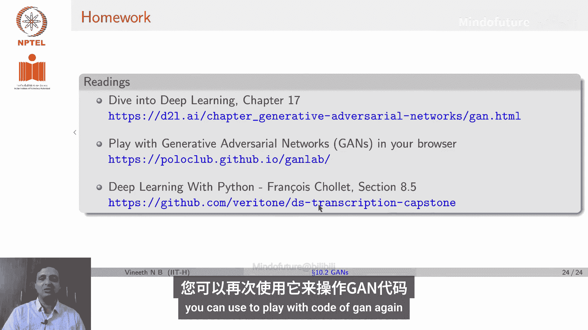

# 063：生成对抗网络 - 第二部分

## 概述
在本节课中，我们将深入探讨生成对抗网络（GAN）的数学原理、优化过程、经典架构DCGAN以及如何评估GAN模型的性能。我们将从理论推导开始，逐步过渡到实践应用。

---

## 优化目标与最优解推导

上一节我们介绍了GAN的基本概念，本节中我们来看看如何从数学上推导其最优解。

首先，重新考虑GAN的训练目标函数：
**Min_G Max_D [ E_{x~p_data(x)}[log D(x)] + E_{z~p_z(z)}[log(1 - D(G(z)))] ]**

将期望展开为积分形式：
**Min_G Max_D ∫ [ p_data(x) log D(x) + p_g(x) log(1 - D(x)) ] dx**

为了求解最优判别器D，我们将最大化操作移入积分内部，并分析被积函数。设 **y = D(x)**，**a = p_data(x)**，**b = p_g(x)**，则函数为：
**f(y) = a log y + b log(1 - y)**

通过求导并令导数为零，可以找到使f(y)最大的y值：
**f'(y) = a/y - b/(1 - y) = 0**
解得：
**y* = a / (a + b)**

将变量代回，得到最优判别器的输出为：
**D*(x) = p_data(x) / (p_data(x) + p_g(x))**

---

## 生成器的最优条件

在得到最优判别器D*后，我们将其代入目标函数，来求解最优生成器G。

将D*的表达式代入，目标函数变为：
**Min_G ∫ [ p_data(x) log( p_data/(p_data+p_g) ) + p_g(x) log( p_g/(p_data+p_g) ) ] dx**

此式可以重写为两个KL散度之和的形式，并进一步与Jensen-Shannon散度（JSD）建立联系。JSD的定义为：
**JSD(P||Q) = 1/2 KL(P || M) + 1/2 KL(Q || M)， 其中 M = (P+Q)/2**

经过推导，最终目标函数可简化为：
**Min_G [ 2 * JSD(p_data || p_g) - log 4 ]**

由于JSD是非负的，且当且仅当两个分布相等时为零。因此，目标函数在 **p_g = p_data** 时取得最小值 **-log 4**。

这意味着，在最优状态下，生成器学到的分布 **p_g** 必须与真实数据分布 **p_data** 完全一致。

---

## 最优状态下的平衡

将 **p_g = p_data** 代回最优判别器公式，得到：
**D*(x) = p_data(x) / (p_data(x) + p_data(x)) = 1/2**

这个结果具有深刻的含义：当GAN训练达到全局最优时，判别器对于任何输入（无论是真实样本还是生成样本）的输出概率都将是0.5。此时，判别器完全无法区分真假，达到了纳什均衡。

---

## DCGAN：深度卷积生成对抗网络

上一节我们从理论上分析了GAN的最优解，本节中我们来看看一个里程碑式的实践架构——DCGAN。

DCGAN于2016年提出，它将CNN在监督学习中的成功经验引入到无监督的生成模型中，显著提升了生成图像的质量。

以下是DCGAN引入的核心训练策略：

*   **用步幅卷积替代池化层**：使用带步幅的卷积层来学习空间下采样，取代了确定性的最大池化。
*   **去除全连接层**：在深层架构中主要使用卷积层，移除了全连接隐藏层。
*   **引入批量归一化**：在生成器和判别器中都使用批量归一化（BN），以稳定训练、防止梯度问题。但注意，生成器的输出层和判别器的输入层不使用BN。
*   **使用ReLU族激活函数**：生成器中使用ReLU，判别器中使用Leaky ReLU。
*   **输出层激活函数**：生成器最终输出层使用Tanh，将像素值映射到[-1, 1]；判别器输出层使用Sigmoid，输出一个概率值。

---

## 潜在空间的操作

DCGAN的一个重要贡献是展示了生成器的潜在空间具有有意义的算术性质。

*   **图像插值**：对两个潜在向量 **z1** 和 **z2** 进行线性插值 **α*z1 + (1-α)*z2**，输入生成器后，可以得到从图像G(z1)到G(z2)的平滑过渡。
*   **向量算术**：通过对潜在向量进行算术运算，可以控制生成图像的语义属性。例如：
    **Z_{女人戴眼镜} ≈ Z_{男人戴眼镜} - Z_{男人不戴眼镜} + Z_{女人不戴眼镜}**
    将运算结果输入生成器，可以得到戴眼镜的女性图像。

---

## GAN的特征学习能力

DCGAN还证明了GAN的判别器可以学习到具有判别力的特征，可用于其他任务。

实验方法如下：
1.  使用ImageNet数据集训练一个DCGAN。
2.  固定训练好的判别器权重。
3.  将另一个数据集（如CIFAR-10）的图像输入该判别器。
4.  提取判别器中间某一层的卷积特征。
5.  用这些特征训练一个SVM分类器对CIFAR-10图像进行分类。

实验结果表明，用这种方式学到的特征取得了具有竞争力的分类性能，证明了GAN强大的特征学习能力。

---

## GAN的评估方法

评估生成模型比评估分类模型更具挑战性，因为没有明确的“正确”标签。以下是几种常见的评估方法：

**1. 人类评估**
最直接但主观的方法。好的生成器应能生成：
*   **可识别的物体**：生成的图像包含清晰可辨的物体。
*   **语义多样性**：生成的样本覆盖了训练集中的多种类别。

**2. Inception Score (IS)**
这是一个试图量化上述人类评估标准的自动化指标。它使用一个在ImageNet上预训练的Inception-v3网络。
*   **核心思想**：对于高质量的生成数据，分类器对每个生成图像应有很高的置信度（条件分布 **p(y|x)** 的熵低），同时所有生成图像的类别分布应尽可能均衡多样（边际分布 **p(y)** 的熵高）。
*   **计算公式**：
    **IS = exp( E_{x~p_g} [ KL( p(y|x) || p(y) ) ] )**
    分数越高越好。

**3. Fréchet Inception Distance (FID)**
IS的一个主要局限是它完全不考虑真实数据分布。FID通过比较生成分布与真实分布在特征空间中的距离来解决这个问题。
*   **计算方法**：
    1.  将真实图像和生成图像分别输入Inception-v3网络，提取某一中间层（如pool3层）的特征。
    2.  假设这两组特征均服从多元高斯分布，分别计算它们的均值 **m, m_w** 和协方差矩阵 **C, C_w**。
    3.  计算这两个高斯分布之间的Fréchet距离：
        **FID = ||m - m_w||^2 + Tr(C + C_w - 2*(C*C_w)^{1/2})**
*   **解读**：FID分数越低，表示生成分布与真实分布越接近，模型性能越好。

FID对图像质量的退化（如添加噪声）比IS更敏感，通常被认为是更可靠的指标。

---

## 总结
本节课我们一起学习了生成对抗网络的核心理论、经典架构DCGAN以及评估方法。
1.  我们从数学上推导了GAN的最优解，证明了在全局最优时，生成分布会匹配真实分布，且判别器输出为0.5。
2.  我们介绍了DCGAN，它通过引入CNN的最佳实践（如使用卷积层、BN、特定激活函数）极大地改善了GAN的训练稳定性和生成质量，并展示了潜在空间的可解释性。
3.  最后，我们探讨了评估GAN的挑战，介绍了Inception Score和Fréchet Inception Distance这两种重要的自动化评估指标，其中FID因其同时考虑生成质量和多样性，并与真实数据对比，而被广泛使用。

**延伸阅读与资源**
*   深入了解GAN：[Dive into Deep Learning on GANs](https://d2l.ai/chapter_generative-adversarial-networks/index.html)
*   在线体验GAN：[GAN Lab](https://poloclub.github.io/ganlab/)
*   代码实践：[PyTorch GAN Tutorial](https://pytorch.org/tutorials/beginner/dcgan_faces_tutorial.html)