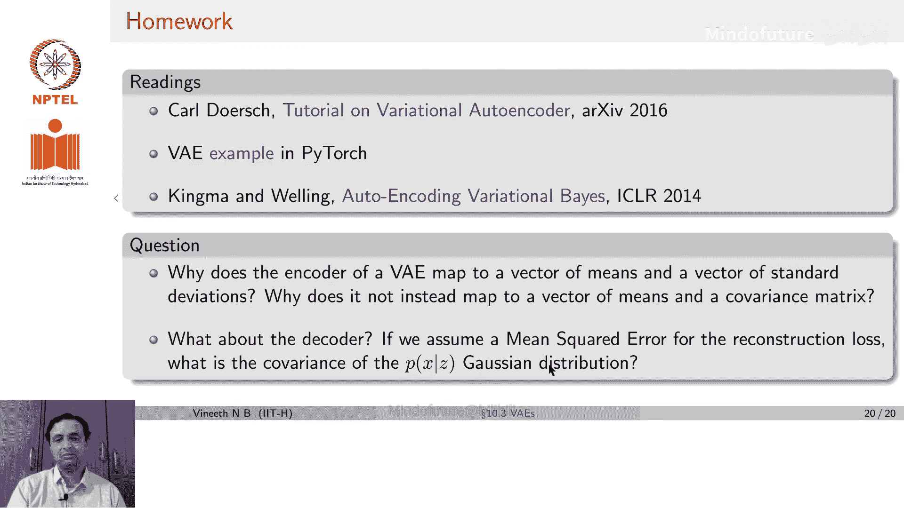

# 064：变分自编码器 (VAE) 🧠

在本节课中，我们将要学习一种重要的深度生成模型——变分自编码器。我们将从回顾自编码器开始，逐步理解VAE的核心思想、数学原理、训练方法及其应用。

## 概述

上一节我们介绍了生成对抗网络，本节中我们来看看另一种深度生成模型，称为变分自编码器，通常简称为VAE。在讨论变分自编码器之前，我们先简要回顾一下上周学过的自编码器。

自编码器是一种用于无监督学习的神经网络，其目标是重构输入本身作为输出。自编码器的架构通常包含一个将输入压缩到瓶颈层的编码器，该层产生输入的某种表示（也称为潜在编码），然后通过解码器重构输出，理想情况下输出应尽可能接近输入。

在本周主题的背景下，我们想问的问题是：如何利用这种方法自动生成图像？回想一下，当我们讨论自编码器时曾提到，训练完成后通常会丢弃解码器，仅使用编码器来获取数据的低维表示。

现在，让我们尝试看看是否能反转这个思路：在训练结束时，我们能否丢弃编码器而非解码器？如果我们使用某个向量作为编码，能否生成接近训练数据分布的图像？正如你所见，这个目标与GANs试图实现的目标相近，但实现视角不同。

变分自编码器的思想大约在同一时间由两组研究人员提出。Kingma和Welling在2014年ICLR上发表的论文《Auto-Encoding Variational Bayes》中提出，以及Rezende、Mohamed和Wierstra在2014年ICML上发表的《Stochastic Backpropagation and Variational Inference in Deep Latent Gaussian Models》中提出。

## 理解变分自编码器

VAE的核心在于学习所谓的**潜变量模型**。在潜变量模型中，我们的目标是学习从某个潜在随机变量 **Z** 到一个可能很复杂的分布 **X** 的映射，我们假设 **X** 是我们希望生成相似数据的真实世界训练分布。

从数学上讲，可以写作：
`p(x) = ∫ p(x, z) dz`
其中 `p(x, z) = p(x|z) * p(z)`。

我们在这里假设，潜在变量 **Z** 的先验或边缘分布是简单的。那么如何得到 `p(x|z)` 呢？我们假设 `p(x|z)` 是输入向量 **z** 的某个函数。这就是这里简单的数学构造。

我们提出的问题是：在给定训练数据（这里假设是无监督学习，只有 **X**）的情况下，我们能否学习解耦数据分布背后真正的解释因素或潜在变量？这些潜在变量可能正在生成数据。例如，在人脸图像中，你可能想假设存在一个称为“身份”的潜在随机变量和一个称为“表情”的潜在随机变量。因此，如果说人物A是快乐的，你应该能够生成人物A处于快乐情绪的人脸图像。在这种情况下，身份和表情就是潜在变量，这些变量可以取不同的值。身份可以取不同人的值，如A、B、C，表情可以取不同的值，如快乐、悲伤、愤怒等，组合起来就产生了特定类型的图像。

所以，我们讨论的是一组潜在变量（在此表示为 **z1, z2, ...**）和一个函数 **G**，它将我们从这个潜在空间带到原始数据空间。我们如何学习这样一个从 **z** 到 **x** 的函数 **G**？

我们将假设使用神经网络来学习这样一个从 **Z** 到 **X** 的函数，因此这里的条件分布 `p(x|z)` 可以通过神经网络给出。现在剩下的问题是：**Z** 从何而来？计算后验概率 `p(z|x)` 是难以处理的，因为我们不知道 **Z** 是什么样子，不幸的是，我们需要它来训练 `G(z)` 模型。没有 **Z** 的值，我们也无法训练 `G(z)` 模型。那么，我们如何解决这个问题？

正如你所见，到目前为止，变分自编码器为自编码器提供了贝叶斯视角。因此，如果我们假设数据是通过这个生成过程产生的：**Z** 是一组我们假设属于某个先验分布的潜在随机变量，我们从真实条件分布中采样，得到 **X**，即我们看到的训练数据分布。这里的直觉是，**X** 可以是一幅图像，它由一些潜在属性生成，例如类别标签、方向、属性等。因此，我们可以说类别标签是人脸，方向是他/她看的方向，属性可以是肤色、眼睛颜色、头发颜色等。现在对我们来说的问题是，在不知道这些 **z** 是什么的情况下，我们需要估计这个条件分布 `p(x|z)` 的参数 **θ**。

如何做到这一点是VAE的核心思想。为了启动这个过程，我们现在假设随机变量 **Z** 上有一个先验分布，为了方便起见，我们假设它是一个单位高斯分布。一旦有了 **Z**，你现在可以构建一个我们称为解码器网络的神经网络，它具有某些参数 **θ**（即解码器网络中各层的权重）。解码器输出一组均值和方差，然后可以用来采样并获得类似于 **X** 的数据。因此，这里的条件分布 `p_θ(x|z)` 被假设为对角高斯分布（为简单起见，可以假设具有某个协方差矩阵的多元高斯分布，但过程会变得有点复杂，我们将其保持为简单的对角高斯分布，其每个维度的均值和方差由解码器网络预测）。

根据贝叶斯规则，我们知道后验概率 `p_θ(z|x)` 由 `p_θ(x|z) * p_θ(z) / p_θ(x)` 给出。现在，如果我们观察右边的项：`p_θ(x|z)`，我们刚刚讨论了如何获得它；`p_θ(z)`，我们刚刚说假设它是高斯分布；分母 `p_θ(x)` 不幸地是一个难以处理的积分。为了找出 **X** 来自什么分布及其参数化，我们目前并不知道。

那么，我们该如何解决？我们现在将假设存在另一个分布 `q_φ(z|x)`，我们将其称为**近似后验分布**。这是使用一个编码器网络获得的。编码器网络的作用是：它接收你的训练数据分布（即神经网络从训练数据中接收所有输入），它有一组由某些权重参数化的层（我们表示为 **φ**），并且它再次输出一组多元对角高斯分布的均值和方差，该分布由近似后验 `q_φ(z|x)` 给出。

如果把所有这些部分放在一起，我们现在有了下面的编码器和上面的解码器。编码器接收 **x**，并为这个近似后验分布 `q_φ(z|x)` 输出一组均值和方差。一旦有了那个分布，你就可以从中采样一个 **z**。然后将该样本 **z** 作为输入给你的解码器网络，解码器网络输出一组对应于 `p_θ(x|z)` 的均值和方差，给定这些均值和方差，你可以从 `p_θ(x|z)` 中采样以获得你的输出图像或重构。

我们在这里假设 `q_φ` 和 `p_θ` 都是具有特定均值和对角协方差的多元高斯分布，因此每个维度是独立的。

## 训练VAE网络

我们理想地希望训练解码器网络，就像普通的自编码器一样。因为它将构造并给我们一个输出 **x**，我们理想地希望使用像重构损失这样的东西，例如均方误差损失，以确保这里的重构尽可能接近 **x** 本身，这肯定应该是我们损失函数的一项。我们还需要做什么？

我们还需要确保这个近似后验 `q_φ(z|x)` 应该接近我们假设的 **Z** 的先验。我们为解码器网络假设 **Z** 来自一个单位高斯先验。因此，我们理想地希望 `q_φ(z|x)` 接近分布 `p_θ(z)`，在我们的例子中，我们假设它是一个均值为0、协方差矩阵为单位矩阵的高斯分布。

让我们尝试把这些放在一起，得到训练这种变分自编码器的正式损失函数。记住，这里的目标是进行最大似然估计：我们有一个由 `{x_i}` 给出的训练数据，我们理想地希望学习参数 **θ**（即解码器的参数），使得该分布生成训练数据点的可能性最大化，这就是数据的最大似然估计。

我们将把它转换为对数似然最大估计（最大对数似然估计），其中乘积转换为和，然后你有 `log p_θ`，这在数学上使事情变得简单一些。

现在，`p_θ(x)` 可以定义为 `∫ p_θ(x, z) dz`。这可以展开为 `∫ p_θ(x|z) * p_θ(z) dz`。不幸的是，我们再次面临一个难以处理的积分。

因此，让我们尝试看看如何解决这个最大似然估计问题，我们将用一个技巧来解决。让我们重写最大对数似然估计问题。我们有对数似然 `log p_θ(x)`，它可以表示为对从近似后验采样的 **Z** 向量取期望的 `log p_θ(x)`。如果我们从你的近似后验中采样 **Z** 向量并作为输入给解码器，生成类似于训练分布的样本的可能性必须很高。这就是第一句话的意思。

现在，`log p_θ(x)` 可以使用贝叶斯定理写为 `log [p_θ(x|z) * p_θ(z) / p_θ(z|x)]`。对于这个表达式，我们将乘以并除以近似后验 `q_φ(z|x)`。一旦我们有了这个等价于该问题最大似然估计设置的表达式，我们可以以不同的方式分组项来书写它。

第一项 `log p_θ(x|z)` 保持不变。然后你有另一项 `q_φ(z|x)` 和 `p_θ(z)`。理想情况下，你可以将其写为 `+ E_z[log (p_θ(z) / q_φ(z|x))]`。但现在，我们将减去它并这样写。所以我们有 `- E_z[log (q_φ(z|x) / p_θ(z))]`。然后剩下的项是分母中的 `p_θ(z|x)` 和分子中的 `q_φ(z|x)`，这就是第三项。

现在，如果你观察这里的第二项和第三项，你会注意到第二项是近似后验 `q_φ(z|x)` 和先验 `p_θ(z)` 之间的KL散度。第三项是真实后验 `p_θ(z|x)` 和近似后验 `q_φ(z|x)` 之间的KL散度。

现在，观察这里，KL散度是一个非负量，所以第三项将大于或等于0。因为这是一个对数似然估计问题，我们理想地希望最大化这个量。因此，要最大化由这三项组成的量（其中第三项大于等于0），可以通过最大化前两项本身来实现。

所以我们现在说的是，我们有一个下界，由前两项给出。记住第三项是非负的并且是加上的，所以整个对数似然将以下面这两项为下界。因此，如果我们想最大化对数似然，我们可以最大化这个下界。这个下界也被称为**证据下界**或**ELBO**。这整个优化过程被称为**变分推断**的方法，其中我们引入了一个变分分布（在本例中是近似后验 `q_φ`），并利用它来学习分布的参数化。

所以，我们现在的目标是找到最大化这个证据下界的 **θ*** 和 **φ***。

## 编码器与解码器结构

让我们把这些放在一起。我们现在说，我们引入了一个推理模型 `q_φ(z|x)`（近似后验），它试图通过优化变分下界来近似原始后验。我们使用编码器网络对 `q_φ(z|x)` 进行参数化。

因此，我们现在有了一个编码器和一个解码器网络。让我们在将它们放在一起之前单独看看它们：给定训练数据 **X**，我们将其作为输入提供给编码器。编码器输出近似后验分布的均值和方差，我们希望它接近 **Z** 的先验。然后我们从 **Z** 采样，并使用解码器生成 **x**，我们希望它接近训练数据分布。

## 重参数化技巧

如何训练这个网络？如果你看损失本身，这是我们要最大化的总体目标函数，但训练过程中存在一个问题。我们说的是将输入分布给编码器，编码器给出近似后验的参数化，然后我们从先验中采样，再给解码器，最后得到最终输出。这意味着我们现在有一个编码器-解码器模型，一个自编码器，其中在中间步骤或瓶颈层步骤，我们将采样一个向量，而不是前向传播一个向量。为什么这是个问题？那个样本可能不是确定性的，我们不知道如何通过那个瓶颈层将梯度传递回编码器。这是一个挑战。我们该怎么做？

我们理想地必须以某种方式确保我们得到的样本变得独立于编码器的输出，因为如果它变得独立于编码器的输出，你可以简单地通过解码器和编码器反向传播梯度，并假设随机性来自某个外部量。

如何将随机性与编码器输出分离？这是通过一个称为**重参数化技巧**的诀窍完成的，这是变分自编码器方法的主要贡献之一，一个简单的技巧但解决了通过网络反向传播的问题。

记住，我们将从某个近似后验分布中采样 **Z**，该分布由具有均值 `μ_z(x)` 和标准差 `σ_z(x)` 的高斯分布给出。现在，从这样的分布中抽取的样本可以稍微不同地重写。我们可以将该样本 **Z** 参数化为：
`z = μ_z(x) + σ_z(x) * ε`
其中 `ε` 是从单位标准正态分布中随机采样的向量。

这如何解决了真正的问题？记住，在之前的步骤中，到目前为止，你可以认为这类似于这样：你在神经网络中有一组层。变分自编码器的早期版本中，其中一层变成了随机的，你必须采样一个向量，而不是像我们迄今为止所见的那样通过神经网络前向传播的向量。因为那是一个样本，我们不会知道如何通过该层反向传播到更早的层（在我们的例子中是编码器）。

因此，重参数化技巧建议：让我们将该层固定为前一层的输出，相反，从外部引入这个随机性，而不是该层输出本身。如果你在这里看到，现在新样本由 `μ_z`（编码器的输出）、`σ_z`（也是编码器的输出）和 `ε`（你现在几乎可以将其视为来自噪声的偏置向量）给出。它并不真正影响反向传播到更早的层，它只是在该特定层中给出的外部输入，现在你可以像以前一样使用梯度下降通过整个网络反向传播。

因此，你现在在编码器中给定 **x**，生成 `μ` 和 `σ`，然后使用重参数化技巧采样 **z**，通过解码器并生成输出的 `μ` 和 `σ`，从中你可以采样并获得任何生成。

通过重参数化技巧，整个变分自编码器变得可微分，你可以使用梯度下降和反向传播来更新VAE中的权重并训练网络。

## 损失函数与训练

如前所述，这里的目标函数由下式给出：
`L(θ, φ; x) = -D_KL(q_φ(z|x) || p_θ(z)) + E_{z~q_φ(z|x)}[log p_θ(x|z)]`

现在，`log p_θ(x|z)` 结果是一个简单的重构损失，我们希望它接近你的训练分布，因此你甚至可以使用均方误差来最大化这个似然（第二项）。那么第一项呢？我们如何使其可微分？如何获得其梯度以进行反向传播？关键点在于，我们假设 `q_φ` 是一个具有编码器提供的特定均值和方差的高斯分布，我们也假设 `p_θ(z)` 是一个单位高斯分布。高斯分布之间的KL散度是一个定义明确且可微分的公式，这有助于我们确保可以计算梯度并反向传播，从而端到端地训练这个网络。

## VAE与自编码器的区别

这完成了我们对VAE如何学习的讨论。总结一下并与自编码器区分：
*   **传统自编码器**通过学习重构输入来训练，通常用于学习特征（低维表示），然后可用于训练另一个神经网络、SVM或任何其他监督模型。
*   **变分自编码器**在概念上是贝叶斯学习和深度学习的结合。在训练变分自编码器之后，你可以丢弃编码器，只需从你的先验 `p_θ(z)`（一个单位高斯分布）中采样，现在你的解码器已经学会了以单位高斯分布作为输入来生成看起来接近输入数据分布的图像。这就是使VAE成为生成模型的原因。

## VAE的应用与示例

VAE能做什么？以下是几个例子，其中VAE在MNIST数据和Frey Face数据集上进行了训练。你可以看到，当VAE中的潜在变量 **z** 被微小值修改时（记住我们将采样一些向量），你可以看到解码器的输出（即生成的图像）随着 **z** 值的变化而逐渐变化。这表明变分自编码器确实学会了能够在其所在的流形上平滑生成数据的潜在变量值。

类似地，就像我们在Frey Face数据集上对GANs所做的那样，你可以学习诸如表情和姿势等潜在变量，当你改变这些对应的潜在随机变量的值时，最终会得到具有不同姿势和不同表情的人脸图像生成。

VAE还能用于什么？它们有很多应用，我们将在下周详细讨论其中一些。但这里有几个例子：图像和视频生成、超分辨率、从静态图像进行预测、图像修复等等。我们将在下周看到其中一些。

## VAE的扩展

VAE在过去几年中也以多种方式得到了扩展。虽然我们可能没有范围在本课程中涵盖所有这些，但如果你想知道更多，这里有一些提示：
*   原始作者扩展了VAE以获得半监督变体，其中可以使用标记和未标记数据来学习VAE。
*   另一个流行且强大的扩展是**条件VAE**，你可以在给定特定类别标签的情况下生成数据。
*   另一种变体称为**重要性加权VAE**，它对潜在随机变量进行不同的加权以获得更强大的生成。
*   还有**去噪VAE**，你可以将其视为去噪自编码器在VAE设置中的扩展。
*   VAE也被用于图形学，一个流行的网络称为**逆向图形网络**，它使用类似VAE的策略来学习潜在变量，使你能在生成各种对象、3D对象等方面进行控制。
*   最后，另一种网络称为**对抗自编码器**，它将GANs和VAEs结合在一起，这将是我们下一讲立即讨论的主题。

## 总结

本节课中我们一起学习了变分自编码器的核心概念。我们了解到，VAE通过结合编码器、解码器以及重参数化技巧，在潜在空间中学习数据的连续、结构化表示，从而能够生成新的数据样本。其训练目标ELBO平衡了重构精度和潜在空间的正则化。与标准自编码器不同，VAE是一种强大的生成模型，在图像生成、数据压缩和特征学习等领域有广泛应用。