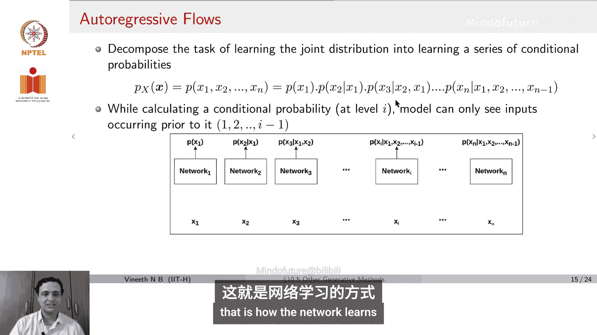

# 066：超越VAE和GAN - 其他深度生成模型 - 01

## 概述
在本节课中，我们将学习除了变分自编码器和生成对抗网络之外的其他深度生成模型。这些模型通常被称为基于流的模型，它们与VAE和GAN的一个关键区别在于，它们能够显式地学习真实数据的概率密度函数。

## 基于流的生成模型简介
虽然VAE和GAN是最流行的深度生成模型，但在过去几年中，其他方法也取得了成功。在本周的最后一讲中，我们将了解其中的几种。这些模型通常被广泛称为基于流的模型。

### 与GAN和VAE的区别
它们与GAN和VAE之间存在一个非常重要的区别。GAN和VAE都没有显式地学习真实数据的概率密度函数。在GAN的情况下，我们已经看到密度估计是隐式的。你并不显式地分配一个概率密度函数并尝试在GAN中估计它。在VAE的情况下，我们通过使用变分推理优化证据下界来获得近似的密度估计。在这两种情况下，你都无法得到精确的密度函数。

然而，真实数据的确切概率密度函数 `p(x)` 对于许多任务可能非常有用，例如处理缺失值、采样数据，甚至识别数据分布中的偏差。了解密度函数对于这类任务会很方便。因此，我们将在本讲座中讨论的这类方法，是那些能够估计所提供训练数据的真实密度的方法。

### 主要类别
广义上讲，这些方法可以分为两种不同的类型：标准化流和自回归方法（或自回归流）。

## 标准化流
让我们从标准化流开始。回想一下本周的第一讲，我们曾试图提出这个问题：如果我们有一个包含 `n` 个数据点的数据集，这些数据点来自一个底层分布 `P(x)`。我们想要找到一个参数 `θ`，它属于分布族 `M`，使得通过 `M` 中的参数化选择，`P_θ` 和 `P_data` 之间的距离最小化。我们当时还指出，如果这里的距离被替换为KL散度，那么这就变成了一个最大似然估计问题，或者说通过最小化负对数似然来求解。

### 最大似然估计的重要性
为什么这一点很重要？到目前为止，我们在训练神经网络时涉及的所有方法，都可以被视为最小化负对数似然的一种方式。无论是使用均方误差训练神经网络，还是使用交叉熵损失为分类问题训练神经网络或LSTM，都可以证明这两者最终都归结为最小化负对数似然。所以我们现在说，即使在无监督学习设置中，我们也可以使用类似的方法。

### 模型框架
那么，基于流的模型在这里试图做什么呢？我们可以将GAN看作是一个判别器和一个生成器，其中判别器负责区分真实数据和生成数据，而生成器将你从潜在空间 `z` 带到生成的图像 `x'`，然后 `x'` 与真实数据 `x` 一起作为输入提供给判别器。类似地，VAE是一个编码器-解码器模型，其中编码器捕获由参数 `φ`（编码器的权重）参数化的近似后验 `Q`；同样，解码器捕获给定 `z` 的 `P_θ(x|z)`，其中 `θ` 是解码器的参数。所以在这种情况下，正如我们刚才提到的，它是一种近似的密度估计。

而在基于流的生成模型中，我们做了一件本应显而易见但并非很简单的事情：给定 `x`，找到函数 `f` 来获得一个潜在表示 `z`，如果我们将其反转，就能得到 `x'` 或重建结果。所以这里的挑战在于，如何找到这些完全可逆的函数 `f` 来恢复原始数据？显然，这就是挑战所在。

### 标准化流的核心思想
在第一类方法，即标准化流中，主要目标是识别一个从 `z` 到 `x` 的变换 `f`。如果你还记得，`z` 再次是潜在变量，与VAE非常相似。VAE和基于流的模型之间的主要区别在于，在VAE中，编码器捕获具有不同参数化的近似后验，解码器捕获 `P_θ` 本身。我们知道 `Q_φ` 是真实后验 `P_θ(z|x)` 的近似，而在基于流的模型中，函数是精确可逆的。

因此，在这里我们识别一个从 `z` 到 `x` 的变换 `f`，其中变换 `f` 是一系列可微的双射函数 `f1` 到 `fk`，使得 `x` 可以写成 `f(z)`，而 `f(z)` 又可以写成 `f_k ∘ f_{k-1} ∘ ... ∘ f_1(z)`。反过来，`z` 可以写成 `f^{-1}(x)`，而 `f^{-1}(x)` 又可以写成 `f_1^{-1} ∘ f_2^{-1} ∘ ... ∘ f_k^{-1}(x)`。

### 图解说明
从图解上看，给定一个潜在变量 `z`（可能类似于GAN中的高斯分布），你将这个从 `z` 中采样的输入向量通过一个神经网络 `f1`（此时我们只称其为函数），它输出 `z1`，`z1` 再通过 `f2`，依此类推，直到 `fk`，我们最终期望它输出原始数据分布 `x` 所来自的分布。

### 数学推导
让我们更详细地看看这一点。在进入实现之前，对于任何从 `z` 到 `x` 的可逆函数 `f`，利用概率密度函数的变量变换公式，我们可以写出：
`p_x(x) = p_z(z) * |det( df^{-1}(x) / dx )|`

这并不难证明。如果 `z` 属于分布 `π(z)`，`z` 是一个随机变量，且 `x = f(z)`，使得 `f` 可逆，那么 `z = f^{-1}(x)`。根据概率分布的定义，我们有 `∫ p(x) dx = 1`，也等于 `∫ π(z) dz = 1`。从这个等式，我们可以说 `p(x)` 可以表示为 `π(z) * |dz/dx|`。但我们已知 `z = f^{-1}(x)`，所以代入得到 `π(f^{-1}(x)) * |d f^{-1}(x)/dx|`，我们将其写作 `π(f^{-1}(x)) * |f^{-1}'(x)|`，其中 `'` 表示梯度。

在向量形式下，这将是：
`p(x) = π(z) * |det( dz/dx )|` 或 `π(f^{-1}(x)) * |det( d f^{-1}/dx )|`，这就是我们一开始写的内容。

如果我们取相同的表达式，将其展开并对两边取对数，那么我们将得到：
`log p(x) = log π(z) + Σ_{i=1}^{k} log |det( d f_i^{-1} / d z_i )|`

这是如何得到的？这是通过将 `f` 替换为函数 `f1` 到 `f_K` 的组合得到的。在对数运算下，这种组合变成了求和。这就是我们得到这个表达式的方式。

### 直观理解
在估计概率密度函数的对数似然时，这两项的直观理解是：第一项可以看作是变换将密度 `p(z)` 塑造成 `p_x(x)`，这就是它想要做的。第二项量化了围绕 `z` 的小邻域的相对体积变化。记住，这就是梯度度量的内容，行列式也可以看作是捕获你试图测量的空间的体积。

### 工作原理图示
这里有一个图示来理解标准化流的工作原理。假设你最初从一个高斯分布 `Z_n` 中采样，应用函数 `f1` 得到 `Z1`，然后应用另一个函数，依此类推，直到得到 `Z_{i-1}`、`Z_i`，最后你不断应用许多函数，直到得到 `Z_k`，此时概率密度函数以这种方式变换，这就是我们正在寻找的 `x` 的密度函数。

### 为什么需要可微双射函数？
为什么我们说需要一个可微的双射函数？为什么每个 `f` 都应该是可微的双射函数？这应该相当直接，我们已经看到了逆函数是如何被使用的，但让我们更正式地定义它。

我们使用的这种双射函数被称为微分同胚。微分同胚函数是可组合的。这意味着给定两个变换 `f1` 和 `f2`，组合也是可逆且可微的。这在处理神经网络时非常重要。因此，从高斯分布到真实世界数据的复杂概率密度函数的任何复杂变换，都可以通过组合多个简单变换的实例来建模。

### 标准化流的要求
对于标准化流，我们需要什么？
1.  我们希望变换函数中的每一个都是可微的。所以，如果每个将你从 `z` 带到 `x` 的函数是神经网络的一层、一个LSTM或一组神经网络层，那么它们就是可微的，我们就满足了第一个前提条件。
2.  函数必须易于求逆。我们稍后会看到如何做到这一点。
3.  雅可比行列式应该易于计算。为什么？因为这是你损失函数中的一项，你希望它易于计算，以便你可以使用梯度下降训练整个网络。

## NICE：非线性独立分量估计
让我们看看实现标准化流的最早努力之一。这被称为NICE（非线性独立分量估计）。这项工作由Laurent Dinh等人于2015年发表。

这里的想法是引入所谓的可逆耦合层。让我们看看这些变换是什么。

### 耦合层操作
使用的耦合层操作是：
`y1 = x1`
`y2 = g( x2, m(x1) )`

所以，如果 `x1, x2, ...` 是数据 `x` 的不同维度，`y1, y2, ...` 是你试图生成的、最终希望匹配 `x` 的输出的不同维度。那么 `y1` 等于 `x1`，`y2` 由某个函数 `g` 作用于 `x2` 和 `m(x1)` 给出。从图示上看，`y2` 由函数 `g` 给出，该函数应用于 `x2` 以及 `m(x1)`。注意，在这个特定的公式中，`y1` 不依赖于 `x2`，但 `y2` 依赖于 `x1`。

在这种情况下，很明显雅可比矩阵将是一个下三角矩阵。为什么这么说？因为 `y1` 不依赖于 `x2`，所以雅可比矩阵的所有上三角元素都将变为零。

### 雅可比矩阵回顾
让我们花点时间回忆一下雅可比矩阵是什么。雅可比矩阵是所有偏导数的矩阵。如果你有一个包含 `y1` 到 `y_k` 的输出向量 `y`，以及一个包含 `x1` 到 `x_d` 的输入向量 `x`，那么所有成对的梯度 `∂y1/∂x1, ∂y2/∂x1, ..., ∂y_k/∂x1`，以及类似地 `∂y1/∂x2, ∂y1/∂x3, ...` 将构成雅可比矩阵的行和列。所以它是一个向量对向量的所有一阶偏导数矩阵。

在这种情况下，你可以看到，由于操作的构造，`y2` 将依赖于 `x1`，但 `y1` 不依赖于 `x2, x3, ..., x_d`。类似地，`y2` 将依赖于 `x1` 和 `x2`，但不依赖于 `x3` 到 `x_d`。这意味着这里的所有上三角元素都将变为0，你将得到一个下三角矩阵，而下三角矩阵的行列式就是对角线元素的乘积，因此在这种构造中，行列式变得易于计算。

### 逆映射
逆映射会是什么？逆映射将是：
`x1 = y1`
`x2 = g^{-1}( y2, m(y1) )`

这将是这种情况下的逆操作。

### 考虑所有数据
如果你希望考虑所有数据，在之前的构造中，我们认为 `y2` 可以依赖于 `x1`，但 `y1` 不能依赖于 `x2`。如果我们希望输出的所有元素都依赖于输入的所有元素，这是可以做到的，但你可能需要在每一层之后翻转输入。这样，在下一个迭代（下一个函数，记住它是一系列层或函数的组合）中，你可以让 `y1` 依赖于 `x2`，并且你可以继续这个过程，以确保所有输出变量都依赖于所有输入变量。所以你现在也可以将其写为加法耦合操作。

### 加法耦合操作
在加法耦合操作中，你可以说：
`y1 = x1`
`y2 = x2 + m(x1)`

所以，在这种特定情况下，它不是一个函数 `g`，你只是有 `y2 = x2 + m(x1)`。这里的逆操作将是 `x1 = y1` 本身，`x2 = y2 - m(y1)`。

在这种加法耦合层的构造中，雅可比行列式将始终为1。为什么这么说？你可以看看这两个方程并给出答案，因为它是加法耦合。`∂y1/∂x1` 将是1。`∂y2/∂x2` 也将是1，因为这里的第二项是加法的，并且不依赖于 `x2`。所以，你雅可比矩阵的所有对角线元素（你的雅可比矩阵的对角线元素是什么？你会有 `∂y1/∂x1`, `∂y2/∂x2`, ..., `∂y_k/∂x_k`，假设两者维度相同）如果你看这些方程，所有这些值都将是1。对角线元素的乘积将是1，雅可比行列式将是1。这被称为体积保持操作。

### 体积变化与雅可比行列式
记住我们说过，雅可比行列式是体积变化程度的一个估计。例如，如果你有一个随机变量 `x`，它具有一定的密度，比如在0到1之间是均匀密度。如果你有另一个随机变量 `z`，它从0到3。如果它的体积像这样，那么你可以看到梯度会给你一个答案为3，所以对于你在 `x` 中移动的每一个单位，你将在 `z` 中移动三个单位。所以，这告诉你 `x` 和 `p(z)` 之间的体积增加了两倍（译者注：应为变为三倍），梯度 `dz/dx` 的行列式也给出了答案3，这在某种意义上直观地告诉你在新的PDF中体积变化了多少。

因此，当雅可比行列式始终为1时，就像在加法耦合层中一样，它是一种体积保持操作。所以在这种情况下，对数似然变得非常简单；你只需知道雅可比行列式项始终为1，所以该项会消失，而 `p_x` 的对数似然就是 `y` 本身的对数似然。

## Real NVP：实值非体积保持标准化流
对NICE的一个改进是另一种流行的标准化流方法，称为Real NVP（实值非体积保持标准化流）。正如其名称所示，它是非体积保持的，所以我们肯定需要做一些超越加法耦合的事情。我们做什么呢？

我们进行仿射耦合操作。仿射耦合操作做什么？我们说：
`y1 = x1`
`y2 = x2 ⊙ exp( s(x1) ) + t(x1)`

这里 `⊙` 是哈达玛积，表示它是逐元素乘积。所以 `x2` 是一个向量，这里的第二项也是一个向量，它是 `x2` 与 `exp(s(x1))` 的逐元素乘积，再加上 `t(x1)`。所以有一个平移分量和一个缩放分量，它们共同构成一个仿射变换。

这种变换的雅可比矩阵仍然是一个下三角矩阵，因为 `y1` 不依赖于 `x2, x3` 等等，类似地 `y2` 不依赖于 `x3, x4` 等等。所以雅可比矩阵的上三角项将为0。在下三角项中，你会有 `∂y2/∂x1`，而对角线项在这种情况下将是 `diag( exp( s(x1) ) )`，因为这就是 `∂y2/∂x2` 的微分结果。

在这种情况下，雅可比行列式不一定为1，因此变换可能不是体积保持的，这在真实世界数据中更可能发生。例如，如果我们考虑用于标准化流的随机变量 `z` 是一个单位高斯分布，期望任何真实世界数据分布也具有与该单位高斯分布相同的体积，这可能不是一个非常正确的假设。从这个意义上说，Real NVP更现实。

### 逆操作
这里的逆操作会是什么？
`x1 = y1`
`x2 = ( y2 - t(y1) ) ⊙ exp( -s(y1) )`

记住这个指数函数。当你转到另一边时，它变成了逆指数函数，这就是这个项表示的含义。

### 图解说明
形象地说，这就是Real NVP仿射耦合的样子：你有你的 `x1`, `x2`；`y2` 依赖于 `x1` 和 `x2`；`y1` 仅依赖于 `x1`。`y2` 如何依赖于 `x1` 和 `x2`？通过一个平移分量和一个缩放分量。逆操作，正如你在这里看到的，看起来像这样，其中 `x2` 将依赖于来自 `y1` 的缩放分量和除了 `y2` 贡献之外的平移分量。

### 网络训练
然而，所有这些网络都是被训练的。因此，其余部分应该像任何其他神经网络一样工作。所以，它是关于最大化似然的。你可以使用标准的误差函数，如均方误差或交叉熵，根据你试图重建的内容以及这些网络每一层的输出来学习网络。例如，`y1 = x1` 将是神经网络的一层，第二层将是这个，其中缩放和平移由神经网络学习，依此类推。这就是网络学习的方式。

## 总结
在本节课中，我们一起学习了超越VAE和GAN的其他深度生成模型，重点是标准化流方法。我们了解了标准化流的核心思想是通过一系列可逆、可微的变换，将简单的先验分布（如高斯分布）映射到复杂的数据分布，并能够精确计算数据的概率密度。我们介绍了NICE模型中的加法耦合层及其体积保持特性，以及更先进的Real NVP模型中的仿射耦合层，它允许非体积保持的变换以更好地建模真实数据。这些方法通过最大化对数似然进行训练，为显式密度估计提供了一种强大的框架。