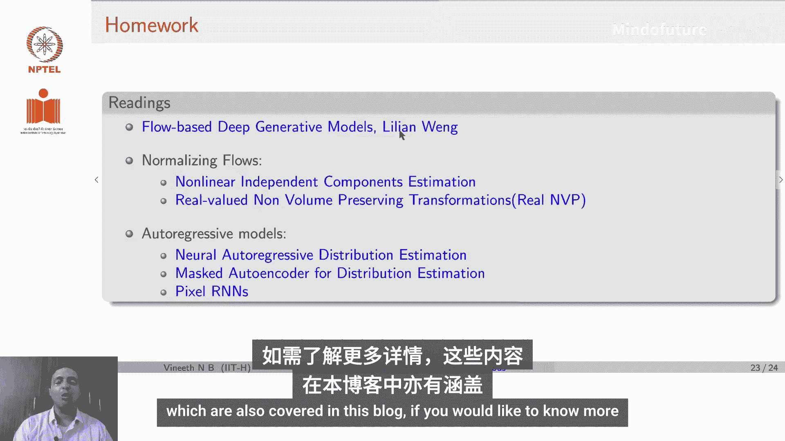

# 067：超越VAE和GAN - 其他深度生成模型 - 02

在本节课中，我们将继续探讨深度生成模型，重点介绍自回归流模型。我们将了解其核心思想、几种具体实现（如NADE和MADE），以及它们在图像生成领域的应用，例如Pixel CNN和Pixel RNN。课程内容旨在让初学者理解这些模型如何通过分解概率密度函数来生成数据。

## 自回归流模型概述

上一节我们介绍了标准化流模型。本节中，我们来看看另一类重要的深度生成模型——自回归流。

自回归流，顾名思义，源于自回归思想。在标准的机器学习中，自回归模型常用于时间序列数据，即通过观察过去n个时间步的数据来预测下一个值。例如，根据过去10天的股价预测第11天的股价。这类问题可以使用ARMA、ARIMA等经典时间序列模型解决。

我们在此讨论的是该思想的一种扩展。然而，现在的目标不是预测单一结果，而是生成数据。这标志着从监督学习到无监督学习的转变。

## 自回归用于生成

我们来看看如何将自回归用于数据生成。我们将寻找真实世界数据概率密度函数（PDF）的任务分解。给定数据 `x1` 到 `xn`，其联合概率密度函数 `p(x1, ..., xn)` 可以写为一系列条件概率的乘积：

**p(x1, ..., xn) = p(x1) * p(x2|x1) * p(x3|x1, x2) * ... * p(xn|x1, ..., xn-1)**

在计算某一层的条件概率时，模型只能看到出现在它之前的输入。具体工作原理如下：如果 `x1` 到 `xn` 是输入的不同维度，那么 `x1` 被用作第二个网络的输入，该网络可以预测 `p(x2|x1)`。这个概率（取决于 `x2` 可能取的值）可以通过均方误差、交叉熵等损失函数来学习。接着，`x1` 和 `x2` 共同贡献给第三个网络，以学习 `p(x3|x1, x2)`，依此类推，直到 `p(xn|x1, ..., xn-1)`。

因此，自回归流可以看作是标准化流的一个特例，其中每个中间变换都屏蔽了某些输入——并非每一步都查看所有输入。如果假设网络1到网络n是不同的函数（类似于标准化流），并且每个网络只查看输入的一部分而非全部，就可以这样理解，尽管实际实现方式略有不同。

## 神经自回归分布估计（NADE）

以下是NADE的工作原理。我们有输入 `x1` 到 `xN`，它们是每个输入向量的维度。同样，我们有 `p(x1)`，`p(x2|所有小于2的随机变量)`，`p(x3|所有小于3的随机变量)`，直到 `p(xn|所有小于等于n的随机变量)`。我们试图理解真实世界数据的概率密度函数，它是所有这些条件概率的乘积。

具体操作是：将所有输入提供给一个共享的神经网络（层数可自定义）。该神经网络的输出然后传递到一个隐藏表示层，这些隐藏表示是在被屏蔽的输入上获得的。也就是说，这里的节点 `H_n` 依赖于所有小于 `n` 的 `x` 值。具体做法是：`x1` 仅用于计算 `H2`；`x1` 和 `x2` 用于计算 `H3`；`x1`、`x2`、`x3` 等用于计算 `H4`，依此类推，所有小于 `n` 的 `x` 值用于计算 `H_n`。因此，必须屏蔽输入，以确保相应的输入到达隐藏层中的相应节点。

接下来，每个 `H1` 到 `Hn` 通过不同的网络传递，以得到 `p(x1)`，`p(x2|x<2)` 等。

### 推理与生成

在推理或生成时，如何实际生成数据呢？在训练好这样一个网络后（回想一下GANs，我们知道训练后如何生成图像：只需从高斯分布采样一个向量，通过生成器得到图像），NADE的做法类似。现在可以假设 `H1` 等价于生成样本时的潜在变量 `z`。可以假设 `H1` 来自高斯分布，从中采样一个值，通过第一个网络，会得到某个 `x1`。这个 `x1` 现在被馈送以得到 `H2`，用于得到 `p(x2)`；然后 `x1` 和 `x2` 一起被馈送以得到 `H3`，用于得到 `p(x3)`；接着用于得到 `x4`，依此类推，直到最后一个网络预测 `p(xn|xn-1)`。可以重复这个过程，直到生成完整的数据样本。

## 掩码自编码器分布估计（MADE）

MADE是NADE的一种改进变体。在这种情况下，我们使用自编码器来实现与NADE相同的效果。我们有 `x1`, `x2`, `x3`, `x4`，以及 `p(x1)`，`p(x2|所有小于2的随机变量)`，`p(x3|所有小于3的随机变量)`，直到最后一个随机变量。

我们如何将NADE适配到这种架构呢？有一个有趣的方法。首先，为每个输入节点和输出节点分配一个顺序（这里简单设为1,2,3,4）。同时，为隐藏层的每个节点也分配一个顺序，但每个隐藏层节点的顺序号必须小于 `n`（例如，这里 `n=4`，所以每个节点应分配数字1、2或3，必须小于4）。下一个隐藏层也是如此。

这样做的目的是什么呢？我们现在保留那些连接节点 `i` 到节点 `j` 的权重，其中对于所有隐藏层，要求 `i <= j`。例如，标记为1的隐藏节点应只连接到输入节点1（因为 `i<=j`，且 `j` 最大为1）。标记为3的隐藏节点可以连接到输入节点1、2和3。标记为2的隐藏节点连接到输入节点1和2，依此类推。我们只保留这些权重，丢弃这些层的所有其他权重。

在最后一层，我们也只保留那些连接输出节点 `i`（对应 `p(xj)`，其中 `j <= i`）的权重，使得 `i < j`。例如，输出节点2只连接到标记为1的隐藏节点；输出节点3连接到标记为1和2的隐藏节点，依此类推。同样，消除所有其他权重。

通过这个过程我们实现了什么？我们确保了 `p(xi|所有小于i的随机变量)` 只依赖于小于 `xi` 的输入。例如，`p(x2|x<2)`（注意图中的蓝色箭头）只连接到标记为1的节点，根本没有连接到标记为2的节点，这正是一开始的目标。这确保了只有输入 `x1` 影响 `p(x2|所有其他小于2的随机变量)`。同样，`p(x3)` 只依赖于标记为1和2的节点，`p(x4)` 依赖于标记为1、2和3的节点。

最终，自编码器只保留了一部分权重。在实现时，看起来是一个完整的自编码器，但在前向传播或反向传播时使用掩码，只保留特定的一组权重，丢弃另一组权重。这就得到了MADE。通过这个过程，在训练网络时，我们自动学习了这里的每个函数：`p(x1)`，`p(x2|x<2)` 等，它们共同给出了给定数据的真实密度函数。

## 自回归图像生成模型：Pixel CNN

另一类自回归模型被称为Pixel CNN，于2016年在NeurIPS会议上提出。其核心思想是：给定一张图像，我们的总体思路是将其通过一个CNN（不改变形状），并得到一个逐像素的Softmax分布来生成相同的数据。

但我们的实现方式是通过引入像素掩码过滤器，指定哪些像素应用于预测输出中特定像素位置的值。例如，要预测图中这个特定的像素，可能不需要所有像素，而只需要预测像素周围邻域中的某些像素集。这就是Pixel CNN的思想。正如所见，它的计算速度非常快，过程并不复杂。

然而，Pixel CNN可能无法利用完整的上下文信息。例如，用于预测特定像素的像素掩码方式，可能只关注出现在它之前的一组像素值。在这种情况下，如果要预测这个红色像素，可能会使用所有这些蓝色像素。这提供了一种局部上下文感，但也缺失了该区域中同样构成局部上下文的其他像素。因此，在生成过程中可能会丢失一些信息，尽管其计算速度极快。

## 自回归图像生成模型：Pixel RNN

同一作者在ICLR 2016上提出的一个变体被称为Pixel RNN。Pixel RNN有一个非常相似的想法，但生成是使用LSTM而不是CNN完成的。同样，这是一个自回归模型，图像是逐像素生成的。每个像素依赖于之前的像素，基于一个有向图。

因此，整体联合分布 `P(x)` 由 `i=1` 到 `n^2`（假设是 `n x n` 图像）的 `P(xi|所有直到该特定像素的其他像素)` 给出。如图所示，任何特定像素都依赖于它之前的所有其他像素，以影响该像素值的生成。这些像素之间的依赖关系使用LSTM建模，因此得名Pixel RNN。

与本节中我们看到的所有模型类似，学习过程再次是通过梯度下降最大化似然。似然是可处理的，因为我们使用的是LSTM，我们知道它的工作原理，只需要相应地构建它，但除此之外，LSTM的训练方式与我们之前看到的相同。

Pixel RNN中的图像生成可能较慢，因为必须使用LSTM生成每个像素的值，而不是像GAN那样一次性生成整个图像。Pixel RNN也可以被视为完全可见模型的一个例子，其中没有潜在变量。Pixel CNN也是这样的例子。事实上，大多数自回归模型结果都是完全可见模型，在方法本身中并不对任何潜在变量进行建模。

### Pixel RNN的变体

让我们看看该方法如何工作。Pixel RNN有两种变体：一种称为行LSTM，其中每个LSTM一次生成一整行像素。因此，当必须生成特定行 `t` 时，假设需要生成该行 `t` 中的一个特定值，这将是LSTM一个时间步的输出。LSTM应该查看什么，应该如何操作来生成这个特定的像素 `i`？如果我们考虑该行中该像素之前的像素集为 `K_i`，以及紧邻该行上方、`i` 的邻近像素为 `K_s`，它们两者都成为隐藏状态上下文，类似于LSTM生成当前像素。因此，隐藏状态和细胞状态将由某个权重 `W_{hs} * H_{t-1} + W_i * x_i` 给出，其Sigmoid函数将给出所有不同的门，其余部分与LSTM的操作非常相似。因此，输入基于 `K_i` 和 `K_s` 的值。可以这样看：如果要生成一个特定的像素（比如这个红色像素），可以从同一行的前一个像素以及前一行中这里的上三个像素获取上下文。然而，这三个像素从前一行的这五个像素接收输入，因此可以认为正在生成的这个红色像素在其生成过程中具有一个三角形的上下文。显然，由于这种生成方式，该模型将比Pixel CNN慢得多。

Pixel RNN中提出的另一种变体称为对角线双向LSTM。在对角线双向LSTM中，方法类似于双向RNN。双向RNN是一种RNN，在标准RNN中，`x0` 影响 `y0`，`x0` 和 `x1` 影响 `y1`，`x0`、`x1` 和 `x2` 影响 `y2`。在双向RNN中，还可以反向进行，所有这些箭头也可以反向操作。这意味着可以反转整个RNN，现在可以说 `y2` 仅基于 `x2` 生成，`y1` 基于 `x1` 和 `x2` 生成，`y0` 基于 `x0`、`x1` 和 `x2` 生成。如何学习这样的RNN？学习两个方向的权重，会得到两组不同的输出 `y0`、`y1`、`y2`，可以平均这些输出，这可能更好地指示输出应该是什么，特别是当序列中的方向可能不重要，且可能存在来自两个方向的上下文时。

这就是Pixel RNN中对角线双向LSTM变体所使用的思想。在这种情况下，图像是按对角线填充的。如图所示，每次填充一条对角线，当填充任何一个像素时，在该特定位置，这些值作为上下文来填充该像素 `i`。反过来，这两个用蓝色方块表示的像素依赖于之前的像素，因此它们最终都会影响这个像素 `i` 值的生成。我们现在也从另一侧的对角线重复这个过程，非常类似于双向RNN。

现在让我们看看，如果要生成这个特定的像素 `i`，我们会考虑哪些像素。你会说直接邻居，即上面的像素和右边的像素。不幸的是，不能使用右边的像素，因为根据图像的光栅化顺序（即逐行生成：第一行，然后第二行，第三行等），该像素尚未生成。那么如何克服这一点呢？在对角线双向LSTM方法中，当从另一条对角线过来时，使用这两个顶部像素作为上下文来生成这个特定的像素 `i`。这是唯一的变化。但现在尝试结合从这两个方向获得的上下文，然后在值 `i` 处进行生成，这就是我们讨论的双向RNN。因此，现在可以使用来自两个方向的完整上下文来看待这个中间的红色像素。为了生成一个像素（这里的红色像素），考虑从一条对角线填充时得到的所有深蓝色像素，以及从另一个方向填充时得到的浅蓝色像素，这提供了完整的上下文。同样，可以看出这比Pixel CNN慢。

## 总结与延伸阅读

本节课中，我们一起学习了自回归流模型。我们从基本概念出发，探讨了如何通过分解联合概率密度函数来生成数据。接着，我们详细介绍了神经自回归分布估计（NADE）及其改进版本掩码自编码器分布估计（MADE）的工作原理。最后，我们了解了这些思想在图像生成领域的应用，即Pixel CNN和Pixel RNN（包括行LSTM和对角线双向LSTM变体），并比较了它们的特点和性能。

本讲的课后作业是阅读Lillian Weng关于基于流的深度生成模型的精彩博客。如果你对每种方法感兴趣，请务必阅读此处链接的相应论文。该博客还涵盖了更新的方法，例如用于标准化流的Glow，如果你想知道更多，可以查阅。

以下是参考文献。