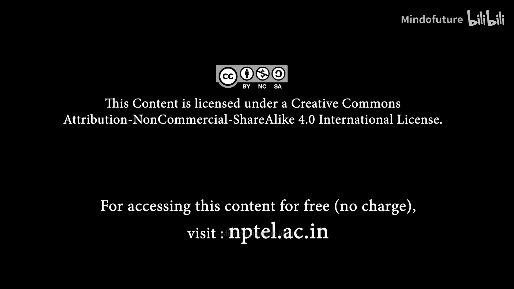
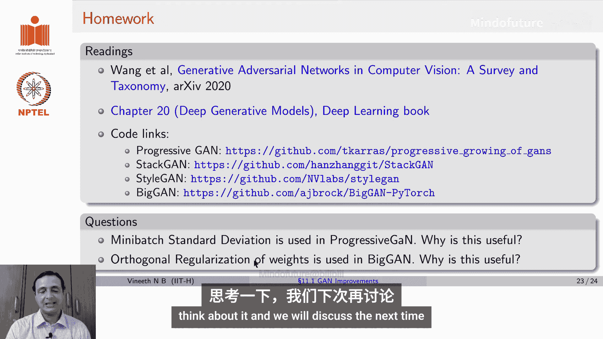

# 068：GAN改进 🚀

在本节课中，我们将学习生成对抗网络（GAN）在过去几年中的多种改进方法。我们将从对基础GAN的改进开始，简要讨论潜在空间的解耦，然后探讨GAN在图像和视频生成中的应用。

## 从基础GAN的改进开始

上一周我们学习了各种深度生成模型，如GAN、VAE、标准化流和自回归流。现在，我们将转向GAN在过去几年中被改进的各种方式。

首先，我们来介绍几种对基础GAN的改进方法。

### StackGAN：分阶段生成高分辨率图像

我们将讨论的第一个方法称为StackGAN。这项工作发表于2017年的ICCV会议。

该工作的目标是生成分辨率达256x256、具有照片级真实感的图像，并且这些图像是基于文本描述生成的。以下是其高级流程。

整个生成器模型以一个文本描述为条件，例如一个图像标题。使用标准的NLP方法（如Word2Vec、GloVe、BERT等）来获取该文本描述的嵌入向量，并将其作为输入提供给生成器。

在第一阶段，生成器以该嵌入向量和标准高斯噪声为输入，生成64x64的图像，这些图像可能包含一些高级或低频细节。这些图像随后被提供给StackGAN的下一阶段，以生成细节更丰富、分辨率达256x256的照片级真实感图像。这两个阶段都以相同的文本输入为条件。

现在，让我们看看整个架构。

*   **文本输入与嵌入**：你有一个文本描述（例如：“这只鸟是灰色的，胸部有白色，喙很短”），它被输入到整个StackGAN。通过Word2Vec、GloVe或BERT等方法获得其嵌入向量。
*   **第一阶段生成器**：该文本嵌入向量被用来计算一个均值和标准差，从而对高斯噪声进行采样。这个采样结果与一个标准正态分布的样本连接起来，共同作为第一阶段生成器的输入。第一阶段生成器通过一个上采样模块生成一个64x64的图像。
*   **第一阶段判别器**：生成的图像和真实图像的小批量样本被提供给判别器。判别器对这些图像进行下采样。在最终将其分类为“真实”或“虚假”之前，文本嵌入向量再次被引入并与下采样后的特征表示结合。此时，判别器的任务是判断这个（图像特征，文本嵌入）组合是真实的还是虚假的。
*   **第二阶段生成器**：第一阶段的结果（64x64图像）与文本嵌入向量再次结合，作为第二阶段的输入。图像经过下采样，然后与文本嵌入连接，再通过一组残差块，最后上采样得到最终的256x256图像。
*   **第二阶段判别器**：生成的256x256图像和真实的256x256图像被提供给第二个判别器。同样，下采样后的特征表示与文本嵌入向量连接，判别器需要判断每个这样的组合是真实的还是虚假的。

接下来，我们理解判别器如何查看这个组合并进行分类。

在这种情况下，判别器需要提供三种类型的分数：
1.  **S_R**：当提供**真实图像**和**正确文本**时，判别器希望给出高分（接近1）。
2.  **S_W**：当提供**真实图像**和**错误文本**时，判别器应给出低分。
3.  **S_F**：当提供**虚假图像**和**正确文本**时，判别器应给出低分，但生成器会试图提高这个分数。

现在，让我们理解优化过程是如何工作的。

与标准GAN类似，StackGAN交替地最大化判别器损失和最小化生成器损失。
*   **判别器**：试图最大化**S_R**的对数似然，同时最小化**S_W**和**S_F**的对数似然。
*   **生成器**：试图最大化 **log(1 - S_F)**，同时也最小化从文本嵌入层输出的均值/标准差分布与标准正态分布之间的KL散度。

以下是StackGAN获得的一些结果。顶行显示的是2016年发表的基线方法“GAN-INT-CLS”的结果，底行显示的是StackGAN的结果。可以看到，StackGAN生成的图像质量在照片真实感方面远超早期方法。

### Progressive GAN：渐进式生成高分辨率图像

另一个2018年出现的流行方法是Progressive GAN（渐进式GAN）。它旨在生成高达1024x1024分辨率的高分辨率图像。

其核心思想体现在方法名称中：该方法**渐进式地增长**生成器和判别器。这项工作发表在2018年的ICLR会议上。

它还包括一些其他设计决策，例如使用**小批量标准差**、**均衡学习率**以及生成器中的**逐像素特征向量归一化**。

Progressive GAN的整体思想如下图所示。生成器首先生成一个4x4的图像（如图中最左侧部分）。一个来自标准正态分布的潜在向量通过一个非常简单的网络生成4x4图像，该图像与真实样本一起提供给判别器D，以判断其真伪。

在接下来的训练迭代中，分辨率增加到8x8。与4x4设置相比，8x8的图像仍然模糊，但细节更多。可以注意到，当生成下一个更高分辨率时，生成器和判别器中都会添加新的层。这个过程不断重复，直到最终生成1024x1024的图像。

这种渐进式增长的关键优势在于能够稳定地训练GAN以生成高分辨率图像。

每当Progressive GAN从生成某个分辨率过渡到下一个更高分辨率时，如前所述，会引入新的层。这些层是如何引入的呢？这个过程与残差网络非常相似。例如，当从16x16升级到32x32时，16x16层输出的最近邻插值版本（得到32x32）会通过一个跳跃连接添加到新的32x32层的输出中。最终输出由 `alpha * 新层输出 + (1 - alpha) * 插值投影层输出` 给出，这允许新层以有机的方式逐渐融入，从而生成更好的图像。

如前所述，Progressive GAN还引入了一些其他设计决策。

*   **小批量标准差**：在此步骤中，计算一个小批量中每个空间位置（即每个像素）上每个特征的标准差，然后进行平均。这个计算出的标准差被连接到判别器后续层的所有空间位置。**为什么这样做？** 这将作为本讲的课后思考题。
*   **均衡学习率**：在这种情况下，生成器网络每一层的权重都由一个每层特定的常数 **C** 进行归一化。这样做可以确保每一层的权重尺度相似，从而有助于在训练期间保持权重的稳定。之所以称为“均衡学习率”，是因为权重的值实际上会影响梯度，从而影响学习率。虽然像Adam这样的方法会自适应调整学习率，但如果权重本身非常小或非常大，它们最终可能仍会得到较低的值。通过常数归一化，可以使所有层的权重在训练期间保持相似的尺度，从而实现更好的学习。
*   **生成器中的逐像素特征向量归一化**：对于生成器中的每个卷积层，归一化定义为：`b_{x,y}^i = a_{x,y}^i / sqrt( (1/N) * sum_{j=0}^{N-1} (a_{x,y}^j)^2 + epsilon )`。其中，`a_{x,y}^i` 是第 `i` 个特征图中位置 `(x, y)` 的像素值，`N` 是特征图的数量。分母考虑了同一位置在所有特征图中的像素值，并用它来归一化第 `i` 个特征图的值。`epsilon` 是为了数值稳定性，避免除以零错误。

凭借这些贡献，Progressive GAN报告了令人印象深刻的结果。与Mao等人和Gulrajani等人的早期工作相比，采用渐进式GAN方法生成的结果具有更高的照片真实感和分辨率，细节也更丰富。

### StyleGAN：基于风格控制生成

第三种更近期的GAN改进是2019年CVPR会议上发表的StyleGAN。它着眼于同样能生成高质量图像的Progressive GAN（也称为ProGAN），但ProGAN无法控制生成过程中的特定特征。例如，很难使用ProGAN并指定为图像添加某种颜色或改变特定属性。

StyleGAN的目标是能够使用预定义的特定**风格**来控制图像的生成。它是如何做到这一点的？它能自动学习高级属性的无监督分离（例如人脸图像中的姿态和身份）、随机变化（如具有大量随机性的发型）以及特定尺度的属性控制。

StyleGAN的直觉是：在图像中，粗略的分辨率（对于人脸图像）可能影响姿态、大致发型、脸型等属性。在中间分辨率（如16^2到32^2）会影响更精细的属性，如面部特征、更具体的发型、眼睛开合等。在最高分辨率（如64^2到1024^2）则影响色彩方案（眼睛、头发、皮肤）并引入面部的微观特征。

StyleGAN试图在这些分辨率级别上引入特定的风格组件以达到其预期效果。它是如何实现的？

给定一个输入随机向量（与基础GAN相同），StyleGAN首先对该向量进行归一化，然后通过8个全连接层（不改变输入维度）进行处理，得到一个512x1的向量 **w**。这个变换后的向量 **w** 被输入到生成器（或合成网络）。

现在，让我们看看这个向量 **w** 如何影响生成过程中的不同分辨率。这是通过引入一个矩阵 **A** 来实现的，该矩阵在不同分辨率下学习一种仿射变换。

合成网络（或StyleGAN中的生成器）有一个上采样模块，然后是一个称为**自适应实例归一化**的层，后面跟着一个卷积层，然后是另一个自适应实例归一化层，这个过程在多个块中重复。

让我们看一下其中一个卷积层和自适应实例归一化层的组合。一个卷积层的特定通道的特征图通过其均值和方差进行归一化，以实现自适应实例归一化。在此之前，输入到每个块的权重向量 **w** 会经过一个 **A** 映射，产生一组值 **y_s^i** 和 **y_b^i**，用于改变卷积层输出的尺度和偏置。这就是“自适应”归一化的来源。

具体来说，归一化后的值计算为：`(x - μ(x_i)) / σ(x_i) * y_s^i + y_b^i`。其中，`(x - μ)/σ` 是减去均值并除以方差的标准归一化操作，然后乘以从 **A** 变换得到的缩放值 **y_s^i**，再加上偏置值 **y_b^i**。注意，**y_s^i** 和 **y_b^i** 在合成网络的不同块中可能不同，每个这样的变换从而定义了该层级特征的视觉表达，这使得输入潜在向量能够在生成的不同分辨率上产生不同的影响。

### SPADE：空间自适应归一化

另一个近期方法是同样发表于2019年CVPR的**SPADE**。SPADE的核心思想是：先前的方法直接将语义布局图作为网络的输入。而在SPADE中，通过**空间自适应归一化**，输入布局通过这种空间自适应的学习变换来调制归一化层中的激活。

让我们看看这是如何发生的。在标准的批量归一化层中，你可以将输出视为经过一个仿射变换：缩放一个值并加上一个常数（即 `gamma * value + beta`）。然而，在SPADE中，一个语义分割图被作为输入。这个语义分割图经过一个卷积层，该卷积层输出一个 **gamma** 和一个 **beta**，用于对生成器的前一层进行归一化。

与盲目归一化特定层的输出特征图不同，在这种情况下，归一化是以空间自适应的方式进行的，其中 **gamma** 和 **beta** 来自语义分割图中的空间关系。语义分割图具有像素级的类别标签关联（例如，树、天空、山、草、路）。这被用来定义归一化的 **gamma** 和 **beta**。

一个随机潜在向量也可以用来操纵生成图像的风格，但语义分割图提供了一种利用每个像素的空间内容进行归一化的方法。这些 **gamma** 和 **beta** 是在像素级别定义的，允许每个像素根据语义分割掩码以不同的方式进行归一化。

以下是一些有趣的结果。可以看到，语义分割输出作为SPADE的输入（这些是像素级类别标注的掩码），以及对应的真实图像。与其他方法（第三、四列）相比，SPADE生成了相当逼真的输出，接近真实情况。SPADE中生成器的架构类似于许多其他GAN架构，但区别在于每个层都有语义分割掩码的输入。

### BigGAN：规模化GAN用于更好的生成

最后，我们将讨论本讲座中最后一个目前非常流行的方法：**BigGAN**，发表于2019年的ICLR。BigGAN的重点是**扩大GAN的规模**以实现更好的高分辨率生成。它专为**类别条件图像生成**而设计，这意味着输入既包括类似于基础GAN的噪声向量，也包括一些类别信息（例如一个one-hot向量），它们共同提供给生成器以生成对应类别的图像。

BigGAN也引入了一些不同的设计决策。

BigGAN中的一个重要设计决策是使用**自注意力GAN** 的思想。SAGAN实际上是一项更早的工作（2018年底提出，2019年ICML发表），它引入了自注意力的思想。这与我们一周前在Transformer中看到的自注意力是相同的概念。在生成器中某一层的卷积图输出上，通过多个1x1卷积进行处理。其中一些分支经过变换和转置以获得注意力图。这三个分支类似于Transformer架构中的查询、键和值。注意力图用于聚焦于卷积图的特定部分，以便在下一层中生成图像的该部分细节。引入自注意力是因为通常的GAN在生成清晰图像时可能会遗漏更精细的细节（例如，在狗的图像中可能生成狗的毛发但遗漏了腿）。使用自注意力的思想是聚焦于图像的特定部分，从而更恰当地生成每个局部细节。

在BigGAN中，与SAGAN一起使用的损失函数是**铰链损失**。这个铰链损失类似于支持向量机中使用的损失函数：`max(0, 1 - t*y)`，其中 `t` 是目标输出，`y` 是预测输出。这是因为GAN是类别条件的，所以你希望输出图像属于特定类别，这个类别信息在判别器阶段也会被使用，因为判别器现在不仅判断真假，还可以给出一个类别标签，其损失在这种情况下由铰链损失给出。

此外，BigGAN还以略有不同的方式引入了**类别条件潜在向量**。不是直接将类别条件潜在向量（如one-hot向量）提供给生成器的输入，而是将其作为单独的输入，在生成的多个阶段与某些输入连接，然后提供给每个残差块。

在每个残差块内部，连接后的类别标签向量通过线性变换（实际上是两个不同的线性变换）传递，并输入到块内的两个批量归一化层。

BigGAN还有其他有助于其性能的设计决策：
*   **谱归一化**：对每一层的权重矩阵进行归一化，以确保其谱范数保持不变，并满足Lipschitz约束 `σ(W) = 1`。其主要思想类似于批量归一化，即用某些属性约束权重，以确保学习更好更快。在这种情况下，我们试图约束权重矩阵的最高奇异值。
*   **正交权重初始化**：一种众所周知的权重初始化方法，其中每一层的权重被初始化为确保 `W^T W = I`，即权重矩阵是正交的。
*   **跳跃连接**：我们已经看到，输入潜在向量 **Z** 连接到网络深处的特定层。
*   **正交正则化**：鼓励权重在每次训练迭代中保持正交。这是通过一个正则化项 `β * ||W^T W - I||_F^2` 来实现的，其中 `β` 是一个系数。这确保了 `W^T W` 接近单位矩阵，因此矩阵是正交的。**为什么我们需要正交正则化？** 这将是本讲的另一个课后思考题。

BigGAN中采用的其他技巧包括：在每次迭代中，在更新生成器模型之前，先更新判别器模型两次；使用移动平均方法对最后几次训练迭代的模型权重进行平均（这在ProGAN中也做过）；观察到使用非常大的小批量大小（如256、512、1024和2048）时性能最佳（实际上，他们观察到2048的小批量大小性能最好）；将每层的模型参数或通道数量增加了一倍；并采用了称为**截断技巧**的方法。在训练时，生成器从高斯分布接收潜在向量。在测试时，你从高斯分布中采样一个潜在向量。如果该值小于某个阈值，则丢弃它并重新采样。这被称为截断高斯。其主要思想是，你不会使用这些潜在向量得到异常生成，而是得到属于该高斯分布PDF核心部分的生成结果。

## 总结

在本节课中，我们一起学习了多种重要的GAN改进方法。我们从**StackGAN**开始，它通过分阶段生成和文本条件化来创建高分辨率、逼真的图像。接着探讨了**Progressive GAN**，它通过渐进式增长生成器和判别器来稳定地生成极高分辨率的图像，并引入了小批量标准差、均衡学习率等技巧。然后，我们了解了**StyleGAN**，它通过自适应实例归一化和风格向量在多个分辨率上的控制，实现了对生成图像风格的高级操控。之后，介绍了**SPADE**，它利用语义分割图进行空间自适应的归一化，实现了精确的语义图像合成。最后，我们讨论了**BigGAN**，它通过结合自注意力、谱归一化、正交正则化以及扩大模型规模和小批量大小，在类别条件图像生成上取得了突破性成果。

这些改进展示了GAN研究领域的快速演进，从提升生成质量、分辨率到增强控制能力和训练稳定性。要深入理解这些模型，建议阅读深度学习书籍的第20章（关于GAN的综述）以及相关论文和代码。

**课后思考**：
1.  为什么在Progressive GAN中使用小批量标准差？
2.  为什么在BigGAN中使用正交正则化？

我们将在下次讨论这些问题。