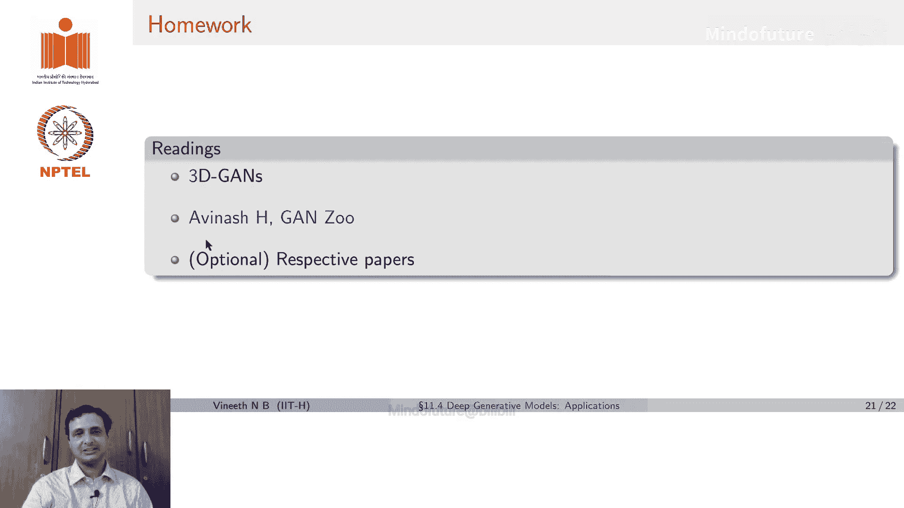

# 071：深度生成模型 - 图像应用

在本节课中，我们将学习生成对抗网络（GANs）和生成模型在图像与视频领域的几个应用。我们将尝试涵盖GANs在不同领域的简单应用，以及这些生成模型的一些变体。

在开始之前，我们先回顾上一讲遗留的问题：为什么在解耦度量中使用的是互信息间隙，而不仅仅是互信息？希望你已经尝试寻找答案。互信息间隙旨在惩罚未对齐的潜在变量，因为我们关注的是与某个生成因子具有最高互信息的两个潜在变量之间的差距。因此，如果一个生成因子是两个潜在变量的组合，这将在互信息间隙中被惩罚，我们会得到一个0或较低的值，表明解耦程度较差。另一个原因是，如果一个潜在变量已经建模了一个生成因子，我们就不需要其他潜在变量来建模同一个因子。如果发生这种情况，我们希望表明解耦程度较差。这也说明了为什么需要定义“间隙”，而不仅仅是使用与生成因子相关的最高潜在变量的互信息。更多细节请参阅《Isolating Sources of Disentanglement in VAEs》论文，如果你感兴趣或需要更多信息，请阅读它。

现在，让我们来看一些GANs的应用。

## 🖼️ 图像编辑

简单的图像编辑，如将图像转为灰度或调整亮度/对比度，不需要理解图像内部的语义。然而，如果我们想处理一张人脸图像，例如将头发变黑、添加刘海、添加微笑或改变性别，就需要理解图像中的语义内容。GANs能帮上忙吗？有可能。然而，GANs没有固有的机制将图像映射到其潜在表示。我们之前看到VAEs可以做到，但正如在VAEs课程中讨论的，VAEs有时会存在重建问题。那么，如何使用GANs来实现类似功能呢？

这在一个名为**可逆条件GAN**的GAN变体中提出，发表于ECCV 2016研讨会，称为**IC-GAN**。IC-GAN通过以下架构实现目标：

它是一个条件GAN，与我们本周早些时候看到的跨域GANs非常相似。但现在，架构中还有一个编码器，可以将图像编码为其潜在属性。整体架构如下：有两个编码器，一个编码器给出图像的潜在表示`z`，另一个编码器给出图像的属性`y`。为了生成具有不同属性的新图像，你将图像通过编码器，得到一个属性向量`y`，然后改变其属性（例如，将黑发从0改为1，将棕发从1改为0），现在你就得到了具有黑发的同一张图像。

那么，这实际上是如何工作的呢？生成器`G`从潜在表示`z`和一些条件信息`y`中采样生成图像`x'`，即 `x' = G(z, y)`。编码器执行逆操作：给定图像`X`，它输出`z`和`y`。如何训练这样的模型？其总体目标与我们之前看到的条件GANs相似，类似于跨域GANs的课程内容。

因此，我们有一个图像`X`和属性`Y`的对数似然，我们希望最大化训练数据中给定的这个似然。同时，我们也关注GAN的第二个目标：判别器`D`查看由生成器生成的元组`(x_hat, y_hat)`，并判断其是真实的还是伪造的。这与我们尝试从文本生成图像的条件GAN类似。

这里的编码器有两个部分：`E_z`和`E_y`，分别对应潜在表示和属性。为了训练`E_z`编码器，首先训练生成器，然后使用生成器生成一个图像数据集。现在我们有了图像及其对应潜在表示的数据对，这些数据对通过生成器的性能获得，现在被用来训练编码器。因此，我们有生成图像`G(z, y_hat)`和用于生成该图像的对应`z`。现在，通过最小化这两者之间的L2范数或均方误差来训练`E_z`编码器。另一个编码器`E_y`则使用数据本身进行训练。我们假设训练数据包含数据和属性。因此，现在将`y`视为数据集中提供的属性，`E_y(x)`是预测的属性，通过最小化这两者之间的均方误差来训练`E_y`。

以下是在一个名为**CelebA**的流行数据集上的一些结果。你可以看到原始图像，以及通过改变多个属性后得到的相当逼真的多个重建/生成图像，例如秃顶、添加刘海、黑发、金发、眼镜、更多妆容、性别改变、苍白皮肤、微笑等。

## 🔍 超分辨率

GANs的另一个应用是**超分辨率**任务。我们之前在CNNs的背景下也讨论过这个问题，现在重新审视一下。图像超分辨率是从低分辨率图像获取高分辨率图像的任务，这可能是一个具有挑战性的任务，因为你必须填充原本不存在的信息。

**SRGAN**（超分辨率GAN）旨在生成具有高达4倍放大倍率的逼真图像。即使是CNNs也可以通过反卷积或在编码器-解码器架构的第二阶段进行上采样来用于超分辨率。在这些架构中，损失函数最小化生成输出与真实高分辨率地面实况图像之间的均方误差。由于对所有像素取平均的效果，均方误差可能导致输出图像过度平滑。因此，由于尝试计算均方误差，它可能不会尝试使特定像素更锐利，而这对于超分辨率可能很重要。GANs通过使用对抗性损失，将输出推向更接近自然图像流形，从而有助于获得高质量的超分辨率图像。

SRGAN是如何训练的？SRGAN有几个组成部分。其中一个损失被称为**内容损失**。内容损失最小化生成器输出`G_theta_G`与真实高分辨率图像之间的均方误差。但它不是测量图像本身之间的均方误差，而是最小化这两个图像特征表示之间的均方误差。是什么特征呢？这两个图像都通过一个**VGG19**网络。取VGG19网络中某个卷积层输出的特征表示，并考虑这些表示之间的均方误差作为损失函数来训练SRGAN。在这个特定情况下，`Phi_{I,j}`对应于在第`i`个最大池化层之前的第`j`个卷积层获得的特征图，`W_{I,j}`和`H_{I,j}`分别是用于归一化的特征图的宽度和高度。

用于训练SRGAN的第二个损失是标准的对抗性损失，它着眼于欺骗判别器，类似于我们迄今为止看到的其他所有GAN。用于训练SRGAN的最终损失是内容损失和对抗性损失的加权和。在这个特定案例中，研究表明，对抗性损失可以通过一个较小的权重（在他们的案例中是`10^{-3}`）来获得良好的超分辨率性能。

使用这种损失，以下是一些示例结果。你可以看到图像的双三次插值结果、使用超分辨率CNN（如SRCNN）的结果，以及使用GAN生成的图像，与原始图像相比，后者清晰得多。更多自然场景的图像对比：双三次插值、使用SRCNN和SRGAN的结果，以及最终的高分辨率原始图片。你可以看到，SRGAN在局部细节上比超分辨率CNN清晰得多，也比双三次插值好得多。

## 🧊 3D物体生成

第三个应用是用于**3D物体生成**的GANs。到目前为止，我们已经看到GANs生成2D图像。GANs也能生成3D物体吗？相当直接。近年来，随着3D CNNs和体积卷积网络的进步，学习3D物体表示已成为可能。因此，生成器中的层现在必须生成一个体积，所以只要你能替换这些层，你就可以通过GAN框架生成任何物体。

在这个特定示例中，这项工作发表于NIPS 2016。**3D-GAN**的工作方式是：生成器`G`将一个长度为200的潜在向量映射到一个`64 x 64 x 64`的立方体，该立方体表示3D体素空间中的物体`G(z)`。判别器`D`则分类该物体是真实的还是合成的。因此，只有生成器中的架构与标准GAN不同。损失函数是标准GAN损失。这是通过改变生成器架构以处理3D体积，将GANs直接应用于3D物体的一个例子。

使用这种损失，当GAN被训练来生成3D物体时，你会得到相当好的各种3D物体生成结果，正如你在本幻灯片上看到的那样。

## 🎨 图像修复

我们将看到的最后一个应用是用于**图像修复**的GANs。图像修复是一项任务，其中图像的一部分缺失，而GAN的工作是填充图像中缺失的部分。GAN能被训练来执行图像修复吗？答案是肯定的。为此提出的一种方法称为**PG-GAN**，它使用一个标准的GAN框架，其中生成器是一个残差网络，它以部分缺失的图像作为输入，生成相同分辨率的图像。判别器分为两部分：一个**全局判别器**和一个**局部（Patch）判别器**。全局判别器在全局或图像级别进行推理，以决定图像是真实的还是伪造的。而局部GAN判别器在局部级别、块级别进行推理，以决定图像是真实的还是伪造的。因此，局部判别器有助于捕捉局部纹理细节并填充图像中那些缺失的间隙。

损失函数是什么？有一个**重建损失**，它测量生成图像与地面实况之间的逐像素L1距离。还有一个**对抗性损失**，其中对抗性损失分为两部分：一部分用于全局GAN，一部分用于局部GAN。总体目标是重建损失、全局GAN的对抗性损失和局部GAN的对抗性损失三者的组合。

通过这种训练过程和架构，以下是一些图像修复的结果，当从图像中取出一块时，GAN能够相当真实地重建那些部分。你可以在这里看到许多例子，其中可能有一些伪影，但GAN生成的内容仍然相当逼真。以下是建筑立面的更多结果，同样，GAN以逼真的方式填充信息。

关于这些应用的更多信息，请参阅3D GANs的链接，以及一个名为“GAN Zoo”的非常好的链接，它概述了可用于不同应用的各种GANs。

🎼 参考文献。