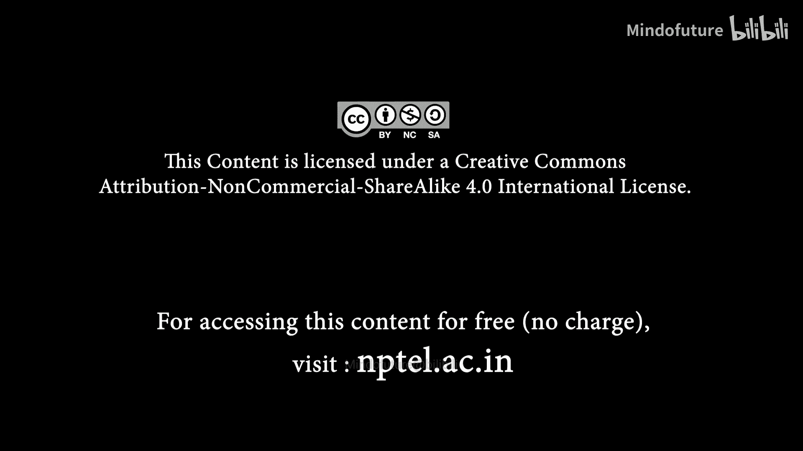
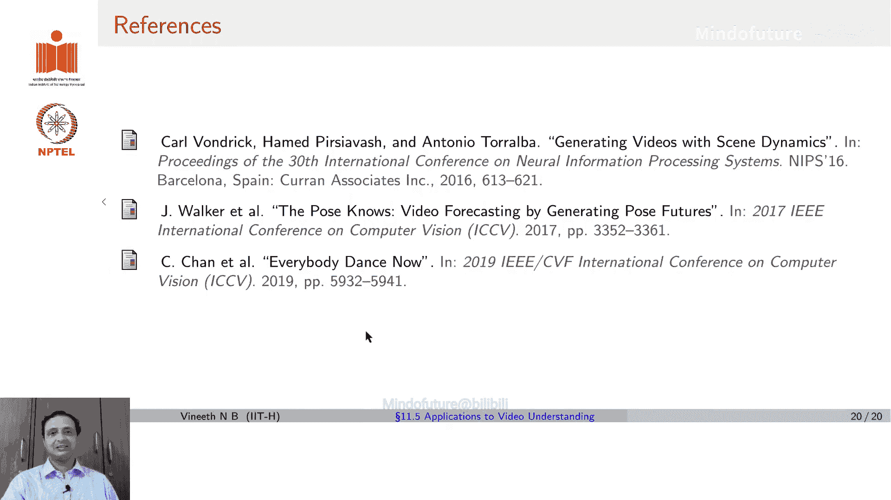

# 072：深度生成模型在视频中的应用 🎬

在本节课中，我们将探讨生成模型在视频理解领域的应用。我们将介绍三种不同的方法，它们分别解决了视频生成、视频预测和舞蹈动作迁移等任务。通过学习这些方法，你将了解如何将生成对抗网络和变分自编码器等模型应用于动态的视觉数据。

---

## 生成视频：场景动态生成法 🎥

上一节我们介绍了生成模型的基本概念，本节中我们来看看如何将其应用于视频生成。一个核心问题是：我们能否使用GAN来生成视频？答案是肯定的。视频本质上也是一种三维数据（空间+时间），因此可以借鉴3D物体生成的思路。

一种名为“Generating Videos with Scene Dynamics”的方法对此进行了独特改进。其生成器的输出由以下公式定义：

**输出 = M(Z) ⊙ F(Z) + (1 - M(Z)) ⊙ B(Z)**

其中：
*   **Z** 是输入生成器的潜在向量。
*   **F(Z)** 代表**前景**（动态部分）。
*   **B(Z)** 代表**背景**（静态部分）。
*   **M(Z)** 是一个**掩码**，指示每个像素应使用前景还是背景。

以下是该生成器架构的工作流程：

1.  一个100维的噪声向量被输入到两个分支。
2.  **前景流**：生成一个三维体积（视频序列），并在最后分叉为前景视频和对应的像素级掩码。
3.  **背景流**：生成一个静态的背景图像。
4.  最终，通过掩码将前景和背景逐像素融合，生成完整的视频。

判别器部分则采用标准的GAN架构，对生成的视频进行下采样，并通过一个二元分类器判断其真伪。损失函数与标准GAN相同。

通过这种方法，模型能够学习并生成具有动态前景和静态背景的视频。例如，它可以生成海浪退去或物体在固定场景中移动的短视频。

---

## 视频预测：基于姿态的预测法 🔮

上一节我们学习了如何生成全新的视频，本节中我们来看看一个相关的任务：**视频预测**。给定一段视频的前几帧，预测接下来的帧。直接使用GAN在像素空间生成未来帧可能导致结果模糊或结构不合理。

“Pose Nose”方法提出了一种解决方案：先在更高层次的抽象（**人体姿态**）上进行预测，再利用预测的姿态作为条件信息来生成像素级的视频帧。这相当于将问题分解为两步：

1.  **姿态预测**：使用一个**变分自编码器**来预测未来帧中人物的姿态序列。
2.  **视频生成**：将预测的姿态作为条件，输入到一个**条件生成对抗网络**中，生成具体的未来视频帧。

以下是姿态预测VAE的工作细节：

*   **编码器**：接收当前帧的图像特征、历史姿态序列（P1...Pt）以及历史姿态关节点的速度（Y1...Yt）。
*   **解码器**：接收编码器的隐藏状态Ht，并尝试以逆序重建姿态速度（Yt...Y1）。
*   训练完成后，使用**未来解码器**。它接收过去的隐藏状态Ht，并从先验分布中采样，以预测未来的姿态速度（Yt+1...YT），从而得到未来姿态。

在视频生成阶段，GAN的生成器以历史视频帧和预测的未来姿态为输入，生成未来的视频帧。其损失函数包含两部分：

1.  **对抗损失**：使判别器难以区分生成帧和真实未来帧。
2.  **L1重建损失**：最小化生成帧与真实未来帧在像素上的差异。

这种方法能够生成相对合理的未来帧，例如预测滑雪者的下一个动作位置。

---

## 舞蹈动作迁移：人人皆可舞法 💃

前面我们讨论了视频生成和预测，本节中我们来看一个有趣的应用：**舞蹈动作迁移**。“Everybody Dance Now”方法的目标是：给定一段专业舞者的视频和一段业余者的视频，生成一段业余者跳出专业舞步的视频。

该框架包含几个关键模块，以下是核心部分：

1.  **时序一致性GAN**：确保生成的视频帧之间过渡自然。
    *   判别器的任务不再是区分“真/假”，而是判断连续两帧是否“时序连贯”。
    *   损失函数鼓励生成的连续帧（G(Xt), G(Xt+1)）与真实的连续帧（Yt, Yt+1）具有相似的时序特性。

2.  **姿态归一化与视频生成**：
    *   提取专业舞者的姿态序列（X1‘...XT’）。
    *   将这些姿态**归一化**到目标人物（业余者）的肢体比例上，得到（X1...XT）。
    *   使用预训练好的生成器（来自模块1），根据归一化后的姿态生成目标人物的视频帧。

3.  **面部细化GAN**：由于动作迁移可能导致面部细节失真，此模块专门用于增强生成人脸的清晰度和真实感。
    *   从生成的帧中裁剪出面部区域。
    *   使用另一个GAN来学习一个**残差图**，将其加到原始生成的面部上，以添加细节。
    *   损失函数同样包含对抗损失和感知损失。

整个训练过程分阶段进行：先训练主生成器（阶段一），冻结其权重后训练面部细化GAN（阶段二），然后交替微调。该方法能成功地将一个人的舞蹈动作转移到不同体型、性别和背景的另一个人身上，实现有趣的“同步舞蹈”效果。

---

## 总结与思考 🧠

本节课中我们一起学习了生成模型在视频领域的三种应用：
1.  **场景动态生成法**：通过分离前景和背景，使用GAN生成具有动态内容的短视频。
2.  **基于姿态的视频预测法**：利用VAE预测高层姿态，再用条件GAN生成像素帧，实现未来帧预测。
3.  **舞蹈动作迁移法**：通过时序一致性约束、姿态归一化和面部细化，实现跨人物的舞蹈动作迁移。

这些方法展示了如何将生成模型的强大能力与视频数据的时空特性相结合。最后留给你一个思考题：我们能否从**单张图片**生成一段视频？这将是生成模型另一个充满挑战和机遇的方向。