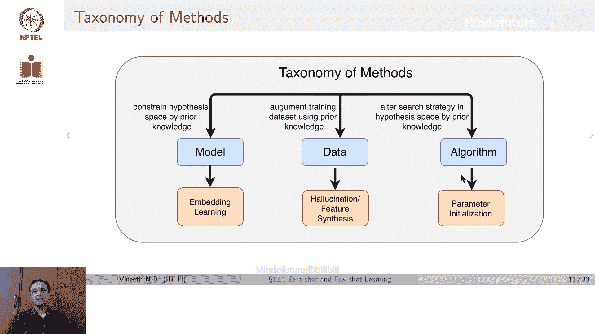

# 073：少样本和零样本学习 - 第一部分

在本系列课程的最后一周，我们将讨论一些与计算机视觉深度学习相关的高级主题。我们将从一个当代主题——零样本和少样本学习——开始。

在继续之前，我们先回顾一下上一讲留下的一个问题。在上一讲关于深度生成模型在视频理解中的应用中，我们看到了使用视频作为输入来生成视频的方法。留下的问题是：**能否从单张图像生成视频？** 你可能已经猜到了答案，答案是肯定的。我们现在不讨论具体方法，但你可以查看本幻灯片链接的文章及其相关论文。实现这一点的核心思想是通过一种称为**单样本学习**的方法。我们使用单个实例（在我们的案例中是一张图像），网络学习生成完整的视频。有趣的是，单样本学习是少样本学习的一种特定设置，也是本讲的重点，这为我们即将讨论的内容提供了一个很好的过渡。更多细节，请查阅相关文章以了解如何从单张图像生成视频。

## 概述

在本节课中，我们将学习少样本和零样本学习的基本概念、问题定义以及解决这些挑战的三大核心思路。深度学习模型在训练时严重依赖大量标注数据，这是它们表现出色的原因之一，但也是其主要局限之一。如果只有少量样本可供学习，深度学习模型可能无法提供良好的模型和预测性能。正则化方法在一定程度上用于避免低数据情况下的过拟合，但它们并不能在数据稀缺时提供良好性能。那么，我们该怎么办？解决方案是训练能够仅凭少量样本甚至没有样本就能快速泛化到新任务的模型，这正是本节课的重点。我们的目标是使模型能够在数据标注不可行、成本高昂或新类别随时间增加的现实场景中有效工作。

## 问题定义

上一节我们介绍了课程概述，本节中我们来看看少样本和零样本学习的具体问题定义。

这个问题的设置被称为**少样本学习**或**零样本学习**。让我们首先回顾一下这两者的形式化定义。

假设 **x** 是一张图像或一个特征（例如，通过VGG或ResNet网络提取的特征），**y** 表示该数据点的类别标签。

**少样本学习**的形式化定义如下：
*   训练数据 **D_train** 由 **(x_i, y_i)** 元组组成，总共有 **I** 个元组。
*   对于某些类别，只有很少的训练样本。
*   少样本学习也常被描述为 **N-way K-shot** 设置，其中总共有 **C** 个类别。对于 **N** 个类别（N < C），每个类别只有 **K** 个样本，而对于其余类别，则拥有大量样本。这些拥有大量样本的类别也被称为**基类**。

**零样本学习**则是当“少样本”变为“零样本”时的情况。这意味着：
*   训练数据包含 **(x, y)**，但现在我们希望分类器能够对训练集中从未出现过的类别（即零样本类别）的数据点进行分类。
*   对于这些零样本类别，完全没有标注数据。
*   因此，训练数据由 **x**、**y** 以及每个类别 **y** 相关的属性 **a(y)** 组成。这些属性可以是文本描述或一组特征（例如，对于动物，是否有尾巴、四条腿、鬃毛等）。我们将 **a(y)** 视为即使数据不可用也能提供的元数据。
*   在测试时，输入 **x** 来自未见过的类别 **x_U**，**y** 是对应的标签，**a(y)** 是对应的属性。关键点在于，未见类别 **Y_U** 与已见类别 **Y_S** 的交集为空。

## 学习设置分类

在少样本和零样本学习内部，还有两种进一步的分类方式。

**1. 传统少样本/零样本学习**
*   目标：学习一个分类器 **F**。
*   测试时，待识别的图像或特征 **x** 仅来自未见类别或少样本类别，而不来自基类或已见类别。
*   这是该领域早期（约四五年前）方法采用的设置。

**2. 广义少样本/零样本学习**
*   目标：学习一个分类器 **F**。
*   测试时，待识别的图像或特征 **x** 可能属于已见/未见类别或基类/少样本类别中的任何一类。
*   显然，广义设置更具挑战性，也更有用，因为在现实世界中，你无法预测测试图像只会来自未见类别或少样本类别。

## 理论基础：泛化误差分析

上一节我们明确了问题定义，本节中我们深入探讨其背后的理论基础，以理解为何数据稀缺会带来挑战。

让我们回顾监督机器学习的一个基本原则：**经验风险最小化**。

如果 **P(x, y)** 是输入 **x** 和输出 **y** 的真实联合概率分布，监督学习的目标是：给定一个假设（模型）**h**，最小化相对于该联合分布的期望风险或损失。期望风险 **R(h)** 定义为损失函数 **L** 在联合分布上的积分（或期望）：
`R(h) = ∫ L(h(x), y) dP(x, y) = E[L(h(x), y)]`

然而，在现实世界中，我们无法估计真实的联合概率分布 **P(x, y)**。因此，这个期望被近似为相对于我们拥有的训练数据的**经验风险**：
`R_emp(h) = (1/I) * Σ_{i=1}^{I} L(h(x_i), y_i)`

现在，假设我们有一个模型族 **H**（例如，所有线性模型）。我们定义三个函数：
*   **h***：在模型族 **H** 中，能最小化期望风险 **R(h)** 的最佳函数。
*   **h_cap**：在所有可能的模型中，能最小化期望风险 **R(h)** 的全局最优函数（真实函数）。
*   **h_I**：在模型族 **H** 中，通过最小化经验风险 **R_emp(h)** 得到的函数（即我们实际训练出的模型）。

我们模型 **h_I** 与全局最优模型 **h_cap** 之间的泛化差距可以分解为两部分：
`R(h_I) - R(h_cap) = [R(h_I) - R(h*)] + [R(h*) - R(h_cap)]`

*   **第一部分 [R(h_I) - R(h*)]**：称为**估计误差**。它衡量了由于使用有限训练数据（经验风险最小化）而非真实分布（期望风险最小化）而导致的，在模型族 **H** 内部最优解 **h*** 附近的偏差。
*   **第二部分 [R(h*) - R(h_cap)]**：称为**近似误差**。它衡量了由于我们选择的模型族 **H** 的局限性，其内部最佳模型 **h*** 与全局最优模型 **h_cap** 之间的差距。

为什么现在讨论这个？在少样本和零样本学习中，我们面临的核心问题是数据不足。这直接影响了**估计误差**。当你有大量标注数据时，经验风险最小化器 **h_I** 会非常接近模型族内的最佳期望风险最小化器 **h***。然而，在少样本/零样本设置下，对于某些类别，我们没有足够的训练数据，因此 **h_I** 可能远离 **h***，导致模型**过拟合**训练数据，泛化性能差。

## 解决思路

上一节我们分析了数据稀缺导致泛化误差增大的原因，本节中我们来看看解决这一问题的三大核心思路。

我们可以从三个不同角度来解决这个问题：**数据**、**模型**和**算法**。

**1. 数据角度：扩充训练数据**
*   思路：简单地增加训练样本数量，从 **I** 增加到远大于 **I** 的 **Ĩ**。
*   作用：这有助于获得对经验风险最小化器更好的估计。通过利用先验知识（如数据增强、合成数据），我们可以将训练得到的模型 **h_I** 推向更接近理想模型 **h*** 的位置。

**2. 模型角度：约束假设空间**
*   思路：利用先验知识或领域理解，将模型族 **H** 约束到一个更小的、更合理的子空间。
*   作用：限制模型的复杂度，使得即使只有少量训练数据，也足以在这个较小的假设空间内训练出一个可靠的、接近 **h*** 的模型 **h_I**。

**3. 算法角度：改变搜索策略**
*   思路：利用先验知识来改变在假设空间 **H** 中搜索最佳参数 **θ** 的策略。
*   作用：这可以包括提供更好的参数初始化点，或者改变优化算法本身。一个好的起点可以帮助算法更快、更稳定地收敛到一个更优的模型 **h_I**。

这三种方法都是解决少样本/零样本学习问题的有效途径。

## 方法分类

基于上述三大思路，少样本和零样本学习方法可以大致分为三类：

以下是基于不同解决思路的方法分类：

1.  **嵌入学习方法**：对应**模型角度**。通过先验知识约束假设空间，学习将图像和类别（或其属性）映射到共享的嵌入空间，在该空间中进行比较和分类。
2.  **幻觉/特征合成方法**：对应**数据角度**。通过先验知识扩充训练数据，例如，根据类别属性合成少样本或零样本类别的特征或图像。
3.  **参数初始化方法**：对应**算法角度**。利用先验知识改变搜索策略，例如，设计元学习算法，学习如何快速将模型参数初始化为适合新任务的状态。

在接下来的课程中，我们将详细探讨每一类方法。

## 总结

本节课中，我们一起学习了少样本和零样本学习的基础知识。我们首先明确了问题定义，区分了少样本学习、零样本学习以及传统与广义设置。接着，我们从经验风险最小化的角度分析了数据稀缺导致模型泛化能力下降的根本原因——估计误差增大。最后，我们介绍了解决这一挑战的三大核心思路：从数据角度扩充样本、从模型角度约束假设空间、以及从算法角度优化搜索策略，并对应地概述了嵌入学习、特征合成和参数初始化这三类主流方法。在下一讲中，我们将深入每一类方法的具体实现。

