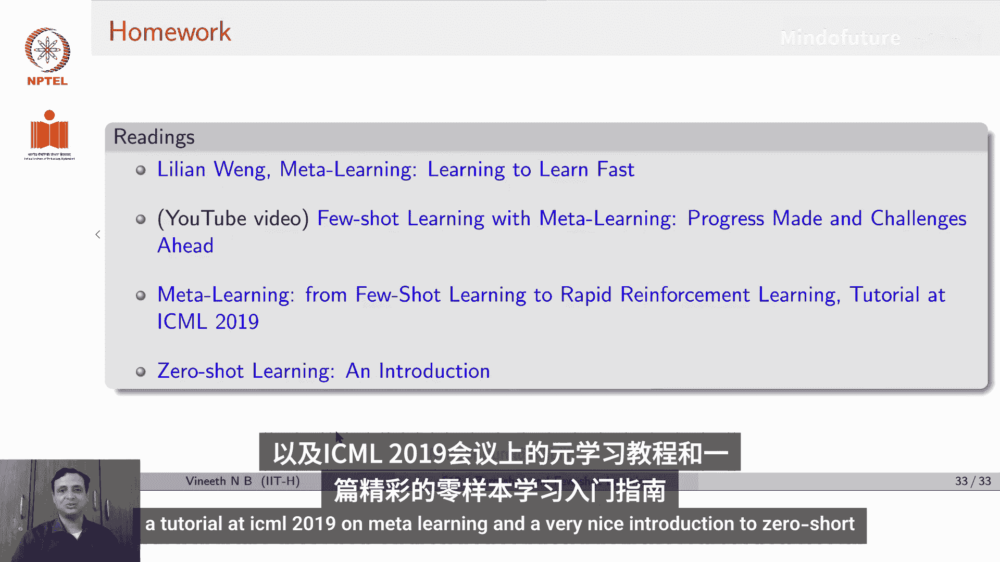

# 074：少样本与零样本学习 - 第二部分

## 概述
在本节课中，我们将学习解决少样本和零样本学习问题的三类核心方法：嵌入学习方法、数据生成方法和参数初始化方法。我们将了解每种方法背后的关键思想、工作原理以及它们如何帮助模型在数据稀缺的情况下进行学习。

---

## 嵌入学习方法：学习“比较”

上一节我们介绍了少样本和零样本学习的基本概念。本节中，我们来看看第一类方法——嵌入学习方法，也称为基于模型的方法。

这类方法的核心直觉是通过学习“比较”来解决少样本学习问题。如果一个模型能够判断两张图像的相似性，或者判断类标签语义的相似性（这在零样本学习中需要），那么它就可以通过与训练时见过的标记实例进行比较或关联，来对未见过的输入进行分类。

总体思路是学习独立的嵌入函数。在此上下文中，嵌入函数是神经网络对训练样本和测试样本的输出表示。这些比较模型使用一种称为“元学习”的方法进行端到端训练。在测试时，预测是基于比较测试样本特征与每个类别的训练集特征之间的距离做出的。

以下是整体示意图：你有一个少样本训练集 D_train 和一个测试样本 P_test。你为训练集学习一个嵌入 G，为测试样本学习一个嵌入 F，然后计算相似度以对目标类别标签做出最终预测。

### 什么是元学习？
元学习被称为“学会学习”。如果我们考虑少样本学习的 N-way K-shot 设置（总共有 N 个类别，每个类别只有 K 个示例），在元学习中，每个“情节”都有一组不同的训练类别和一组测试示例。这些训练类别可能并非完整训练数据中的所有类别，而是从数据中随机采样的一部分类别。该情节的目标是训练一个“学习者”，使其能够基于这个训练集对该测试集进行预测。这就完成了一个元学习情节，输出一个学习者。在第二个元学习情节中，再次采样一组不同的类别形成训练数据集，并有一个测试集，元学习者再次优化学习者以解决该情节中的问题。这个过程在多个情节中重复，每个情节可能采样不同的训练类别集合。在元测试时，你最终拥有希望部署最终模型的训练类别和测试样本设置。这里的元训练和元测试情节中的类别是不相交的，目标是你已经学会了“学习一个模型”的方法。

另一种理解方式是：在经典的机器学习算法设置中，你有一个训练集，学习一个具有特定数量参数的模型，目标是在测试集上获得良好性能。在元学习中，你有一个元训练集，它有自己的训练和测试分割，对应一个元学习情节。你学习一组元参数 θ，用于在新的元测试集上训练学习者。元学习者知道如何为元测试情节中出现的训练类别集合生成模型，以解决这些测试样本。

### 匹配网络：一个具体例子
让我们看一个元学习思想的具体例子。这被称为“匹配网络”，是 2016 年 NeurIPS 上发表的一种方法。匹配网络的前提是结合参数模型和非参数模型。参数模型从训练样本中缓慢学习模型参数，理想情况下需要大数据集以避免过拟合。不幸的是，在我们讨论的少样本和零样本设置中，可能没有大数据集。另一方面，像 K 近邻这样的非参数模型允许快速吸收新样本，并且对一种称为“灾难性遗忘”的现象具有鲁棒性。灾难性遗忘是指：如果一个模型在一组类别上训练（例如在 MNIST 的 0-6 类上训练），当你在稍后出现的 7 和 8 类上训练或微调模型时，模型可能会忘记 0 或 1 的样子。神经网络模型已知容易受到这种现象的影响。非参数模型则自动对此类现象具有鲁棒性。

在匹配网络方法中，提出结合两者的优点。在训练阶段，你学习基于余弦相似度的嵌入模型。你有一个样本集 S（像一个元学习情节中的训练集）和一个查询样本 Q（像该情节中的测试集）。你学习嵌入函数 F，为训练集和测试集生成相应的嵌入。然后使用余弦距离来衡量相似度。在测试时，一旦获得这些嵌入，就使用基于余弦距离的最近邻方法来分类测试样本。

以下是匹配网络中使用的架构。在一个元学习情节中，你有一组来自给定训练类别的样本，以及该情节中的一个测试样本。这些训练样本作为序列输入给一个 LSTM，LSTM 为每个输入训练样本输出一个表示。你同时获得测试样本的表示。然后，一个比较模块查看测试样本与每个训练样本之间的相似性。该比较在公式中给出为 a(X_hat, X_i)，其中 X_i 是不同的训练样本。在这个方法中，a 函数的计算非常简单：取测试图像嵌入 h(X_hat) 与每个训练图像嵌入 g(X_i) 之间的余弦相似度，然后对这些余弦相似度进行 softmax 操作，得到一个分布，显示测试样本最接近哪个训练样本，将其与类别标签相乘就得到测试样本的最终类别标签预测。这里的一个细节是，LSTM 是双向的。这是因为我们不希望 LSTM 依赖于作为输入给出的训练样本序列。通过双向（前向和反向）处理，试图抵消对序列的依赖。

### 关系网络：一个改进想法
一个改进的想法被称为“关系网络”，发表于 2018 年 CVPR。在这种方法中，作者质疑使用余弦嵌入的做法。相反，该方法提出训练和学习一个数据驱动的非线性度量，而不是使用余弦距离度量。这使得模型能够提取数据样本之间复杂的非线性关系，从而更好地泛化到新类别。事实上，关系网络也容易扩展到更具挑战性的零样本设置，其中未见类别没有任何样本。

以下是整体示意图。你仍然有 S 和 Q，即训练样本和查询样本。它们经过一个学习的嵌入函数 F_φ（该网络的参数）。现在，你取属于一个类别的一组样本的类别均值 μ，并将查询样本与该类别的均值表示进行比较。如何比较？这种比较也是由模型学习的，而不是使用余弦距离。因此，在训练阶段，你元学习嵌入模块 F 和关系模块（学习表示之间关系或距离度量的模块）。在测试阶段，给定查询样本，你使用在嵌入空间中对每个训练类别均值的“关系分数”来最终预测查询样本的类别。

以下是整体架构。在给定的元学习情节中，你有训练集和作为单独测试样本输入的查询样本。所有这些都经过相同的嵌入模块 f_φ，得到相应的特征图。与匹配网络不同，关系网络将这些特征图连接起来。黄色条对应 x_j 的特征，其他颜色的条是训练集中每个其他 x_i 的特征。连接后，将其馈送到关系模块 G（其参数也是学习的），最终为 x_j 与每个 x_i 之间的相似性产生一个标量分数，给出为一个关系分数向量，最后通过对关系分数进行 softmax 或 argmax 操作，可以预测出最终的 one-hot 向量。

这个网络如何训练？关系分数 R_ij 对训练网络至关重要。损失函数由参数集上的求和给出：`(R_ij - 1(y_i == y_j))^2`。这意味着，每当查询样本的标签 y_i 与训练样本的标签 y_j 匹配时，我们希望 R_ij 为 1（因为相似度高）；当标签不匹配时，R_ij 将被强制小于 1。

这如何用于少样本或零样本学习？在少样本学习场景中，我们所描述的正是所做的：你对嵌入模块进行逐元素求和以获得类别特征图，将类别特征图与查询特征图结合（我们刚谈过连接），然后获得关系分数以最终得到预测标签。对于零样本，因为你可能对某些类别没有任何样本，所以需要所谓的语义类别嵌入。你可以获得关于类别的元信息，可以是一组属性、类别标签的任何其他文本描述，或者直接取类别标签本身的词向量表示。现在，连接和嵌入操作符比较类别标签的嵌入与每个训练样本的嵌入，用于获得相似性并能够给出最终结果。

---

## 数据生成方法：学习“增强”

上一节我们介绍了基于“比较”的嵌入学习方法。本节中，我们来看看第二类方法——数据生成方法，也称为幻觉或特征合成方法。

这类方法的直觉是学习“增强”。我们看到了学习比较，现在我们讨论学习增强。在这里，我们学习一个生成模型来“幻觉”出新的、未见类别数据以进行数据增强。通过生成更多数据，我们将少样本或零样本学习问题简化为标准的监督学习问题。

如何做到这一点？一个标准方法是学习一个以某些元信息为条件的生成器，使用基础类别中的数据。然后，我们以未见类别的元信息为条件生成新类别特征。最后，我们在基础类别样本和生成的新类别样本上训练一个分类器。简而言之，在你的元学习情节中，你有一组训练样本和一个测试样本。使用一些元信息和训练样本本身，你训练一个生成模型，最终将其提供给一个分类器。当然，由于是生成模型，你可能有一个对抗性组件来判断生成的特征是真实的还是伪造的，但你也有一个分类组件来指示如何分类这些最终生成的特征。

### FCLS-WGAN：一个具体例子
这个领域的一个流行方法是 FCLS-WGAN。目标是：给定场景类别的训练集，我们学习一个条件生成器 G，它接收输入 Z（你给 GAN 的标准随机噪声）和对应于每个类别的类别嵌入。使用这些，生成器学习生成图像特征。我们这里不需要生成图像，因为我们的目标不是生成漂亮的图像，而是生成可以分类的图像表示，这使其成为一个更可行的问题。为了确保这种方法生成的特征是好的，还有一个判别器模块，它最小化生成特征上的分类损失。FCLS-WGAN 尝试以属于不同类别的某些属性为条件来生成图像特征。生成的是哪种图像特征？这些是标准图像在 CNN 模型上的输出特征。如果你使用 VGG 或 ResNet 作为 CNN，你会得到图像的某种表示。我们现在要求生成器 G 生成类似的向量特征，而不是生成图像。

如何将其扩展到少样本学习？这将是零样本学习的方法，其中某些类别没有样本，这就是为什么我们需要类别嵌入。然而，在少样本学习中，你已经有一些类别的样本，它们也可以用于帮助生成。因此，对于少样本，你可能不需要类别嵌入，而可能只使用噪声本身作为输入的生成器。当将这种方法扩展到少样本学习时，这样的 GAN 如何训练？该方法使用两个组件 CLS 和 WGAN，因此得名。WGAN 组件使用标准的 GAN 损失，但使用一种称为 WGAN 或 Wasserstein GAN 的变体，这是一种试图缓解 GAN 中模式崩溃问题的变体。此外，还有一个分类损失用于对生成的特征进行分类。在你的数据集中有一些图像，你有一个 CNN，其输出给出一些真实特征 x。另一方面，你的生成器接收噪声向量和一些类别信息，也生成一些图像特征 x_tilde。然后，判别器接收 x 和 x_tilde 以及条件信息（类别），并判断这些 x 和 x_tilde 是真实的还是伪造的。但还有另一个损失，它获取生成的特征并尝试将它们分类到你的类别全集中的某个类别。最终损失是 GAN 损失和分类损失的组合，使用系数 β 适当加权。

重复一下，为了训练分类器，你使用预训练的生成器，以类别嵌入为条件生成未见类别样本，分类器通常是一个 softmax 分类器，在训练集（给出 x）和生成的未见类别图像特征（x_tilde）上训练，两者一起用于训练此框架中的分类器模块。

---

## 参数初始化方法：学习“微调”

上一节我们介绍了基于“增强”的数据生成方法。现在，让我们转向第三类方法，即参数初始化方法，它们尝试使用先验知识来改变搜索策略。

这里的核心直觉是学习“微调”。我们看到了学习比较和学习增强，现在我们讨论通过学习微调来解决少样本问题。这意味着什么？我们学习一组元模型参数，这些参数对于所有类别（在此上下文中我们说“任务”，每个类别是一个任务）是通用的。我们学习一组可以应用于所有类别或任务的元参数，使得对于给定类别的极少样本，你可以微调那些元模型参数来学习该类别的参数。

以下是其工作原理的总体直觉或方法。对于每个元学习情节，你有 D_train 和 D_test。你更新一些任务特定参数 φ_i，以最小化该类别的总体参数损失。记住，你有一个 θ，这是一组总体模型参数，你用它初始化模型。然后你微调它，以解决当前元学习情节中仅一个特定类别的问题。然后，在给定元学习情节中的所有任务中，你现在更新元参数 θ，以最小化所有这些类别的损失。在测试时，如果你有来自某个少样本类别的几个样本，你已经学习了作为元模型参数的 θ，你现在可以使用这些少量样本微调 θ，以获得测试时该特定少样本类别的模型。

### MAML：模型无关元学习
这类方法中最流行的方法称为 MAML，代表“模型无关元学习”。多年来 MAML 有几个改进，但我们将讨论基本方法，其思想非常相似。任务特定参数 φ_i 通过优化获得。总体公式如下：记住，这类方法的目标是学习一个先验，使得模型能够轻松适应新任务。我们在此讨论少样本学习的背景，期望少样本类别有几个样本。这里的“先验”指的是良好的参数初始化，这正是 θ 或元模型参数试图实现的。

你的任务特定更新是：从初始化 θ 开始，在每个元学习情节中，更新任务特定参数 θ_i‘，其值为 `θ - α * ∇_θ L(θ, D_train_i)`，这为你提供了该元学习情节中特定类别的参数。一旦完成，θ 然后使用 `θ - β * ∇_θ Σ_i L(θ_i‘, D_test_i)` 更新。从视觉上看，正如我们在上一张幻灯片上解释的，你试图学习一个 θ，如果微调，可以轻松获得 θ_1*、θ_2* 和 θ_3*，这些是类别 1、2 和 3 的理想模型参数。因此，元模型参数指的是可以轻松微调的 θ。如果你观察任务特定更新和元更新，你会注意到，你现在可以用 `θ - α * ∇_θ L(θ, D_train_i)` 替换损失内部的 θ_i‘。当你这样代入时，你会看到 θ 等于 `θ - β * ∇_θ [ L(θ - α * ∇_θ L(θ, D_train_i), D_test_i) ]`。在某种意义上，这几乎等同于对 θ 进行二阶导数计算。然而，这提供了一种使用此元学习方法计算 θ 更新的高效有效方式。

以下是相同方法的算法视图。你随机初始化 θ。在给定的元学习情节中采样一组任务。对于该元学习情节中的任务，从每个类别中采样一组数据点（记住，这里的类别和任务含义相同）。你评估相对于每个类别的损失梯度，并更新任务特定参数 θ_i‘。然后，你为元更新从相同类别中采样一组数据点。然后，基于这些样本进行元更新，结合所有任务特定损失的梯度。每个任务在这里是一个类别，这给出了你的元模型参数更新，完成一个元学习情节。然后你重复此过程，取下一组任务。

### 扩展到零样本学习：Meta-ZSL
我们说过 MAML 用于少样本学习。这能用于零样本学习吗？一个更新的方法展示了如何做到这一点，这被称为 Meta-ZSL 或广义零样本学习的元学习。这里的想法是再次学习以类别属性为条件，然后使用与 MAML 相同的元学习框架进行训练，从而促进向新类别的泛化。

关键思想是使用元学习框架，其中每个情节都有一组训练类别和测试类别，但在每个情节中，它们将模拟零样本学习类型的设置。让我们看看这是如何完成的。有一个 GAN 与分类器模块耦合，这导致了三个元学习者：一个生成器 G（元学习者，学习元模型参数），一个判别器 D（也学习元模型参数），然后是一个分类器，检查生成特征的质量。你可以将其视为特征合成方法（用于进行零样本学习）和 MAML（用于实现基于元学习的方法）的组合。

让每个模块 D、G 和 C 的参数分别为 θ_D、θ_G 和 θ_C，我们将 θ_GC 表示为 θ_G 和 θ_C 的组合参数集。现在，学习是如何完成的？给定已见类别的图像和属性，通过 CNN 传递图像，你会得到一组图像特征 x 和相应的属性 a。然后，给定噪声和属性，要求生成器生成特征 x_tilde。给定 x_tilde 和 a，判别器尝试判断这是 0 还是 1（真实或伪造），然后你有一个分类器，它判断生成的特征是否属于特定类别。这类似于特征合成框架，但这里有一个关键组件，即元学习框架，这将其与 FCLS-WGAN 区分开来。

这是通过以下方式完成的：对于判别器，目标是最大化生成真实图像特征 x 和相应属性 a_c 的对数似然，并最小化生成图像特征和相应属性的对数似然。另一方面，生成器试图通过获取属性和噪声并生成 x_tilde 来欺骗判别器，我们希望判别器将其称为真实，并且你有分类损失。除了这个目标，你现在还有元学习情节。基本更新是：给定元模型参数 θ_D，你现在为元学习情节中的每个任务或类别获得 θ_D‘，与 MAML 非常相似。然后，在该元学习情节结束时执行元更新，结合该元学习情节中所有任务的损失，并更新 θ_D、θ_GC 等。因此，你将 FCLS-WGAN 置于元学习框架中，就得到了 Meta-ZSL。

一旦完成，推理的方式是使用学习到的生成器生成未见类别样本（假设你可以将未见类别的属性作为条件输入给生成器），得到 x_hat。一旦生成未见类别样本或其特征，你可以使用分类器，也可以训练任何其他分类器来预测零样本类别或所考虑问题中任何其他类别的类别标签。

---

## 总结
本节课中，我们一起学习了解决少样本和零样本学习问题的三类主要方法：
1.  **嵌入学习方法**：核心是“学习比较”，通过元学习训练模型，使其能够衡量样本或类别之间的相似性，例如匹配网络和关系网络。
2.  **数据生成方法**：核心是“学习增强”，通过生成模型（如 FCLS-WGAN）合成新类别的特征或数据，将问题转化为有充足数据的标准监督学习。
3.  **参数初始化方法**：核心是“学习微调”，通过元学习（如 MAML）获得一组良好的模型初始化参数，使得模型在面对新类别时，仅需少量样本进行微调即可快速适应，并可扩展至零样本学习（如 Meta-ZSL）。

这些方法各有侧重，共同为数据稀缺场景下的机器学习提供了强大的工具。