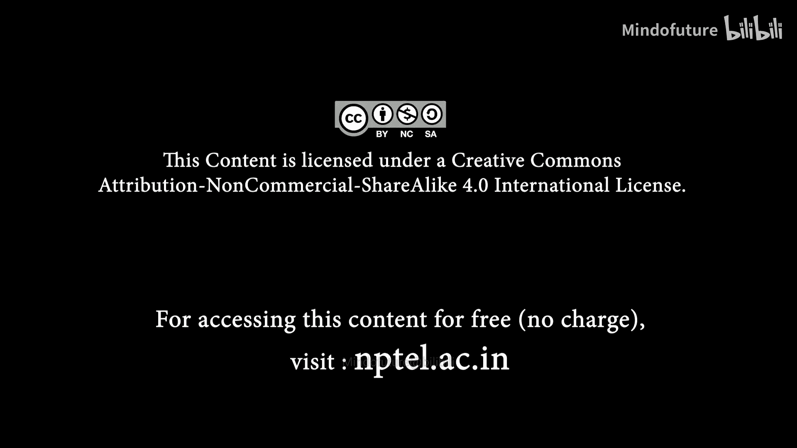
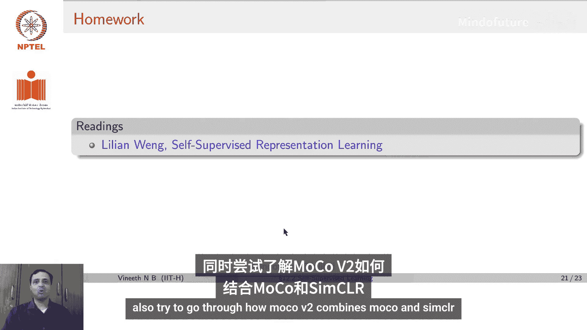

# 075：自监督学习 🧠



在本节课中，我们将学习一个当前非常热门的话题——自监督学习。我们将探讨其基本概念、动机以及几种核心的实现方法。

## 概述

上一节我们讨论了无监督学习的各种任务。本节中，我们将深入探讨自监督学习，这是一种特殊的无监督学习方法，它通过巧妙地从无标签数据中构造监督信号来学习有用的数据表示。

自监督学习是无监督学习的一种变体。其核心思想是：在没有显式标注或类别标签的情况下，利用数据本身来生成某种“标签”，从而在无标签数据上诱导出一个监督学习模型。具体来说，我们会设计一些被称为“前置任务”或“辅助任务”的监督任务，通过这些任务学习有意义的表示。这些学到的表示可以使模型更好地准备去解决下游任务，例如分类或语义分割。

## 为什么需要自监督学习？

我们知道，深度监督学习在拥有大量标注数据时效果很好。然而，现实世界中存在海量的无标签数据。如何利用这些数据？我们从人类学习中获得灵感：人类并非通过监督来学习一切，而是通过观察、预测和自我反馈来学习。自监督学习正是借鉴了这种自我反馈的学习范式。

## 常见的自监督前置任务

以下是几种在计算机视觉中流行的自监督前置任务示例。

### 1. 图像修复 🖼️

这个任务的目标是遮挡或移除图像的某一部分，然后要求网络完成图像。这不需要外部标签。例如，在2016年CVPR发表的Context Encoders工作中，研究者训练了一个编码器-解码器框架来填充图像的缺失部分。损失函数结合了**L2损失**和**对抗损失**，以生成更真实的修复结果。

**核心公式**：
总损失 = L2损失 + 对抗损失

### 2. 解决拼图游戏 🧩

这个任务的目标是教会模型理解图像由多个部分组成，并学习部分到对象及其空间排列的映射。具体做法是，将图像分成9个瓦片并打乱顺序，然后让神经网络预测正确的排列顺序。这是一个分类问题，使用**交叉熵损失**进行训练。

**核心代码逻辑**：
```python
# 假设有9个图像块，对应N种可能的排列
# 网络输出一个N维的概率分布
predicted_permutation_index = model(shuffled_patches)
loss = cross_entropy_loss(predicted_permutation_index, correct_permutation_index)
```

### 3. 预测旋转角度 🔄

给定一张图像，对其应用多种旋转（如0°，90°，180°，270°）。然后使用同一个CNN模型来预测所应用的旋转角度。这有助于网络学习图像特征。训练时使用标准的**交叉熵损失**。

**核心公式**：
设旋转操作函数为 **G**， CNN为 **F**。
模型输出：`p = F(G(image))`， 损失：`L = CrossEntropy(p, rotation_label)`

### 4. 图像着色 🎨

此任务的目标是获取灰度图像，并预测其彩色版本。假设数据集中已有彩色图像，我们将其转换为灰度图作为输入，让网络预测颜色。为了简化任务并得到更鲜艳的颜色，通常将输出颜色空间（如Lab空间中的a、b通道）量化为多个区间（例如313个），从而将回归问题转化为分类问题。

**核心思路**：
输入：灰度图（L通道）。
输出：量化后的颜色类别（a、b通道的组合）。
损失：分类交叉熵损失。

## 对比学习：近期主流方法

最近一年，自监督学习领域主要由基于**对比学习**的方法主导。其总体目标是通过对比正样本和负样本来学习表示。

### 核心思想

目标是学习一个编码器，使得图像与其**相似样本**之间的相似度得分，大于该图像与**不相似样本**之间的得分。如果没有类别标签，如何定义正负样本呢？这是对比学习方法需要解决的关键问题。

一个通用的损失函数形式如下（基于Softmax的对比损失）：

**核心公式**：
`L = -log( exp(sim(q, k+) / τ) / Σ_{i=0}^{K} exp(sim(q, k_i) / τ) )`
其中，`sim` 是相似度函数（如点积），`τ` 是温度超参数，用于调节分布的尖锐程度。

### 经典方法：MoCo

MoCo代表动量对比，它提出使用动态字典查找的思想进行视觉表示的无监督学习。它维护一个作为队列的字典，其中包含大量数据样本的编码表示（键）。查询样本通过一个编码器得到表示`q`，键样本通过一个**动量编码器**得到表示`k`。损失使用上述的对比损失。

**动量更新**：
动量编码器的参数 `θ_k` 通过以下方式更新：
`θ_k = m * θ_k + (1 - m) * θ_q`
其中 `θ_q` 是查询编码器的参数，`m` 是动量系数（通常接近1，如0.999）。

### 经典方法：SimCLR

SimCLR的目标是通过最大化同一数据样本的不同增强视图之间的一致性来学习表示。在一个小批量中，对每个样本应用两种不同的数据增强，产生一对正样本。该样本与批次内其他所有样本构成负样本对。它使用一个基础编码器网络 `F` 和一个投影头网络 `G` 来学习表示。

**优势与局限**：
SimCLR使用了强大的数据增强和MLP投影头，但负样本数量受限于批次大小。而MoCo通过字典队列可以包含更多负样本，通常能带来更好的性能。

### 前沿方法：BYOL

Bootstrap Your Own Latent 方法声称在不依赖任何负样本的情况下达到了最先进的结果。它通过“引导”网络自身的输出来创建目标。具体来说，它使用两个网络：在线网络和目标网络。在线网络的目标是预测目标网络对同一图像另一个增强版本的表示。损失是**L2损失**。

**核心流程**：
1.  对输入图像 `x` 应用两种随机增强，得到 `v` 和 `v‘`。
2.  `v` 通过在线网络得到表示 `y_θ` 和投影 `z_θ`。
3.  `v‘` 通过目标网络得到表示 `y_ξ’` 和投影 `z_ξ’`。
4.  在线网络还有一个预测器 `q_θ`，其目标是预测 `z_ξ’`。
5.  损失：`L = || q_θ(z_θ) - z_ξ’ ||_2^2`。
6.  目标网络的参数通过动量方式从在线网络更新。

## 总结

本节课我们一起学习了自监督学习。我们从其基本概念和动机出发，了解了它如何通过设计前置任务从无标签数据中学习有用表示。我们介绍了几种经典的前置任务，如图像修复、拼图、旋转预测和着色。接着，我们深入探讨了当前主流的对比学习方法，包括MoCo、SimCLR的核心思想及其区别。最后，我们简要了解了不依赖负样本的BYOL方法。自监督学习是释放海量无标签数据潜力的关键方向，对于推动深度学习发展具有重要意义。

---
**课后阅读建议**：
1.  阅读Lillian Weng关于自监督表示学习的优秀文章。
2.  了解MoCo V2是如何结合MoCo和SimCLR优点的。



**参考文献**：
*   Context Encoders (CVPR 2016)
*   Unsupervised Learning of Visual Representations by Solving Jigsaw Puzzles (ECCV 2016)
*   Unsupervised Representation Learning by Predicting Image Rotations (ICLR 2018)
*   Colorful Image Colorization (ECCV 2016)
*   Momentum Contrast for Unsupervised Visual Representation Learning (CVPR 2020)
*   A Simple Framework for Contrastive Learning of Visual Representations (ICML 2020)
*   Bootstrap Your Own Latent (NeurIPS 2020)