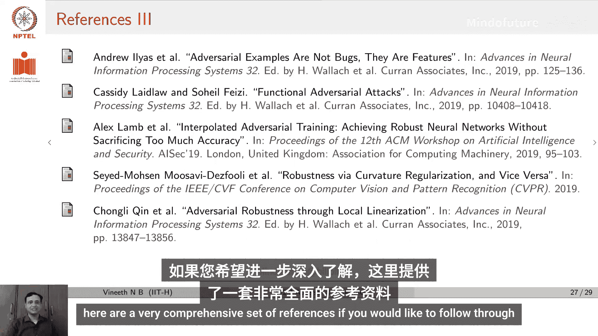

# 076：对抗鲁棒性 🛡️

在本节课中，我们将要学习一个当代的重要话题——对抗鲁棒性。我们将探讨为什么深度学习模型在面对精心设计的微小扰动时容易出错，了解不同类型的对抗攻击方法，并学习如何通过防御技术来增强模型的鲁棒性。

## 概述

在监督式机器学习中，我们部署模型的测试数据分布，常常与训练模型时的数据分布不同。不幸的是，每当出现这种分布偏移时，机器学习模型，尤其是深度学习模型，其性能往往会显著下降。其中，**对抗样本**是这种差异变得尤为突出的一个场景。

对抗样本与数据集中其他样本在视觉上难以区分，但却会导致模型做出错误的预测。例如，一张被模型以91%置信度识别为“猪”的图片，在添加了微小的随机噪声后，同一模型会以99%的置信度将其识别为“客机”。这是一个严重的问题，因为人类通常不会受此影响。虽然原因尚不完全清楚，但这一现象催生了大量关于**对抗攻击**（试图“黑”掉模型）和**对抗防御**（保护模型免受攻击）的研究。

## 对抗攻击的类型

上一节我们介绍了对抗样本的基本概念，本节中我们来看看对抗攻击的不同分类方式。根据攻击者掌握的信息、攻击目标以及衡量扰动大小的方式，对抗攻击可以分为多种类型。

以下是基于威胁模型的分类：

*   **白盒攻击**：攻击者假设可以访问模型的全部参数和架构。
*   **黑盒攻击**：攻击者无法访问模型内部参数，只能通过查询模型的输入输出来进行攻击。

以下是基于攻击目标的分类：

*   **非定向攻击**：攻击者的目标是使模型对输入样本产生**任何**错误分类。
*   **定向攻击**：攻击者的目标是使模型将输入样本错误分类为一个**特定的目标类别**。这在生物识别等领域可能带来严重的安全风险。

以下是基于距离度量的分类（用于约束扰动大小）：

*   **L0范数**：衡量干净图像与对抗图像之间**不同像素的数量**。
*   **L2范数**：衡量干净图像与对抗图像之间**像素值的均方根差**。
*   **L∞范数**：衡量干净图像与对抗图像之间**单个像素的最大变化值**。许多方法常用此范数。

## 白盒对抗攻击方法

了解了攻击的分类后，我们首先深入探讨几种经典的白盒攻击方法。这些方法假设攻击者完全了解模型。

### 快速梯度符号法

一种著名的白盒攻击方法是**快速梯度符号法**。这是一种单步方法，通过沿损失函数梯度的符号方向添加扰动来生成对抗样本。

其核心公式为：
`x_adv = x + ε * sign(∇_x L(θ, x, y_true))`
其中，`x`是原始输入，`∇_x L`是损失函数关于输入的梯度，`sign`是符号函数，`ε`是控制扰动大小的预算参数。

该方法试图添加一个能**增加损失**的扰动，从而导致模型误判。对于定向攻击，只需将梯度方向取反，并针对目标标签计算梯度即可。

### 投影梯度下降法

一个更强大、更完备的方法是**投影梯度下降法**。与FGSM的单步更新不同，PGD是一种迭代方法。

其迭代更新公式（以L∞约束为例）为：
`x_adv^{t+1} = Proj_ε ( x_adv^t + α * sign(∇_x L(θ, x_adv^t, y_true)) )`
其中，`Proj_ε`表示将扰动投影回以原始样本为中心、半径为`ε`的L∞球内，`α`是迭代步长。

PGD通过多次迭代，不断寻找能使损失最大化的微小扰动，直到成功欺骗模型。它被认为是目前最强大的攻击基准之一。

### DeepFool方法

**DeepFool**方法的核心思想是考虑分类器的决策边界。对于一个线性分类器 `f(x) = w^T x + b`，将一个样本`x_n`误分类所需的最小扰动，就是该点到决策超平面的距离。

对于更一般的非线性分类器，DeepFool假设在样本点附近决策边界是局部线性的，并通过迭代计算将该点推向最近决策边界所需的最小L2范数扰动。

### 其他白盒攻击方法

除了上述方法，还有其他多种白盒攻击策略：

*   **C&W攻击**：将生成对抗样本的问题形式化为一个优化问题，直接最小化扰动范数，同时确保对抗样本被错误分类。
*   **基于雅可比矩阵的显著图攻击**：通过计算模型输出（logits）对输入的雅可比矩阵，来识别哪些输入像素对改变分类结果最有效，然后有针对性地修改这些像素。
*   **通用对抗攻击**：目标是寻找一个**单一的扰动向量**，当将其添加到**任何**输入图像上时，都能以高概率欺骗目标模型。这与为每个样本寻找特定扰动的思路不同。

## 非基于范数的白盒攻击

上一节我们介绍了基于添加扰动范数约束的攻击，本节中我们来看看一些不直接依赖于LP范数的白盒攻击方法。

以下是两种此类方法：

*   **空间变换对抗攻击**：不是添加像素值扰动，而是学习一个**流场**来轻微扭曲图像中的像素位置，再通过双线性插值生成对抗图像。其目标函数同时鼓励误分类和保持流场变化最小。
*   **函数式对抗攻击**：通过对输入样本应用一个**函数变换**（而非简单的加法扰动）来生成对抗样本。例如，将图像中所有红色像素的强度缩放为浅红色。这种方法可以与加性攻击结合使用。

## 黑盒对抗攻击方法

现在，我们转向黑盒攻击场景。在这种情况下，攻击者无法获取模型参数，只能通过向模型提交输入并观察输出来进行攻击。

以下是几种黑盒攻击策略：

*   **零阶优化攻击**：通过多次前向传播查询来**近似估计梯度**。公式近似为：`∇f(x) ≈ (f(x+h*e_i) - f(x-h*e_i)) / (2h)`。得到梯度估计后，便可使用类似白盒的方法（如FGSM）生成对抗样本。
*   **边界攻击**：一种更严格的黑盒设定，攻击者甚至无法获取模型输出的概率（logits），只能得到最终的分类标签（硬标签）。该方法通过**粗粒度搜索**定位决策边界，再使用**二分搜索**精确定位所需的最小扰动。
*   **单像素攻击**：一种完全**无梯度**的方法。它通过随机修改一个或少数几个像素，并观察分类结果的变化，来评估像素的重要性，并迭代地选择能最大程度改变分类的像素进行修改。

## 对抗防御方法

我们已经看到了多种强大的攻击手段，现在来看看防御方如何保护模型。对抗攻击对使用现代深度学习模型的服务构成了严重的安全威胁，因此在诸如自动驾驶等关键应用中，防御至关重要。

以下是几种对抗防御技术：

*   **随机输入变换**：在测试时，对输入图像进行**随机缩放**和**随机填充**，然后从变换后的多种版本中随机选择一个送入模型分类。这增加了攻击者预测模型实际所见输入的难度。
*   **随机噪声层**：在训练和测试时，在每个卷积层前添加一个**随机噪声层**。通过对多个噪声扰动版本的输入进行预测并集成结果，来提高模型的鲁棒性。
*   **防御性生成器**：首先训练一个生成器来建模干净图像的分布。在测试时，对于一个可能被对抗扰动的输入，通过生成器寻找与其最接近的“干净”版本，再用这个版本进行分类，从而“净化”输入。
*   **网络蒸馏**：首先训练一个“教师网络”，然后训练一个“学生网络”去学习教师网络输出的**软化后的概率分布**（使用高温Softmax），而不是原始的硬标签。这种平滑的概率分布可以降低模型对微小扰动的敏感性。

### 对抗训练

目前最强大、应用最广泛的防御方法是**对抗训练**。这是一种计算密集型的方法，但效果显著。

其核心思想是在模型训练过程中，主动将对抗样本纳入训练集。具体来说，在每次训练迭代中，包含一个内层最大化步骤：
`max_δ L(θ, x+δ, y), s.t. ||δ||_p ≤ ε`
即寻找一个在约束范围内的扰动`δ`，使当前模型的损失最大化。然后，外层最小化步骤更新模型参数`θ`，以最小化这个对抗样本上的损失：
`min_θ L(θ, x+δ, y)`

这实质上是一种终极的数据增强。虽然计算代价高，但对抗训练能显著提升模型对各种攻击的鲁棒性。其变体包括**对抗对数配对**（强制干净样本和对抗样本的logits接近）和**TRADES**（将误差分解为自然误差和边界误差）等。

## 鲁棒性与准确性的权衡及前沿方向

一个重要结论是，对抗鲁棒性的提升往往伴随着**标准准确率**的轻微下降，这是一个需要权衡的问题。研究表明，随着**训练数据量的增加**，这种权衡可以得到缓解。

因此，近期的一些方法，如**插值对抗训练**或**对抗性Vertex Mixup**，尝试通过在干净样本和其对抗样本之间进行插值来**扩增训练集**，从而在提升鲁棒性的同时，更好地保持标准准确率。

此外，对抗鲁棒性的研究范畴也在扩展，包括：
*   **可解释性鲁棒性**：攻击目标不再是预测结果，而是模型给出的**解释或显著图**。
*   **自然扰动鲁棒性**：使模型对自然发生的损坏（如雾、模糊、雪等）具有鲁棒性，这对于自动驾驶等实际应用至关重要。

## 总结

本节课中，我们一起学习了深度学习中的对抗鲁棒性这一重要课题。我们从对抗样本的现象出发，系统性地了解了**白盒与黑盒攻击**、**定向与非定向攻击**等多种攻击分类与方法，例如FGSM、PGD和DeepFool。接着，我们探讨了多种**防御策略**，特别是目前最有效的**对抗训练**技术。最后，我们认识到鲁棒性与准确性之间的权衡，并展望了该领域的前沿方向。理解对抗攻击与防御，对于构建安全、可靠的深度学习系统至关重要。