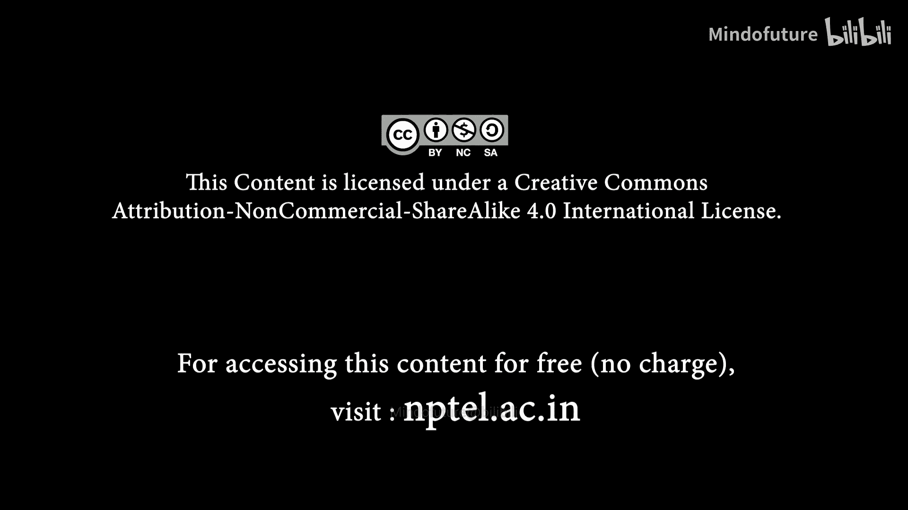
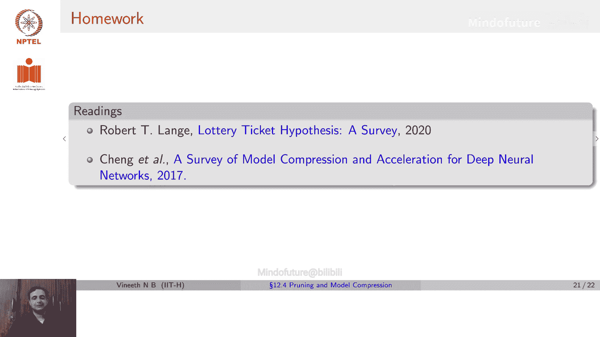

# 077：剪枝与模型压缩

在本节课中，我们将学习如何将庞大的深度学习模型压缩成更小的尺寸，以便部署在计算资源有限的设备上。我们将探讨几种核心的模型压缩技术，包括剪枝、知识蒸馏和彩票假设。

从对抗鲁棒性的话题继续，我们现在讨论剪枝和模型压缩。这是将深度学习模型应用于现实世界应用中的另一个重要组成部分。

通常，神经网络被优化以提高预测准确性。无论是分类模型的准确率、检测模型的平均精度均值，还是分割模型的像素级分类准确率。然而，仅仅追求准确性往往导致神经网络变得非常庞大。

如今最先进的模型通常拥有数百万甚至更多的参数。回想一下，我们曾提到AlexNet有超过6000万个参数，在内存中占据约200MB的空间。VGG仅模型的权重就占据了高达500MB的内存空间。

这真的是一个问题吗？在训练模型时，拥有很高的存储和内存占用是可以接受的，并且可以使用强大的GPU来训练这些模型。然而，在测试或推理时，期望有强大的计算资源可能是受限的。

如果考虑在低计算设备上部署深度学习模型，例如手机、无人机或物联网设备，这些设备可能部署在世界的任何角落，甚至在恶劣条件下，那么庞大的神经网络模型就成为将其成功应用到这类计算平台上的限制因素。

从执行这些内存操作所消耗的能量的角度来看，这是另一种思考方式。一项有趣的分析由Song Han完成，他发表了关于深度模型压缩的最受欢迎的论文之一。分析表明，一个32位整数加法操作消耗约0.1皮焦耳（10^-12焦耳）的能量。一个32位浮点数加法操作消耗0.9皮焦耳。进一步，一个32位SRAM缓存访问操作消耗5皮焦耳，而访问动态内存（DRAM）则显著上升到640皮焦耳。访问动态内存比访问静态内存（SRAM）的成本要高得多。

为什么我们要讨论这个？这意味着当我们谈论低计算设备时，理想情况下，我们希望这些深度学习模型能驻留在SRAM中，而不必去访问DRAM，因为访问DRAM可能导致大量的能量需求，特别是在无人机或边缘设备、物联网设备等环境中，电池续航也是一个部署这些模型时需要考虑的问题。

因此，一个关键需求出现了：需要能够将这些庞大的神经网络模型剪枝成更小的内存占用，以便部署在低计算环境中。这类方法被广泛称为模型压缩方法，即一个训练好的模型被压缩成更小的内存占用，以便在低计算设备上部署。

过去几年，不同的研究人员进行了多项努力，这些方法可以大致分类为：参数剪枝与量化，这是一类专注于减少不影响性能的冗余参数的方法。第二类方法是基于低秩分解，使用矩阵和张量分解方法来估计信息丰富的参数并丢弃其余部分。转移或紧凑卷积滤波器是一类设计特殊结构卷积滤波器以节省参数的方法。最后，一个有趣的方法族称为知识蒸馏，其思想是将知识从大型神经网络模型提炼到小型学生神经网络模型中。

我们不会在本讲座中全部介绍，但会介绍几种。我们将简要介绍一种非常流行的基于剪枝的方法、一种知识蒸馏方法以及一种称为彩票假设的较新方法。

## 深度压缩：一种三阶段方法

一种最流行且相对较早的模型压缩方法是由Song Han在2016年ICLR上提出的深度压缩。这是一个具有变革性的方法，也将该方法推进到了硬件设计领域。它使用一个三阶段流程来减少神经网络的存储需求。

第一步是剪枝训练好的模型。然后是权重量化。最后是霍夫曼编码步骤。这提供了一个能将模型大小减少35到50倍，而精度损失极小的模型。

让我们看看这些步骤。

### 第一步：剪枝模型

这里的剪枝意味着什么？首先，你训练完整的模型，这是第一步。然后，将值低于某个阈值的权重从网络中移除。例如，如果任何权重的值低于10^-5，则该权重被从网络中移除。剩下的稀疏网络仅包含其他连接，然后被重新训练以获得更好的网络。这同样是一个迭代过程：在新的重新训练的稀疏网络中，如果任何权重低于某个阈值，它们会被移除，然后再次对剩余的稀疏网络进行重新训练。这个步骤被迭代执行。

仅通过这个简单的步骤，作者就展示了可以将许多流行网络的大小显著减小。例如，AlexNet的原始大小是6100万参数，使用简单的剪枝步骤后，大小下降到670万，这是9倍的压缩。当查看在ImageNet上的top-1或top-5错误率时，你会注意到由于参数减少，性能没有显著下降。对于VGG，仅剪枝就将参数数量减少了30倍。对于较小的网络如LeNet，也观察到了类似的结果。

### 第二步：权值共享

剪枝之后的第二步是一个称为权值共享的步骤。在每一层中，该层的权重使用简单的K均值聚类划分为K个簇，每个权重被替换为其所属簇的质心。

这里你看到一个4x4权重矩阵的例子。以及后续矩阵中的簇分配。还有每个簇的簇质心值。最后，这些蓝色权重中的每一个都被替换为这里蓝色对应的簇质心，依此类推。这有什么帮助？我们需要存储更少的值来表示这一层的权重。

随之而来的问题是，如果权重像这样改变和聚类，梯度会怎样？梯度也遵循类似的过程。因此，如果你在该特定层的这些位置有特定的梯度值，梯度也会被聚类，然后使用梯度的簇质心值从原始权重中减去，以获得新的权重。因此，即使梯度也以同样的方式参与了这个权值共享过程。

### 第三步：量化与霍夫曼编码

完成剪枝和权值共享后，作者使用的下一步是量化。这是基于一个经验观察：与使用32位浮点值相比，如果我们只使用8位，性能并没有降低多少。因此，这个量化步骤被用来进一步减少存储占用。

最后一步是使用霍夫曼编码。霍夫曼编码是计算机科学中一种流行的编码压缩方法，其中频繁出现的模式用较少的位数存储，而很少出现的模式用更多的位数存储以捕获其额外信息。霍夫曼编码是一种长期存在的压缩方法，在这里被用来再次减少存储占用。

通过这些方法依次应用，整体方法显示出参数减少了35到49倍，而精度损失极小。正如你在这里看到的，AlexNet从240MB变成了6.9MB，而VGG从552MB变成了11.3MB，这是49倍的存储参数减少。如果你看这里的错误率，由于这种压缩，错误率没有显著损失，这是主要目标。

因此，一旦模型达到6.9MB或10MB，它们现在就可以部署在低计算设备上了。

## 知识蒸馏：从大模型到小模型

我们将讨论的第二种方法是知识蒸馏。这类方法的关键直觉是将知识从一个笨重的大型模型转移到一个我们称为学生模型的小型模型中，后者的尺寸更适合部署。

这里显然的问题是，在深度神经网络中，知识意味着什么？这里使用的第一个想法是，知识可以被视为输入和softmax概率之间的映射。例如，当你看一张猫的图片时，你希望猫的类别为1，其他所有类别为0。但神经网络可能不一定给你那个输出，它可能说猫的概率是0.8，其他类别的概率可能是0.01、0.05等等。现在，这些输出代表了神经网络在训练过程中获得的知识。

因此，在知识蒸馏中，现在的想法是采用一个浅层的小型学生网络，不是用硬标签或独热编码标签来训练这个网络，而是要求学生网络以预测教师网络的softmax概率甚至logits为目标。你可以看到这里有一个笨重的模型，通过蒸馏，蒸馏模型的目标是匹配教师模型的软输出或目标。从这个意义上说，教师模型获得的知识被提炼到学生模型中，学生模型以更小的存储占用实现了相近的性能。

这里有一个简单的实验例子。给定一个笨重的模型（这是一个具有1200个ReLU节点和dropout的两层网络）和一个较小的模型（一个具有800个ReLU节点的两层网络，至少没有正则化），很容易观察到：笨重模型在MNIST上的错误数是67。如果你使用标准训练训练小模型，它在MNIST测试集上会犯146个错误，而使用蒸馏的小模型只犯74个错误，这接近笨重模型的性能。

多年来，知识蒸馏已经产生了多种变体，其中不仅仅是匹配教师模型的logits或概率输出，还可以匹配隐藏层的中间表示，可以添加一些噪声并尝试集成多个教师模型，等等。这些在参考文献中提供以供进一步阅读。

## 彩票假设：寻找幸运子网络

我们将在这里讨论的第三种方法是2019年ICLR上发表的一个较新的方法，称为彩票假设。顾名思义，这是基于一个观察：当你训练一个完整的庞大深度神经网络时，通常，剪枝后获得的一个非常稀疏的子网络产生的准确率接近完整模型。所以，你随机初始化权重并训练一个完整网络，得到90%的准确率；你剪枝后得到一个具有90%准确率的稀疏子网络。但是，如果你取同样的子网络，随机重新初始化并训练，你只得到60%的准确率。所以，似乎训练完整网络然后剪枝有一些特别之处。

因此，这项工作提出了一个假设：一个随机初始化的密集神经网络包含一个子网络，该子网络被初始化，使得当它被单独训练时，最多经过相同次数的迭代训练，它可以匹配原始网络训练后的测试准确率。

现在对我们来说，明显的问题是如何找到这个子网络？为此，这种方法提出了一个简单的想法，称为一次性剪枝。首先，用随机初始化训练一个完整网络。然后，剪掉完整网络中最小权重的某个百分比P。最后，将剩余权重重置为它们之前的初始化值，以创建“中奖彩票”。他们表明，遵循这个程序有助于我们找到彩票，即那个似乎能匹配完整网络准确率的随机稀疏子网络。

你也可以像我们在深度压缩中提到的迭代剪枝那样，在多轮中重复剪枝网络，这确实能得到更好的结果，但当然需要更多的计算。

这里展示了这项工作中的一些结果。在左侧，你看到的是剩余权重百分比与MNIST和CIFAR-10上早期停止迭代次数的关系。你可以看到，如果你看这两条曲线，其中虚线是随机采样的稀疏网络，粗线是通过彩票假设获得的网络。你可以看到，即使早期停止迭代次数非常低，彩票假设的剩余权重百分比仍然很高。使用这种方法，在CIFAR-10上也观察到了类似的模式。

另一方面，更重要的是，剩余权重百分比与准确率的关系图再次对彩票假设有利。你可以看到这里的虚线和这里的粗线，虚线是随机采样的稀疏子网络，粗线是使用彩票假设获得的网络。你可以看到，随着剩余权重百分比的减少（这里从100到0.2），随机子网络的准确率下降得更快，而彩票假设在更长的时间内保持了更高的准确率。在CIFAR-10上，对于不同种类的层，也看到了类似的结果。

那么，这总是一个好策略吗？并不完全是。虽然迭代剪枝能产生更好的结果，但它可能需要每轮剪枝训练网络大约15次。另一方面，寻找彩票假设虽然有时可以做到，但可能无法像原始网络那样提供同样好的性能。如果你进行迭代剪枝，研究像ImageNet这样的大型数据集将会更加困难。

因此，在过去的几年里，对原始的彩票假设工作已经有了改进，研究人员研究了这些“中奖彩票”是否可以在训练早期找到，而不是等待太多迭代；这样的中奖彩票是否能推广到新的数据集和优化器；以及这个假设是否在其他领域如文本处理或强化学习中成立。

## 其他方法与总结

这些方法也以几种不同的方式得到了扩展。XNOR-Net是一种流行的压缩方法，它使用二值权重。这里的理解是，你不需要用太多位来表示每个权重的精度，仅使用二值权重并用XNOR操作替换卷积，就可以使神经网络以非常小的内存占用获得合理的准确率。

TinyNet通过滤波器剪枝压缩CNN。知识蒸馏方法使用了带噪声的教师模型，其中教师模型的logits被扰动以获得多个教师的效果来训练学生。关系知识蒸馏在蒸馏中采用了度量学习。还有一些特定的架构，我们在讨论CNN时讨论过其中的一些，如MobileNets、ShuffleNet、用于检测的SSD和SqueezeNet等，它们都被用于模型压缩。

正如我们之前所说，这个领域相当广阔，还有低秩分解方法，也有以特定方式设计卷积滤波器以节省参数的方法，等等，我们在本讲座中留作阅读。

本节课中，我们一起学习了模型压缩的重要性以及三种主要技术：深度压缩通过剪枝、量化和编码来大幅减小模型尺寸；知识蒸馏通过让小型学生网络模仿大型教师网络的输出来转移知识；彩票假设则探索了在随机初始化的密集网络中寻找高性能稀疏子网络的可能性。这些技术使得将强大的深度学习模型部署到手机、物联网设备等资源受限的环境中成为可能。

你的作业是阅读一篇关于彩票假设的优秀综述，以及这篇关于深度神经网络不同模型压缩和加速方法的全面综述。

