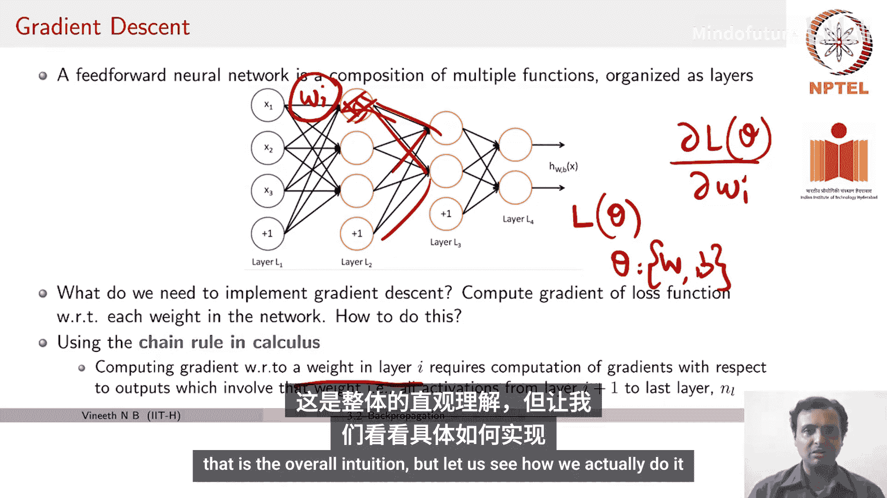

# 082：前馈神经网络与反向传播 - 第一部分

在本节课中，我们将继续讨论多层感知机，并学习如何训练它们。我们将从感知机学习算法出发，探讨如何将类似的方法应用于多层感知机，即前馈神经网络的训练。

## 神经网络作为函数近似器

上一节我们介绍了感知机的基本概念。本节中，我们来看看多层感知机，它也被称为前馈神经网络。之所以称为“前馈”，是因为信息从输入层开始，逐层向前传播，最终到达输出层。所有神经元都按层组织。虽然我们在上一讲中看到了只有一个隐藏层的多层感知机示例，但实际上，在输入层和输出层之间，可以根据需要设置任意数量的隐藏层。

本质上，前馈神经网络或感知机是在近似一个从输入到输出的函数。无论要近似的函数是什么，如果该函数很复杂，使用更多的隐藏层可能有助于更好地近似它。但这并非绝对必要，我们稍后会看到，添加过多的层也可能带来问题。

## 网络结构与函数复合

如前所述，神经网络通常用于近似某个理想函数 **F\***。在机器学习中，**F\*** 是给定输入后能为其分配正确标签的理想函数，它可以是一个分类器。我们希望通过神经网络来近似这个函数。

神经元以有向无环图的形式组织。之所以是有向的，是因为所有从一层到下一层的边都是有向边，信息不能反向流动（尽管在训练时会用到反向传播，我们稍后会看到）。之所以是无环的，是因为图中没有循环，信息只从输入单向流向输出。

神经网络的层数通常被称为**深度**。每个神经元可以看作一个向量到标量的函数，它接收来自前一层的输入向量并计算出一个标量值。从这个意义上说，每个神经元都类似于一个感知机。

当神经网络中多层结构堆叠在一起时，可以将整个网络视为多个函数的复合。每一层都是一个特定的函数。例如，第一层函数 **F1** 将输入维度 **R^n** 映射到第一个隐藏层的维度 **R^h1**。类似地，**F2** 从 **R^h1** 映射到 **R^h2**，**F3** 从 **R^h2** 映射到输出层的维度 **R^o**。因此，每一层本身就是一个函数，整个神经网络可以被视为实现特定目标的函数复合。

## 训练目标与损失函数

在机器学习中，我们通常使用训练数据来训练算法。在监督学习设置下，训练数据同时提供了数据 **x_i** 和对应的标签 **y_i**。这里，**x** 是一个可能具有多个维度的向量，**y** 是对应输入数据点 **x_i** 的输出标签。训练数据集中总共有 **M** 个这样的样本。可以认为，这些训练样本是整体函数 **F\*** 在不同点上的实例。

我们的神经网络定义了一个函数 **y = f(x, θ)**，其中 **x** 是输入，**θ** 代表神经网络中所有权重和偏置参数。**θ** 是参数化神经网络的值，它决定了当信息通过网络传播时你将得到的输出函数。

我们的目标是找到一种方法，使 **f** 能最好地近似 **F\***。需要再次澄清的是，**F\*** 是一个假设的、从输入映射到标签的函数。我们并不知道 **F\*** 具体是什么，这正是机器学习的核心：我们只拥有 **F\*** 的带噪声实例，但需要学习它本身。

现在的问题是：如何找到参数 **θ**（权重和偏置）的值来训练这个网络？假设给定一个特定架构的神经网络（例如，两个隐藏层，分别有10个和100个神经元）和一个训练数据集，我们的目标就是找到能使网络在训练数据上表现良好的权重。

## 梯度下降法简介

为了实现这个目标，我们引入优化中一个非常著名的方法：**梯度下降法**。梯度下降是一种简单但研究深入的优化方法，通常用于最小化目标函数，我们将用它来训练前馈神经网络。

神经网络通常通过最小化一个损失函数来训练，例如**均方误差**。当你给神经网络一个输入时，它会根据当前参数 **θ** 产生一个输出 **f(x, θ)**。例如，在病人诊断的例子中，输入病人属性（血型、年龄、是否吸烟等），神经网络会在输出层给出一个结果。

但在训练数据中，你已经知道对于这个特定的 **x**，正确的输出 **F\*(x)** 应该是什么。因此，你可以计算网络输出 **f(x, θ)** 与真实标签 **y** 之间的误差。对所有训练数据点求和并取平均，就得到了均方误差：

**MSE = (1/M) * Σ (y_i - f(x_i, θ))^2**

让我们先看一个简单的一维例子来理解梯度下降。假设我们想最小化函数 **f(x) = x^2**。我们知道在 **x\* = 0** 处取得最小值。

梯度下降法的思想是：给定函数 **f(x)**，我们可以通过求导得到其在 **x** 点的斜率 **f'(x)**。如果在 **x** 点沿着斜率的方向（即梯度方向）前进一小步，函数值会增加。反之，如果沿着负梯度方向（即与梯度相反的方向）前进一小步，函数值则会减小。

因此，如果我们从一个随机的 **x** 值开始，不断沿着负梯度方向迈出一小步，迭代下去，最终就能到达函数值最小的点。这是一个寻找函数最小值的简单而有效的方法。

## 扩展到多变量与神经网络

现在考虑更复杂的情况：多变量设置。在训练神经网络时，我们要最小化的损失函数由网络中的许多权重参数化。我们将所有权重和偏置统一为一个量 **θ**，并将损失函数表示为 **L(θ)**。我们的目标是找到最小化 **L(θ)** 的权重向量 **θ**。

假设 **u** 是一个指向损失函数最小化方向的单位向量。我们想要最小化 **u^T * ∇_θ L(θ)**（即 **u** 与损失函数梯度 ∇_θ L(θ) 的点积）。由于 **u** 是单位向量，点积可以写成 **||u|| * ||∇_θ L(θ)|| * cos(β)**，其中 **β** 是 **u** 与梯度向量之间的夹角。

显然，范数总是非负的。为了最小化整个点积，我们需要让 **cos(β)** 尽可能小，其最小值为 **-1**。这意味着 **u** 必须指向负梯度的方向。因此，为了到达函数的最小值，我们必须沿着负梯度的方向前进。

## 梯度下降算法实践

现在，让我们看看如何在实践中使用梯度下降法来训练神经网络。

对于神经网络，我们从一个随机的权重向量 **θ** 开始。
1.  计算网络在当前参数下，在整个训练数据上的损失函数 **L(θ)**（例如均方误差）。
2.  计算损失函数相对于网络中每个需要学习的参数（每个权重、每个偏置）的梯度，记为 **∂L/∂θ_i**。
3.  根据梯度下降的迭代更新规则，更新每个参数：
    **θ_i_next = θ_i_current - η * (∂L/∂θ_i)**
    其中，**η** 称为**学习率**或**步长**，它决定了我们沿着负梯度方向前进的步幅大小。我们稍后会讨论如何选择学习率。
4.  重复步骤1-3，直到梯度为零或接近零。当梯度为零时，我们到达了一个临界点，这很可能就是损失函数的最小值点。

## 神经网络中的梯度计算挑战

如前所述，前馈神经网络是组织成层的多个函数的复合。那么，在这种网络中如何实现梯度下降呢？

我们知道需要计算损失函数相对于网络中每个权重的梯度。这可以通过利用微积分中的**链式法则**来实现。

计算相对于某一层中某个权重 **W_ij** 的梯度，需要结合从该层到输出层所有涉及该权重的输出的梯度。例如，对于网络中某个特定的权重 **W_ij**，损失函数 **L(θ)** 定义在所有参数 **θ**（即所有权重 **W** 和偏置 **b**）上。我们需要求 **∂L(θ)/∂W_ij**。

由于 **W_ij** 影响了它所在神经元的输出，而这个输出又作为下一层神经元的输入，影响下一层的输出，如此逐层传播直至最终影响损失函数。因此，我们必须通过链式法则，将所有层中 **W_ij** 的贡献累加起来，才能得到损失函数相对于该权重的梯度。这就是反向传播算法的核心思想，我们将在下一部分详细探讨其具体算法步骤。

---

本节课中我们一起学习了前馈神经网络的基本训练框架。我们了解到神经网络是函数的近似器，其训练目标是通过调整参数最小化损失函数。我们引入了梯度下降法作为核心优化工具，它通过沿着损失函数负梯度的方向迭代更新参数来寻找最小值。最后，我们指出了在多层复合的神经网络中计算梯度需要用到链式法则，这为下一节讲解反向传播算法奠定了基础。