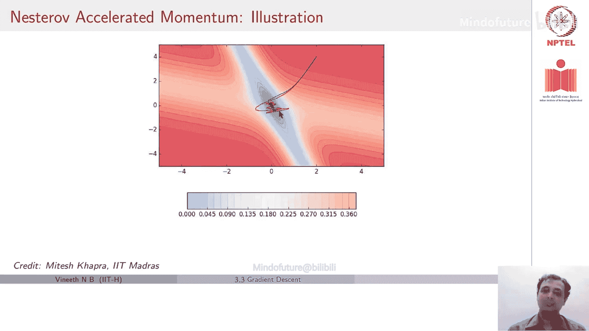

# 084：梯度下降及其变体 - 第一部分

## 概述
在本节课中，我们将学习梯度下降算法在训练神经网络时面临的挑战，并探讨其改进变体，特别是动量法和Nesterov加速动量法。我们将从回顾基础梯度下降开始，理解误差曲面的复杂性，并学习如何通过引入动量来加速训练并避免震荡。

## 梯度下降回顾
上一节我们介绍了神经网络和反向传播。本节中，我们来看看用于优化神经网络的核心算法——梯度下降。

梯度下降是一种用于寻找任何可微函数最小值的优化算法。用于训练神经网络的损失函数（例如我们目前使用的均方误差）必须是可微的。如果尚不了解其他损失函数，无需担心，我们将在后续课程中学习。

在使用梯度下降时，参数会沿着成本函数（或称误差函数、损失函数）梯度的负方向更新。参数更新规则由以下公式给出：
`θ_new = θ_old - α * ∇L(θ)`
其中，`α` 是学习率或步长，`∇L(θ)` 是损失函数关于参数的梯度。

我们可以在一个简单的凸函数上可视化这个过程。如果在最小值左侧取一点，该点梯度为负，沿负梯度方向（即正方向）移动将靠近最小值。如果在右侧取一点，梯度为正，沿负梯度方向移动同样会靠近最小值。这直观展示了梯度下降如何最小化目标函数。

以下是梯度下降算法的步骤：
1.  给定学习率 `α`、初始参数 `θ_t` 和训练数据 `D_train`。
2.  只要停止条件未满足，就执行以下循环（每个循环称为一个“epoch”）：
    a. 初始化参数更新量 `Δθ = 0`。
    b. 对于训练数据 `D_train` 中的每个数据点：
        i. 使用反向传播计算损失函数关于每个参数的梯度。
        ii. 将梯度累加到 `Δθ` 中。
    c. 应用更新：`θ_{t+1} = θ_t - α * (1/|D_train|) * Δθ`。

当梯度变为零时，算法停止。

## 神经网络的误差曲面
理解了基础算法后，我们需要认识训练神经网络的核心挑战之一——误差曲面的复杂性。

神经网络的误差曲面是所有参数取值与对应损失函数值之间的关系图。现代神经网络（尤其是计算机视觉中）拥有数百万参数，这意味着误差曲面存在于一个极高维的空间中，其形状可能非常复杂。

训练神经网络的目标是从误差曲面上的某个随机初始点出发，通过梯度下降找到最小值。然而，误差曲面通常是非凸的，存在许多“局部最小值”。梯度下降最终收敛到哪个局部最小值，很大程度上取决于初始化的位置，而我们无法在训练前预知曲面的形状。

此外，高维非凸优化中，“鞍点”问题比局部最小值更为普遍。鞍点是梯度为零的点，但它在某些维度上是极小值，在另一些维度上是极大值。在高维空间中，找到一个在所有维度上都是极小值的临界点概率很低，因此鞍点大量存在。梯度下降若收敛到鞍点，训练就会过早停止。

## 梯度下降的挑战：震荡与平原
现在，让我们通过一个具体例子来观察梯度下降在复杂曲面上的行为。

观察梯度下降在误差曲面上的轨迹，可以发现更新速度并不均匀：在某些区域更新缓慢，在某些区域更新迅速。这引出了我们需要理解的两个关键概念：震荡与平原/平坦区域。

从等高线图视角看，参数更新的大小与误差曲面梯度的大小直接相关。在梯度小的区域，参数更新也小；在梯度大的区域，参数更新也大。

平原和平坦区域构成了误差曲面中梯度高度“非球形”的区域。这里的“非球形”是指梯度向量在各个维度上的值差异很大。在平原区域，某些维度的梯度很小，导致更新缓慢，梯度下降会在此类区域耗费大量时间。

一个自然的想法是：在平原上，能否通过增大步长（即提高学习率 `α`）来走得更快？这在一定情况下是有效的。然而，如果学习率设置得过高，可能会导致在梯度变化剧烈的区域更新步伐过大，从而跳过最小值，甚至导致损失上升和发散，无法收敛。

## 基于动量的梯度下降
为了解决上述问题，我们引入基于动量的梯度下降法。

动量法的核心思想是：结合当前梯度和过去更新的方向来决定当前步骤。类比一个盲人在喜马拉雅山脉下山：如果他一直朝某个方向下坡，即使在某一点用手杖探路发现另一个方向更陡，他可能也不会立刻完全转向，而是会结合之前的行进方向。

数学上，我们引入一个“速度”向量 `v_t` 来实现动量：
`v_t = γ * v_{t-1} + α * ∇L(θ_t)`
`θ_{t+1} = θ_t - v_t`
其中，`γ` 是动量参数，通常在0到1之间。`v_{t-1}` 包含了之前更新的历史信息。

当历史速度 `v_{t-1}` 与当前梯度方向相同时，动量会加速在这个方向上的移动，有助于快速通过平原。当它们方向不同时，动量起到缓冲作用，可以减少更新方向的剧烈变化，从而抑制震荡。

动量参数 `γ` 的选择：通常初始设为0.5，待训练初步稳定后，可以增加到0.9或0.99。实践中，很多人直接设置为0.9。

以下是动量梯度下降的算法步骤，主要修改在于速度向量的计算和更新：
1.  初始化参数 `θ`，速度 `v=0`，设定学习率 `α` 和动量参数 `γ`。
2.  对于每个epoch：
    a. 对于每个训练数据点（或小批量）：
        i. 计算梯度 `∇L(θ)`。
        ii. 更新速度：`v = γ * v + α * ∇L(θ)`。
        iii. 更新参数：`θ = θ - v`。

从等高线图可视化可以看出，标准梯度下降在非球形曲面上会沿之字形路径震荡前进。而动量法通过结合历史方向，有效减少了震荡，能以更直接的路径走向最小值，收敛速度更快。

## Nesterov加速动量
动量法虽然加速了收敛，但在接近最小值时仍可能产生振荡。Nesterov加速动量法对此做出了改进。

Nesterov动量的核心思想是“向前看一步”：在计算当前梯度之前，先根据动量项向前走一步，在那个“向前看”的位置计算梯度，然后用这个“前瞻梯度”来更新。这相当于在决定下一步时，已经考虑了动量将要带我们去往的方向。

其更新公式如下：
`v_t = γ * v_{t-1} + α * ∇L(θ_t - γ * v_{t-1})`
`θ_{t+1} = θ_t - v_t`

与普通动量法的区别在于，梯度计算的位置是 `θ_t - γ * v_{t-1}`，即当前参数加上一个动量项。这使得算法对未来的变化有更强的预见性。

在同一个示例中，Nesterov动量（蓝色轨迹）相比普通动量（红色轨迹），在接近最小值时的振荡更小，能以更平滑、更快的路径收敛。这是因为它利用了“向前看”的信息，提前调整了更新方向，避免了不必要的来回摆动。

## 总结
本节课中，我们一起学习了梯度下降法在训练深度神经网络时的局限性，包括收敛速度慢、易陷入鞍点和平原、以及在非球形误差曲面上的震荡问题。

为了克服这些挑战，我们介绍了两种重要的梯度下降变体：
1.  **动量法**：通过引入速度向量，累积过去的梯度信息，从而在持续方向上加速，在不稳定方向上减速。这有助于加速训练并减少震荡。
2.  **Nesterov加速动量法**：动量法的改进，采用“向前看”的策略计算梯度，使优化过程更具预见性，能进一步减少收敛时的振荡，实现更快的收敛。

理解这些优化算法是有效训练深度神经网络的基础。在接下来的课程中，我们将继续探讨其他先进的优化器变体。