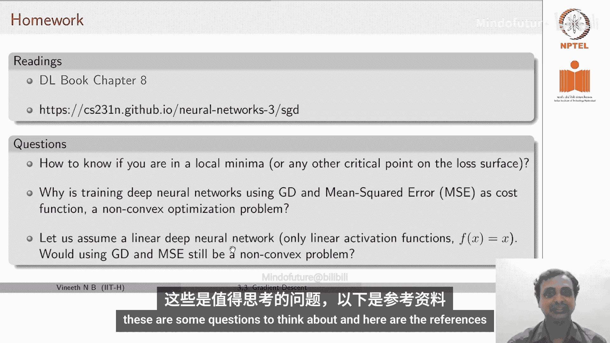

# 085：梯度下降及其变体 - 第二部分

在本节课程中，我们将继续探讨梯度下降优化算法。我们将分析不同梯度下降方法的优缺点，并介绍几种关键的改进算法，特别是用于自适应调整学习率的算法，如AdaGrad、RMSProp和Adam。这些方法旨在解决训练神经网络时遇到的各种挑战，如收敛速度慢、陷入局部极小值等问题。

## 梯度下降方法的比较与分析

上一节我们介绍了基于动量的梯度下降方法。现在，我们来分析一下目前所见梯度下降方法的优缺点。

以下是批量梯度下降（Batch Gradient Descent）的优缺点：

*   **优点**：从优化理论角度看，其收敛条件有很好的理解。许多加速技术（如共轭梯度法）在批量梯度下降场景下效果很好。
*   **缺点**：计算速度可能很慢，尤其是在训练数据集很大时（例如1万个或100万个数据点）。需要遍历整个数据集后才能进行一次参数更新。

批量梯度下降的缺点引出了另一种非常流行的方法：随机梯度下降（Stochastic Gradient Descent, SGD）。

## 随机梯度下降与Mini-Batch SGD

随机梯度下降的算法流程如下：首先随机打乱训练数据集，然后针对每个训练样本计算梯度并立即更新参数。这与批量梯度下降的关键区别在于，参数更新步骤位于遍历数据点的循环内部。

随机梯度下降虽然更快，但基于单个样本的更新方向可能非常随机。为了获得更稳定的梯度方向，实践中通常采用**小批量随机梯度下降**。

小批量随机梯度下降（Mini-batch Stochastic Gradient Descent）的做法是：每次从训练集中取一小批样本（例如20个），前向传播计算所有输出和误差，计算所有梯度后取这20个梯度的平均值，然后用这个平均梯度来更新参数。这种平均操作能提供跨多个数据点更一致的梯度方向。如今，当人们提到使用SGD时，通常指的就是小批量SGD。

以下是随机梯度下降（包括小批量SGD）与批量梯度下降相比的优缺点：

*   **优点**：
    1.  训练神经网络通常比批量学习快得多，因为它利用了数据中的冗余性。
    2.  由于更新带有噪声，可能有助于逃离糟糕的局部极小值或鞍点，从而经常能得到更好的解。
    3.  易于跟踪变化，当新数据点到来时，可以轻松更新系统。
*   **缺点**：
    1.  权重更新中的噪声可能导致不收敛。实践中，如果前几次迭代误差波动过大，可以尝试更改初始化或调整学习率。
    2.  需要选择合适的**学习率**。

## 学习率调整策略

学习率的选择至关重要：学习率太小，收敛缓慢；学习率太大，梯度可能爆炸。如果不使用动量，如何选择学习率呢？

以下是几种常见的学习率调整启发式方法：

*   **固定学习率**：在整个训练过程中保持学习率恒定。
*   **步长衰减**：每经过N次迭代，或在满足特定退化条件（如当前误差大于前一次误差）时，降低学习率。其思想是随着训练接近最小值，需要更小的步长以避免 overshoot。
*   **指数衰减**：学习率按公式 `α = α0 * e^(-k*t)` 衰减，其中α0和k是超参数，t是迭代次数。
*   **1/t衰减**：学习率按公式 `α = α0 / (1 + k*t)` 衰减。

这些方法都是启发式的。能否根据网络的实际行为更智能地调整学习率呢？答案是肯定的。

## 自适应学习率算法

一种早期的自适应方法是**AdaGrad**。其核心直觉是：稀疏但重要的特征（对应神经网络中的某些权重）可能梯度较小，学习在这些方向上可能很慢。AdaGrad为网络中的**每个权重单独设置学习率**。

AdaGrad算法为每个权重维护一个梯度平方的累积和 `R_t`。参数更新公式为：
`θ_{t+1} = θ_t - α / (δ + √(R_t)) * Δθ_t`
其中 `Δθ_t` 是当前梯度向量，`δ` 是一个小常数（如10^-7）用于数值稳定。

这个公式的效果是：对于历史梯度平方和`R_t`小的权重，有效学习率会变大；对于`R_t`大的权重，有效学习率会变小。这实现了对不同权重的差异化学习率调整。

但AdaGrad有一个问题：梯度平方累积项 `R_t` 会随着迭代不断增大，导致分母持续变大，最终所有权重的学习率都会变得极小，学习可能停滞。

**RMSProp** 方法通过修改 `R_t` 的计算方式来解决这个问题。它使用一个衰减率 `ρ` 来计算 `R_t` 的指数移动平均：
`R_t = ρ * R_{t-1} + (1 - ρ) * (Δθ_t)^2`
这确保了 `R_t` 不会无限增长，从而避免了学习率过早衰减的问题。

## Adam：自适应矩估计

目前最流行的自适应学习率算法是**Adam**。它结合了**RMSProp**和**动量**的思想。

Adam同时维护两个移动平均：
1.  梯度的一阶矩（均值）估计 `s_t`，类似于动量。
2.  梯度的二阶矩（未中心化的方差）估计 `r_t`，类似于RMSProp中的梯度平方累积。

其参数更新公式为：
`θ_{t+1} = θ_t - α * (s̃_t / (δ + √(r̃_t)))`
其中 `s̃_t` 和 `r̃_t` 是经过**偏差校正**后的估计，用于解决初始迭代时移动平均初始化为0带来的偏差问题。偏差校正公式为：
`s̃_t = s_t / (1 - ρ1^t)`, `r̃_t = r_t / (1 - ρ2^t)`

Adam算法因其良好的实践效果，已成为训练神经网络的首选优化器之一。

## 总结与挑战

本节课我们一起学习了梯度下降的各种变体及其改进方法。我们分析了批量梯度下降、随机梯度下降和小批量SGD的优缺点。重点介绍了自适应学习率算法，包括AdaGrad、RMSProp，以及结合了动量和自适应学习率的Adam算法。

然而，训练深度神经网络仍然面临诸多挑战：
*   误差曲面中存在**平坦区、局部极小值和鞍点**。
*   随着网络加深，会出现**梯度消失或爆炸**问题，导致误差曲面出现“悬崖”。
*   权重矩阵或损失函数的**病态条件数**。
*   **梯度的数值计算不精确**。
*   **局部结构与全局结构对应性差**。
*   **选择学习率、动量系数等超参数**本身也是一个难题。

深度神经网络的误差曲面通常是非二次、非凸、高维的，可能存在许多极小值和平坦区域。没有严格的保证网络一定会收敛到一个好的解，或者一定会收敛。但实践表明，使用随机梯度下降及其变体训练神经网络是有效的，并在全球众多应用中得到使用。

**课后作业与思考**：
1.  如何判断自己处于损失曲面上的局部极小值点或其他临界点？
2.  为什么使用梯度下降和均方误差训练深度神经网络是一个非凸优化问题？（这是我们本节课开始时提出的问题）
3.  如果我们假设一个**深度线性神经网络**（完全没有激活函数），使用梯度下降和均方误差进行训练，是否仍然是一个非凸优化问题？

建议阅读《深度学习》书籍第8章的相关部分，以及斯坦福CS231n课程中关于优化算法的讲座。

