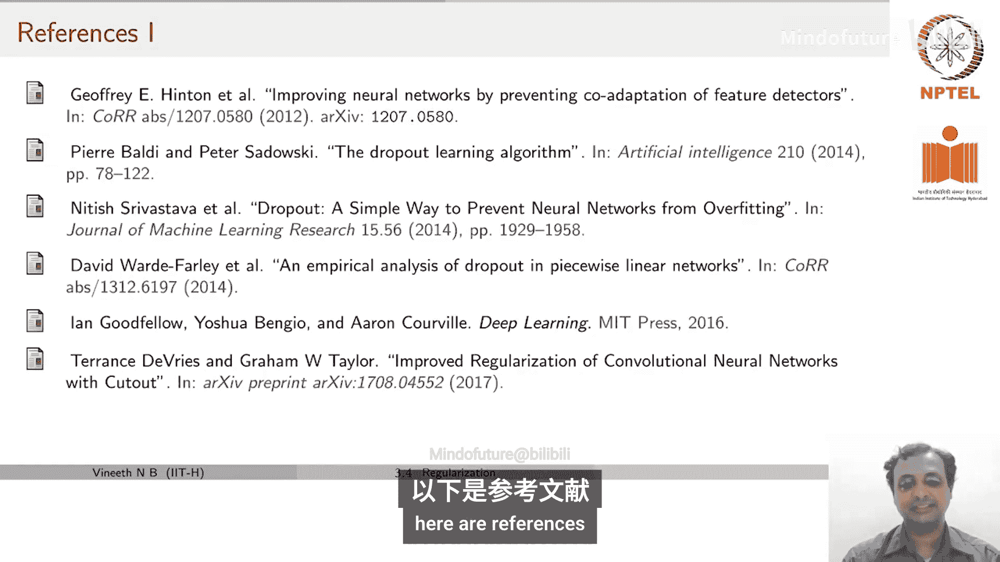

# 087：神经网络正则化 - 第二部分

在本节课中，我们将继续探讨神经网络的正则化方法。我们将学习如何通过提前停止、数据增强、噪声注入、集成方法以及Dropout等技术，来防止模型过拟合训练数据，从而提升其在未知测试数据上的泛化能力。

## 提前停止 🛑

上一节我们介绍了通过惩罚权重范数（如L2正则化）来防止过拟合的方法。本节中，我们来看看另一种简单直接的正则化方法——提前停止。

提前停止的核心思想是：在训练过程中持续监控模型在验证集上的性能，一旦性能开始下降，就停止训练，即使此时模型在训练集上的性能仍在提升。这样可以防止模型过度拟合训练数据。

以下是提前停止的直观示例：假设Y轴是准确率，X轴是训练轮数。训练集准确率（红色曲线）可能持续上升，但验证集准确率（蓝色曲线）在达到某个峰值后开始下降。当验证集性能开始下降时，就是停止训练的最佳时机。

## 停止准则 ⏹️

提前停止引出了一个问题：我们如何确定何时停止训练？由于计算机的数值近似，梯度可能永远不会精确为零。因此，我们需要一些启发式准则来决定何时停止。

以下是几种常用的停止准则：

1.  **误差变化准则**：在一个窗口期（如连续10个epoch）内，如果误差没有显著下降，则停止训练。停止后，可以再固定训练几个迭代以确保接近临界点。
2.  **权重变化准则**：比较当前迭代（t）和之前某个迭代（t-10）的权重。如果所有权重中最大的变化量小于一个阈值（如 `max(|w_t - w_{t-10}|) < ρ`），则停止训练。阈值ρ也可以设置为权重本身的一个百分比。

## 数据增强 📈

另一种有效的正则化方法是数据增强。其思想是通过对原始训练数据进行各种变换，生成新的训练样本，从而增加数据量并让模型见识到更多样的数据，提升泛化能力。

数据增强的关键在于，某些图像变换不会改变其语义标签。例如，一只猫的图像无论大小、旋转角度如何变化，它仍然是一只猫。

以下是常见的数据增强操作列表：

*   **数据抖动**：对图像进行模糊或轻微扭曲，以模拟测试数据中的噪声变化。
*   **旋转**：将图像旋转一定角度。
*   **颜色变换**：调整RGB通道的强度，或交换通道顺序（例如，将绿色通道当作红色通道）。
*   **注入噪声**：在图像中添加高斯噪声。
*   **镜像翻转**：水平或垂直翻转图像（适用于标签不变的场景）。

这些操作都是基于本课程早期介绍的图像处理技术。更现代的数据增强方法包括：

*   **Mixup**：通过线性插值创建虚拟训练样本。对于两个样本 `(x_i, y_i)` 和 `(x_j, y_j)`，生成新样本：`x̃ = λ * x_i + (1-λ) * x_j`，`ỹ = λ * y_i + (1-λ) * y_j`。其中λ∈[0,1]。这迫使模型学习更平滑的决策边界。
*   **Cutout**：在训练过程中，随机将输入图像中的方形区域掩蔽（填充为黑色），让模型学习不依赖于局部特定特征。

## 噪声注入 🔊

除了在数据层面注入噪声，还可以在标签或梯度层面注入噪声，这同样能起到正则化的作用。

*   **数据噪声**：在训练时向输入数据添加高斯噪声。可以证明，对于均方误差损失函数，**向输入添加高斯噪声等价于进行L2权重衰减**。这是一个有趣的关联，建议作为练习自行推导。
*   **标签噪声**：以概率α随机扰动训练样本的标签，将其替换为从所有类别中均匀采样的一个标签。这可以防止模型对训练标签过于自信。
*   **梯度噪声**：在反向传播更新权重之前，向梯度添加噪声。通常添加均值为0、方差为 `σ_t²` 的高斯噪声，并且让方差随着训练进行而衰减，例如 `σ_t² = η / (1+t)^γ`。

## 集成方法 🤝

集成方法通过训练多个不同的模型，并让它们共同决策来提升泛化性能。这是一种温和的正则化方法，因为即使某个模型过拟合，其他模型也可能纠正它。

一个标准的集成策略是**模型平均**。假设有K个不同的模型，对它们的输出进行平均。这些模型可以通过不同的超参数、不同的输入特征或不同的训练数据子集得到。

**Bagging（自助聚合）** 是一种经典的集成方法。它通过有放回抽样从原始训练集中创建K个不同的数据子集，并用每个子集训练一个模型。

从数学上分析，假设每个模型在测试样本上的误差 `ε_i` 来自均值为0的多变量正态分布，方差为 `V`，协方差为 `C`。那么，集成模型的均方误差为 `(1/K)*V + ((K-1)/K)*C`。这表明：
*   如果模型误差完全相关（`C = V`），集成没有帮助。
*   如果模型误差不相关（`C = 0`），集成模型的方差会降低为单个模型的 `1/K`。

## Dropout：神经网络的集成正则化 🎲

将集成思想直接应用于大型神经网络的一个主要问题是**协同适应**：在迭代训练中，强大的连接会越来越强，而较弱的连接被忽略，这可能导致过拟合。

**Dropout** 是一种专门为神经网络设计的、高效的集成正则化方法。其工作原理如下：
*   **训练阶段**：对于每个隐藏层，在每个训练样本（或小批量）的前向传播过程中，以概率 `p`（例如0.5）随机“丢弃”（即暂时忽略）一部分神经元。
*   **测试阶段**：使用完整的网络，但将每个神经元的激活值乘以 `p`。

**直觉理解**：可以将每个神经元看作公司的员工。如果总是让固定的员工组队完成任务，他们可能会过度专业化。Dropout就像每周随机让一半员工上班，迫使所有员工都学习处理各种任务，从而建立一个更稳健的“组织”。

**数学理解**：一个具有H个隐藏单元的神经网络，理论上可以组成 `2^H` 个不同的子网络。Dropout在训练时随机采样这些子网络。可以证明，在测试时**将激活值乘以 `p`，等价于对所有可能的 `2^H` 个子网络的输出取几何平均**。这使得我们无需实际训练海量子网络再进行集成，只需在训练时随机丢弃，测试时简单缩放即可获得集成效果。

---

本节课中我们一起学习了多种防止神经网络过拟合的正则化技术。我们了解了如何通过监控验证集性能来实施提前停止，如何通过数据增强和噪声注入来丰富训练数据并提升模型鲁棒性，以及如何利用集成方法和其高效的神经网络变体——Dropout来平均多个模型的预测，从而显著降低方差并提升泛化能力。掌握这些技术对于构建强大、稳健的深度学习模型至关重要。

**本节作业**：
1.  证明对于均方误差损失函数，向输入添加零均值高斯噪声等价于L2权重衰减。
2.  阅读关于Dropout的教程以加深理解。

**参考文献**：
（见课程原图）

