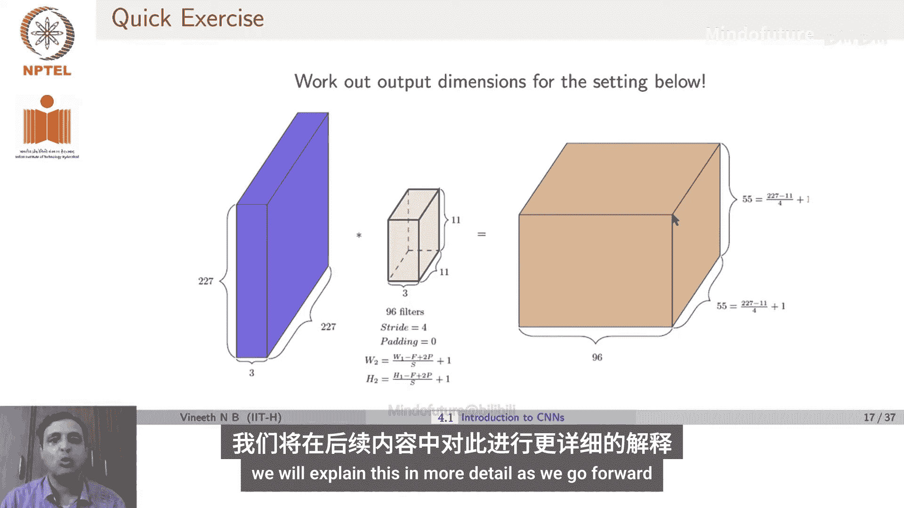

# 090：卷积神经网络介绍 - 第一部分


在本节课中，我们将从简单的前馈神经网络过渡到计算机视觉深度学习的核心构建模块——卷积神经网络。在开始讨论之前，我们先回顾一下上周课程留下的作业或练习。

## 📚 批归一化层的反向传播

上一节我们介绍了批归一化算法，本节中我们来看看如何对其进行反向传播。以下是批归一化的计算图表示。

**前向传播**：给定输入 `x1` 和 `x2` 以及一个小批量数据，我们计算该层激活输出的均值和方差，然后使用均值和方差对数据进行归一化。归一化后，通过缩放参数 `gamma` 和平移参数 `beta` 进行重新调整，以适应具体问题。这是批归一化的核心思想。

**反向传播**：我们需要计算损失函数 `L` 对各个参数的梯度，以便将梯度传播到网络的前层。以下是关键步骤：

以下是计算梯度的主要步骤：

1.  **计算梯度 dL/dbeta**：`beta` 是直接加到输出 `y` 上的。因此，`dL/dbeta` 等于所有输出 `y_i` 的梯度之和。
    ```
    dL/dbeta = Σ (dL/dy_i)
    ```

2.  **计算梯度 dL/dgamma**：`gamma` 与归一化后的数据 `x_hat` 相乘。因此，`dL/dgamma` 等于 `dL/dy_i` 与对应的 `x_hat_i` 的乘积之和。
    ```
    dL/dgamma = Σ (dL/dy_i * x_hat_i)
    ```

3.  **计算梯度 dL/dx_hat**：这是为了将梯度传播到前一层。`dL/dx_hat_i` 等于 `dL/dy_i` 乘以 `gamma`。
    ```
    dL/dx_hat_i = dL/dy_i * gamma
    ```

4.  **计算梯度 dL/dsigma^2**：方差 `sigma^2` 用于计算 `x_hat`。`dL/dsigma^2` 等于 `dL/dx_hat_i` 与 `dx_hat_i/dsigma^2` 的乘积之和。`dx_hat_i/dsigma^2` 可通过 `x_hat_i` 的定义式求导得到。
    ```
    dL/dsigma^2 = Σ (dL/dx_hat_i * dx_hat_i/dsigma^2)
    ```

5.  **计算梯度 dL/dmu**：均值 `mu` 同时影响 `x_hat` 和 `sigma^2`。`dL/dmu` 包含两部分：一部分来自 `x_hat`，另一部分来自 `sigma^2`。
    ```
    dL/dmu = Σ (dL/dx_hat_i * dx_hat_i/dmu) + dL/dsigma^2 * dsigma^2/dmu
    ```

6.  **计算梯度 dL/dx_i**：这是最终需要传播到前一层输入的梯度。它由三部分组成：来自 `x_hat`、`sigma^2` 和 `mu` 的贡献。
    ```
    dL/dx_i = dL/dx_hat_i * dx_hat_i/dx_i + dL/dsigma^2 * dsigma^2/dx_i + dL/dmu * dmu/dx_i
    ```

通过以上步骤，我们可以完成批归一化层的反向传播。一个重要的启示是：在神经网络中引入任何新参数时，只要确保所有新增组件都是可微的，并仔细运用链式法则计算每一项的梯度，就能实现正确的反向传播。

## 🧠 卷积神经网络基础

现在，让我们进入卷积神经网络的世界。本部分内容主要基于Mish Kara的精彩讲座。

### 卷积回顾

在第一周的课程中，我们介绍了卷积。卷积是一种将两个信号组合成第三个信号的数学方法，是信号处理（包括图像处理）中极其重要的技术。图像是二维信号，但卷积也广泛应用于语音、加速度计数据、时间序列数据等其他类型信号。

对于二维数据（例如灰度图像），滤波器 `W`（尺寸为 `k x k`）与图像 `X`（尺寸为 `n1 x n2`）的卷积操作定义为：
```
Y[i, j] = Σ Σ W[u, v] * X[i - u, j - v]
```
其中，求和范围 `u` 和 `v` 从 `-k` 到 `k`。

更一般地，我们可以将卷积写为以像素为中心的求和形式：
```
Y[i, j] = Σ Σ W[u, v] * X[i + u, j + v]
```
其中，求和范围 `u` 从 `-k1/2` 到 `k1/2`，`v` 从 `-k2/2` 到 `k2/2`。这两种写法本质相同，只是索引方式不同。

在二维情况下，我们滑动一个二维滤波器（如Sobel边缘滤波器）在二维输入上操作。那么，三维情况呢？

### 三维卷积：处理彩色图像

图像本身是二维的，但彩色图像包含红、绿、蓝三个通道，这构成了第三个维度。为了同时处理所有通道，我们需要进行三维卷积。

*   **输入**：一个彩色图像，是一个三维体积（宽度 `W1` x 高度 `H1` x 深度 `D1`），深度 `D1=3` 对应RGB通道。
*   **滤波器**：也是一个三维体积（宽度 `f` x 高度 `f` x 深度 `D1`）。**滤波器的深度必须与输入体积的深度相同**。
*   **操作**：将这个滤波器体积在输入体积的宽度和高度方向上滑动，在每个位置进行点乘求和，得到一个**标量输出**。这个输出构成了**二维特征图**上的一个像素点。

这里的关键在于，我们只在空间维度（宽和高）上滑动滤波器，而不在深度维度上滑动，因为深度已经匹配。因此，**单个滤波器对三维输入进行卷积，产生的是一个二维输出（特征图）**。

### 多滤波器与输出体积

如何得到三维的输出体积呢？答案是使用**多个滤波器**。

每个滤波器体积与输入体积卷积后，会生成一个独立的二维特征图。如果我们使用 `K` 个不同的滤波器，就会得到 `K` 个二维特征图。将这些特征图堆叠起来，就形成了一个三维的输出体积（宽度 `W2` x 高度 `H2` x 深度 `D2`），其中深度 `D2 = K`（滤波器数量）。

## 📏 卷积输出尺寸的计算

现在我们来推导卷积层输出特征图尺寸的计算公式。假设输入尺寸为 `W1 x H1 x D1`，滤波器空间尺寸为 `f x f`（深度为 `D1`），使用 `K` 个滤波器，输出尺寸为 `W2 x H2 x D2`。

首先，最直接的是深度：`D2 = K`。

接下来计算空间尺寸 `W2` 和 `H2`。这受到三个关键参数的影响：

1.  **滤波器尺寸 `f`**：滤波器越大，在图像边界处无法进行有效卷积的区域就越多，会导致输出尺寸缩小。
2.  **填充 `P`**：为了解决边界问题，我们可以在输入图像周围填充零（或其他值）。填充 `P` 是指在输入的**每一边**添加的像素行/列数。因此，总的宽度和高度增加量为 `2P`。
3.  **步幅 `S`**：步幅定义了滤波器每次滑动的距离。当步幅 `S=1` 时，滤波器每次移动一个像素；`S=2` 时，则每次移动两个像素。步幅增大会使输出尺寸进一步减小。

综合以上因素，输出宽度 `W2` 和高度 `H2` 的计算公式为：
```
W2 = (W1 - f + 2P) / S + 1
H2 = (H1 - f + 2P) / S + 1
```
**注意**：计算结果必须为整数。如果不是整数，则意味着参数设置无法让滤波器恰好滑过整个输入，通常需要调整参数。

### 计算示例

假设我们有一个输入图像，尺寸为 `227 x 227 x 3`。
我们使用 `96` 个滤波器，每个滤波器尺寸为 `11 x 11 x 3`。
设置步幅 `S = 4`，填充 `P = 0`。

根据公式计算：
*   **输出深度 `D2`** = 滤波器数量 = `96`
*   **输出高度 `H2`** = `(227 - 11 + 2*0) / 4 + 1 = (216) / 4 + 1 = 54 + 1 = 55`
*   **输出宽度 `W2`** = `(227 - 11 + 2*0) / 4 + 1 = 55`

因此，输出特征图的尺寸是 `55 x 55 x 96`。

## 🎯 本节总结

本节课中我们一起学习了两个核心内容：
1.  **批归一化的反向传播**：我们详细推导了如何通过链式法则计算批归一化层中所有参数（`beta`, `gamma`, `mu`, `sigma^2`）及输入 `x` 的梯度，确保了梯度可以在包含批归一化的网络中有效传播。
2.  **卷积神经网络的基础**：我们从二维卷积回顾延伸到三维卷积，解释了如何用三维滤波器处理彩色图像，并引入了**多滤波器**的概念来生成输出体积。最后，我们掌握了计算卷积层输出尺寸的关键公式 `(W1 - f + 2P)/S + 1`，并通过示例进行了演练。

理解输出尺寸的计算对于设计卷积网络结构至关重要，这与前馈神经网络中直接指定神经元数量的方式有所不同。在卷积网络中，你通过选择滤波器尺寸、数量、步幅和填充来间接决定下一层的尺寸。



