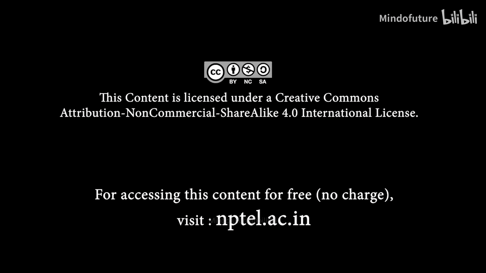
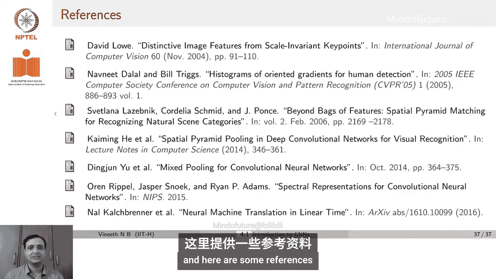

# 091：卷积神经网络介绍 - 第二部分

在本节课中，我们将深入探讨卷积与神经网络的联系，分析为何在图像处理中需要卷积神经网络而非全连接网络，并详细介绍CNN的核心概念：局部感受野、权值共享和池化。我们还将了解CNN的一些变体，如空洞卷积和转置卷积。

## 卷积与神经网络的联系

回顾了卷积操作后，我们提出一个问题：卷积与神经网络有何联系？对于图像处理，我们能否直接使用前馈神经网络？我们将通过图像分类的例子来仔细理解这一点。

传统基于机器学习的计算机视觉解决方案，会从图像中提取一些被称为**手工特征**的信息，例如SIFT、LBP、HOG等。之所以称为“手工”，是因为我们通过一些思考过程和启发式方法设计出提取这些特征的程序。这些方法在一段时间内很有效，但将其扩展到更多数据集和更复杂的真实世界图像时，成为了瓶颈。

传统流程是：给定一张图像，提取原始像素、边缘或SIFT、HOG等特征，这个过程被称为**静态特征工程**，完全不涉及机器学习。然后，将这些特征提供给一个分类器（如神经网络）以得到最终输出。

现在我们要问的问题是：与其使用那些用于边缘检测、SIFT或其他方法的手工设计卷积核，我们能否**学习有意义的卷积核或滤波器**？除了学习分类器的权重参数外，能否也学习这些卷积核的权重？例如，一个拉普拉斯高斯边缘检测器（LoG）在其卷积核中有特定的权重。我们能否将这些权重作为学习算法的一部分自动学习，而不是将其分离为手工设计步骤和学习步骤？

我们想更进一步：除了学习分类器的权重，能否学习**多个有意义的滤波器**？既然要学习，不如学习多个。此外，能否学习**多层有意义的卷积核和滤波器**？我们知道卷积具有良好的数学性质，可以在神经网络的不同层之间组合卷积操作。那么，我们能否在学习分类器权重的同时或之前，利用这一点学习多层有意义的卷积核？

这是可能的。实现方法很简单：将卷积核的权重系数也视为参数，与最终分类器的权重一同学习。具体流程是：输入图像经过一个卷积核，得到一个输出特征图，这成为第二层。可以再使用另一个卷积核，得到第三层的特征图。最终，这些特征图可以作为输入，传递给一个全连接层，得到最终输出。我们可以使用反向传播来更新每个中间步骤的滤波器系数。

这样的网络被称为**卷积神经网络**。之所以如此命名，是因为在每一步中，我们不是使用全连接的二部图来连接前后层，而是定义一组权重（即卷积核），对输入图像进行卷积以得到输出特征图，并通过反向传播学习这些权重。

## 为何使用CNN而非全连接网络？

学习滤波器似乎很有趣，但为什么不直接将图像展平并使用全连接神经网络呢？为什么要把事情复杂化去学习滤波器？神经网络本身就会学习权重，为什么中间需要一个卷积操作？为什么不能让神经网络直接接收展平的图像像素作为输入，让各层学习它们该学的东西？

我们不能这样做有几个原因。让我们逐一分析。

即使使用像**MNIST**这样的简单数据集（一个用于手写数字识别的数据集），如果使用不带卷积或不学习滤波器的前馈神经网络，也能获得相当不错的性能（接近98%-99%）。但这种方法存在一些局限性。

**第一个局限性**是：这种方法忽略了图像中结构的**空间相关性**。通过将像素展平成一个向量，我们移除了图像不同部分或角落之间存在的空间关系。空间上分离的像素与相邻的像素被同等对待，这似乎丢失了表征图像的一些重要信息。

**第二个局限性**是：网络没有明显的方法来学习输入图像中**不同位置的相同特征**。与其他一些机器学习问题不同，在图像中，无论猫出现在左上角还是右下角，我们都期望能识别出它。如果简单地将图像展平为向量，左上角的猫和右下角的猫将具有完全不同的向量表示（猫所在的维度会不同）。我们并没有强制网络去学习“猫就是猫，无论它在图像中的哪个位置”这一特性。

**第三个局限性**是：计算成本可能非常高昂。举个例子，如果你有一张100万像素的彩色图像，并在第一个隐藏层使用20个神经元，那么第一层将有多少个权重？答案是**6000万**个。100万像素是10^6个像素，彩色图像有3个通道，所以是300万个像素。与20个神经元全连接，仅第一层就会产生6000万个权重。为了获得更好的性能，你还需要添加更多层，这将导致权重数量爆炸式增长。

## CNN如何解决这些问题？

我们通过使用**卷积**的思想来克服这些问题。我们知道，一个滤波器只对原始图像中的**局部邻域**进行操作。我们称这些区域为**局部感受野**。具体来说，用于卷积的输入区域通常被称为感受野，它是图像的一个局部部分。因此，下一层的每个隐藏单元只连接到输入图像的一个局部部分。

这有几个目的：
1.  **捕捉空间关系**：因为如果你用一个滤波器对一个图像块进行卷积，你就是在捕捉该区域的二维空间关系。这种关系可能无法被前馈神经网络有效捕捉。
2.  **极大减少模型参数数量**：因为现在你只需要连接到一个局部区域，而不是拥有一个全连接图（第一层的每个神经元都连接到第二层的每个神经元）。沿用之前的例子，对于100万像素的彩色图像，假设你在第一个隐藏层学习一个大小为 `K1 x K2` 的滤波器，那么现在的权重数量就仅仅是滤波器本身的大小 `K1 x K2`。这与之前提到的全连接网络的6000万个权重形成了鲜明对比。

其次，卷积神经网络引入了**权值共享**的概念。权值共享意味着，无论你将滤波器与图像的右上角还是左下角进行卷积，你都使用滤波器中的相同数值。你不会因为卷积位置不同而改变滤波器权重。这与将图像展平并使用全连接层来估计该层权重（不同位置权重不同）的做法形成对比。

权值共享有两个目的：
1.  它使神经网络对图像中物体的**平移具有不变性**。正如之前所说，无论猫在左上角还是右下角，都是相同的权重在起作用，因此无论猫在图像的哪个部分，网络都能识别它。
2.  它减少了模型中的参数数量。

第三，CNN还进行**池化**操作。池化用于压缩来自前一层的信息。这也有两个目的：
1.  通过压缩信息，它**聚合了信息**，特别是平均掉了微小的变化，从而在下一层得到一个共同的输出。
2.  池化最终会将原始图像**下采样**为下一层中更小的图像。这样做之后，当卷积应用于下一层时，需要进行的卷积次数减少，从而降低了CNN后续层的计算量。

## CNN核心组件详解

现在让我们更详细地看看这些组件。首先回顾一下，CNN具有局部感受野、权值共享和池化。让我们依次回顾它们。

### 局部感受野

如果我们使用常规的前馈神经网络，它看起来会像这样：输入是红色神经元（假设是16个像素，对应16个输入神经元），蓝色方块是中间层的神经元，最后输出层是10个绿色神经元（对应10个数字）。可以看到，这里每个输入神经元都连接到第一隐藏层的每个隐藏层神经元，这是一个密集连接。如果继续这样连接下去，就会产生非常密集的权重集合，正如我们之前提到的。

让我们对比一下进行卷积时的情况。再次观察此图，输入同样是16个输入神经元。但现在，只有像素1、2、5和6这四个神经元参与第一个卷积的计算，像素3、4、7和8不参与。因此，只有像素1、2、5、6参与计算隐藏层第一个像素 `H11`。类似地，随着卷积核滑动，隐藏层的每个像素都由类似的局部操作产生。

这有什么帮助？
*   连接现在**稀疏得多**。这种稀疏连接自动减少了需要学习的权重数量。
*   重要的是，我们还利用了图像的结构。如图所示，参与 `H11` 输出的像素1、2、5、6在空间上是相关的（例如，与像素1、2、3、4、7、8相比）。

这里可能会问一个问题：稀疏连接真的是好事吗？假设我们有无限的计算和存储带宽，让神经网络通过全连接学习它该学的东西不是更好吗？通过稀疏连接，我们难道不是禁止了某些像素相互作用并贡献给下一层的输出吗？

答案是否定的，我们并没有通过这个过程丢失信息。因为，随着我们深入这样的神经网络，如果我们看这里高亮的神经元 `x1` 和 `x5`，它们在考虑第一隐藏层时可能不直接交互，但它们可能在后续隐藏层中间接交互。因为 `x1` 贡献给 `h2`，`h4` 从 `x5` 获得输入，而 `h2` 和 `h4` 在后续层中可能相互作用。因此，只要神经网络有足够的层数，我们实际上并没有丢失这些信息。

### 权值共享

让我们再通过一个例子来理解这一点。假设像素1、2、5、6通过一组权重连接到第一隐藏层的第一个隐藏神经元。类似地，最后四个像素（15, 16, 11, 12）连接到该隐藏层的最后一个像素。

我们要问的问题是：我们希望这些卷积核权重不同吗？我们希望这里是不同的权重集合，那里是另一个不同的权重集合吗？答案是否定的。我们希望滤波器以相同的方式响应图像中的物体或特征，无论它出现在图像的哪个位置。这就是所谓的**平移不变性**。我们希望我们的神经网络对于图像中物体从一个位置平移到另一个位置具有不变性。

其次，我们也可以拥有不同的卷积核来捕捉不同类型的特征。所以，并不要求你必须为左上角部分使用一个卷积核，为右下角部分使用另一个卷积核。你可以使用相同的卷积核，并使用另一个卷积核来捕捉另一种特征（例如，一个捕捉人的眼睛，另一个捕捉人的鼻子）。

这种在整个输入中使用相同权重的思想，是卷积的默认特性，被称为**权值共享**。显然，这也减少了参数数量。

### 池化层

现在让我们看看一个完整的CNN是什么样子。这里是一个示例卷积神经网络：给定输入，你有一个卷积层1，它可以有许多滤波器（例如，步幅为1，滤波器大小 `F` 为 `5x5`，滤波器数量 `K=6`，填充 `P=0`，参数总数是150）。然后你有一个**池化层**，接着是另一个卷积层，再一个池化层，最后是所谓的**全连接层**。

现在让我们理解一下这些中间的池化层是什么。如图所示，大多数CNN都有交替的卷积层和池化层（至少早期设计的CNN是这样）。如今，你可以在CNN架构中融入其他选项和更多层，我们将在本周后续课程中重新讨论。

池化层是一种**无参数的下采样操作**。它是一种子采样或下采样操作，并且没有参数，你不需要在这一层学习任何权重。

让我们看一个池化操作的例子。如图所示，这可能是一个特征图，或者是卷积步骤的输出（某个隐藏层中的特征图），大小为 `4x4`。

如果我们现在尝试进行步幅为2的**最大池化**，操作如下：你取一个 `2x2` 的窗口，计算其中的最大值（例如第一个窗口最大值是8），并将其放在输出对应位置。然后你步进2（跳过中间一个像素），移动到下一个 `2x2` 窗口，取最大值（例如4），放在下一个输出位置。

如果使用步幅为1，则移动到紧邻的下一个像素（不跳过），再次取 `2x2` 窗口的最大值。你需要在整个特征图上重复此操作。

你所要做的就是查看那个 `2x2` 窗口，不涉及任何权重，只需取最大元素并将其放入下一层的对应位置。正如你所见，这变成了一种下采样操作，意味着它会根据你选择的滤波器大小和步幅，将你在此处拥有的任何图像或特征图的大小减小。

在这个例子中，我们看到了**最大池化**，即取 `2x2` 窗口中的最大值。但你也可以有其他类型的池化操作，例如**平均池化**（取给定 `2x2` 窗口中值的平均值）或**L2池化**（取给定窗口中所有权重的L2范数）等等。

还有更多池化的变体，例如结合最大和平均池化的**混合池化**，以及**空间金字塔池化**、**谱池化**等。我们将在本课程后续讲座中介绍其中一些。

## CNN的变体

除了局部感受野、权值共享和池化这三个操作外，我们还可以在讨论的这些层中引入变体，特别是在卷积神经网络的卷积层中。在结束本讲座之前，让我们看看其中的几个变体。

### 空洞卷积

一个流行的变体是**空洞卷积**。它引入了一个新参数，称为**膨胀率**，顾名思义，它控制卷积核中值之间的间距。因此，当你在输入图像上应用卷积核时，你改变了卷积核值相对于输入的卷积间距。

让我们看一个膨胀率为2的 `3x3` 卷积核的例子。如图所示，你不是直接将 `3x3` 卷积核放置在输入的 `3x3` 窗口上，而是将卷积核放置在经过间隔采样的图像上。也可以说，这相当于先以某个膨胀率对原始图像进行下采样，然后应用标准卷积，两者是等价的。但我们现在一步完成。记住我们之前说过，采样和插值可以解释为卷积操作，我们现在只是利用空洞卷积来利用这一点。

注意，当膨胀率为1时，它就变成了标准卷积。空洞卷积和步幅大于1的标准卷积有一个细微差别：在步幅大于1的标准卷积中，卷积仍然是与图像中原始的相邻像素进行，只是下一个卷积移动到更远的像素。而在空洞卷积中，每个卷积本身是膨胀的，并且在输入图像中看到更大的邻域。

### 转置卷积

CNN中使用的另一个流行卷积变体是**转置卷积**。顾名思义，转置卷积允许对输入进行**上采样**。

在传统卷积中，你有一个输入图像，取一个滤波器，如果不进行填充，你会得到一个尺寸更小的输出。转置卷积则试图逆转这个过程：给定一个输入图像，通过卷积操作，能否得到一个更大的图像？这个过程被称为转置卷积，有时也称为反卷积或上卷积（尽管在信号处理上下文中，反卷积在技术上意味着不同的东西）。

传统上，我们会使用插值或类似规则来实现上采样。我们在第一周的课程中看到，可以使用像帐篷核这样的核与图像进行卷积，以获得更高分辨率的图像或对图像进行上采样。现在我们要问：为什么我们要使用帐篷核？为什么不能学习那个插值核的权重？

让我们通过一个例子看看如何进行转置卷积。考虑一个一维输入 `[4, 2, 3, 0, 1]` 和一个一维卷积核 `[1, 2, -1]`。我们想要得到一个比输入更大的输出。

操作如下：取卷积核 `[1, 2, -1]` 与输入的第一个值 `4` 卷积，得到 `[4, 8, -4]`。然后将卷积核滑动到输入的第二个值 `2`，得到 `[2, 4, -2]`。继续滑动，与 `3` 卷积得到 `[3, 6, -3]`，与 `0` 卷积得到 `[0, 0, 0]`，与 `1` 卷积得到 `[1, 2, -1]`。现在，在每个输出位置，我们将卷积核滑动到不同输入位置时在该位置得到的值相加。最终输出为：第一个位置 `4`，第二个位置 `8+2=10`，第三个位置 `-4+4+3=3`，第四个位置 `-2+6+0=4`，第五个位置 `-3+0+1=-2`，第六个位置 `-1`。这样就得到了比输入更大的输出 `[4, 10, 3, 4, -2, -1]`。你可以在二维中做同样的事情来放大图像。我们将在本课程后面看到使用这种操作的例子。

### 其他卷积类型

还有其他类型的卷积，我们将在讨论它们在不同上下文中的应用时详细探讨，但现在让我们简要回顾一下。

*   **3D卷积**：正如我们已经提到的，进行3D卷积，输出也是一个3D体积。在本讲座讨论的场景中，我们的滤波器是3D的，但输出特征图是2D的，我们通过使用多个滤波器或特征图使其成为3D。但如果我们通过卷积本身的性质确保输出是3D体积，那就是3D卷积。
*   **1x1卷积**：你只沿着体积的深度进行卷积，在输出中变成一个单一的值。因此，一个 `W x H x D` 的输入变成 `W x H`，因为你用一个深度卷积核在特定像素位置对整个深度进行卷积，得到该位置的一个标量。
*   **分组卷积**：不同的滤波器与输入中不同的深度进行卷积。例如，如果你的输入有100个通道，一组滤波器可能与前10个通道交互，另一组与接下来的10个通道交互，依此类推。
*   **可分离卷积**：就像我们在第一周看到的那样，我们可以将二维卷积分离为沿一个维度的卷积，然后是沿第二个维度的卷积。回想一下，我们说这有助于减少计算量。
*   **深度可分离卷积**：给定一个输入体积，你有三个不同通道的三个滤波器，分别对它们进行卷积，得到三个不同的特征图。然后进行深度卷积，将它们压缩成一个单一的特征图。这可以针对不同的滤波器重复进行，以在下一层获得多个滤波器特征图。
*   **扁平化卷积**：与可分离卷积非常相似，你首先有一个沿一个维度的滤波器，然后有一个沿另一个维度的滤波器，然后有沿第三个维度的第三个滤波器。在某种意义上，这是可分离卷积和深度可分离卷积的结合。
*   **空间和跨通道卷积**：我们可以并行进行卷积，然后连接它们以获得输出。

我们将在本周后续的讲座中，结合它们的使用场景，看到其中几种卷积类型的例子。

## 总结与思考

本节课我们一起学习了卷积神经网络的核心思想及其相对于全连接网络的优势。我们深入探讨了CNN的三个关键组件：**局部感受野**、**权值共享**和**池化**，并介绍了几种重要的卷积变体，如**空洞卷积**和**转置卷积**。

以下是你的推荐阅读材料：
*   关于卷积的交互式演示，请参阅[此链接](http://setosa.io/ev/image-kernels/)。
*   关于反卷积操作的精彩讨论，请参阅[Distill.pub的此链接](https://distill.pub/2016/deconv-checkerboard/)。
*   其他优秀资源包括《深度学习》一书第9章，以及CS231n课程的相关笔记。

最后，留给你两个思考问题：
1.  给定一个 `32 x 32 x 3` 的图像，以及6个大小为 `5 x 5 x 3` 的滤波器，在步幅为1、填充为0的情况下，输出的维度是多少？请计算一下。
2.  最大池化层是可微分的吗？如何通过它进行反向传播？在本节课结束时思考这些问题。

