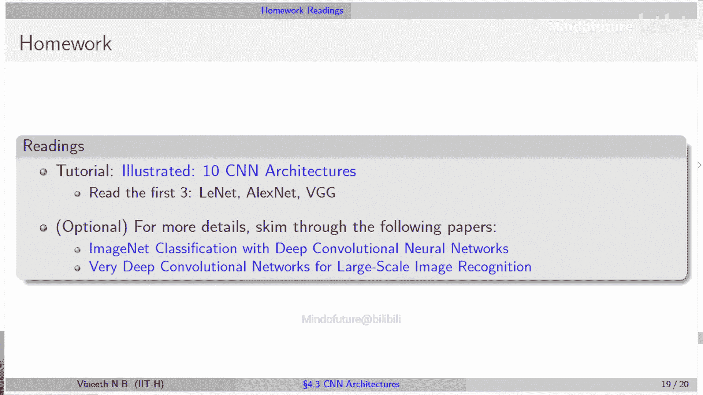

# 093：CNN架构演变 - 第一部分

## 概述
在本节课中，我们将学习卷积神经网络架构的演变历史。我们将从最早的架构开始，了解它们的设计原则、关键贡献以及如何随着时间推移而改进。我们将重点关注用于ImageNet图像分类挑战赛的几种重要架构，包括LeNet、AlexNet、ZFNet和VGGNet。

---

## 卷积神经网络的早期先驱

上一节我们介绍了卷积神经网络的基本概念和反向传播原理。本节中，我们来看看CNN架构是如何随着时间演变的。

卷积神经网络的历史可以追溯到1980年的Neocognitron。Neocognitron或许是CNN最早的先驱。它提出了特征提取的概念、池化层的概念、在神经网络中使用卷积的概念，以及最终进行分类识别的概念。

但“卷积神经网络”这一名称，是随着Yann LeCun设计的LeNet网络而出现的。LeNet主要在1989年至1998年间开发，用于手写数字识别任务。

LeNet卷积神经网络架构如下图所示。它以一个卷积层开始，接着是一个池化层，然后又是卷积层和池化层，最后是两个全连接层和输出层。

卷积滤波器的大小为5x5，步长为1。池化层大小为2x2，步长为2。你可以看到整体架构可以这样描述：`Conv -> Pool -> Conv -> Pool -> FC -> FC`。这表示一个卷积层后接一个池化层，再接一个卷积层和池化层，最后是两个全连接层。

直到今天，许多架构在设计CNN时仍遵循类似的原则。

---

## ImageNet挑战赛与评估指标

CNN新架构设计和发展的主要推动力，得益于2010年开始的ImageNet分类挑战赛。ImageNet是一个数据集，他们在2010年组织了名为“大规模视觉识别挑战赛”的比赛。

ImageNet中的图像数据库根据WordNet层次结构组织。它目前包含WordNet层次结构中各种名词对应的图像，拥有数百万张图像，目前每个节点大约有500张图像。

这促使全球研究人员投入大量精力，在一个公共数据集上对他们的机器学习模型（特别是计算机视觉模型）进行图像分类性能基准测试。该数据集的性能衡量标准被称为**Top-1错误率**和**Top-5错误率**。

*   **Top-1错误率**：将神经网络的最佳预测与真实标签进行比较时的错误率。
*   **Top-5错误率**：检查真实标签是否在神经网络输出层的前五个预测标签中。这仍然是一个很好的衡量标准，因为ImageNet数据集有大约1000个类别，这意味着神经网络输出层有1000个神经元。只要你的真实标签在输出层得分的前五名中，就认为是正确匹配。否则，就会产生Top-5错误。

关于ImageNet数据集的更多详细信息，请参阅[此链接](https://image-net.org/)。

---

## 分类任务中的损失函数与激活函数

在继续讨论CNN架构之前，让我们退一步，看看神经网络通常如何用于分类问题。

当我们讨论前馈神经网络时，我们将损失函数视为均方误差。这在当时是可以的。但当你处理分类问题时，均方误差可能不是损失函数的正确选择。均方误差更适合回归问题。

在分类问题中，最常见的损失函数被称为**交叉熵损失函数**。它衡量真实标签输出上的概率分布与神经网络输出的标签概率分布之间的熵。这可以让你了解神经网络所犯的错误。

以下是交叉熵损失函数的正式定义：

**公式：**
`L = - (1/C) * Σ (y_i * log(ŷ_i))`

其中，`C`是总类别数，`ŷ_i`是神经网络对特定类别`i`的预测（或最后一层对类别`i`的得分），`y_i`是该特定类别的正确标签。

更具体地说，`y_i`是一个向量。假设你有`C`个类别（1到C），并且第二个类别是正确的类别，那么你期望的`y`向量将是 `[0, 1, 0, 0, ..., 0]`（直到第C个类别）。这就是真实标签空间中标签的概率分布，因为这是正确的类别。这就是我们在这里讨论的`y_i`，而`ŷ_i`是神经网络输出层的得分。

在二分类情况下，这可以简化为 `- [y_i * log(ŷ_i) + (1 - y_i) * log(1 - ŷ_i)]`。例如，当你使用Sigmoid函数时，神经网络只会输出一个得分，`1 - y_i`将是负类的得分。

交叉熵损失函数是可微的。如果我们使用这个损失函数，首先要检查的是它是否可微。通过观察，我们可以说交叉熵损失函数肯定是可微的。然后，我们需要计算它对最后一层权重`W_j`的梯度。一旦我们得到这个梯度，就可以通过我们目前讨论的方法将其进一步传播到更早的层。

如果我们考虑激活函数为Sigmoid（假设是二分类问题），交叉熵损失函数对最后一层权重`W_j`的导数可以推导出来。有趣的是，这个梯度项与均方误差的梯度项非常相似。记住，`σ(z)`就是`ŷ`。所以即使在均方误差中，当你对`(1/2)*(ŷ - y)^2`求导时，你也会得到`(ŷ - y)`。因此，交叉熵的梯度看起来与均方误差的梯度非常相似。

在转向CNN架构之前，还有一点需要注意：当你进行分类时，虽然我们讨论过不同类型的激活函数，如Sigmoid、Tanh、ReLU、Leaky ReLU等，但我们通常在输出层单独使用一种称为**Softmax激活函数**的函数。

什么是Softmax激活函数？给定最后一层的`Z_1`到`Z_C`（假设它们是最后一层`C`个神经元的输出），网络的最终输出由 `e^{Z_j} / Σ_{k} e^{Z_k}` 给出。

这有什么作用？记住，在这种情况下，最后一层所有`e^{Z_k}`的总和总是大于`e^{Z_k}`，这意味着这些值肯定介于0和1之间。此外，因为分母是所有神经元指数值的总和，对最后一层的每个神经元都进行此操作，其输出之和也将等于1。这样，我们现在将神经网络输出的任何得分转换为一个概率值向量，其中每个值都在0到1之间，并且它们加起来等于1。这使我们能够将神经网络的输出解释为输出标签空间上的概率分布。

因此，Softmax是用于分类的神经网络输出层默认使用的激活函数。

这里有一个小的术语说明：概率得分之前的值通常被称为神经网络的**逻辑值**。因此，神经网络输出逻辑值，你应用Softmax激活函数并将其转换为概率得分。

---

## ImageNet挑战赛的赢家：从传统方法到CNN

现在让我们回到ImageNet分类挑战赛。

我们将要讨论的所有这些CNN，都使用交叉熵损失作为损失函数，并且几乎都在最后一层使用Softmax激活函数，作为这些CNN架构中常见的选择。

正如我们几分钟前所说，ImageNet数据在2010年创建并发布，世界各地的研究人员参加了ILSVRC挑战赛。

*   2010年，获胜的错误率是28.2%，这是在没有神经网络的情况下实现的。
*   2011年，研究人员将错误率从28.2%提高到25.8%。
*   2012年，Alex Krizhevsky和Geoffrey Hinton提出了一种至今仍很流行的CNN架构——**AlexNet**，它将错误率从25.8%大幅降低到16.4%。

因此，这是第一个基于CNN赢得ImageNet挑战赛的架构。自2012年以来，每年的挑战赛都由CNN获胜，其性能显著优于其他浅层机器学习方法。传统的机器学习方法通常被称为浅层学习，因为你没有在许多层上进行深度学习。当我们试图理解神经网络的深度为架构带来什么价值时，这一点将在接下来的课程中变得更加清晰。

---

## AlexNet：2012年的突破

现在让我们从AlexNet架构开始，并尝试理解它。

以下是AlexNet的架构。实际上，当我们在本周第一堂关于CNN的课程中计算大小时，我们以AlexNet的第一层为例。输入是一个体积为224x224x3（RGB通道）的数据。滤波器大小为11x11（深度为3，这在所有情况下都遵循），步长为4。这导致了55x55的输出。总共选择了96个滤波器，其中48个滤波器进入一个处理单元，剩下的55x55x48进入另一个处理单元。我们将在接下来的几张幻灯片中更详细地描述这一点，但这就是2012年赢得ILSVRC的整体架构。

它的设计原则与LeNet相似，但也有许多不同的特点，并且比LeNet更深，还有一些我们将要讨论的其他重要改进。它使用带有正则化的随机梯度下降法在120万张图像上进行了训练。

让我们更仔细地看看这个架构。

它有一个输入图像，大小为224x224x3，这是ImageNet数据集中图像的大小。第一层有一个卷积加池化操作，你在这里一起看到输出。因此，55x55x48的输出是在完成卷积部分之后得到的，然后你进行最大池化，进一步减小尺寸。

然后，他们再次进行卷积加池化，接着是单独的卷积层，再是单独的卷积层，然后又是卷积加池化，接着是全连接层，再一个全连接层，最后是输出层。

让我们再看一下至少第一层的数字，你或许可以根据我们本周第一堂课讨论的原理计算出剩余层的大小。

所以，输入是224x224x3，滤波器大小为11x11，步长为4。他们还有一定程度的填充，所以最终输入网络的大小是227x227。因此，`(227 - 11) = 216`，除以4得到54，加1得到55，这就是我们之前讨论过的。

同样，你可以通过知道每层中的滤波器数量和核大小（图中所示）来计算每层的参数。它总共有8层：5个卷积层和3个全连接层（最后三层是全连接的）。正如我们提到的，它在ImageNet数据集上进行了训练。

AlexNet的设计者还引入了一个称为**局部响应归一化层**的归一化层。到目前为止，我们看到了批归一化层，类似地，局部响应归一化层对给定层中特定位置跨通道的所有值进行归一化。例如，如果你有一定的深度，你会取一个特定的像素位置，沿着深度方向，并在该特定空间位置对所有深度值进行归一化。这被称为局部响应归一化，作者认为这会产生一种称为**侧抑制**的效果，因此它允许其中一个值在归一化后获得更高的输出值，从而胜过其他值。

除此之外，这个特定的架构还引入了**修正线性单元**作为激活函数，这是使该架构成功的贡献之一。当然，ReLU现在是许多其他CNN中激活函数的默认组件或默认选择。

正如你在架构中看到的，最大池化跟随第一、第二和第五个卷积层。第三和第四层没有池化。ReLU非线性激活函数应用于整个架构中每一层的输出。

为什么当时选择这样的设计？也许这是能带来最佳经验性能的架构。

让我们尝试从参数和神经元的角度分析这个架构的复杂性。

第一层的参数由以下公式给出：滤波器大小为11x11x3，加上一个偏置，乘以第一层选择的滤波器总数96（其中48个进入一个处理单元，另外48个进入另一个处理单元）。因此，第一层的参数总数大约是35,000。

另一方面，神经元的数量由图像本身的大小给出，即55x55x96，结果大约是253,000。

同样，你可以计算其他层的数字。第二层的参数大约是300k，神经元大约是186,000。第三层的新参数是884k，神经元数量是64,000。所以你可以看到，由于应用池化后尺寸减小，神经元的数量在减少。在这里，神经元指的是下一层特征图中的每个像素。因为我们进行池化，图像尺寸从224x224变为55x55，再到27x27，再到13x13，由于尺寸减小，神经元数量减少。

但参数数量持续增加，因为初始选择的滤波器数量很大（最初是96个），下一层有128+128个滤波器，总共256个滤波器。然后是192+192，大约是384个滤波器，依此类推。你可以看到，随着网络加深，参数数量持续增加，神经元数量减少，直到进入全连接层，参数数量急剧增加，达到百万级别。在总共约6000万个参数中，大约5700万个参数仅位于全连接区域。这应该再次向你解释卷积层和池化层在参数数量方面是多么高效。

神经元总数约为63万个。

从另一个角度来看，你可以在这里看到，参数从35k增加到最后几层的数百万，而神经元从253k开始，在最后几层减少。

这个架构一个有趣的观察是：卷积层可能只包含5%的参数。记住，在AlexNet总共6000万个参数中，它们只包含300万个参数。但它们却占用了95%的计算量。为什么会这样？

尽管它们只有5%的参数，但请记住，在卷积中，你必须取相同的权重，并将其放置在原始图像的每个位置以获得输出。因此，尽管权重数量少，但卷积层的计算量很高。

所以，90%到95%的计算位于卷积层，而90%到95%的参数位于全连接层。

AlexNet使用SGD在两张NVIDIA GTX 580 GPU上进行训练，这使他们能够将特征图分配到两个不同的GPU上。训练这个架构花了他们大约一周时间。今天，由于GPU的改进，可以在更短的时间内完成，但在当时，他们花了一周时间来训练这个架构。

---

## ZFNet：2013年的改进

在接下来的一年，2013年，ImageNet LSVRC的获胜者是一个名为**ZFNet**的网络。它来自提出这种CNN设计的Zeiler和Fergus的名字。

2013年，ZFNet相对于AlexNet的主要贡献是：架构大体相同（整体上是Conv-Pool-Conv-Pool-Conv-Conv-Pool-FC-FC），但在超参数上有一些变化。

以下是超参数的变化：
*   在Conv1中，滤波器大小从11x11（步长4）改为7x7（步长2）。
*   在Conv3、4和5中，滤波器数量从384、384、256增加到512、1024和512。

这种对超参数的精心选择，使得Top-5错误率从16.4%显著降低到11.7%。

在这个阶段，我应该澄清一个术语：**超参数**的概念。为什么我们称这些值（如11x11、7x7、384）为超参数？因为我们学习到的参数是神经网络的权重。所有其他值都是用户定义的，不是学习得到的，所以我们称它们为超参数。参数是权重，这才是我们实际学习的东西。

但这就是ZFNet在2013年的主要贡献。

---

## VGGNet：2014年的深度探索

进入2014年，一个主要的贡献是一种名为**VGGNet**的新架构。VGGNet代表由牛津大学VGG小组开发的架构，VGG代表视觉几何组。他们在设计中提出了一种特定的理念。

他们提出了多种深度的架构。他们认为，虽然AlexNet将深度提升到一定水平，ZFNet保持了与AlexNet相同的深度，但通过使CNN更深，可以更好地解决问题，并在ImageNet分类挑战赛上获得更低的错误率。

因此，他们的做法是采用多种不同深度的架构。你可以在这里看到，输入在顶部，输出在底部。你可以看到卷积层、最大池化层、卷积层、最大池化层等等。这些64、128表示这些架构中的尺寸。

他们有趣的设计理念是：这个架构在2014年ImageNet挑战赛中获得亚军。他们的理念是，通过增加深度，你可以在函数中建模更多的非线性。关键贡献是：**深度是一个关键组件**。

他们从头到尾保持了一个同质的架构。这是什么意思？他们在所有层中只使用**3x3卷积**。我们看到AlexNet第一层有11x11滤波器，ZFNet在第二年将其改为7x7滤波器。但VGG认为，与其在设计架构时费力寻找滤波器大小，他们决定将其固定为3x3。这有什么帮助？我们稍后会讲到。他们在网络的所有池化层中使用**2x2最大池化**。

他们的主要思想是：较小的感受野意味着更少的参数。这意味着如果你有一个3x3滤波器，需要学习的参数更少。更重要的是，连续进行两个3x3卷积，其效果等同于一个5x5卷积。当你进行一次3x3卷积时，你会得到一个输出。如果你在第一个输出的基础上再进行一次3x3卷积，原始图像中5x5像素的邻域将对后面的输出产生影响。换句话说，两个3x3卷积具有与单个5x5卷积相同的感受野。同样，三个3x3卷积具有与7x7卷积相同的感受野，依此类推。

因此，与其尝试保持11x11或7x7等滤波器大小，他们认为可以始终将滤波器大小保持为3x3。重要的是，正如我们所说，它会有更少的参数。如果你采用单个7x7卷积，你将有`7^2 * C^2`个参数（`7^2`是49，乘以`C^2`）。而如果你有三个连续的3x3卷积，你将拥有`3 * (3^2 * C^2)`个参数，即`27 * C^2`，对比`49 * C^2`。因此，这比进行单个7x7卷积具有更少的参数。

他们发现，在这个架构中，VGG-19仅比VGG-16略好。因此，直到VGG-16，性能随着深度增加而持续提高，但在达到一定深度后似乎趋于饱和。这个问题后来得到了解决，我们将在接下来的幻灯片中看到。

他们还尝试使用不同网络的集成，以在同一任务上获得改进的性能。

然而，在参数方面，VGG具有显著的内存开销和参数开销。你可以在这里看到AlexNet与VGG-16在内存方面的比较。内存简单地是你VGG中所有层的神经元总数与AlexNet中所有层的神经元总数的比较。再次记住，当我们说神经元数量时，我们指的是特征图的大小，因为在CNN中，每个特征图中的每个像素对我们来说都是一个神经元。

因此，你可以仔细计算并发现，AlexNet总共有190万个神经元，而VGG-16有4860万个神经元。在参数方面，虽然前几个卷积层对于AlexNet和VGG来说都相对较小，但在全连接层，VGG的参数显著增加。虽然AlexNet总共有大约6000万到6100万个参数，但VGG-16最终拥有大约1.38亿个参数。

因此，虽然VGG在许多场景下表现良好，但由于其增加的参数数量和内存需求，这也是VGG的一个限制。尽管选择3x3本身减少了参数，但由于后面的层、深度、全连接层等原因，参数累积起来对他们来说还是很多。它使用了更多的内存和参数。正如我们所见，大多数参数位于第一个全连接层。大多数内存，正如他们之前所见，位于早期的卷积层，因为那时你需要最大数量的神经元来容纳所有这些特征图。

---

## 总结
本节课中，我们一起学习了卷积神经网络架构的演变历程。我们从最早的LeNet开始，了解了其基本结构。然后，我们探讨了推动CNN发展的ImageNet挑战赛及其评估指标。接着，我们深入分析了用于分类任务的交叉熵损失函数和Softmax激活函数。之后，我们详细研究了几个里程碑式的架构：2012年首次以CNN赢得ImageNet的AlexNet，2013年通过调整超参数取得改进的ZFNet，以及2014年强调深度和同质化设计（使用3x3卷积）的VGGNet。我们了解了它们的设计理念、关键贡献、参数与计算量的分布特点，以及各自的优缺点。这些架构为后续更复杂网络的发展奠定了基础。