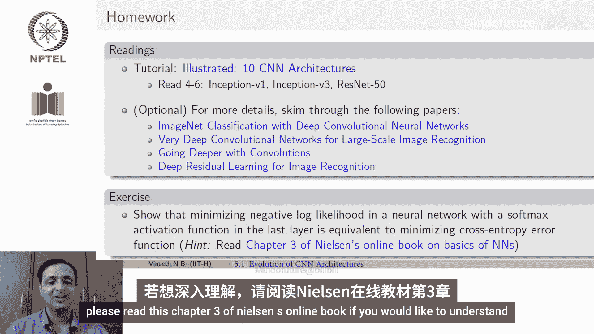

# 094：CNN架构的演变 - InceptionNet与ResNet

在本节课中，我们将学习卷积神经网络（CNN）架构发展历程中的两个重要里程碑：GoogleNet（InceptionNet）和ResNet。我们将了解它们如何通过创新的模块设计来解决深层网络训练中的效率与梯度问题。

## 概述

随着2014年VGG网络的出现，另一个名为GoogleNet的网络也同时诞生。GoogleNet的目标是构建更深的网络，同时追求效率，旨在减少参数数量、内存使用和计算量。

## GoogleNet与Inception模块

上一节我们回顾了VGG网络，本节我们来看看GoogleNet的创新之处。GoogleNet网络深度达到22层，它通过移除全连接层和引入**Inception模块**来达成其设计目标。

### Inception模块的设计理念

以下是Inception模块的核心思想：它不再单一地选择卷积核尺寸，而是并行使用多种尺寸的卷积核，并将结果拼接起来。

原始的朴素Inception模块结构如下：
*   并行执行1x1卷积。
*   并行执行1x1卷积后接3x3卷积。
*   并行执行1x1卷积后接5x5卷积。
*   并行执行3x3最大池化后接1x1卷积。

这种设计允许网络在同一层捕捉不同尺度的特征。然而，直接进行这种并行计算非常昂贵。

### 1x1卷积的瓶颈作用

为了解决计算量大的问题，GoogleNet引入了**1x1卷积**作为瓶颈层，用于在昂贵的卷积操作之前降低通道维度。

其工作原理是：对于一个尺寸为 `56x56x64` 的输入张量，使用32个 `1x1x64` 的卷积核进行卷积操作。每个空间位置（共56x56个）经过 `1x1x64` 的卷积后，会输出一个标量值。因为有32个这样的滤波器，最终输出变为 `56x56x32`。

**公式表示**：`输出尺寸 = (输入高度, 输入宽度, 1x1卷积核的数量)`

这种方法保持了空间维度，但显著降低了深度，从而减少了后续卷积层的计算量。

### 最终的Inception模块

因此，最终的Inception模块在并行分支中执行3x3或5x5卷积之前，都先应用了1x1卷积来降低深度。对于最大池化分支，则先进行池化操作以保持通道数，然后再用1x1卷积降低深度。

### GoogleNet的整体架构

GoogleNet的整体架构始于一个小的“主干”网络（包含卷积和池化层），之后堆叠了多个Inception模块。网络末端是分类器输出，没有全连接层。此外，网络中还有**辅助分类器**，它们将中间层的输出接入一个小型分类网络，计算损失并回传梯度，这有助于缓解深层网络中的梯度消失问题，确保前面层的权重也能得到有效更新。

## 深度网络的挑战与ResNet

随着网络逐年加深，研究人员开始探索CNN的深度极限。然而，他们发现一个反直觉的现象：更深的网络（如56层）的训练误差和测试误差反而比更浅的网络（如20层）更高。

### 梯度消失问题

造成这一现象的主要原因是**梯度消失**。在深度神经网络中，使用如Sigmoid的压缩型激活函数时，其梯度值小于1。在反向传播过程中，这些小于1的梯度值在多层之间连续相乘，会导致传递到前面层的梯度变得极其微弱，甚至趋近于零，使得前面层的参数无法得到有效更新。

**公式示意**：对于初始层输入 `x_n` 的梯度 `dL/dx_n`，在反向传播链式法则中会连续乘以多个Sigmoid导数 `σ'`（每个`σ'` ≤ 0.25），导致乘积迅速变小。

### 残差网络（ResNet）的解决方案

为了解决梯度消失问题并使深层网络至少不差于浅层网络，ResNet在2015年引入了**残差块**。

在普通的CNN块中，输入 `x` 经过一系列层（如卷积、激活函数）变换为 `H(x)`。而在残差块中，目标不再是学习 `H(x)`，而是学习**残差** `F(x) = H(x) - x`。因此，块的输出变为 `F(x) + x`。

**核心结构**：输入 `x` 一方面通过两到三个卷积层进行变换，另一方面通过一条**恒等映射**（或称“捷径连接”）直接传递到输出端，并与卷积变换的结果相加。

### ResNet为何有效？

这种设计为梯度回传提供了“高速公路”。在反向传播时，梯度可以通过恒等映射这条捷径几乎无损地传递到更早的层，确保了即使网络非常深，前面层也能获得较强的梯度信号进行更新。这使得训练超过100层的超深网络成为可能。

### ResNet的架构细节

ResNet由多个残差块堆叠而成。在深层ResNet（如ResNet-50/101/152）中，也使用了类似GoogleNet的**1x1瓶颈层**来提升计算效率。网络末端使用**全局平均池化**将每个特征图压缩为一个标量，然后接一个全连接层进行分类。

凭借残差连接，ResNet在2015年的ImageNet分类、检测、定位以及COCO检测与分割等多项竞赛中均取得了第一名，并成为计算机视觉领域的基础性架构。

## 总结

本节课我们一起学习了CNN架构演变中的两个关键网络。GoogleNet通过设计并行的Inception模块和使用1x1瓶颈卷积，在增加网络深度的同时提升了计算效率。ResNet则通过引入带有恒等映射的残差块，巧妙地解决了深度网络中的梯度消失问题，使得训练成百上千层的神经网络成为现实，并显著提升了模型性能。这两种创新思想对后续的深度学习模型设计产生了深远影响。