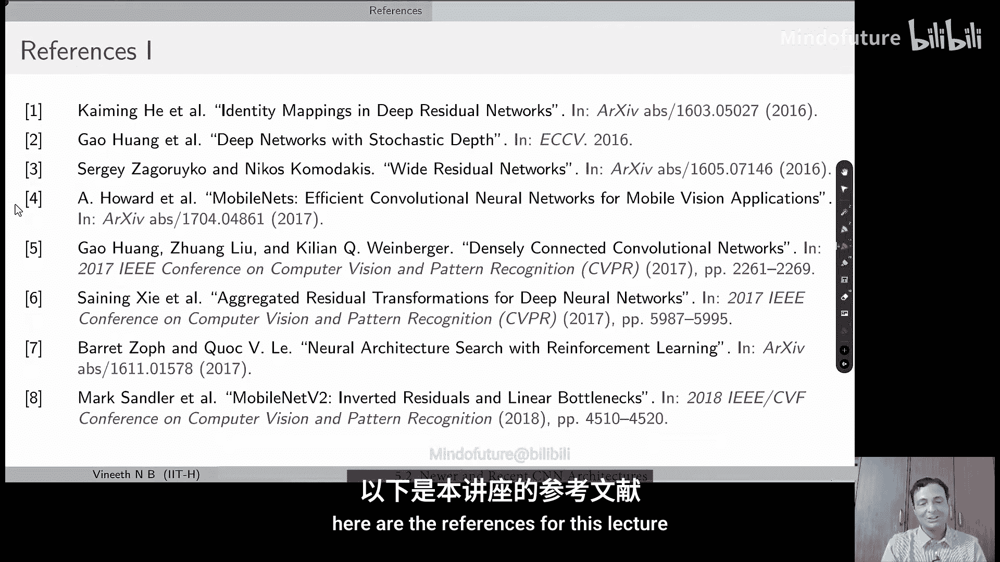

# 095：更新与近期CNN架构 🏗️


在本节课中，我们将学习自ResNet之后发展起来的一系列重要CNN架构。我们将探讨ResNet的几种变体，如宽残差网络和随机深度网络，然后介绍DenseNet、MobileNet、EfficientNet、SENet等高效网络，最后讲解受Transformer启发的ConvNeXt架构。这些架构在提升性能、降低计算成本或适应移动设备方面各有侧重。

## 从ResNet到其变体 🔄

上一节我们回顾了ResNet及其核心的残差连接思想。本节中，我们来看看几种基于ResNet的改进架构，它们通过不同的方式优化了网络设计。

### 残差连接的重要性与改进

ResNet中的恒等映射为反向传播提供了“高速公路”，缓解了梯度消失问题。ResNet的创建者进一步改进了设计，将ReLU激活函数移入残差块内部，使得恒等连接路径不再紧随ReLU之后，从而创建了更直接的信息传播路径，这被证明能带来更好的性能。

### 宽残差网络

宽残差网络基于一个假设：ResNet的成功主要归功于残差块结构本身，而非单纯的网络深度。因此，该架构不追求增加深度，而是**增加每个残差块内的宽度**（即卷积核数量）。具体做法是将基础残差块中两个3x3卷积层的滤波器数量F增加K倍，变为F*K。研究表明，一个50层的宽ResNet可以超越152层的原始ResNet。增加宽度而非深度还有计算上的好处，因为更宽的网络层更易于并行化计算。

以下是宽残差网络中一个残差块宽度增加的示意：
```python
# 原始残差块的两个卷积层
conv1 = Conv2D(filters=F, kernel_size=3)
conv2 = Conv2D(filters=F, kernel_size=3)
# 宽残差块中宽度增加K倍
conv1_wide = Conv2D(filters=F*K, kernel_size=3)
conv2_wide = Conv2D(filters=F*K, kernel_size=3)
```

### ResNeXt：聚合残差变换

ResNeXt将Inception模块的多分支思想引入残差网络。其核心残差块包含**多个并行路径**，每条路径都遵循“1x1卷积降维 -> 3x3卷积 -> 1x1卷积升维”的瓶颈结构，最后将各路径输出相加。这种设计增加了网络的“基数”（路径数量），被视为深度和宽度之外的另一个维度，能有效提升模型容量和性能。

### 随机深度网络

该思想可以看作是在残差块层级应用“Dropout”。由于残差连接的存在，网络不会因为随机丢弃（即跳过）某些残差块而断开。在训练时，每个小批量迭代中会按一定概率随机跳过一部分残差块。这种方法能进一步缓解梯度消失、减少训练时间（因为前向传播路径变短），并起到正则化的作用。在测试时，则使用完整的网络。

## 密集连接卷积网络 (DenseNet) 🌐

从ResNet及其变体对跳跃连接的探索出发，DenseNet提出了更极致的连接方式。

在DenseNet的**密集块**中，每一层都与其前面所有层直接连接。这与ResNet中周期性的恒等连接不同，DenseNet建立了所有层之间的直接连接。这些连接也称为跳跃连接或恒等连接（权重为1），它们确保了梯度能够直接流向更早的层，极大地缓解了梯度消失问题。研究表明，一个相对“浅”的50层DenseNet可以超越152层的ResNet。

以下是DenseNet中一个密集块内连接方式的简化描述：
```
第1层输出 = H1(输入)
第2层输出 = H2([输入, 第1层输出])  # [ ] 表示拼接
第3层输出 = H3([输入, 第1层输出, 第2层输出])
... 以此类推
```
其中，H代表一系列操作（如BN、ReLU、卷积）。

## 面向移动与高效计算的架构 📱

随着CNN在视觉应用中的普及，在嵌入式或边缘设备等低功耗设备上部署模型的需求日益增长。这催生了一系列旨在实现**低延迟、低功耗、小模型尺寸**同时保持足够精度的网络架构。

### MobileNet

MobileNet的核心是使用**深度可分离卷积** 替代标准卷积，从而大幅减少计算量和参数量。

深度可分离卷积分为两步：
1.  **深度卷积**：对输入的每个通道独立进行空间卷积（滤波器尺寸为 `DK x DK x 1`），产生与输入通道数相同的特征图。
2.  **逐点卷积**：使用1x1卷积对深度卷积输出的所有通道进行线性组合，改变通道数。

假设输入特征图尺寸为 `DF x DF x M`，输出为 `DF x DF x N`，卷积核为 `K x K`。
*   **标准卷积计算成本** ≈ `K * K * M * N * DF * DF`
*   **深度可分离卷积计算成本** ≈ `K * K * M * DF * DF` (深度卷积) + `M * N * DF * DF` (逐点卷积)

计算量减少的比例约为：`1/N + 1/(K^2)`。当使用3x3卷积核时，深度可分离卷积的计算量大约为标准卷积的1/8到1/9。

此外，MobileNet还引入了**宽度乘数**和**分辨率乘数**两个超参数，允许根据不同的资源约束（如算力、存储）调整模型的宽度和输入图像大小，从而形成一个模型家族。

### EfficientNet

EfficientNet系统地研究了网络缩放问题。传统做法是单独增加深度、宽度或输入分辨率，但EfficientNet发现这些维度单独缩放时收益会递减。因此，它提出了**复合缩放方法**，使用一个单一的复合系数 φ 来平衡地缩放网络的深度、宽度和分辨率：

*   深度：`d = α^φ`
*   宽度：`w = β^φ`
*   分辨率：`r = γ^φ`

约束条件为：`α · β² · γ² ≈ 2`，且 `α, β, γ ≥ 1`。其中，α, β, γ 是通过在小模型上搜索确定的常数。这样，当总计算资源增加 `2^φ` 倍时，模型性能能得到更高效的提升。

### 挤压与激励网络 (SENet)

SENet关注于提升通道间特征的表征能力。它在卷积块中引入了**SE模块**，该模块包含两个操作：
1.  **挤压**：对每个通道的特征图进行全局平均池化，得到一个标量，从而捕获该通道的全局信息。
2.  **激励**：通过一个小型全连接网络（通常包含瓶颈结构）学习每个通道的重要性权重（介于0和1之间），然后使用这些权重对原始特征图的各个通道进行重新校准（缩放）。

SE模块可以灵活地嵌入到如ResNet等现有架构中，以极小的计算开销带来明显的性能提升。

## 受Transformer启发的CNN：ConvNeXt 🚀

近年来，Transformer模型在视觉领域大放异彩。ConvNeXt是一项将Transformer成功设计理念系统化地融入纯CNN架构的工作。它通过对ResNet进行一系列精心设计的改进，证明了传统CNN经过现代化改造后，性能可以媲美甚至超越视觉Transformer。

以下是ConvNeXt采用的一些关键设计改动：

*   **大卷积核与非重叠下采样**：将初始的7x7卷积+步长2，改为使用4x4卷积、步长4。这类似于ViT中将图像分割为不重叠的图块，减少了冗余计算。
*   **倒置瓶颈块**：借鉴Transformer的MLP块，将ResNet中“先压缩（1x1降维）-后扩展（1x1升维）”的瓶颈结构，改为“先扩展（1x1升维）-后压缩（1x1降维）”，并且中间使用深度卷积。
*   **减少激活与归一化层**：在每个块中，将常用的ReLU激活函数替换为更平滑的GELU，并且只保留一个激活函数。同时，用**层归一化** 替代批归一化，并且每个块也只使用一个归一化层。
*   **分离下采样层**：将下采样操作（如步长2的卷积）作为独立层，而不是在残差块内部完成，使设计更清晰。

这些改动共同作用，使得ConvNeXt在ImageNet等基准数据集上取得了优异的性能。

## 总结 📝

本节课我们一起学习了自ResNet以来CNN架构的重要发展脉络。我们从ResNet的多种变体（宽ResNet、ResNeXt、随机深度网络）出发，看到了对残差连接的不同利用方式。接着，我们探讨了DenseNet的密集连接思想，以及为适应移动和高效计算场景而设计的MobileNet、EfficientNet和SENet。最后，我们介绍了受Transformer启发、通过现代化设计大幅提升性能的ConvNeXt架构。这些工作展示了CNN领域在追求更高精度、更低成本和更强泛化能力方面的持续创新。



**课后练习**：
1.  参考幻灯片10，计算当使用深度可分离卷积替代标准卷积时，计算量大约减少了多少倍？（假设使用3x3卷积核）
2.  参考幻灯片14，解释为什么对于复合系数 φ，总计算量（FLOPs）大约增加 `2^φ` 倍？