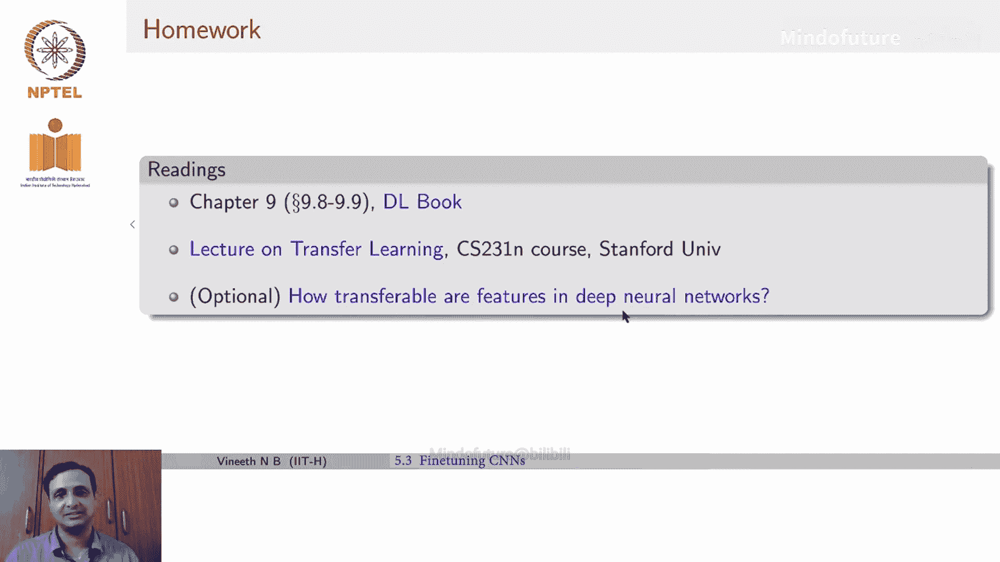

# 096：微调CNN 🎯

在本节课中，我们将学习一个关键概念：**微调**。这是一种利用在大型数据集（如ImageNet）上预训练好的卷积神经网络模型，来帮助我们解决新领域或新任务的技术。我们将探讨其背后的原理、适用场景以及具体操作方法。

## 概述

到目前为止，我们已经了解了多种CNN架构的变体。这些变体首先尝试增加深度以提高性能，然后尝试在不牺牲性能的前提下提高计算效率，最后甚至出现了可以牺牲部分性能以大幅降低计算量的变体。我们看到了所有这些变体，包括Squeeze-and-Excitation网络。在这些变体中，CNN的反向传播过程本身并未受到影响，这让我们可以灵活地使用这些架构。

在本讲中，我们将讨论CNN的一个重要方面，它使我们能够为新的任务或领域设计架构。例如，如果我们知道AlexNet在ImageNet数据集上表现良好，我们如何利用这些知识来为另一个领域或任务开发模型？为了探讨这个问题，让我们从CNN本身的一些局限性开始。

## CNN的局限性

CNN存在一些基本问题。首先，优化这些深度模型中的权重或参数通常很困难。这需要恰当的权重初始化，以及大量的超参数调优。这是其基本限制之一。

其次，CNN可能遭受过拟合，因为用于训练的样本数量通常远少于被训练的参数数量。我们已经看到，AlexNet有6000万个参数，VGG有1.38亿个参数，Inception V1（GoogleNet的第一个版本）有500万个参数，其改进版本Inception V3有2300万个参数，ResNet-50有2500万个参数，等等。

因此，训练这些网络从根本上需要很长时间和大量的计算能力。正如我们所说，AlexNet在两个Nvidia GTX 580 GPU上训练了大约一周，VGG在四个Nvidia Titan Black GPU上训练了两到三周，Inception V1在未共享的硬件上训练了大约一周。

当你需要为一个新领域设计架构时，所有这些会变得更加困难。在这种情况下，你必须设计一个架构，运行大约一周或几天，观察其效果，然后回去更改超参数，再运行一周，再次观察效果。这种设计新架构或CNN架构的方法无法规模化。

## 应对策略

那么，我们如何为新的任务和领域管理这项工作呢？

你可以尝试的一些方法是使用良好的权重初始化，这样你就能独立于架构设计。我们见过Glorot或He初始化，这是一种可能性。你也可以用手工设计的滤波器来初始化你的CNN，例如使用边缘滤波器或其他滤波器来初始化卷积层中的滤波器，然后让CNN对它们进行微调。或者，我们已经见过无监督贪婪逐层预训练作为另一种方法，它可以提供一个初始化，神经网络随后可以利用它。正如我们之前所说，由于计算能力的提高和数据集规模的扩大，这种无监督贪婪逐层预训练方法如今已不常用。

我们讨论过的另一种改进神经网络训练的方法是使用正则化方法，无论是L2权重衰减、L1权重衰减、Dropout、批归一化、添加输入噪声、添加梯度噪声，还是数据增强等。这可能缓解过拟合，但可能不会真正加快CNN的训练速度。那么，我们该怎么办呢？

## CNN的一个有趣特性

CNN有一个被观察到的有趣特性，这也是我们下周讲座将重点关注的。如果你在训练CNN后，可视化卷积网络各层学习到的滤波器，你会发现较早的层拥有可能代表能够捕捉各种定向边缘、颜色斑点等的滤波器。换句话说，这些就是我们所说的**低级特征**，即从图像中提取的简单低级特征。

CNN中间层学习到的滤波器似乎捕捉到一些**中级特征**，这些特征可以被视为低级特征的组合，例如某种由两条边缘组合而成的纹理，或者颜色和边缘的某种聚合等。最后，后面层的滤波器学习**高级特征**，例如物体的印象，与初始层中仅仅是边缘相比，这是高级抽象。

我们现在要问的问题是，我们能利用这一点做些什么？我们能否利用对CNN滤波器如何学习的这种理解，来更好地为新的任务和领域设计架构？

## 迁移学习

答案是机器学习中一个称为**迁移学习**的设置。在迁移学习中，你有一组给定的源任务和一个你想要表现良好的目标任务，也就是你想要解决问题的新领域或新任务。例如，你可以想象你已经用ImageNet数据集训练了AlexNet，而明天你有了来自不同领域的数据，比如你想为印度的自动驾驶汽车构建一个物体识别系统。这些物体可能与ImageNet中的物体不同。

那么，你现在如何将你在ImageNet上学到的模型转移到你想在新领域开发的模型上呢？在这种情况下，你尝试利用目标领域的数据以及从源领域获得的模型或知识，来为目标领域学习一个模型。我们称之为**迁移学习**，即能够将知识从早期的源任务转移到我们当前感兴趣的目标任务。

## 迁移学习与CNN特征学习的关系

这与CNN中特征的层次化学习有什么关系？我们马上就会看到。我们现在知道，利用在不同任务上学到的知识来辅助当前任务的训练就是迁移学习。我们现在也知道，我们确实拥有预训练好的、结果良好的模型，例如，在ImageNet上预训练的AlexNet模型已经提供给我们。

我们能否以某种方式利用这一点来提高在目标任务上的性能呢？我们可以通过几种方式做到这一点。我们之所以能做到这一点，是因为我们知道AlexNet的滤波器，或者任何其他CNN模型的滤波器，其前几层具有一些通用特征，而随着你进入更深层，特征逐渐变得专门化。为什么我们这么说？如果你回到前面的一张幻灯片，你会看到较早层的滤波器似乎捕捉像边缘和颜色斑点等通用信息，而较晚的滤波器似乎捕捉一些特定于物体的信息，这可能专门针对该任务。

## 微调

那么，我们现在可以做什么呢？你可以将一个预训练的神经网络（如AlexNet）用于新领域，并保持AlexNet的所有权重完全不变，不为这个新任务更新它们。相反，只取最后一层，我们称之为**分类层**，并仅为新任务训练这些参数。我们称之为**微调**。在这里，你基于另一个模型的预训练权重来初始化新任务的网络权重，并且只针对新任务微调新网络中的某些层。

我们刚刚讨论了这里的第一个设置，即只训练分类层。你也可以使用预训练权重作为初始化，然后微调整个网络或CNN末端的某些层，不仅仅是分类层。你可以取最后三层或最后四层，根据你的选择进行微调，以更好地建模目标任务。选择哪一种取决于你的数据集大小以及你的目标任务与源任务的相似程度。

## 不同场景下的微调策略

让我们看看几种可能性，看看我们能做什么。

**场景一：数据集小，且目标与源数据集相似**

在这种情况下，由于目标数据集和源数据集彼此相似，你可以说在这两个数据集上训练的模型的专门化特征很可能保持不变。因此，你现在可以做的是：取源任务的通用层和专门层（中间显示的整个块可以是一个完整的预训练网络，如AlexNet或ResNet，你在另一个数据集上训练过，我们称之为源任务）。保持其不变，只随机初始化分类层，并仅为新任务的输出训练这一层。这是因为你的数据集很小，你可能没有足够的数据来重新训练或微调所有这些特征提取层，不如只专注于正确训练分类层。

在这种情况下，我们使用预训练权重初始化新网络，并且只微调分类层。

**场景二：数据集小，且目标与源数据集不相似**

这次意味着专门化特征可能不通用，但通用特征（如边缘检测器这类滤波器）可能仍然对源任务和目标任务通用。我们能做什么呢？我们现在考虑整个预训练的CNN，因为我们知道通用层（我们指的是CNN的早期层）的特征图。你可以从你的预训练网络中获取这些特征图作为输出，然后训练另一个分类器，例如支持向量机，也可以是神经网络，来为目标任务提供输出。

我们这样做是因为数据集小，并且目标数据集和源数据集不相似，我们不能使用在源任务上预训练网络的专门化特征。我们现在假设从前几层获得的通用特征（我们所说的表示是指每个输入的那些特征图）将帮助我们提高分类器的性能，尽管数据集很小。

**场景三：数据集大**

当你的数据集很大时，你有一些优势。你现在可以使用预训练网络作为良好的初始化，在目标数据集上微调整个网络。但是，你也可以做一些事情来进一步提高性能。

在微调时，你可以将学习率保持得非常低。请记住，学习率是你的梯度下降方法中梯度的系数。你可以保持学习率很低，这样你的预训练参数就不会发生显著变化。你在说：我仍然希望我的整体网络权重与我从源任务中学到的权重相似，但我有数据，我将更新它，但让我保持低学习率，这样我就不会对权重做太多偏离源任务的更新。

另一方面，如果数据集非常不同且数据量大，有明确的方法，例如所谓的**传递迁移学习**等方法，你可以从头开始训练。你根本不需要微调，你可以使用Glorot初始化随机初始化，并在新的目标任务上从头开始训练，因为你有一个大数据集。你在说目标任务和源任务彼此不相似，所以你不如从头开始训练，或者使用传递迁移学习等方法，这是传统机器学习中的已知方法，可以帮助你提高性能。

## 总结

本次讨论的主要思想是告诉你，虽然我们看到了几种不同的设计，但为给定问题设计新的CNN架构并非易事。有许多超参数，包括层数、宽度、分辨率、滤波器数量，以及学习超参数。尝试为某个领域和任务本身找到合适的组合可能是一项非常困难的任务，而使用迁移学习和微调的思想可以帮助你采用一个已解决不同问题的现有架构，并将其适应到新问题上。

这是人们将CNN应用于新领域和新任务时非常常见的流程。

## 延伸阅读

*   你可以阅读《深度学习》一书的第9章。
*   以及CS231N课程中关于迁移学习的讲座。
*   如果你感兴趣，可以阅读最早尝试研究CNN特征在迁移学习背景下可迁移性的文章之一。