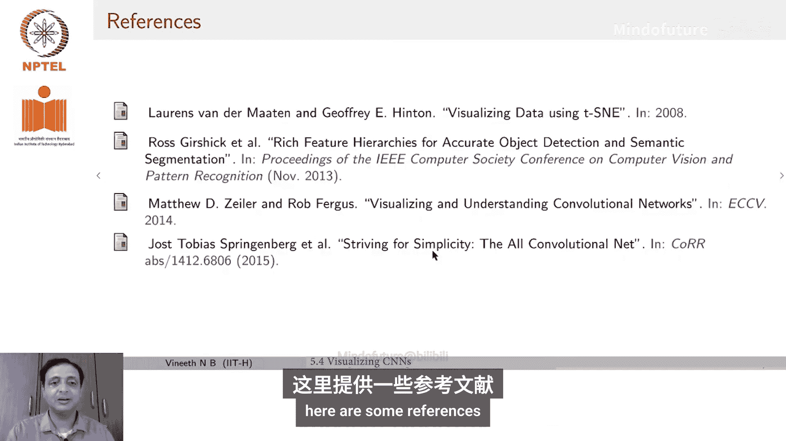

# 097：CNN可视化方法 🧠

在本节课中，我们将学习如何可视化卷积神经网络（CNN）的内部工作机制。我们将探讨几种不同的方法，包括可视化网络中的滤波器、理解中间层的激活模式，以及通过实验分析CNN的决策依据。这些技术有助于我们理解CNN究竟“看到”了什么，从而增强对模型的信任和解释能力。

## 可视化滤波器或卷积核 🔍

上一节我们介绍了CNN可视化的目标，本节中我们来看看最直接的方法：可视化CNN各层学习到的滤波器或卷积核。

在CNN的每一个卷积层中，都包含一定数量的滤波器。例如，在AlexNet的第一个卷积层中，有64个尺寸为11x11x3的滤波器（对应RGB三个通道）。我们可以将这些滤波器本身当作图像来可视化。

以下是可视化AlexNet第一层滤波器的结果：
*   **边缘检测器**：许多滤波器看起来像不同方向的高斯边缘检测器，用于捕捉图像中的线条和轮廓。
*   **高阶模式检测器**：部分滤波器能捕捉棋盘格、条纹等更复杂的纹理模式。
*   **颜色检测器**：还有一些滤波器专门检测特定颜色之间的过渡或色块。

这种现象并非AlexNet独有。在ResNet、DenseNet、VGG等不同模型的第一个卷积层中，学习到的滤波器都非常相似，普遍呈现出类似**Gabor滤波器**的特性。Gabor滤波器是高斯函数与正弦函数的乘积，可以调整其尺度和方向来检测不同方向的边缘和纹理。CNN在训练过程中，自发地学习到了这类基础特征检测器，因此我们常称此现象为“类Gabor滤波器疲劳”。

## 可视化CNN学习到的表示空间 🌌

了解了基础滤波器后，我们进一步探索CNN如何组织其学习到的高级特征。本节我们将学习如何可视化CNN的表示空间。

以AlexNet为例，其最后一个全连接层（fc7）会输出一个4096维的特征向量。我们可以收集验证集中所有图像经过网络前向传播后得到的这些向量。

为了在二维平面上观察这些高维向量的分布，我们需要使用降维技术。以下是两种常用方法：
*   **主成分分析（PCA）**：一种经典的线性降维方法。
*   **t-分布随机邻域嵌入（t-SNE）**：一种更强大的非线性降维方法，能更好地保留高维空间中的局部结构。

将MNIST手写数字数据集的特征表示通过t-SNE降至二维后，可以观察到属于同一数字的样本会聚集在一起，形成清晰的簇。这表明，在送入最后的分类层之前，CNN已经将不同类别的样本在特征空间中很好地分离开了。对于更复杂的ImageNet数据集，可视化结果也显示，语义相似的物体（如各种汽车、田野场景）在降维后的空间中也彼此靠近。这证明CNN在中间层学习到的表示确实捕获了图像的语义信息。

## 可视化特征图与神经元激活 🎯

除了静态的滤波器，我们还可以观察网络在处理具体图像时的动态响应。本节我们来看看如何可视化特征图和特定神经元的激活。

我们可以可视化CNN中间层（如conv5）输出的特征图。当输入一张包含两个人的图像时，某些特征图会高亮显示图像中存在两个独立实体的区域，这表明深层网络能够捕捉图像中物体的高级语义信息。

另一种方法是**分析单个神经元的激活**。对于一个训练好的CNN，我们可以观察哪些输入图像（或图像中的哪些区域）能最大程度地激活某个特定的神经元。通过这种方法，我们可以发现：
*   某些神经元专门对人像（尤其是上半身）产生强烈响应。
*   另一些神经元可能对狗、红色色块、文本或镜面反射等特定模式敏感。

这有助于我们理解CNN内部不同神经元的分工，并与Dropout正则化技术的设计初衷联系起来——即鼓励神经元学习多样化、非冗余的特征。

## 遮挡实验 🔦

最后，为了理解CNN的决策依据，即它到底关注图像的哪一部分来做出判断，我们可以进行遮挡实验。

遮挡实验的方法如下：使用一个灰色方块依次遮挡输入图像的不同区域，然后将遮挡后的图像输入CNN，并记录正确类别的预测概率如何变化。通过在整个图像上滑动灰色方块，我们可以生成一个热力图。

热力图中，红色表示高概率区域（遮挡后对预测影响小），蓝色表示低概率区域（遮挡后导致预测概率大幅下降）。例如：
*   在一张博美犬图片中，当灰色方块遮挡住狗的脸部时，模型预测为“博美犬”的概率急剧下降，甚至可能错误地分类为“网球”。这说明模型确实是依靠狗脸部的特征来识别它的。
*   在一张包含人物和一只阿富汗猎犬的图片中，遮挡住狗的脸部同样会导致对应类别的预测概率大幅降低，尽管图片中存在可能造成干扰的人物。

这个实验直观地展示了CNN在分类时真正关注的图像区域，增强了模型决策的可解释性。

## 总结 📝

本节课中我们一起学习了多种CNN可视化方法，这些方法都属于“不干扰模型”的分析方式，即我们直接使用训练好的模型进行分析。我们主要探讨了四种技术：
1.  **可视化卷积核**：直接绘制网络学到的滤波器，这在第一层最具解释性，常表现为类Gabor滤波器。
2.  **可视化表示空间**：对网络中间层（如全连接层）输出的高维特征进行降维（如t-SNE），观察不同类别样本在特征空间中的分布。
3.  **可视化神经元激活**：找出能最大程度激活网络中特定神经元的输入图像或图像块，以理解神经元的功能。
4.  **遮挡实验**：通过系统性地遮挡输入图像的不同部分，观察模型预测概率的变化，生成热力图以揭示模型的关注区域。

这些方法为我们打开CNN“黑箱”提供了窗口，是理解和解释深度学习模型行为的重要工具。

## 推荐阅读与参考资料 📚
*   CS231n 课程讲义第13讲。
*   Jason Yosinski 的深度可视化工具包演示视频和网页。
*   关于t-SNE降维技术的详细介绍与可视化示例。
*   Zeiler, M. D., & Fergus, R. (2014) 的论文《Visualizing and Understanding Convolutional Networks》。