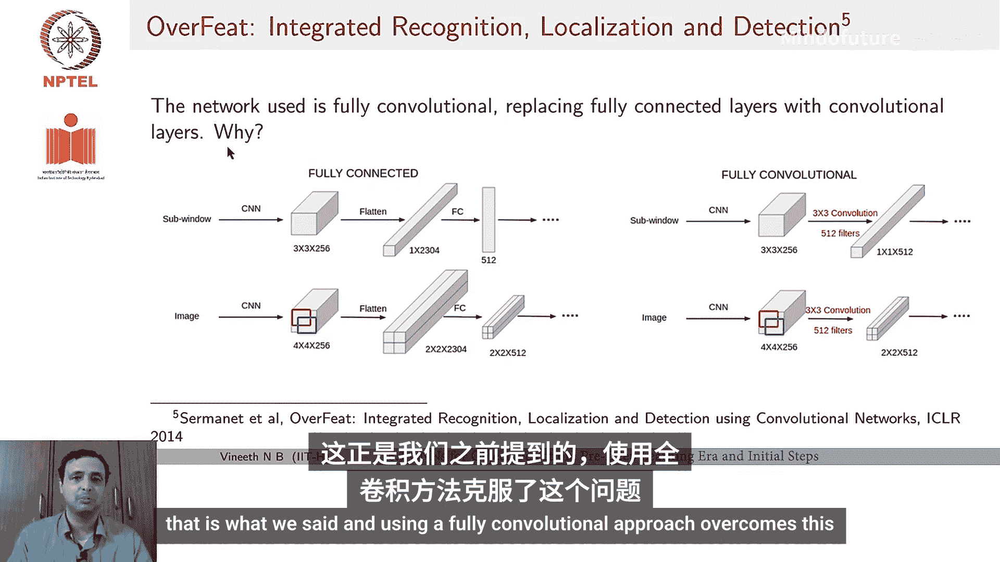

# 098：用于目标检测的CNN - 深度学习时代前和初始步骤

## 概述
在本节课中，我们将要学习目标检测任务，这是计算机视觉中一项非常重要的应用。我们将从深度学习时代之前的方法开始，了解早期目标检测是如何实现的，然后探讨如何将卷积神经网络（CNN）应用于目标检测任务。

## 从分类到检测
到目前为止，我们已经学习了神经网络最基本的形式——前馈神经网络，学习了反向传播，了解了如何使用不同变体的梯度下降法，并掌握了一些训练神经网络的实用技巧。随后，我们转向了计算机视觉的基石——卷积神经网络（CNN）。我们看到了如何使用反向传播训练CNN，了解了CNN中的各种架构。上周我们还学习了如何可视化和理解CNN正在学习什么，以及如何解释它们的预测。

然而，在迄今为止的所有讲座中，我们关注的任务都是分类。给定一张图像，我们的目标是分类图像中包含什么物体。你可以通过将交叉熵损失改为均方误差，将其扩展到回归任务，预测实数值。但是，视觉领域还有许多其他类型的任务，本周我们将开始学习这些任务。

我们将从当今最常用的任务之一——目标检测开始。

## 分类、定位与检测的区别
分类、定位和检测之间的区别如下：

*   **分类**：给定一张包含猫的图像，目标是判断图像中有一只猫。
*   **定位**：除了判断有一只猫，还需要用一个边界框框出猫在图像中的位置。
*   **目标检测**：更进一步，检测给定图像中属于你类别集合的所有可能出现的物体，并对它们进行定位。

在定位任务中，你只定位一个物体；而在目标检测中，可能有多个物体，甚至是同一物体的多个实例。例如，图像中可能有一只猫和一只狗，或者两只狗和一只猫。目标检测的目标是识别出每一个物体，并使用边界框对它们进行定位。

最后是**分割**任务，其工作是将每个像素标记为属于C个类别中的某一个（C取决于我们拥有的类别数量）。因此，我们将在本次讲座中从检测开始，然后在本周晚些时候再讨论分割以及其他任务。

## 深度学习时代前的目标检测方法
在深度学习出现之前，还有其他方法被用于在各种设备上部署计算机视觉进行目标检测。因此，即使在15年前深度学习方法尚未成熟时，目标检测和人脸检测就已经出现在例如傻瓜相机中。这些方法大多使用了**Viola-Jones算法**的变体。

### Viola-Jones算法
该算法由Viola和Jones开发，因此得名，其工作于2001年的CVPR上发表。这是一个用于实时执行目标检测的框架，最初主要用于检测正面人脸，尽管后来也被调整用于检测其他类型的物体，甚至检测物体的部分（例如人脸中的眼睛）。

这项工作的主要贡献包括：
1.  使用所谓的**Haar-like特征**进行弱分类。
2.  引入了**积分图像**这一非常强大的概念，可以显著加快Haar-like特征的计算速度。
3.  使用**AdaBoost**作为分类器，但其使用方式与传统机器学习中的AdaBoost略有不同。
4.  使用了**级联分类器**。

#### Haar-like特征
Haar特征是基于Haar小波的矩形特征。它们看起来像这样：通常有一个黑色区域和一个白色区域，但可以有不同组合。你可以有水平或垂直排列的黑白两区域，也可以有白色夹着黑色（水平或垂直），或者棋盘格图案等等。

Haar滤波器的核心思想是：特征值等于**黑色矩形内像素和**减去**白色矩形内像素和**。记住这是卷积操作，所以滤波器会翻转。因此，与Haar滤波器卷积的输出将是黑色矩形内的像素和减去白色矩形内的像素和。为了适应不同尺度的图像，这些特征可以通过高度、宽度甚至不同的模式进行缩放。

使用Haar特征进行目标检测（特别是人脸检测）的直觉是，人脸的许多特征都涉及特定区域与相邻区域之间的对比度。例如，观察眼部区域，其下方可能是一个黑色区域，上方则是一个相对明亮的区域。像这样的Haar特征就能捕捉到这种差异。

#### 积分图像
这项工作还引入了**积分图像**的概念。这是一个基本概念，不一定只与人脸检测相关，它是一种加快计算速度的方法，尤其是在使用Haar-like特征时。

积分图像的定义是：对于积分图像中的任意像素`(x, y)`，其值是从左上角原点开始，到该点为止的所有像素值的总和。

数学上可以写为：
`integral_image(x, y) = Σ_{x'≤x, y'≤y} I(x', y')`

给定一个图像，其积分图像看起来像这样。例如，一个2x2窗口的值290是由38+66+89+97得到的。

积分图像的递推定义如下：
`s(x, y) = s(x, y-1) + I(x, y)`
`integral_image(x, y) = s(x, y) + integral_image(x-1, y)`
其中`s(x, y)`是累积行和。为了使这个递推定义成立，需要定义`s(x, -1) = 0` 和 `integral_image(-1, y) = 0`。

现在让我们看看积分图像如何用于Haar滤波器。假设我们想计算由点1、2、3、4定义的矩形内的像素强度和。设A为左上角小矩形，B为包含A的较大矩形，C为包含A右侧部分的矩形，D为整个大矩形。那么矩形1-2-3-4内的像素和可以表示为：`D + A - B - C`。

更正式地说，一个左上角为`(x1, y1)`，右下角为`(x2, y2)`的矩形内像素和可以表示为：
`integral_image(x2, y2) + integral_image(x1-1, y1-1) - integral_image(x1-1, y2) - integral_image(x2, y1-1)`

这非常有用。当你想使用像Haar滤波器这样的卷积时，如果你有一个两矩形特征（即一个黑色区域接一个白色区域），计算这样一个滤波器的卷积输出只需要在积分图像中进行**6次查找**。你只需要查找所有角点的值（包括中间的点），就可以计算出Haar滤波器的输出，而无需进行任何实际的卷积操作。

**练习**：思考一下，对于一个三矩形特征（例如，中间是黑色，两边是白色）需要多少次查找？对于一个四矩形特征（例如棋盘格）又需要多少次查找？

#### 使用AdaBoost构建强分类器
一旦你有了这些Haar滤波器的输出，Viola-Jones算法建议每个特征都可以被视为一个**弱分类器**。

给定一个特征`f_j`（可以是两矩形、三矩形、四矩形特征等），一个阈值`θ_j`和一个表示符号的奇偶性`p_j`，弱分类器`h_j`定义为：
`h_j(x) = 1 if p_j * f_j(x) < p_j * θ_j`

现在，使用这个定义，每个Haar特征都会得到一个分类器。我们知道弱分类器的组合可以产生强分类器。但到目前为止，你看出这个方法有什么问题吗？

仔细想想，即使你有一个简单的24x24滑动窗口，在这个窗口内计算各种Haar特征并使用阈值判断是否有人脸，问题在于，仅在一个24x24的窗口内，就有超过**160,000种可能的特征**。这意味着在每个滑动窗口内计算160,000个弱分类器是非常繁琐的。我们该怎么办？这时**AdaBoost**就派上用场了。

Viola-Jones算法中使用AdaBoost的方式如下（这是论文中的算法，我们只关注其关键部分）：
1.  给定示例图像`(x1, y1) ... (xn, yn)`，初始时对所有训练样本赋予均匀权重并进行归一化。
2.  对于每个特征`j`（即所有可能组合中的一个Haar特征），训练一个分类器`h_j`（一个弱分类器，仅限于使用单个特征）。
3.  该弱分类器的误差`ε_j`由权重乘以分类器输出与期望输出的差异给出。
4.  Viola-Jones方法的关键在于：在所有可能的特征（它们会给出许多不同的分类器）中，选择误差`ε_t`最小的那个分类器`h_t`。
5.  基于这个分类器的误差，重新加权所有样本（这是AdaBoost中标准的重新加权步骤）。
6.  重复此过程多次。经过一定次数的迭代后，最终的强分类器是`T`个特征的加权组合（`T`是一个可设定的参数）。在每次迭代中，你挑选一个最强的特征，最终只使用`T`个不同特征的加权组合。

#### 级联分类器
Viola-Jones算法的第三个组成部分是**级联分类器**。这个想法源于一个动机：图像中实际上包含物体或人脸的**子窗口非常少**。一个给定的图像可能有数十万个子窗口，但其中不会有很多人脸。因此，如果你评估每一个可能的窗口，误报率可能会非常高。

级联分类器的思想是：**尽早排除负样本窗口**，从而减少在它们身上花费的计算时间。如果一个子窗口是负样本（不包含目标），就忽略它，并且不再对该子窗口内的任何进一步子窗口进行处理。

通俗地说，所有可能的子窗口首先进入第一阶段，排除其中一部分，假设它们绝对不包含人脸。只有那些可能包含人脸的窗口进入分类器的下一阶段，再次进行检查。如果在该阶段有子窗口被拒绝，它们也会被排除。只有剩余的子窗口继续进入后续阶段，依此类推。在每个阶段，你都可以使用一组弱分类器（可以通过参数`T`来约束数量）。通过这种方式，你可以使用不同阶段的分类器来逐步优化性能。

为什么级联分类器很重要？我们刚刚提到，对于像人脸检测或目标检测这样的问题，误报率非常重要。如果你有一张100万像素的图像，你至少有大约100万个候选的人脸位置。理想的误报率需要低于10^-6。

如果我们只使用之前提到的基本Haar滤波器组合，可能会得到100%的检测率，但误报率高达50%。这会产生大量可能的人脸，但并非所有都是真正的人脸。

如果我们进一步包含200种特征（即200种不同排列的Haar滤波器），可能会得到95%的检测率，误报率约为1/14000。这虽然更好，但距离我们想要的10^-6误报率还不够。

这时级联分类器就来拯救我们了。记住，当你有一个级联时，最终的检测率和误报率是通过**每个阶段的检测率和误报率相乘**得到的。因此，如果每个阶段都是一个200特征的分类器（即`T=200`），每个阶段的检测率约为0.99，误报率为0.3，那么经过10个阶段的级联，总误报率就是0.3^10，大约在10^-6的数量级。级联分类器的思想允许我们在级联的每个阶段拥有合理的检测率（0.99）和误报率（0.3），正如我们所见，这只需几个特征就可以实现。我们只需在级联的各个阶段不断优化，就能获得理想的误报率。

### 非极大值抑制
该方法的另一个方面（实际上也是任何检测方法）是**非极大值抑制**的概念。很可能一个物体周围的许多窗口都被分类为包含该物体。那么如何选择哪一个才是正确的物体呢？

我们必须使用某种边界框相似性度量，最流行的是**交并比**。交并比的定义是：如果你有两个边界框B1和B2，取它们的交集和并集，**交集与并集的比值**可以衡量这两个边界框的接近程度。如果比值为1，意味着B1和B2完全相同；比值越接近1，说明边界框重叠得越多。

我们如何使用IOU进行非极大值抑制呢？如果你有一组可能包含物体的边界框，你可以从中随机选择一个框，然后将这个框与其余框进行比较。如果IOU大于0.5，就从列表中移除那个框。这样，你确保了在多个重叠度超过50%的框中只保留一个。稍后我们会看到，我们不会仅仅这样做，还会尝试找出这些框中哪个框对包含物体的置信度最高。这个过程被称为**非极大值抑制**，如今在检测中被广泛使用。

以上就是用于人脸检测的Viola-Jones算法，它非常流行，被用于多种技术中。

### 方向梯度直方图
当时另一个流行的方法是**方向梯度直方图**。我们在讨论从图像中提取手工特征时已经见过这个方法，但现在我们将讨论它如何用于行人检测任务。

如果你有一张包含行人的图像，你有一个检测窗口在图像上滑动，并获取所有梯度（可以是Sobel滤波器等）。然后，你将整个图像划分为**单元格**，在每个单元格中绘制梯度方向的直方图（我们之前在SIFT中做过类似的事情）。一旦你在每个单元格中得到了方向梯度直方图，接着考虑**重叠的2x2单元格块**。你取这4个块的直方图，对它们进行归一化，并将其定义为该中心像素的最终直方图。当你对图像中的所有单元格都这样做时，你会得到一个最终的描述符，它看起来像是在图像不同位置的一组方向梯度直方图。

如何使用这个描述符呢？得到这个最终描述符后，你训练一个**支持向量机**来判断这是行人还是非行人。这项工作由Dalal和Triggs于2005年提出。

你还可以可视化支持向量的权重。如果你在所有训练样本上取平均梯度图像，你可以可视化正负SVM权重的样子。给定一张测试图像及其对应的HOG描述符，你可以将这些描述符乘以正负权重，得到类似的结果。你会注意到，观察正权重，SVM很容易将其分类为图像中包含行人。

这种方法还被扩展到多分辨率级别，即使用图像金字塔，在金字塔的每一层执行相同的方法。例如，在最低分辨率下，你有一个特定的块，并使用SVM为该窗口（在最低分辨率图像中）计算一个分数，判断行人是否在那里。你同样对最高分辨率图像进行此操作，然后可以使用各种技术来整合这些分数，例如像金字塔匹配那样给最高分辨率最高分、最低分辨率最低分，或者进行投票，或使用其他启发式方法组合这些分数，以判断图像中是否有人。

以上就是在深度学习出现之前用于检测的不同方法。

## 使用CNN进行目标检测的初始步骤
现在，让我们尝试看看如何以最简单的方式使用CNN进行目标检测。

### 滑动窗口CNN方法
假设在训练时你有汽车的图像，你会训练一个CNN来学习汽车分类器，使用标准的交叉熵损失和一个简单的CNN。

在测试时，当你得到一张汽车可能位于图像中任何位置的图像时，你取**不同尺度的多个滑动窗口**。你可能需要从这张图像中提取多达10万个潜在的滑动窗口，并将每个窗口作为输入提供给CNN（假设它们大小相同，或者调整到相同大小）。然后，CNN将原始图像中的每个窗口分类为包含汽车或不包含汽车。基于此，你会在这里和那里检测到汽车。

同样，在这种方法中，你可以加入**非极大值抑制**来提高性能。但正如之前所说，一旦你得到所有可能包含汽车的边界框列表，你考虑**类别置信度最高**的边界框。例如，红色框可能是置信度最高的框（0.93）。然后，你计算所有其他边界框与这个红色边界框的IOU。如果其中任何一个与红色框有很高的重叠或IOU，你就消除它们，只保留红色框，因为它对包含汽车的置信度最高。

### 这种方法存在的问题
这是使CNN适应目标检测的最简单方法。你看出有什么问题吗？实际上有几个问题：
1.  边界框可能没有紧密地包围物体。你在这里可以看到，有些边界框相当松散。我们理想情况下需要一个紧密的边界框，以便精确地聚焦于包含物体的那部分图像。
2.  另一个明显的问题是，你必须通过CNN评估成千上万个滑动窗口，才能找出哪些窗口包含你选择的物体。

我们将讨论克服这些问题的方法。但在那之前，我们先谈谈**目标定位**，正如我们所说，它是检测的前身。

### 目标定位
目标定位可以通过以下方式实现：如果图像中只有一个物体，你可以将其输入CNN，得到特征图，然后通过全连接网络。现在，你可以将CNN分支为两个部分：
1.  一个部分给出分类分数，可以使用交叉熵损失学习。
2.  另一个部分进行**边界框回归**。你可以尝试找出边界框的确切坐标（例如相对于整个图像或图像中任何其他框的偏移量）。你也将其作为学习过程的一部分来学习。

因此，你网络末端的全连接层将有两个“头”：一个**分类头**和一个**回归头**。分类头需要交叉熵损失。回归头将学习边界框的左上角坐标`(x, y)`、高度`(h)`和宽度`(w)`，共四个值。这些值可以使用L2损失或均方误差损失来学习。因此，整个网络将通过这两个损失之和来训练，不仅对图像进行分类，还要对图像进行定位。

### OverFeat：早期成功的定位器
CNN中一个早期成功的优秀定位器是**OverFeat**。OverFeat是ILSVRC（ImageNet大规模视觉识别挑战赛）定位挑战赛的年度冠军。想象一下，除了分类挑战赛，ILSVRC每年还有一个定位挑战赛。OverFeat是2013年该挑战赛的冠军。

OverFeat实现定位的方式是：确保你的整个网络都是**卷积的**，而不是包含全连接层。这通过直接将滤波器应用于图像来避免计算子窗口的时间。让我们看看如何实现。

给定一个输入（例如14x14，或者填充为16x16），你执行5x5卷积（这只是一个可视化示例）。如果不进行填充，你会得到一个10x10的输出；如果进行2像素填充，则变成12x12。然后进行2x2池化，得到5x5。再进行5x5卷积，得到1x1。现在，使用多个1x1卷积，你可以直接得到输出，而无需执行任何全连接层操作。

因此，OverFeat的这个想法显著加快了计算速度。正如你现在看到的，它用**全卷积层**取代了全连接层，最后通过1x1卷积得到最终输出（类似于我们在Inception Net/GoogleNet中看到的那样）。这为什么有用？因为我们记得全连接层使用了大量参数，而使用全卷积方法克服了这一点，从而可以加快性能。

## 总结
在本节课中，我们一起学习了目标检测的基础知识。我们从区分分类、定位和检测任务开始，回顾了深度学习时代之前的重要方法，特别是**Viola-Jones算法**（利用Haar-like特征、积分图像、AdaBoost和级联分类器）和**方向梯度直方图**。然后，我们探讨了将CNN应用于目标检测的最初尝试，即滑动窗口方法，并指出了其效率低下的问题。最后，我们介绍了**目标定位**的概念以及**OverFeat**如何通过全卷积网络高效地实现定位，为后续更高效、更精确的现代目标检测方法（如R-CNN系列、YOLO、SSD等）奠定了基础。