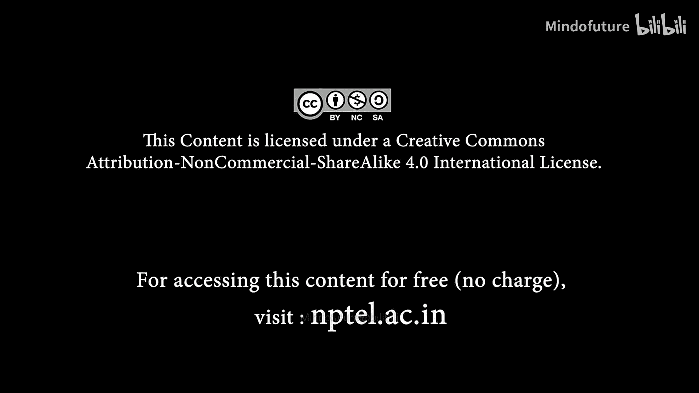
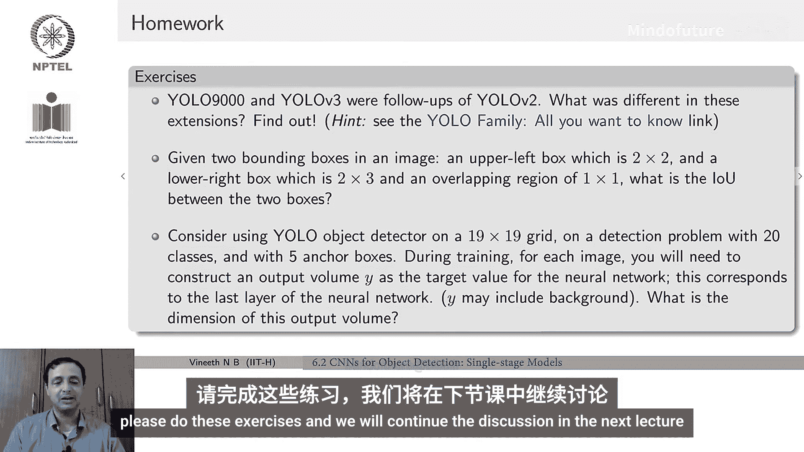

# 100：用于目标检测的CNN - 单阶段模型 🎯

## 概述
在本节课中，我们将继续学习目标检测的密集采样方法。我们将重点介绍几种经典的单阶段检测模型，包括YOLO、SSD、FPN和RetinaNet，并解释它们的核心思想、架构和损失函数。

---

## 从平滑L1损失谈起
上一节我们介绍了区域提议方法，本节中我们来看看密集采样方法。在开始之前，我们先回顾一下上节课留下的思考题：为什么平滑L1损失比L2损失对异常值更不敏感？

当预测输出与真实值偏差很大时（即存在异常值），平方损失或L2损失会放大这种偏差。这也会导致梯度被放大，可能引发梯度爆炸问题。L1损失可以缓解这个问题。但由于L1损失在零点不可导，我们使用其平滑版本，即平滑L1损失，它能减轻异常值带来的问题。

---

## 单阶段检测框架简介
当代方法大致可分为区域提议方法和密集采样方法。我们现在将进入密集采样方法，即单阶段检测框架。

其中最流行且至今仍在使用的模型是YOLO（You Only Look Once）。YOLO的第一个版本于2016年在CVPR上发表。它是一个单阶段检测器。可以说，所有这些单阶段检测器都大致基于OverFeat的思想，它们都只使用卷积层，没有全连接层，其主要目标是速度与良好性能。

其高级流程是：调整图像大小，运行卷积网络，得到一组输出，然后进行非极大值抑制以确定最终的边界框。

---

## YOLO v1 详解
以下是YOLO v1的整体流程。给定一张输入图像，首先将其划分为一个S×S的网格。每个网格单元负责预测与其中心重合的物体的边界框。

例如，如果取这个特定的网格单元，它将负责预测这只狗的边界框。

每个网格单元预测B个边界框（B是另一个超参数）以及每个框的置信度分数。因此，每个网格单元可以预测多个边界框及其置信度。

每个网格单元仅为每个类别预测一个概率。对于总共C个类别，这意味着C个总概率。可以将其视为计算条件概率：**P(Class_i | Object)**。

最终的预测可以编码为：你有一个S×S的网格。在每个网格位置，你预测B个边界框。对于每个边界框，你有五个值：表示物体中心的坐标（x, y）、宽度（w）、高度（h）以及该边界框的置信度，总共5个值。然后，每个网格单元有C个类别概率。因此，在应用非极大值抑制之前，输出层的总输出数为：**S × S × (B×5 + C)**。

每个边界框给出四个坐标：x, y, w, h。x, y是表示物体中心相对于网格单元的坐标，w, h是物体相对于整个图像的宽度和高度。

为每个边界框给出的置信度分数反映了模型对该边界框包含物体的置信程度，以及框的准确性。可以将置信度视为：**P(Object) × IOU(ground truth, predicted)**。因此，置信度同时考虑了这两个量。

每个网格单元有每个类别的条件类别概率，无论每个网格单元预测的边界框数量B是多少。YOLO每个网格单元只预测C个类别概率。因此，可以假设这些C个类别概率就是这里的条件概率**P(Class_i | Object)**。

如果将置信度分数与类别条件概率相乘，你会得到：**P(Class_i | Object) × P(Object) × IOU = P(Class_i) × IOU**。因此，对于每个单元格，我们计算的是该类别出现在此网格单元的概率，以及预测框与真实框的IOU。

---

### YOLO v1 的损失函数
用于训练YOLO的损失函数有效地结合了多个需要计算的组成部分，以确保预测的每个量都接近真实值。以下是损失函数的各个项：

*   **1_{ij}^{obj}**：指示单元格i中的第j个边界框预测器是否对该预测负责。
*   **1_{i}^{obj}**：指示物体是否出现在单元格i中。

以下是各项的作用：
1.  首先确保网络预测的x_i, y_i接近期望的x̂_i, ŷ_i。
2.  确保网络预测的宽度w_i和高度h_i接近原始的宽度和高度。这里取了平方根，因为宽度和高度是二维的。
3.  对于置信度C_i和Ĉ_i，如果存在物体（此时期望置信度为1），则尝试最小化预测置信度与期望置信度之间的差异。
4.  所有这些求和都是跨所有网格单元格以及每个网格单元格预测的所有边界框进行的。
5.  即使物体不存在，也希望置信度与期望置信度（此时为0）匹配。因此，这两项分别对应正类和负类。
6.  最后一项表示条件类别概率与期望条件类别概率的匹配。

这些是用于训练网络的不同损失项。

---

### YOLO v1 的局限性
YOLO v1有一些局限性。首先，它只能检测少量物体。由于方法本身的空间限制以及可以呈现的重叠物体数量，它会漏检小物体或彼此靠近的物体。这导致了较高的定位误差和相对较低的召回率。

为了克服这些问题，YOLO v2作为YOLO v1的扩展，将锚框（anchor boxes）的概念引入了YOLO框架。这些锚框类似于你在Faster R-CNN中看到的。

---

## YOLO v2 与锚框
每个锚框预测五个坐标：t_x, t_y, t_w, t_h, t_o。让我们看看每一个。

如果单元格距离图像左上角的偏移为(c_x, c_y)，锚框具有先验宽度p_w和高度p_h，那么对应于锚框的预测如下：
*   **b_x = σ(t_x) + c_x**
*   **b_y = σ(t_y) + c_y**
*   **b_w = p_w × e^{t_w}**
*   **b_h = p_h × e^{t_h}**
*   物体概率与IOU的乘积（即YOLO v1中的量）是**σ(t_o)**，即条件类别概率。

这些是网络预测的不同量，它们与网格位置试图指向的实际边界框相关。记住，每个锚框只预测这五个值。

---

## YOLO 家族的演进
自v2以来，YOLO出现了多个变体。我们可能无法详细介绍每一个，但让我们快速了解几个，看看这个架构家族是如何演进的。

**YOLO v3** 有几个有趣的改进，例如逻辑分类器和多尺度预测。
*   **逻辑分类器**：使用逻辑回归来预测目标性分数以及进行最终分类。YOLO v2或v1在锚框或网格位置上使用softmax进行最终类别预测，这意味着一个特定的锚框只能有一个类别标签作为最终分配。这被修改为在每个类别标签上使用二元分类器（逻辑分类器），从而允许一个特定的锚框拥有多个类别标签（例如，“人”和“女人”可以同时为真）。
*   **新主干网络**：YOLO v3引入了一个新的主干网络，后来被称为Darknet-53，它包含53个带有残差连接的卷积层。
*   **多尺度预测**：YOLO v3模型在三个不同尺度上预测边界框，以改进对小物体的检测。这是通过使用空间金字塔池化（SPP）实现的，在主干网络中添加了一个修改后的SPP块，并连接了具有不同内核大小的多个最大池化输出以获得多尺度效果。YOLO v2每个网格单元使用5个锚框，而YOLO v3在每个尺度上使用3个锚框，但总共有三个尺度，所以总共是9个锚框。

随着YOLO v3的出现，YOLO的架构可以明确分为三个部分：
1.  **主干网络**：从给定输入图像中提取特征的网络，通常是在大规模图像分类任务上预训练的CNN。
2.  **颈部网络**：通常用于在不同尺度之间交换信息（包括空间和语义信息），在此阶段通常用于聚合和细化特征。
3.  **头部网络**：执行分类以及后处理步骤（如NMS）。

随后出现了**YOLO v4**，它引入了一系列变化。特别是：
*   使用了称为CSPDarknet53的架构，是Darknet53的改进版，在其架构内具有跨阶段部分连接，据其创建者称，这提高了模型的计算效率。
*   认为Mish激活函数在YOLO v4模型上表现更好。
*   还使用了空间金字塔池化和称为路径聚合网络（PAN）的结构来跨尺度组合特征，并引入了空间注意力模块以更好地细化特征。
*   在训练过程中，YOLO v4引入了一种称为“免费礼包”的技术，例如马赛克数据增强，将给定图像的不同增强版本拼接起来，以提高模型在非常规上下文中检测物体的能力。
*   还使用了DropBlock代替Dropout来进行正则化。
*   其他改进包括自对抗训练（在输入图像中引入扰动以提高模型鲁棒性）和使用遗传算法进行超参数优化。

请不要担心没有理解YOLO架构的每个部分。事实上，最初的YOLO版本后来进一步扩展到2020年的YOLO v5（包括自动锚框和缩放YOLO版本），然后是YOLO v6、v7、v8、YOLO-NAS，以及最近的2024年YOLO v9和最新的YOLO v10。

为什么我们要如此详细地讨论YOLO？虽然许多目标检测模型在准确性上已经超过了YOLO，但YOLO仍然是实时目标检测的首选，尤其是在边缘设备和小型计算或内存设备上。

---

## 单次多框检测器
另一个单阶段检测方法称为单次多框检测器（SSD）。SSD再次使用了类似OverFeat的方法。给定输入图像，网络的初始部分是一个类似VGG的网络，然后是具有逐渐减小尺寸的卷积层，并且有一些跳跃连接将你从卷积层直接带到分类器。

让我们更详细地看看它们。以下是SSD的关键点：

*   **用于检测的多尺度特征图**：因为直接将卷积层的特征图发送到输出层，所以输出层接收来自不同尺度卷积层的特征图，这就是多尺度特征图。
*   **每个卷积层连接到输出层的卷积滤波器**：每个卷积层通过一组不同的卷积滤波器连接到输出层，这些滤波器决定了输出层中对应输出的数量。

如果你取任何一个特征图层，例如一个大小为m×n、具有c个通道的特征图，那么它将给出m×n个位置。这些特征图中的每个像素位置都可能是物体的中心（类似于YOLO中的网格单元），边界框偏移值相对于该网格单元位置。

每个卷积图预测（类别数 + 4）个值。这就是它们将预测的值的数量：每个类别的类别概率加上对应于这些卷积特征图中每个像素位置的边界框偏移的四个值。

因此，随着网络向后推进，特征图变得越来越小。例如，如果你有一个8×8的特征图，然后是4×4的特征图。在8×8的特征图中，如果你查看每个网格单元位置的锚框，每个锚框将预测一组值。如果你有k个具有不同宽高比的锚框，SSD将预测c个类别特定分数加上4个锚框偏移。对于一个m×n的特征图，你总共有 **(c+4) × k × m × n** 个输出。这是因为你假设每个像素都可以是物体的中心，每个像素周围有k个锚框，每个锚框预测c个类别概率和4个边界框偏移。

---

### SSD 的损失函数
SSD使用的损失函数与我们目前看到的非常相似。SSD实现了一个定位损失函数和一个置信度损失函数。

**定位损失**再次由平滑L1损失给出。它还有一个因子x_{ijk}来表示是否涉及某个类别，因为你只想在涉及类别时评估这个量。L是预测的偏移量，Ĝ是真实偏移量。

**置信度损失**是类别置信度概率的softmax损失。它由两项组成：第一项针对所有正边界框（标准交叉熵损失），第二项针对负边界框，其中有一个对应于背景类别的标签，你希望最大化其概率。C_0这里对应一个称为“背景”的类别标签，被视为你想要预测的类别之一。Ĉ是你的标准softmax激活函数。

在实际实现中，YOLO和SSD都有这个问题：与Faster R-CNN相比，大多数锚框很可能是负样本。为了应对这一点，你选择具有最高置信度损失的负样本，使得负样本与正样本的比例保持在约3:1。否则，即使在一张图像中有0个物体，锚框和网格单元的数量（在SSD中是每个像素）也可能非常巨大，导致负样本数量过多，影响学习。这就是进行“难负样本挖掘”的原因：在训练时，只选择那些具有非常高置信度损失的部分框，并在我们讨论的损失函数中使用它们。

SSD还使用了一种数据增强策略：除了使用原始图像，还从图像中随机采样图像块，确保与真实物体的最小IOU在预定义的范围内，以确保网络暴露于图像中不同种类的块以及物体及其重叠的不同情况。

通过这种方法，SSD在性能上可以超越YOLO和Faster R-CNN。

---

## 评估指标：平均精度均值
所有检测方法都使用一个称为mAP（平均精度均值）的评估指标进行测量。
*   **精度**指的是机器学习方法中使用的标准精度指标。
*   **平均精度**谈论的是在所有类别上获得的平均精度。
*   **均值**是在所有边界框上取平均。

通常，在特定的IOU阈值下测量mAP。例如，预先指定一个IOU（如0.5），只要预测框与真实框的IOU至少为0.5，就认为预测正确。这就是定义正确性的方式，用以计算精度，然后在预测的类别和框上取平均。

可以看到，SSD在mAP上匹配了Faster R-CNN，但以显著更高的FPS（每秒帧数）实现，这也是使这些单阶段方法在实际中更快的主要目标。

---

## 特征金字塔网络
第三种单阶段检测器方法称为特征金字塔网络（FPN）。FPN基于这样的思想：来自初始层的特征图可能并不真正适合检测。当你经过卷积网络时，初始层是高分辨率的，然后随着网络加深，分辨率变得越来越低。但是，初始层虽然分辨率高，但从CNN的可视化中我们知道，它们可能并没有真正捕获那些初始特征图中的物体语义。然而，它们是分辨率较高的。因此，我们陷入了两难境地：较低分辨率的特征图具有更丰富的特征用于检测，而较高分辨率则在初始特征图中。

FPN试图做的就是弥合这一差距。以下是FPN如何尝试弥合这一差距的可视化：
*   你可以使用图像金字塔进行检测：对图像进行下采样，为每个分辨率构建特征图并预测。
*   或者，你可以获取输入图像，构建越来越低分辨率的特征图，最后在最低分辨率进行预测。
*   或者，给定输入图像，在构建许多卷积层时在不同分辨率构建特征图，并在每个分辨率进行预测。

FPN建议的是：在通过卷积网络时，在不同分辨率构建特征图，但现在进行上采样以获得更高分辨率的特征图，然后进行预测。这样，你试图在最低分辨率获得语义信息，但通过上采样将语义信息传递到更高分辨率。

让我们看看这在架构中是如何完成的。整体架构如下：你有一张图像，经过一系列卷积和池化层（类似于ResNet），得到特征图C1到C5。在FPN中，所有卷积特征图C1到C5都经过一个1×1卷积（输出256个通道）进行处理。然后，M5被上采样2倍以获得下一个M4，但在获得M4之前，将经过1×1卷积的C4的输出与上采样后的M5结合，得到M4。类似地继续得到M3和M2。完成此操作后，在M4、M3和M2上应用3×3卷积，以减少上采样可能带来的混叠效应。最后，你得到所有这些P（P2, P3, P4, P5），它们被提供给单独的目标检测器以获得最终预测。

---

## RetinaNet 与焦点损失
一种更近期的目标检测方法侧重于用于训练这些检测器的损失函数，这就是RetinaNet。提出的损失函数称为焦点损失（Focal Loss），于2017年ICCV提出。它基于这样的直觉：两阶段检测器已知比一阶段检测器更准确，而一阶段检测器显然更快。据推测，两阶段检测器更准确是因为背景（负类）和包含物体（正类）的提议之间的类别不平衡较少。

记住，在进行选择性搜索时，我们将自己限制在仅2000个区域提议。而在一阶段检测器中，你可能要处理100,000个区域，因为在SSD中，特征图的每个像素上都有多个锚框；即使在YOLO中，你也要为每个S×S网格单元预测B个边界框，这可能是一个非常大的数量。那么，我们如何解决负类或背景类与实际正类之间的这种不平衡呢？

每当存在这样的问题，即有许多对模型没有真正帮助的负样本，而只有少数正样本时，可能会发生以下情况：
1.  训练可能变得低效，因为简单的负样本并没有给出任何有用的信号。
2.  损失可能被负样本淹没，而不是正样本，这可能导致训练过程退化，产生退化模型。

在一定程度上，我们在SSD中讨论过的“难负样本挖掘”（试图确保最终损失只使用那些具有显著置信度损失的样本，并确保负样本与正样本的比例为3:1）缓解了这些问题，但问题仍然存在。

因此，这篇论文提出，用于检测分类分支的交叉熵损失可能本质上是不好的。让我们看看为什么。记住，交叉熵损失在二分类中定义为 **-log(p_t)**，在多类设置中就是负对数损失。通过他们的实证研究，他们观察到一个图表：当γ=0时，他们提出的称为焦点损失的损失将变成标准交叉熵损失。你可以看到，即使网络对真实类别预测了高概率，损失值也相当不小，即使模型预测正确类别的概率很高，也会获得相当高的损失。这可能会妨碍学习的目的。

因此，RetinaNet与焦点损失提出的是：你可以进行平衡交叉熵，即通过对数损失加权某个量α（α可以给定为某个逆类别频率）。但RetinaNet方法还提出了焦点损失，它考虑预测概率本身来微调损失。

因此，你用 **(1 - p_t)^γ** 来加权你的对数损失，其中γ是一个可调的聚焦参数。最终的焦点损失给出这个量。假设γ是某个值，比如5。当p_t高时，这个量会变低，从而降低整体损失（因为当p_t高时，你希望损失低）。当p_t低时，比如0.1，由于γ=5，这个量仍然是一个合理的值，并且当预测概率p_t低时，对数损失将保持在高水平。这就是焦点损失的主要思想。

RetinaNet架构在其他方面使用FPN（我们讨论过的特征金字塔网络）以及焦点损失，其中分类子网络使用焦点损失进行学习。

---

## 实现与工具
所有这些当代检测方法（包括密集采样方法和基于区域提议的方法）都在一个流行的库中有所实现，这个库称为Detectron。Detectron由Facebook AI Research提供，特别是为了促进目标检测算法的使用。因此，如果你有兴趣为任何项目实现任何这些目标检测算法，可以查看Detectron或Detectron 2以获取更多细节。

---

## 总结
本节课中，我们一起学习了目标检测中的几种重要单阶段模型。我们从YOLO系列开始，了解了其从v1到v2引入锚框的演进，并简要了解了后续版本如v3、v4的改进。接着，我们探讨了SSD如何利用多尺度特征图进行密集预测，并使用了难负样本挖掘。然后，我们介绍了FPN如何通过自上而下的路径和横向连接来融合不同层级的特征，以同时利用高分辨率的细节和深层的语义信息。最后，我们学习了RetinaNet如何通过创新的焦点损失函数来解决单阶段检测器中极端的正负样本不平衡问题，从而在保持速度的同时提升了精度。这些模型共同构成了现代实时目标检测的基础。

---

## 课后练习
1.  **YOLO演进**：我们只在本讲座中涵盖了YOLO v1和v2。YOLO还有YOLO 9000（谈论将YOLO扩展到9000个类别）和YOLO v3（其思想非常接近YOLO 9000）。然而，这些与YOLO v2的不同之处将是你的作业，请阅读阅读部分中给出的链接以理解YOLO。
2.  **计算IOU**：给定图像中的两个边界框：一个左上角框为2×2，一个右下角框为2×3，重叠区域为1×1。两个框之间的IOU是多少？
3.  **YOLO输出维度**：为了更好地理解YOLO，考虑在19×19的网格上使用YOLO，处理一个具有20个类别和5个锚框的检测问题。在训练期间，你必须构建一个输出体积y作为神经网络的目标值。这个输出体积的维度是多少？记住，在YOLO中，我们设定公式为 **S × S × (5B + C)**。尝试在这里使用该公式找出这个特定YOLO目标检测器的输出体积应该是多少。

请完成这些练习，我们将在下一讲中继续讨论。