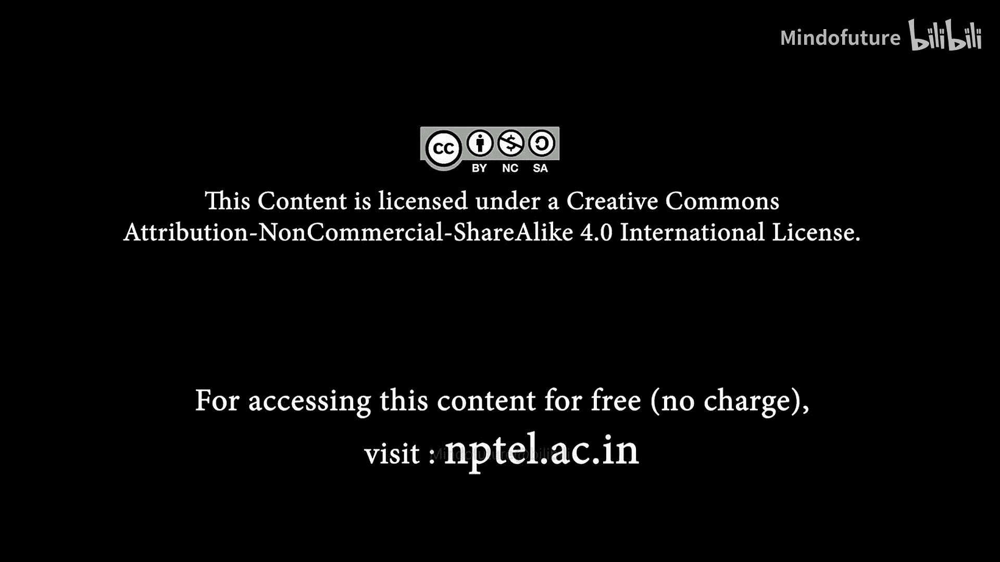
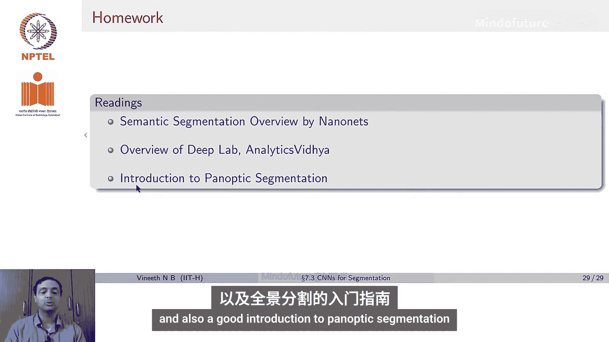

# 101：用于分割的CNN 🧠



在本节课中，我们将学习如何使用卷积神经网络（CNN）进行图像分割。我们将从语义分割开始，介绍几种经典的网络架构，然后探讨更复杂的实例分割和全景分割任务，最后了解用于评估和训练分割模型的关键指标与损失函数。

## 分割任务回顾与CNN引入

上一节我们讨论了目标检测。现在，我们将转向使用CNN架构进行图像分割。

首先快速回顾上一讲的练习。给定图像中的两个边界框：一个左上角框，大小为2x2；一个右下角框，大小为2x3；重叠区域为1x1。那么交并比（IOU）是多少？这应该很简单。

左上角框面积为4，右下角框面积为6。重叠区域面积为1。总区域面积为 `4 + 6 - 1 = 9`。因此，IOU为 `1 / 9`。

第二个问题：考虑在19x19的网格上使用YOLO，有20个类别和5个锚框，输出体积是多少？回忆一下，公式是 `S x S x (5B + C)`，其中B是锚框数量，C是类别数。假设C包含背景类，则最终答案为 `19 x 19 x (5*5 + 21)`。

让我们首先回顾图像分割本身。在课程早期，我们讨论过不同的图像分割方法，如分水岭、图割、归一化割、均值漂移等。在某种程度上，这些方法启发了用于检测和分割任务的早期CNN架构。事实上，使用选择性搜索获取区域提议的R-CNN，就使用了称为CPMC（约束参数化最小割）的最小割分割方法来生成区域提议。

但现在，我们将转向用于分割的深度神经网络。

## 语义分割：像素级分类问题

我们首先要处理的任务是语义分割，即为图像中的每个像素分配一个类别标签。

如何用神经网络，特别是卷积神经网络解决这个问题？我们将此问题视为一个像素级分类问题。

到目前为止，我们讨论的是图像级分类，即整个图像只有一个标签。然后我们学习了检测，即在边界框级别有标签，我们不仅给出类别标签，还给出边界框的偏移量以进行最终预测。但在语义分割中，我们将在每个像素的级别进行分类。

因此，对于每个图像，每个像素都必须用一个语义类别进行标记。可以想象，为语义分割创建数据集需要非常密集的标注工作。

近年来出现了各种架构，如FCN、SegNet、U-Net、PSPNet、DeepLab等。我们将在本讲座中逐一介绍。

## 全卷积网络（FCN）

我们从用于语义分割的全卷积网络（FCN）开始，它于2015-2016年提出。😊

FCN将各种分类网络（如VGGNet、GoogleNet等）适配为全卷积网络。通过将全连接层转换为1x1卷积层，我们实现了这一点。这与单次检测方法中的想法相同，因为对于语义分割，你仍然需要在像素级别进行分类，所以不希望脱离卷积机制。

为了获得每个像素的分类，我们可以在任何CNN的末端添加一个1x1卷积层，并在最终的输出体积中设置 `C+1` 个通道，其中C是类别数，加1通常用于背景类。

但这种方法有问题吗？使用卷积层时存在一个问题：所有标准的CNN随着网络加深都会进行下采样，无论是通过卷积还是池化。这意味着你的输出特征图尺寸不会与输入相同。但我们最终希望以输入图像的分辨率给出像素级标签。

我们该怎么做？答案我们已经知道：可以在某个阶段后进行上采样。因此，你拥有卷积层，在某个阶段后上采样，将特征图恢复到与输入图像相同的维度。

我们如何上采样？之前讨论过的方法之一是转置卷积。

让我们快速回顾一下转置卷积。这是我们讨论卷积神经网络时提到的一维例子，其输出可以大于输入。这是我们为转置卷积给出的图示，当你在输入图像上应用滤波器时，卷积中存在膨胀。由于存在膨胀，转置卷积也被称为膨胀卷积，有时也被称为反卷积。

现在在FCN中，这个想法被用于在某个层级后进行上采样。

让我们看一个带有VGG骨干网络的FCN架构。如果你有一个VGG16骨干网络，FCN做的第一件事是移除所有全连接层，因此你现在只有VGG16的卷积层。三个全连接层被替换为1x1卷积层，最后一个1x1卷积层有 `C+1` 个滤波器。然而，你会注意到，虽然你有21个通道，但输出尺寸仍然比输入分辨率小。因此，最后使用一个转置卷积的上采样层来恢复到原始尺寸。

这就是全卷积网络的做法。然而，转置卷积是获得上采样的唯一方法吗？不一定，我们可以做很多事情，包括稍后会看到的跳跃连接。

## SegNet：编码器-解码器架构

在我们深入之前，我们将讨论另一个与FCN大约同时期出现的方法，称为SegNet。

SegNet就是你在这里图像中看到的：你有一个输入图像，一个输出，其架构是一个全卷积的编码器-解码器架构。

这与FCN有何不同？与FCN非常相似，编码器是去掉全连接层的VGG16。解码器将低分辨率的编码器特征映射到输入分辨率。这里与FCN有一个区别：FCN只在最后有一个上采样层，而SegNet有一系列解码器层，它们镜像了编码器的架构。因此，编码器和解码器架构是彼此镜像的。

SegNet的重要贡献是避免在上采样中使用转置卷积。那么，SegNet如何进行上采样呢？它实际上使用在编码器层中获得的池化索引来进行上采样。

让我们看看这是如何完成的。如果你有一个特定解码器阶段的输出图，我们使用原始编码器的最大池化索引。假设最大池化索引是 `[0,0], [1,0], [1,0], [0,1]`，那么 `a` 会去到 `[0,0]` 位置（左上角），`b` 会去到 `[1,0]` 位置（左下角），`c` 会去到 `[1,0]` 位置（左下角），`d` 会去到 `[0,1]` 位置（右上角）。现在，这成为解码器中前一层输出图的上采样版本。可以继续这样做以获得最终的上采样图像。

编码器中的最大池化索引是什么意思？每当有一个池化层时，你都会跟踪在一个2x2或3x3的补丁中（取决于你进行的池化操作）哪些条目的索引是获胜的，并将这些获胜索引存储在一个单独的内存缓冲区中，我们将使用这些最大池化索引来上采样回更高的分辨率。

为什么这很好？存储最大池化索引比存储编码器的完整特征图更高效。在解码器的每个阶段，使用相应编码器的最大池化索引来生成上采样的特征图。

## 损失函数

现在我们已经看到了几种架构：FCN和SegNet。训练这样的网络会使用什么损失函数？很简单，它是像素级交叉熵损失的总和。记住，在FCN和SegNet中，你的输出将是一个体积，其尺寸与输入分辨率相同，但通道数将是类别数加一（用于背景）。因此，实际上你可以为每个像素在输出体积中拥有一个概率向量，现在你可以计算每个像素的像素级交叉熵，将它们全部加起来，这就成为你的损失函数。由于它是交叉熵的总和，它仍然是可微的。

## U-Net：带有跳跃连接的编码器-解码器

第三种架构，也出现在2015/16年左右，被称为U-Net。

U-Net也是一种全卷积的编码器-解码器架构，但它以一种不同于SegNet的方式引入了跳跃连接的概念。

在收缩路径（编码器路径）中，它是一个移除了全连接层的现有分类网络，类似于SegNet和FCN。但在扩展路径中，除了特征图的上采样外，网络还接收来自收缩路径的相应特征图，以及进一步的卷积层。最后，在末端，你有一个具有 `C+1` 个通道的1x1卷积，其中C是类别数。

U-Net中的上采样是使用步长为2、填充为0的2x2转置卷积来执行的。在每个上采样步骤中，特征通道的数量减半，这意味着总的输入尺寸将加倍。通过2x2转置卷积和通道减半，此时输入图的尺寸将加倍。

原始的U-Net架构执行的是无填充卷积，这意味着输出分割比输入小一个恒定的边框宽度。

让我们看看它的可视化，这就是U-Net。它的形状告诉你为什么它被称为U-Net架构。你可以再次看到收缩路径类似于任何其他没有全连接层的架构，而在扩展路径中，除了在每个步骤进行转置卷积外，你还接收来自收缩路径的相应特征图，这些特征图被添加到你的扩展路径中。因此，这为解码器的每个步骤提供了来自编码器的定位信息，而不仅仅是像SegNet或FCN那样依赖上采样。

U-Net最初是为生物医学图像分割提出的。事实上，它发表在一个医学会议MICCAI上。你认为这会如何影响U-Net模型的学习？生物医学图像分割有一些独特的挑战。首先，通常你没有像一百万甚至几万那样数量级的训练数据集。可能只有很少的训练图像可用。因此，这项特定工作通过对可用的训练图像应用弹性变形来进行过度的数据增强，这是其贡献之一。医学领域的另一个挑战是，同一类别的许多物体可能相互接触。因为可能有彼此相似的物体相邻放置。因此，U-Net还提出了一种损失函数，该函数对靠近边缘的像素的惩罚比对远离边缘的像素的惩罚更重。边缘对于医学图像分割至关重要。

多年来，出现了U-Net的几种变体，主要是通过用密集块替换卷积块和增加U-Net的深度等方式来改变架构。

## PSPNet：金字塔池化模块

另一个用于分割的网络被称为PSPNet。PSPNet首先提出了一个问题：如果在复杂场景上应用FCN，你可能会面临哪些挑战？

如果你深入思考，你会注意到FCN没有学习到上下文模式。例如，我们知道汽车在路上，而船在河流附近。FCN也可能将物体的部分预测为不同的类别，例如，它可能看着一座摩天大楼，认为像素属于不同的建筑物，因为该物体的规模巨大。第三，根据架构和所使用的感受野，FCN可能无法检测到大物体或小物体。

那么，我们如何解决这些限制呢？PSPNet假设应该使用全局上下文信息来提高分割性能。

如何获取全局上下文信息？在多个尺度上进行分割。当你在较低分辨率下分割时，你实际上是在尝试将更多的全局信息带入分割结果中。

因此，PSPNet引入了一个金字塔池化模块。给定一张图像，你通过CNN进行前向传播。然后有一个池化层，它在多个尺度上进行池化。有哪些不同的尺度？有一个粗糙的尺度，即全局平均池化，因此这将是 `1x1xC`，其中C是通道数。每个连续的池化级别提供越来越多的局部化信息。因此，你的池化输出将是 `1x1xC`（全局平均池化）、`2x2xC`、`3x3xC` 和 `6x6xC`，这些是PSPNet采用的四个尺度。记住，当你进行池化时，通常通道数不会减少，你是在通道维度上操作。

一旦完成这四个尺度的池化，PSPNet现在对来自池化操作的每个映射应用一个1x1卷积，以减少输出中的通道数。每个1x1卷积将通道大小减少了多少？减少了四分之一。这样做是有原因的。原因是，一旦执行了这些1x1卷积，所有这些映射都会被上采样并连接起来。因此，每个池化后的映射都使用双线性插值进行上采样，然后它们被连接起来，这个连接后的体积将具有与原始特征图相同数量的通道。完成后，将其通过一个卷积层以获得最终的分割预测。

## DeepLab：空洞空间金字塔池化

另一种方法是DeepLab，这是一种流行的语义分割方法，与PSPNet类似。在这种情况下，图像经过几个卷积块，然后，它执行空洞空间金字塔池化，而不是将图像分成四个不同尺度的池化层。这个模块被称为ASPP模块。记住，空洞卷积与膨胀卷积或转置卷积相同，有时也称为分数步长卷积。因此，当你的步长小于1时，你会得到与在多个尺度上执行池化相同的效果。所以，可以说空间金字塔池化是实现在PSPNet中金字塔池化模块的不同方式。

因此，一旦你进行了空洞空间金字塔池化，你再次上采样、连接，并最终在连接后的体积上得到你的结果。

DeepLab多年来经历了一些不同的版本，其中一个较新的版本称为DeepLab v3。在基本的DeepLab架构中添加了一些模块。在这个DeepLab v3模块中，图像级特征也被传递到ASPP模块。使用了批归一化以方便训练，并且还有一个完整的解码器架构用于细化分割结果。你可以看到这里有一个ASPP模块，使用它执行1x1卷积、3x3卷积等，你得到一组特征图，这些图被连接起来。进行1x1卷积以减少这些通道的深度，然后将其上采样4倍，并与ASPP模块的输出一起传递给解码器。然后将这些连接起来，最后再进行一次卷积，然后上采样并在最后进行预测。记住，当我们说预测时，它将再次是一个输出体积，其分辨率与输入图像相同，通道数将是 `C+1`，其中C是类别数，加1用于背景。

## 实例分割：超越语义分割

从语义分割继续前进，实例分割是比语义分割更具挑战性的任务。在语义实例分割，或通常所说的实例分割中，我们的目标不仅是为每个像素提供类别标签，还要为每个对象分配一个对象ID。

因此，如果有多个人员、多把椅子或多只狗，你还想区分这些人员、狗的实例，这是基本语义分割任务没有考虑的。在语义分割中，狗就是狗像素，无论有两只狗、三只狗还是四只狗，它们都只会被分类为狗。但在实例分割中，我们想要狗1、狗2、狗3和狗4。这里的挑战是你可能不知道狗的数量，这与检测问题类似。这就是为什么最流行的实例分割方法之一，称为Mask R-CNN，实际上试图改进Faster R-CNN以实现实例分割。

因此，Mask R-CNN于2017年ICCV提出，它使用类似Faster R-CNN的架构，但增加了一个分支来掩码化并获得实例级分割。所以，你可以将Mask R-CNN视为在感兴趣区域上带有FCN的Faster R-CNN。它添加了一个并行的头部，除了你的SVM对象分类器（或简单的分类模块）和边界框偏移回归器之外，你现在还添加了一个掩码预测器。这是第三个头部。

Mask R-CNN中能够准确实现掩码的一个重要贡献是一个称为RoI Align的模块。由于Mask R-CNN在Faster R-CNN的框架内运行，该模块解决的主要限制是：当你将对象提议映射到特征空间时，回忆一下，在Fast R-CNN和Faster R-CNN中，你都有某些对象提议，并将它们映射到某个特征空间。特征空间的分辨率可能与你获得对象提议的分辨率不同。在Faster CNN和Faster R-CNN中，我们只是将其变形到所需的大小，然后将你的对象提议带到那个维度。然而，当你这样做时，你可能会遇到由于量化而导致的误差。

为什么这很重要？这很重要，因为特征空间中的一个像素可能相当于图像上的许多像素，因为与初始输入相比，后面卷积层中的特征空间更小。当你试图获得一个掩码时，这几个像素可能会在最终性能中带来显著误差。

那么我们如何克服这个问题呢？RoI Align执行双线性插值，以获得对象提议与给定特征图匹配的确切坐标。这保留了掩码的平移等变性。我们是什么意思？我们的意思是，给定一张图像，其中一个对象可能位于这个黄色框或红色框中，两者都可能是有效的检测，但每个边界框中的掩码位置是不同的。因此，通过平移等变性，我们的意思是，如果对象在边界框内移动了一定距离，掩码也必须移动相同的距离。这可以通过RoI Align层实现。

因此，RoI Align的做法是：当你转换你的对象提议到特征图上的位置时，如果该位置恰好落在特征图上的几个像素之间，那么你对特征图周围的像素执行双线性插值。然后你得到对象提议指向的特定点的特定像素值，这就是随后被池化以获得固定维度表示的内容，该表示将传递到Faster R-CNN架构的后续层。

因此，除了具有分类损失和边界框损失的标准Faster R-CNN架构外，我们还有带有掩码头部的Mask R-CNN。Mask R-CNN所做的是使用一个类似FCN的分支，这意味着它是全卷积的。对于每个RoI，掩码大小为28x28。最后，在推理过程中将其缩放到边界框大小，然后叠加到图像上。因此，这个掩码是为每个RoI获得的，然后在推理时最终叠加回输入图像上。

## 全景分割：语义与实例的结合

最后一种更近期的流行分割形式被称为全景分割。全景分割结合了语义分割和实例分割。因此，正如你所见，语义分割是你分割所有对象的像素，但所有实例保持不变。实例分割是你只关心你类别中对象的实例，但分别标记每个实例。全景分割是两者的结合，你标记每个像素属于不同的对象，并且你还确保每个对象的实例获得完全不同的标签。

那么，如何进行全景分割呢？这项工作首次在2019年CVPR上提出，大约一年前。你可以使用几种架构来实现全景分割。你可以执行Mask R-CNN来获得实例分割结果，你可以使用空洞FCN来获得语义分割结果，然后合并两者以获得全景分割，这是一种方法。因此，这项特定工作实际上实现了几种方法，然后研究了如何以不同的方式对其进行评估。

另一种方法是，你可以使用特征金字塔网络，而不是我们在这里看到的空洞FCN或Mask R-CNN，你可以使用FPN，然后将这些检测结果通过Mask R-CNN头部以获得实例级分割，你也可以将这些不同的特征图通过像素级识别头部进行语义分割。因此，在这两种方法中，都有一个实例分割路径和一个语义分割路径，它们结合起来给出你的全景分割。

这里的损失函数是什么？推荐的损失函数是语义分割和全景分割以及实例分割损失函数的组合。记住，实例分割在Mask R-CNN中有三种损失：分类、边界框和掩码损失。而对于语义分割，你有标准的像素级交叉熵损失。

全景分割的挑战之一是，它不能使用用于语义分割或实例分割的指标进行评估。为什么会这样？在语义分割中，我们使用IOU和每像素精度。因此，你可以尝试查看，如果你绘制了一组属于特定对象的像素，你可以尝试获得该对象与真实标注的交并比。你也可以获得每像素精度，因为你将在每个像素级别为你拥有的所有类别预测概率，你也可以将该精度作为一个指标。😊

另一方面，对于实例分割（类似于检测），你会有在不同IOU阈值上的平均精度。

为什么我们不能将这些用于全景分割？这是因为这可能导致对有或没有实例级标注的类别产生不对称性。记住，在全景分割中，你可能有一些类别有多个实例，例如人员或狗。也可能有一些类别，如天空、道路，可能没有很多实例。因此，不考虑这些不对称性而合并这些指标可能不明智。

因此，这项特定工作推荐了一种称为PQ指标的新指标。PQ指标如何工作？你可以看这里的例子，假设这是你正确的真实标注：有天空、草地、三个人（这是其实例分割部分），然后有一只狗。现在假设我们提出的模型预测结果是这样：天空，它预测对了；草地，它预测对了；狗被预测成了人；并且不是三个人，它只预测了两个人，其中它合并了其中两个人。

那么，你现在如何衡量这种系统的误差呢？因此，这种方法推荐的方式是：首先写出你所有的真正例，这将是你的真实标注和预测之间的两个真正例的人。有一个假阴性，即你错过的那个人。还有一个假阳性，即你添加的而不是狗的那个人。😊

因此，对于一个真实标注段 `G` 和一个预测段 `P`，PQ指标计算为：

```
PQ = Σ(对于所有属于真正例的 PG) IOU(P, G) / (TP + 0.5*FP + 0.5*FN)
```

如果你分析这个，它可以写成：

```
PQ = (Σ IOU / TP) * (TP / (TP + 0.5*FP + 0.5*FN))
```

那么，第一项将是这种方式，第二项将是 `TP / (TP + 0.5*FP + 0.5*FN)`。因此，这里的第一项给出了在所有真正例中，你的分割质量（IOU是多少）。第二部分给出了识别质量，即在所有可能的段中，我们有多少个是真正例。因此，你有一部分检查分割质量，有一部分检查识别质量，这就是为什么这个指标对于全景分割变得有用。

## 分割指标与损失函数

虽然我们看到可以使用不同的指标来研究分割的不同变体，但你可能想问：我们能否使用这些指标中的任何一个来训练模型本身？让我们从回答这个问题开始，回到我们的IOU（交并比），其定义为 `A ∩ B / A ∪ B`，其中A是预测区域或像素集合，B是真实标注的相应像素集合。这衡量了单个类别的预测区域和真实标注区域之间的重叠。然后我们取平均IOU，即数据集中所有类别的IOU平均值。这通常用作语义分割的标准评估指标。

这引出了一个问题：与交并比相比，是否有更好的集合相似性度量？我们能否使用它们直接训练模型？这引出了今天用于分割任务的一个流行损失函数，即Dice损失。

Dice损失基于Dice系数。这个系数可以追溯到20世纪40年代，当时一位名叫Ice，随后是Sørensen的人发明（或者说发现了）这个系数，其公式为 `2 * |A ∩ B| / (|A| + |B|)`。这也是一个类似于IOU的集合相似性度量，但它在分母中考虑了集合的大小，因此使其成为一个更好的集合相似性度量，特别是对于不平衡的集合。分割中的许多应用具有可能只有很少像素的区域，而其他区域可能具有大量像素。这使得Dice系数更适合于研究分割，而导出损失函数的系数变体是看损失为 `1 - Dice系数`。

我们在这里写Dice系数的方式是 `(2 * y * p) / (y + p)`，其中 `y` 是真实分割掩码（一组像素，我们将其写为二进制掩码，这意味着对于该特定真实分割掩码，我们只有0和1），`p` 对应于预测的分割掩码（同样是二进制或概率掩码）。显然，在 `y` 为0的地方，相应的概率不会有值；在 `y` 为1的地方，它会有值。这里的 `+1` 主要是为了数值稳定性而添加的，以避免除以零。现在，这成为一个我们可以用来训练分割模型的损失，除了使用像素级交叉熵之外。

这是我们使用的唯一损失吗？不完全是，有一整套损失函数分类法可以考虑。你可以看这篇名为《语义分割时代的损失函数》的论文，这是一份非常好的文档，它从像素级别、区域级别和边界级别，以及所有这些损失的组合来审视语义分割的损失函数。我们不会在这里深入探讨每一个，但如果你感兴趣，可以查看这篇特定论文以了解更多细节。

## 总结

本节课中，我们一起学习了用于图像分割的卷积神经网络。我们从语义分割的基本概念和全卷积网络（FCN）开始，了解了如何将分类网络转换为分割网络。接着，我们探讨了SegNet和U-Net这两种编码器-解码器架构，它们通过不同的方式（如使用池化索引或跳跃连接）来处理上采样和特征融合。然后，我们介绍了PSPNet和DeepLab，它们通过金字塔池化模块和空洞卷积来捕获多尺度上下文信息，以提升复杂场景下的分割性能。

之后，我们进入了更高级的任务：实例分割和全景分割。我们详细分析了Mask R-CNN，它扩展了Faster R-CNN，通过添加掩码预测分支和RoI Align模块来实现精确的实例级分割。全景分割则结合了语义分割和实例分割，我们讨论了其独特的评估指标PQ。

最后，我们探讨了分割任务的评估指标（如IOU）和训练损失函数（如交叉熵损失和基于Dice系数的损失），理解了直接优化评估指标（如使用Dice损失）的重要性。



通过学习这些内容，你现在应该对使用深度学习进行图像分割的主流方法、架构演变以及关键技术细节有了一个全面的认识。