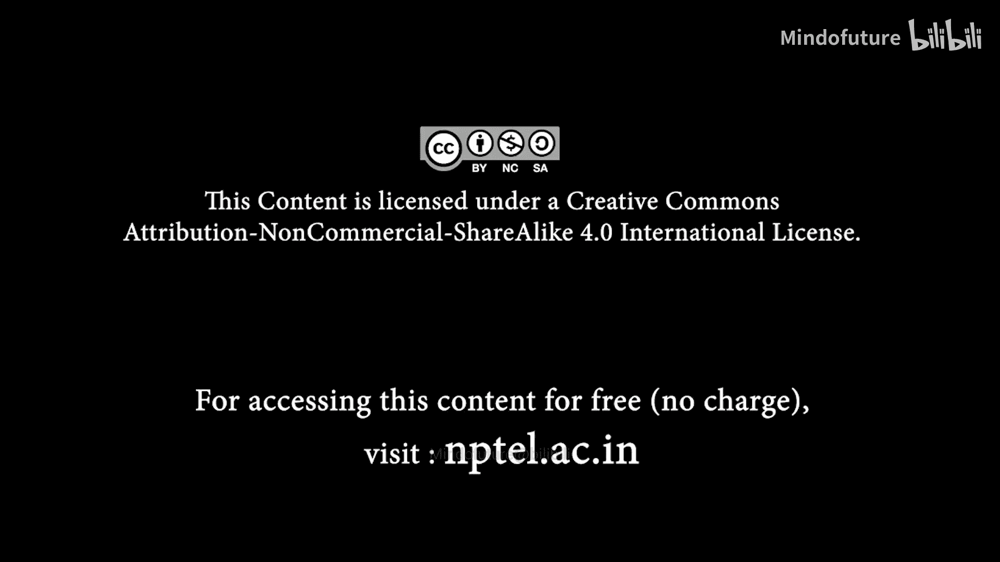
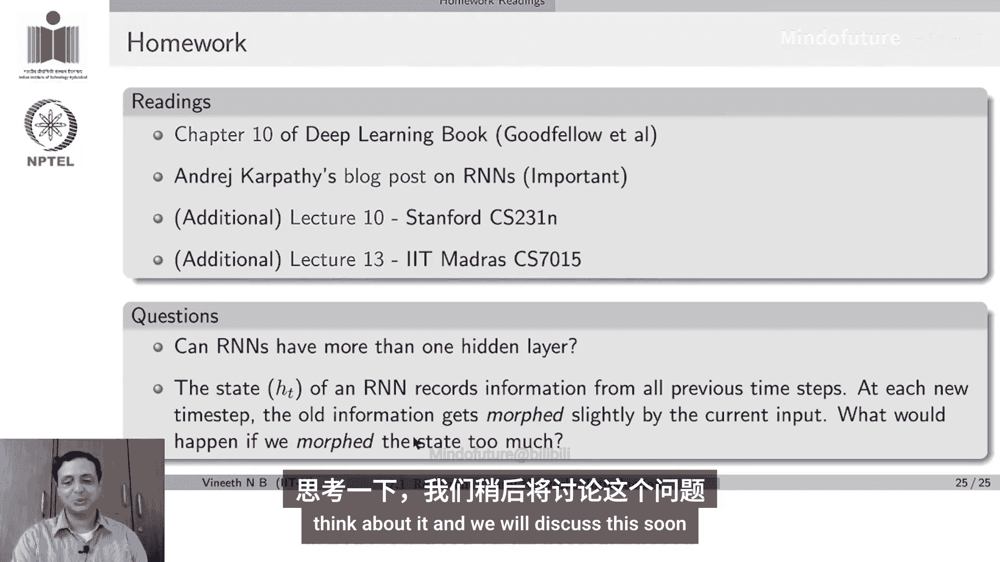

# 102：循环神经网络 - 介绍 🧠

在本节课中，我们将要学习循环神经网络的基本概念。我们将了解RNN为何被设计用于处理序列数据，其核心架构，以及如何通过计算图来理解其工作原理。

到目前为止，我们已经了解了卷积神经网络的工作原理、如何使用反向传播训练它们、它们如何用于图像分类、使用的损失函数，以及如何可视化和理解CNN。我们也看到了CNN如何扩展到其他任务，如检测、分割、人脸识别以及其他杂项任务。

本周，我们将转向深度学习领域的另一个支柱——循环神经网络。循环神经网络旨在处理时间序列，这意味着在计算机视觉中应用时，当输入是视频时，它们就变得相关。

在开始本主题之前，我们有一个问题：如何发现模型中的偏见？如果你有一个人脸识别模型，你如何知道该模型是否对特定人群或数据中心存在偏见？希望你有机会思考过这个问题。在当今这类技术被大规模部署的时代，这是一个重要问题。

一个简单的检查方法是，如果你认为可能存在某个特定的特征或属性，例如某个人的背景。那么你可以在输入中改变该属性，并观察预测是否发生变化。如果发生变化，则表明模型依赖该特征进行预测。如果你认为这种依赖不应该存在，你应该尝试基于该属性进行正则化，使用数据增强方法来改变该属性的值，并确保模型的预测不发生变化。

现在，我们将转向循环神经网络。本讲座幻灯片基于Fili的CS231N课程和Mihikara的IIT Madras课程。

## 序列学习问题

循环神经网络的更广泛背景是序列学习问题。

到目前为止，无论是前馈网络还是卷积神经网络，输入的大小始终是固定的。给定一个CNN，你总是输入一个固定尺寸的图像，例如用于图像分类的32x32图像。每个输入也独立于之前或未来的输入。并且，两个连续图像的计算、输出和决策彼此完全独立。

这是什么意思？这也与我们在机器学习数据集中常说的IID属性有关。IID代表独立同分布。如果我们有一个图像数据集，我们假设数据集中的每个图像都是独立同分布的。这意味着无论你以何种顺序提供这些图像，你的模型最终都可能学习到相同的预测函数。无论输入是这张图像、那张图像还是另一张图像，显然类别标签会改变，但模型参数或架构中的其他内容不会改变。

然而，还有另一类问题，称为序列学习问题，它们需要比我们目前所见更多的东西。

以文本自动补全为例，这是你可能每天都会遇到的情况。如果你输入“Google Autocomplete A”，你会得到一组推荐；如果你输入“Google autocomplete B”，你会得到另一组推荐；对于“C”也是如此。在这类问题中，连续的输入不再独立。为了在特定状态下进行预测，你需要查看之前时间步的输入。这是我们在讨论前馈网络或CNN时不需要的。

在这类问题中，输入的长度和需要进行的预测数量也可能不是固定的。例如，如果你输入“Google autocomplete C”，最后一个词可能是“code”或“country”，它们的长度不同。你希望你的模型不受此类约束的影响。

这类问题的另一个重要启示是：无论你的输入是什么，无论“C”之前有两个词、三个词还是一个词，模型必须在所有这些上下文中执行相同的任务。给定一个先前的短语，它必须预测下一组字符。无论你在哪个时间步尝试进行预测，该任务都不会改变。如果用户输入了一个词，你仍然需要预测下一组字符；如果用户输入了两个词，你的上下文增加了，时间上下文的长度增加了，但任务需要实现的目标保持不变。

这类问题被称为序列学习问题。为处理此类序列学习问题而设计的神经网络架构被称为循环神经网络，我们很快将看到它们为何如此命名。

## RNN的架构类型

以下是RNN的不同架构变体。

如果你将一个标准的前馈普通神经网络可视化为这种形式，其中有一个输入、一组隐藏层和一个输出，那么循环神经网络的变体可以可视化为以下几种：

*   **一对多**：你的输入在一个时间步，但你的输出实际上是跨时间步的一系列输出。例如：图像描述生成，其中输入是单个图像，输出是一系列单词，这些单词需要前后连贯以组成完整的句子。
*   **多对一**：你在多个时间步有输入，但只在一个特定时间步进行预测。例如：动作预测，其中输入是一系列视频帧，模型在看完完整的输入序列后给出一个特定的类别。例如，在看完一段完整的足球比赛视频片段后，模型应预测该片段是否为进球事件。
*   **多对多**：给定一组跨时间步的多个输入，输出也需要有跨时间步的多个输出。这被称为多对多，一个例子是视频描述生成，其中输入是视频（一系列随时间变化的帧），输出也是一系列随时间变化的单词。
*   **同步多对多**：你有一组随时间变化的输入和一组随时间变化的输出，但输出和输入在每个时间步是同步的。一个例子可以是逐帧视频分类，因此视频作为输入进入你的模型（记住，视频具有时间成分），但同时你希望在每一帧级别进行预测。在这种特定上下文中，这将是一个多对多设置。

## 如何为序列建模

那么，我们如何为涉及序列的任务建模呢？我们看到了高级架构，但实际上如何用这些架构学习模型？如何考虑时间序列数据中常见的输入之间的依赖性？如何考虑可变数量的输入？如何确保，例如，在图像描述生成中，输入或输出的数量是可变的？对于另一个应用，如何允许可变数量的输入或输出？

第三个考虑因素是，如何确保在每个时间步执行的函数是相同的？为什么需要这个？无论一帧在视频中的哪个位置，你都希望使用相同的逻辑来执行预测。这类似于我们在卷积中所说的，无论猫在图像的左上角还是右下角，我们都想说图像中存在一只猫。我们通过卷积的思想克服了那个问题。但现在，我们如何在时间序列和序列学习问题上做到这一点，这就是我们接下来几张幻灯片要讨论的内容。

## RNN的核心抽象

因此，循环神经网络的高级抽象是这里的这个图。你有一个输入x，一个输出y。在两者之间，有一个被称为循环神经网络的东西，正如其名，这里有一个循环，现在由这个单元循环表示。

RNN的关键思想是它们有一个内部状态，该状态在序列被处理时更新。人们可以将这个内部状态视为某种记忆，它保留了同一时间序列过去数据的一些信息，这个想法我们本周稍后也会讨论。

如果将循环展开，你会得到一个像这样的网络：你有一组随时间变化的输入x1到xt，这就是你拥有的输入序列，这就是为什么我们将其视为序列学习问题。对于每个输入，你将该输入提供给一个RNN块。这个RNN块可以是单个隐藏层，可以是多个隐藏层，可以有跳跃连接，可以有任何其他架构，但我们将把它视为一个单一的抽象。该RNN的输出就是模型在该时间步的输出。这将是整个展开的RNN。

当你使用RNN时，你必须事先决定你想要展开RNN多少。这是什么意思？对于特定问题，你必须决定这个小T必须是多少。你是想查看过去的20帧来做决定，还是想查看过去的100帧，或者过去的200帧？这是在你开始学习RNN之前必须决定的事情。这里的P将对应于你在进行预测时想要查看的序列长度。

一旦T被决定，你可以这样展开RNN：RNN块内的相同操作用于每个时间步的输入。正如我们之前所说，根据你使用RNN的应用程序，你可以在每个时间步都有输出，或者只在最后一个时间步有输出，或者也可以在最后一个时间步之后有一系列输出。所有这些可能性都是我们在屏幕上看到的这个抽象的变体。

## 循环公式

现在让我们深入更多细节。我们说过它是一个循环神经网络，并且我们也希望这里的RNN块对每个时间步的输入重复相同的操作。那么，我们实际想要使用的循环操作是什么？

对我们来说，每个时间步的循环公式是：给定特定时间步的输入Xt，以及Ht-1（RNN在前一个时间步的状态），然后你将应用某个函数，这个函数是RNN内部的参数，带有一些权重U和W，你会得到该时间步的输出Ht，它被传递到RNN的下一个状态，以处理下一个时间步的输入。

这是一个可视化：在时间步T1，给定输入x1和初始状态h0，RNN使用权重U和W（权重矩阵）处理这两个输入h0和x1，并在该时间步输出y1（如果需要输出）和一个状态H1，该状态被传递到RNN的下一个时间步。但在下一个时间步，RNN接收x2和h1作为输入，使用与前一个时间步相同的权重U和W（记住我们说过，我们希望RNN将每一帧视为类似输入并执行类似操作，尽管它们在时间上位置不同）。因此，第二个时间步的RNN输出y2（根据问题在该阶段是否需要输出）和h2（其隐藏状态），该状态被传递到第三个时间步的RNN，依此类推，直到最后一个时间步。

因此，重复一下循环公式：Ht = F(U, W)，其中U和W是那些权重矩阵，给定输入Xt和Ht-1。这里的关键观察是，相同的函数和相同的参数集在每个时间步都被使用。这不会改变，而这正是循环神经网络中“循环”所在之处。

现在，你可以考虑根据任务使用激活函数。因此，我们刚才在这里写的循环关系现在可以是：H = tanh(U * Xt + W * Ht-1)，其中U是乘以Xt的权重矩阵，W是乘以输入Ht-1的权重矩阵。Yt可以是V * Ht的softmax。所以，如果你有一个从RNN输出的Ht，那么你有一组权重V乘以V*Ht，然后如果你在处理分类问题，你对该V*Ht应用softmax以给出RNN的最终输出。从x到RNN的权重是U，查看Ht-1并给出Ht的权重是W。所以你可以看到有三组权重矩阵（当然，W可能根据RNN块内有多少层而变化），否则这里有三个权重集作用于输入、隐藏状态和隐藏状态到输出。这有时也被称为Elman RNN，以Jeffrey Elman的名字命名，他负责提出这些想法。

## 计算图简介

为了继续前进并理解RNN实际上是如何训练的，我们将退一步，看看所谓的计算图的概念。

计算图是实现神经网络（包括推理和反向传播）的一种非常常见的方法，如今在PyTorch或TensorFlow等框架中也是如此。因此，我们将首先回顾一般的计算图，然后讨论如何为RNN定义计算图。

计算图是一种有向图，其节点对应于操作或变量。输入节点和从节点输出的值是张量。张量是多维数组，通常是大于二维或二维的。向量的推广是矩阵，矩阵的推广通常称为张量。张量通常包含标量、向量、矩阵等，张量是表示这些量的更通用术语。

正如我刚才提到的，计算图可以实例化以执行神经网络的前向传播和后向传播。

在我们讨论神经网络之前，让我们举一个简单的例子，谈谈如何使用计算图来创建表达式并计算它们。

如果你有表达式：E = (a + b) * (b + 1)，这是一个算术表达式。这里有三个操作：两个加法和一个乘法。可以将整个表达式或操作写为一系列中间操作。这些中间操作是什么？你可以首先说C = a + b，D = b + 1，然后E = C * D，这是你的最终输出。所以，你说这里的第一个项是C，第二个项是D，然后你最终将两者相乘得到E。这看起来很简单，我们为什么要讨论这个？

现在可以将其写为计算图。你有作为输入给出的值A和B。你计算由a + b给出的C。然后你计算D，它只依赖于B，即b + 1。然后你组合C和D得到最终输出E，即C * D。

如何评估这些表达式？假设给你A和B的具体值，你如何使用计算图评估这个表达式？你将输入变量设置为给定的特定值，例如a=2，b=1，然后你将从这些变量实例值开始，沿着图向上计算节点，直到根节点，得到最终答案。所以它可能看起来像这样：设置a=2，b=1。首先计算c = a + b，得到C=3；类似地，d=2；然后组合它们得到E的最终答案，即E=6。这很好很简单。

但是，你如何使用这样的计算图进行反向传播？换句话说，如何使用计算图计算梯度或导数？这里的关键是，要理解梯度，你需要理解计算图的边。因为边表示一个特定变量如何影响另一个变量。

例如，如果你有相同的计算图，你在这个叶节点有a，并且在那个叶节点的父节点有C = a + b。现在，可以写出∂C/∂a。因为C = a + b，所以∂C/∂a = 1。类似地，在连接B和C的这条边上，∂C/∂b也将是1，因为c = a + b，依此类推，对于图中的每一组边。

我们如何做到这一点？我们正在将标准的求和规则和乘积规则适当地应用于梯度，以计算每条边的梯度。为了得到你的最终梯度，你可以对从一个节点到另一个节点的所有可能路径求和，将路径上每条边的导数相乘。例如，如果我们想要∂E/∂a，我们查看所有从a到E的可能路径，所以在这种特定情况下，就是这条路径。你将那条路径上的所有梯度相乘，所以在这种情况下是1 * 2，这就给出了∂E/∂a的梯度。类似地，如果你必须计算∂E/∂b，你必须考虑所有从B到E的可能路径。你将每条路径中的梯度相乘，并将这两条路径的贡献相加，你将得到最终梯度。所以再次，在这种情况下，∂E/∂b将是1 * 2 + 1 * 3。

这就是你如何使用计算图来获取特定表达式中的梯度。因此，为了给你一个更具体的例子，在你可能使用的框架PyTorch中，PyTorch在前向传播期间动态跟踪变化，允许创建这样的计算图，称为动态图。当你说`loss.backward()`时（当你在PyTorch中训练神经网络时，如果你说`loss.backward()`，例如，或者如果你只是评估一个表达式，在我们看到的这个特定例子中，你可以说`c.backward()`），PyTorch框架会触发梯度的计算，然后你可以打印出表达式中每条边或每个梯度的梯度。

## 神经网络的计算图

那么，前馈神经网络的计算图呢？所以，如果你在神经网络中有几层，给定输入X，假设你的隐藏层H是tanh(Wx + b)，Wx + b是你的输入x的线性组合，让我们假设你在每个节点上有一个非线性激活函数tanh，这给你一个向量H。然后你在H上应用另一组权重V，给你最终输出y，其中B和a是你的偏置（如果这只是前馈神经网络的数学表示）。你对应的计算图将如下所示：你的第一个输入是W和x，基于此你在这里得到某个输出。然后你将其与+b组合，然后你可以得到某个输出。然后最后你取那个并应用tanh，得到你的tanh(U)。所以这里的第一步可以表示为一个计算图，它是一个序列，以W、X和b作为输入，输出H。类似地，现在对于下一个操作，你现在可以将h视为输入，v视为另一个输入，a视为另一个输入，此时的计算图将是这组操作。显然，此计算图中某个节点的输入是作为前一个计算图的输出而来的边。

## RNN的计算图

现在，回到RNN，由于RNN稍微复杂一些，让我们尝试从计算图的角度来看待RNN。因此，给定输入x1和H0，输入被提供给F(U, W)，这是我们之前讨论过的，F(U, W)输出h1。然后h1和x2再次进入F(U, W)，这是我们在每个时间步评估的相同函数。然后第二个时间步的F(U, W)给你H2。这再次循环地给出到下一个时间步，依此类推，直到你得到序列最后一个时间步的最终隐藏状态。

因此，从计算图的角度来看，这里的输入U、W（权重矩阵）在每个时间步都是相同的，这就是这些箭头所显示的，它们进入每个时间步的F(U, W)。

如果你有一个多对多RNN，你只会稍微改变这一点，因为现在你将在每个时间步都有输出，而我们在前面看到的RNN中没有。你现在可以有一个从多对多RNN出来的输出L1，这最终是作为输出给用户的。你也可以考虑组合所有这些L1、L2、L3...直到Lt，以给出你的最终L作为输出。为什么这很重要？如果你看，比如说，视频描述生成，这将是这种多对多架构的一个实例。你可以将L1、L2、L3、LT等视为保存描述每个单词的变量，而L是作为RNN输出给出的最终描述。

如果你考虑多对一架构，计算图将看起来像这样，初始部分大致保持不变，但输出y现在只在最后一个时间步。这完整吗？在计算图方面并不完全，你还需要连接，其中y可以是一个输出，它也接收h1、h2、h3等作为输入来计算最终输出值。

在一对多设置的情况下，你可以有这种计算图，其中输入仅在第一个时间步是x，但你现在在每个时间步都有输出y1、y2、y3直到yt。这里的一个问题是，在中间时间步你会给出什么作为输入？为什么我们需要讨论这个？记住，F(U, W)在每个时间步是相同的函数。我们已经知道在第一个时间步F(U, W)需要两个输入x和H0，这意味着在每个时间步它确实需要两个输入。我们该怎么办？一个选择是，我们可以在每个时间步输入零，这可能是我们可以提供的一个选项。有时遵循的另一个选择是，通过调整维度，前一个时间步的输出也可以作为下一个时间步的输入。你可以使用前一个时间步的输出也作为下一个时间步的输入。为什么这相关？为了生成描述中的下一个单词，你可以提供描述中的前一个单词来帮助模型生成适当的下一个单词。

## 一个具体例子

为了给出一个更具体的例子，让我们考虑一个RNN模型。让我们假设输入和输出来自我们的词汇表“H E L O”。你的输入字符，假设是“h”，表示为[1,0,0,0,0]。这样的表示也称为独热向量。独热向量是一个向量，在给定输入的位置（在词汇表中的位置）为1，其他地方为0。由于“h”是这里的第一个字符，如果你的输入字符是“h”，对应的独热向量将是[1,0,0,0,0]。给定该输入，让我们假设你有一个隐藏层，一个输出层，并假设输出层有d组输出，在进行softmax后，你最终得到一组概率，其中第二个概率最高，这意味着你将预测下一个字符为“E”。现在，这个字符作为输入被提供给下一个时间步（记住我们刚刚说过y1作为输入被提供给下一个时间步，作为x2）。所以“E”，由于“E”在词汇表中的第二个位置，将由独热向量[0,1,0,0]表示，然后通过相同的网络传递，现在你得到一个softmax输出，如[0.25, 0.2, 0.5, 0.05]，最高的是第三个，即“L”，这是RNN在该时间步的输出。那个“L”然后再次作为输入被提供给下一个时间步，“L”表示为[0,0,1,0]（因为“L”在词汇表中的位置），再次执行此过程，它再次给出“L”作为输出。那个“L”被提供给下一个时间步，然后输出是“O”，在某个时刻，整个RNN模型可以给出一个结束标记作为输出，以知道这组输出在哪里结束。所以结束标记将是词汇表中的一个默认字符，当RNN模型决定结束该特定单词的生成时，就会预测它。

## 总结与作业

在本节课中，我们一起学习了循环神经网络的基本概念。我们了解了RNN为何适用于序列数据，探讨了其一对多、多对一和多对多等不同架构。我们深入研究了RNN的核心循环公式，并通过计算图理解了其前向和反向传播机制。最后，我们通过一个简单的字符预测例子，直观地感受了RNN的工作流程。

作为课后作业，你的阅读材料包括《深度学习》书籍的第10章，以及Andrej Karpathy关于RNN的优秀博客文章。此外，如果你愿意，可以浏览斯坦福大学的CS231N课程或印度理工学院马德拉斯的CS 7015课程。

在下一讲中，我们将讨论如何使用反向传播来训练这些RNN。在此之前，有几个问题供你思考：RNN可以有多个隐藏层吗？我们已经回答了这个问题，但请思考以确保它可以。下一个问题是：RNN的状态H记录了来自所有先前时间步的信息。在每个新的时间步，从某种意义上说，旧的信息被当前输入稍微修改。你有一个Ht-1到来，你有一个Xt到来。先前步骤的状态现在由于这个时间步到来的输入而被修改。如果我们过多地修改状态会发生什么？更确切地说，如果你只非常关注当前输入，而较少关注先前时间步的状态，会发生什么？思考一下，我们很快就会讨论这个问题。