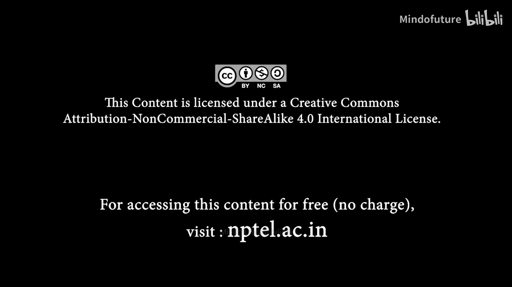
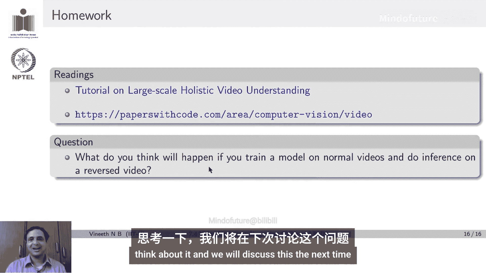

# 105：使用CNN和RNN进行视频理解 🎥

在本节课中，我们将学习如何利用卷积神经网络（CNN）和循环神经网络（RNN）来处理和理解视频数据。视频是视觉领域中的时序序列，我们将探讨几种核心方法。

上一节我们介绍了处理时序序列的RNN。本节中，我们将转向视觉领域的时序序列——视频。

## 为何需要理解视频？🤔

以下是几个例子。第一个例子是自动棒球棒击打棒球。要理解棒球棒将在何处击中球、球将飞向何方或这是什么活动等问题，需要观察所有帧才能做出决策。序列中的单个帧可能无法回答这些问题，例如球将飞向哪里。

另一个例子是理解螺丝的旋转方向。仅凭其中一帧图像无法获知螺丝的旋转方向。需要观察一系列帧才能做出判断。

因此，我们的问题是：如何利用迄今为止学到的知识（前馈神经网络、CNN和RNN）来理解视频？仅靠其中一种网络是否足够，还是需要组合使用？让我们尝试从基础开始，自己找出答案。

## 理解视频的可能方法 🛠️

如果要理解视频，可以关注特定位置。以螺丝视频为例，可以跟踪螺丝上的一个点，观察其随时间的变化，从而判断旋转方向。那么，如何获取这些信息并跟踪特定点呢？

考虑到本课程的重点是深度学习，我们将关注基于深度学习的方法来理解视频。广义上说，可以仅使用CNN，也可以结合使用CNN和RNN来理解视频。本节课我们将看到这两种例子。

即使在CNN内部，也有两种执行视频理解的方法：一种是进行所谓的**3D卷积**，另一种是尝试重新利用**2D卷积**本身来理解视频。

### 3D卷积方法

在3D卷积方法中，时间成为分析的另一个维度。就像图像是二维信号一样，视频是三维信号，时间成为另一个维度。因此，我们迄今为止看到的每个操作都必须增加一个维度，例如3D卷积。

### 2D卷积方法

另一种看待问题的方式是使用2D卷积，但将时间视为一个独立的实体，而不是一个单独的维度。我们将通过一个例子来更清楚地说明这一点。

你可能会问：我们之前不一直在做3D卷积吗？我们CNN的输入是体积（例如R、G、B通道）。那么，我们实际上不是已经在进行体积卷积了吗？那不是3D卷积吗？

如果你之前没有仔细思考过这个问题，答案是否定的。我们不称之为3D卷积的原因是，我们只沿着图像的两个维度移动卷积核。深度（通道数）是固定的，执行卷积时并不跨越该维度移动，移动只发生在两个维度上。因此，我们迄今为止看到的是2D卷积，尽管滤波器延伸到第三维度并被处理，但我们实际上并不在第三维度上移动窗口。

现在，当我们讨论视频和3D卷积时，我们指的是在时间维度上移动。

## 深入理解3D CNN 📊

首先，让我们尝试将3D CNN作为理解视频的一种方式。传统上，如果从视频中取一帧或多帧，并执行标准的2D卷积，你会查看每一帧的特定区域进行卷积，并在输出特征图中得到某个输出。然而，以这种方式应用卷积时，两帧之间没有连接，也没有共享任何信息。

然而，在进行视频理解时，核心思想是能够传递或组合来自多帧的信息以进行预测（例如分类问题）。那么，我们如何做到这一点呢？正如刚才提到的，想法是将卷积扩展到另一个维度。

如果你有三帧图像，我们提出的不是对每一帧单独进行2D卷积，而是在帧之间进行卷积。让我们更仔细地研究这一点。你可以看到，第一个区域有一组权重，在输出特征图中产生一个像素。但该特征图也受到应用于第二帧的另一组权重和应用于第三帧的第三组权重的影响。类似地，在第二个特征图中，你会看到视频的每一帧都应用了不同的权重集。因此，你现在有了一个新的维度（时间维度）需要进行卷积。

我们将看一篇特定的论文，它可能是引发后续大量工作的先驱，即发表于2010年ICML和2012年PAMI的《3D卷积神经网络》。让我们看看这个3D CNN的架构。架构多年来有所发展，但至少这个例子可以给你一个概念。

在这个特定例子中，3D卷积神经网络用于人类动作识别，即观看视频并预测动作。输入是七帧分辨率为60x40的灰度图像。这项工作的初始层使用了硬编码的滤波器，这些滤波器不是学习得到的，而是五种不同类型：灰度滤波器、沿x方向的梯度、沿x方向的光流、沿y方向的光流等。这些滤波器产生了总共33个特征图，每个特征图的分辨率仍为60x40。

在初始处理之后，下一层是使用学习权重进行的3D卷积。他们执行了7x7x3的3D卷积，并确保在这五种不同类型的特征图各自内部进行3D卷积，正如你在这里看到的颜色编码所示。为了增加多样性，他们还引入了另一组完全不同的特征图和权重集，但执行相同的操作。你可以认为这类似于AlexNet第一层中48个特征图分别进入两个不同GPU的情况，尽管在这里意图不是发送到不同GPU，而是为了在特征图中获得更多多样性。

其余层遵循传统的CNN方法：在每个特征图内进行2x2下采样，然后进行另一个3D卷积（7x6x3），同样有两组特征图，接着是3x3下采样，然后是7x4卷积将所有内容整合在一起，最后是一个全连接层进行最终决策。这些是如何学习的呢？从这个角度来看，没有任何变化，你仍然在最后有交叉熵损失，并且仍然可以反向传播通过所有这些层，非常类似于我们为CNN讨论的方式。

使用这种方法，他们可以展示出能够执行动作识别。他们数据集中的某些动作包括：检查是否有人将手机放在耳边，或者发现有人在公共环境中遗留物品，或者有人指向另一个人。如果你仔细观察，每个框旁边还有一条轨迹，显示了导致当前帧结果的先前帧及其位置，以及一个得分（而非概率）。这就是3D CNN理解视频的方法，多年来已经出现了多种变体。

## 使用2D CNN进行视频理解 🔄

现在让我们换个角度思考问题：我们能否仅使用2D CNN来解决视频理解问题？事实证明，有一种非常流行的方法可以做到这一点，称为**双流卷积网络**，至今仍广泛用于视频理解任务。

让我们尝试理解它的工作原理。假设有一段视频，在某一时刻你看到一个人试图从衬衫后面取出某物，手移动，然后有东西从衬衫后面出来。现在，我们可以使用传统的光流方法来找出像素在x和y方向上移动了多少。利用这个光流，你可以有水平分量和垂直分量。

在双流CNN中，你有输入视频（一个体积）。你有一个CNN的**空间流**，它接收单个帧（可以是彩色图像），然后通过标准的CNN架构传递，最终输出这可能是什么动作。这包括conv1、conv2、conv3、conv4、conv5、全连接层、全连接层，非常类似于AlexNet架构，最终得到分类结果。但这仅针对单帧。

另一个流被称为**时间流**，它执行多帧光流分析，以了解内容在帧之间的变化情况。因此，你得到了输入视频中每对连续帧之间的光流图像。这些光流图像在时间维度上形成一组通道，现在可以对这个光流体积执行标准的2D卷积。每个光流图像都是一个2D图像，跨时间堆叠在一起形成一个体积。这个体积可以通过另一个标准的2D CNN架构（我们称之为时间流卷积网络）传递，两者都提供它们自己对动作的分类。

最后一步是执行类别得分的融合，你可以通过多种方式聚合它们（例如多数投票或平均），然后做出最终决策，从而得出这是什么动作的最终判断。请注意，这里所有的卷积都是2D卷积，而不是3D卷积。

## 结合CNN与RNN进行视频理解 🤖

那么，如何使用RNN与CNN结合来进行视频理解呢？给定一个视觉输入（如图像），首先从CNN中提取视觉特征。因此，你会将其前向传播通过一个CNN，并取倒数第二层（例如AlexNet的某层）作为图像的表示。

现在，这些图像表示可以提供给一组LSTM或RNN进行序列学习，以给出最终的预测。假设你有一段视频，有多帧图像。那么，你将每一帧提供给相应的CNN以获得不同的特征表示，然后这些表示可以提供给一个LSTM，LSTM会给出输出。你可以假设这里的每一列是你的LSTM在时间上展开，这是一个堆叠的LSTM在时间上展开。最后，这些LSTM的输出就是你做出的预测。因此，你可以每帧都有一个预测，或者忽略所有这些，只在最后一个时间步做出预测。

这就是结合CNN与RNN的方式。如何学习这样的网络呢？请记住，我们在这里看到的每个组件都是可反向传播的。我们知道如何通过RNN、LSTM和CNN进行反向传播。因此，给定最后的交叉熵损失或每个时间步的交叉熵损失之和，我们可以计算反向传播的误差，即该误差相对于CNN或LSTM中每个权重的梯度。CNN是用于每个图像的相同模型。

## 视频理解的应用领域 🌐

有了这些方法（双流CNN、CNN+RNN或3D CNN），我们可以解决哪些视频理解问题呢？如果你查看像UCF 101这样的数据集（一个非常流行的视频理解数据集），你可以执行动作识别，例如判断人是否在做俯卧撑、攀岩、蹦床跳跃等。或者，如果你有另一种数据集，例如另一个流行的活动理解数据集Hollywood in Homes，你也可以执行动作识别，例如对着书微笑等。或者，你还可以执行句子预测，例如为整个视频生成字幕或类似问题。

视频理解还有更多问题可以解决，例如**动作预测**：如果你有一段体育视频，并且看到了迄今为止的一系列事件，接下来会发生什么？例如，在水球比赛中，根据迄今为止看到的动作序列，球员接下来会把球传给谁？或者在篮球比赛中？**目标跟踪**是另一个重要的视频理解任务。**动态场景理解**：迄今为止，我们已经看到了给定场景可以将场景分类为室内/室外、早晨/夜晚、城市/乡村等的方法，使用的是图像级分类方法。我们知道CNN，给定数据和交叉熵损失，我们可以学习一个场景分类模型。但是，如果你想理解一个动态场景、一个动态视频，那么我们必须转向视频理解模型，如3D CNN、双流CNN或CNN+RNN来解决这样的问题？人们还可以考虑其他问题，例如**时序动作分割**等，这将是一种无监督的方法，也是视频理解中的重要问题。

你的作业是阅读这篇关于大规模整体视频理解的教程，它应该能让你更清楚地了解视频理解中的更多任务，以及如何调整这些架构来解决这类问题。这个链接还很好地列出了该领域的论文。

## 总结与思考题 💡

本节课中，我们一起学习了利用CNN和RNN进行视频理解的几种核心方法：3D CNN、双流CNN以及CNN与RNN的结合。这些方法使我们能够处理视频中的时空信息，解决动作识别、目标跟踪、动态场景理解等问题。

我们将以一个非常有趣的问题结束本周的课程：如果你在正常视频上训练一个模型，然后在测试时输入一段反向播放的视频进行推理，会发生什么？它会工作吗？还是不会？思考一下，我们下次再讨论。