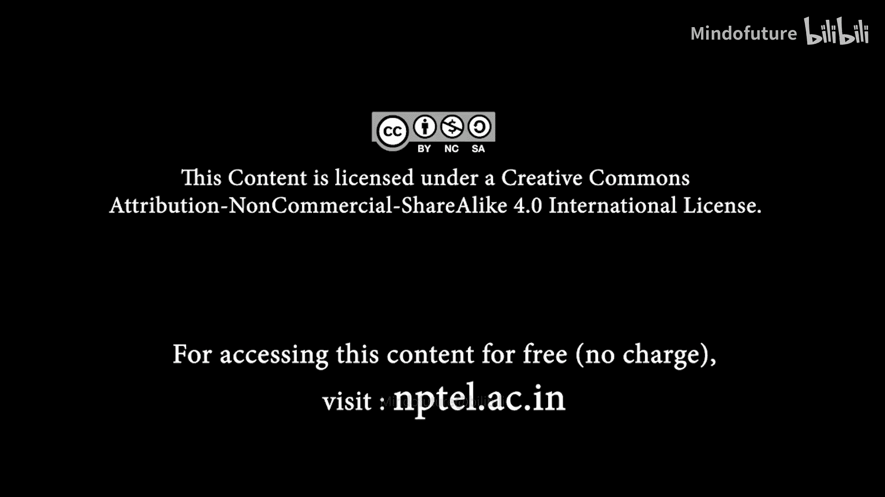
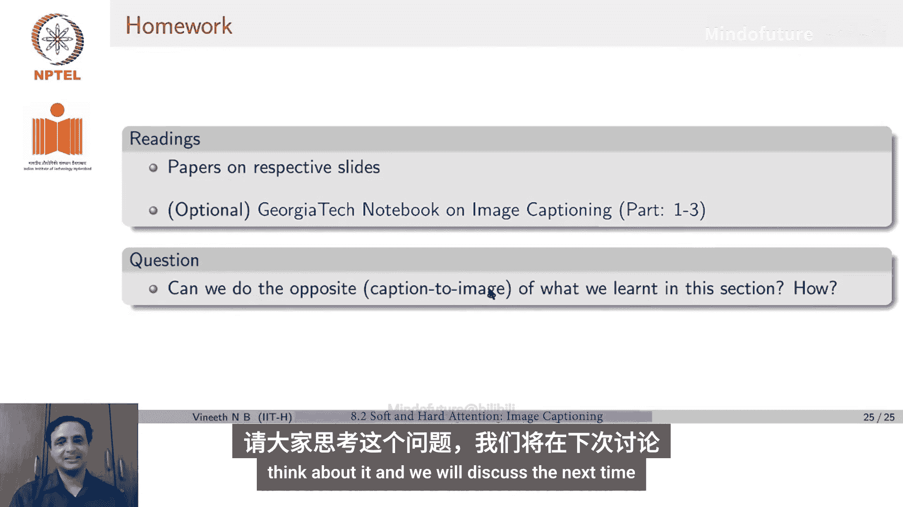

# 107：软注意力和硬注意力 - 图像字幕

在本节课中，我们将要学习图像字幕任务，这是一种让计算机为图像生成自然语言描述的技术。我们将从回顾自动编码器与PCA的联系开始，然后深入探讨如何结合卷积神经网络和循环神经网络来实现图像字幕，并重点介绍使用注意力机制（包括软注意力和硬注意力）来提升模型性能的先进方法。

## 自动编码器与PCA的联系

上一节我们介绍了自动编码器作为一种降维技术。本节中我们来看看它与主成分分析的联系。

答案是肯定的。让我们尝试理解这种联系。如果你以特定方式对数据进行归一化，其中归一化数据 `x_hat` 由公式 `1/√m * (x - 该维度均值)` 给出。这个归一化步骤使每个维度的均值为零，这是一个标准的归一化步骤。当你进行这种归一化时，协方差矩阵由 `x^T * x` 给出，即协方差为 `1/m * x_hat^T * x_hat`。这是因为在计算 `x_hat` 时，你引入了 `1/√m` 这个因子。

给定这个预处理，让我们尝试观察自动编码器的损失。自动编码器的损失，假设其参数总结为 `θ`，是重建输出与原始输入之间的均方误差。我们也可以将这个损失用 `X` 表示为 `||X - h * W*||_F^2`。这里，Frobenius范数 `||A||_F` 由矩阵 `A` 所有元素的平方和给出。`h` 在这里表示自动编码器中间层（瓶颈层或上下文向量）的表示。`W*` 是解码器的权重，因此 `W* * h` 是从该中间表示重建的输出。`X` 是原始输入。这两种表示对于损失函数是等价的。

我们为什么要这样写？让我们进一步看看。我们知道，以这种方式书写的损失函数，`h * W*` 可以使用奇异值分解写为 `U * Σ * V^T`。在这里，我们只考虑 `U` 和 `V^T` 中具有非零奇异值的 `K` 列。所以，我们将 `h * W*` 写成这样，这来自于 `X` 的SVD分解。如果这确实是解，那么一种可能的因式分解可能是：`h` 是前两项，即 `U * Σ`，而 `W` 是 `V`。这是一种可能的因式分解，让我们将其视为神经网络的一种可能结果，并在此基础上继续。

如果我们考虑 `h` 为 `U * Σ`（仅考虑前 `K` 列），那么我们可以将 `h` 写为 `h = X * X^T * (X * X^T)^(-1)`。我们知道这是恒等变换，即取 `h` 的展开并乘以恒等矩阵，恒等矩阵由 `X * X^T * (X * X^T)^(-1)` 给出。现在，根据 `X` 的SVD，我们可以将 `X^T` 写为 `V * Σ^T * U^T`。记住，如果 `X = U * Σ * V^T`，那么 `X^T = V * Σ^T * U^T`，这就是我们在这里写的。`X` 写为 `U * Σ * V^T`，`X^T` 写为 `V * Σ^T * U^T`，然后求逆。

观察这个表达式，你可以看出，再次根据SVD的定义，`V^T * V` 应该是单位矩阵，因为在SVD中 `V` 是一个正交矩阵，`V^T` 等于 `V^(-1)`，因此 `V^T * V = V^(-1) * V = I`。所以当这个项 `V^T * V` 出现时，它坍缩为单位矩阵 `I`，你剩下 `U * Σ * Σ^T * U^T`。

你也可以将其写为：第一个 `U` 提出来，然后有 `(Σ * Σ^T)^(-1)`，再乘以 `U^T`。这是怎么发生的？这来自于这个矩阵的逆。记住，如果你有矩阵 `A * B * C` 的逆，那就是 `C^(-1) * B^(-1) * A^(-1)`。现在，`U^T` 的逆就是 `U` 本身。`(Σ * Σ^T)^(-1)` 保持不变，而 `U` 的逆再次是 `U^T`。因为 `U` 是正交矩阵，你可以交换逆和转置。现在，`U^T * U` 可以坍缩，因为正交性意味着 `U^T * U = U^(-1) * U = I`，即单位矩阵，所以这部分坍缩，剩下其余项。

再次，这里 `(Σ * Σ^T)^(-1) = (Σ^T)^(-1) * Σ^(-1)`，这就是我们在这里写的。现在你有 `Σ * (Σ^T)^(-1)`，这将是单位矩阵并坍缩。所以你剩下 `X * V * Σ^(-1) * U^T * U`。再次，`U^T * U`，其中 `U` 受限于前 `K` 列，将给出受限于前 `K` 列的单位矩阵 `I`，这就是我们在这里写的。

因此，进行到最后一步，`Σ^(-1) * I`（受限于前 `K` 列）将是受限于前 `K` 列的 `Σ^(-1)`，而 `Σ^(-1) * Σ_kk` 将是受限于前 `K` 列的单位矩阵 `I`。这可以写为 `X * V`（受限于前 `K` 列）。

为什么这个推导很重要？这现在告诉我们 `h` 是 `X` 的一个线性变换，而 `W` 在这里是受限于前 `K` 列的 `V`。这意味着什么？从SVD中我们知道，给定一个矩阵 `X` 及其SVD `U * Σ * V^T`，我们知道 `V` 是 `X^T * X` 的特征向量矩阵。回顾课程中的作业0，如果不了解这一点，请复习基础知识。所以，这意味着我们的编码器权重（由 `V` 给出）是协方差矩阵的特征向量。

这告诉你什么？它应该让你想起PCA，其中投影矩阵就是协方差矩阵的特征向量。那么，自动编码器总是PCA的变体吗？或者它们在学习模型后就变成了PCA？并非完全如此。这种情况发生在你的编码器和解码器都是线性的时候。记住，在整个例子中，我们没有讨论在编码器或解码器中加入任何激活函数。并且你必须按照我们看到的方式对输入进行归一化，并且你必须使用均方误差作为损失函数。在这些条件下，自动编码器的编码器所引导的映射确实是主成分分析的投影矩阵。

## 图像字幕任务介绍

在回答了这个问题之后，让我们回到本讲座的主题：图像字幕。假设我们想描述一张图像，例如你在这里看到的，或者你在这里看到的，或者你在这里看到的。作为人类，我们能够用文字描述这些图像。我们如何确保计算机或机器学习模型也能做到同样的事情？我们该如何着手？

理想情况下，我们显然需要一些能够处理图像并给出输出的方法。因此，给定一些图像和描述这些图像的字幕，我们将它们作为输入提供给某个方法。该方法现在接收一张新图像并给出输出，例如“狗正在看向窗外”。现在，我们该如何着手设计这种方法？

我们查看图像并使用基于视觉的深度学习模型。我们查看文本并使用基于自然语言处理的深度学习模型，在这种情况下通常是循环神经网络。因此，在这种情况下，计算机视觉部分将由卷积神经网络替代，自然语言处理部分将由循环神经网络替代，你将它们结合起来以获得最终的字幕输出。

## 基础模型：CNN与RNN的结合

让我们详细看看这些组件。假设我们有这样一个模型的训练阶段。你有一张图像，并且你知道对应的字幕是“草帽”。你如何训练一个相关模型？你取图像并将其作为输入给一个CNN。你取文本并用它来训练一个RNN。然而，这里重要的是能够学习你的CNN和RNN之间、图像和文本之间的交互。我们如何做到这一点？我们在上一讲中简要提到了这一点。

你丢弃CNN最后的分类层。取CNN输出中的一个表示，并将其也作为输入给RNN。那么RNN现在发生了什么？早些时候，你的RNN是这样的，其中隐藏状态 `h_n` 由某个公式给出，比如如果你使用LSTM，那么它将是 `max(0, W_x * x_n)` 的形式，这来自于ReLU激活函数，`W_x` 是权重矩阵，`x_n` 是你的输入。但现在，你不仅要 `max(0, W_x * x_n)`，还要加上一个新的权重矩阵 `W_Ih * V`，其中这个 `V` 向量来自CNN的输出。

在测试时间会发生什么？给定一张不同的图像，这张图像作为输入给CNN。CNN的FC7表示与一个开始标记一起作为输入给RNN。记住，对于RNN开始输出过程，你必须给出某个起始标记。在那里没有单词，你只需在你的词汇表中考虑，除了词汇表中的所有单词外，你还有两个词，称为开始标记和结束标记。开始标记是你将给RNN第一个时间步的输入。因此，RNN接收开始标记以及输入图像的FC7表示。这些共同产生某个输出 `y_0`。然后那个 `y_0` 被用作 `x_1` 来生成一个新单词 `y_1`，而 `y_1` 被作为输入 `x_2`，这又生成一个新单词。如果最终单词是结束标记，你就知道你已经完成了单词的生成，在这种情况下就是“草帽”。

生成单词意味着什么？RNN在实践中、在实现中是如何生成单词的？它实际上并不生成单词。你有一个词汇表，可能是一千个甚至更多的单词集合。RNN预测一个在你的词汇表上的softmax分布，你选择概率最高的单词。根据softmax从词汇表中选择该单词时，你可以改变一些方式，但最标准的方法是选择在你的softmax向量中概率最高的单词。从这个意义上说，所有这些都被视为分类问题。在这种情况下，不是图像类别，而是你有一个词汇表，RNN预测词汇表中每个单词的softmax分布。

那么开始标记是什么？如果你的词汇表中有1000个单词，开始标记和结束标记将是两个额外的单词，所以你现在会有1002个单词。当你给出开始标记时，你会在那个特定位置设置为1，而在102维向量中的其他所有位置设置为0。这也被称为独热向量，其中当前活跃的单词被赋予1，其他每个单词被设置为0。这就是这种RNN在实践中的实现方式。

回到字幕生成，给定图像，你得到一个FC7表示。显然，你也可以取更早层的表示。这作为输入给RNN，RNN生成短语“草帽”。

以下是这种方法的一些结果。你可以在这里看到，对于这张图像，该方法预测“一群人站在房间里拿着遥控器”，这是一个相当好的字幕。“一个小男孩拿着棒球棒”，再次，一个相当好的字幕。“一头牛站在街道中间”，再次，一个相当好的字幕。对数概率在某种意义上显示了你在该特定测试实例上获得的损失。

另一方面，这里有一些这种模型的失败案例。在这个特定案例中，对于这张图像，模型预测“一个男人站在墙上的钟旁边”。对于这张图像，模型预测“一个小男孩拿着棒球棒”。对于这张图像，模型预测“一只猫坐在沙发上拿着遥控器”。所有这些字幕都是错误的，但人们可能能理解方法失败的原因。它相当接近输出，但可能被图像中的一些元素以及元素之间的交互误导了。

还有一些更明显的失败案例。所以你在这里看到一张图像，字幕是“一个女人在镜子前拿着泰迪熊”，或者对于这张图像，你有“一匹马站在路中间”。对于这些情况，很难证明方法失败的原因。那么，我们怎样才能做得更好？我们如何超越仅仅使用CNN和RNN来提高图像字幕的性能？

## 引入注意力机制

我们已经知道主题，我们已经知道答案：我们想使用注意力来帮助提高性能。现在让我们更详细地看看如何使用注意力来改进这种方法的性能。

这种方法基于一篇名为“Show, Attend and Tell”的论文，该论文发表在2015年的ICML上，是一种非常流行的图像字幕方法。在这种方法中，你有一张输入图像。你提取某个特征图。记住，这里我们在上一讲中也提到过，你不考虑FC7层，因为如果你需要注意力，你必须保留表示的空间属性，所以你提取某个卷积层的输出，在这种情况下，比如一个14x14的特征图。

然后你有一个带有注意力机制的RNN在这个特征图上。最后你得到逐词生成，例如“一只鸟飞过一片水域”。现在让我们尝试看看在这个特定方法中，带有注意力的RNN是如何执行的。

给定一张输入图像，其尺寸为 `H x W x 3`。你将其作为输入给一个CNN，特定卷积层后的特征图，让我们假设是 `L x D`，其中 `L = W x H`。现在，正如我们所说，我们将其作为输入给RNN的第一个隐藏状态 `h_0`。所以，`h_0` 除了让我们假设一个开始标记外，还接收这个特征图作为输入，并且 `h_0` 这次给出一个在位置上的分布。回想一下，我们刚刚说过RNN输出一个在词汇表上的分布。这次我们将要求RNN生成一个在 `L` 个可能位置上的分布。这些位置是什么？这些是特征图中每个网格的位置。所以我们要问RNN：你能给我一个softmax向量吗？该向量在这些网格位置中的每一个上分配注意力。

我们用这个 `a_1` 做什么？`a_1` 是一个softmax向量，其长度将是你拥有的网格位置数量，即 `H x W`，我们在这里将其表示为一个单一的值 `L`。现在我们将使用那个 `a_1` 来加权特征图中每个位置，这成为特征的加权组合，我们将其表示为 `z_1`。`z_1` 由 `∑ a_i * v_i` 给出，记住，`v_i` 是来自特征图输出的每个网格位置内的特征。那个 `z_1` 现在与第一个单词或开始标记一起成为RNN的输入。现在，`h_1`，即RNN中下一个时间步的隐藏状态，给我们两个输出：它给出 `a_2`，这再次是一个在 `L` 个位置上的分布；以及 `y_1`，这是一个在词汇表上的分布，它告诉我们预测的单词是什么。

我们用这两个做什么？`a_2` 再次与特征图相乘，给我们一个新的加权图像特征图表示 `z_2`。而 `y_1` 是生成的单词，可以作为输入 `y_2`。或者，在训练时，你可以直接将字幕的第二个单词作为输入 `y_2` 给RNN的下一步。所以，`z_2` 和 `y_2` 再次作为输入给RNN中下一步的隐藏状态，这再次生成 `a_3` 和 `y_2`。`a_3` 是在 `L` 个位置上的分布。`y_2` 是在词汇表上的分布，告诉你单词是什么。`a_3` 告诉你关注图像的哪一部分。这个过程一次又一次地重复，字幕就生成了。

正如我们在上一讲中所述，有两种方法来实现这个注意力模型：软注意力和硬注意力。

在软注意力中，权重向量 `a_1` 是一个softmax向量。你用它作为权重乘以特征图中的每个网格位置，所以你得到 `z_1` 为 `a_1 * v`，`v` 取决于你查看的是哪个条目，例如 `a_1_i * v_i`。这给了你一个软注意力或整个图像的特征图。

那么硬注意力是什么？硬注意力是当你查看那个特定的 `a_1` softmax向量时，选择一个获胜的条目，并且只使用那个网格位置作为下一个时间步的输入。这被称为硬注意力，因为你没有使用跨图像所有部分的权重软分布。你将选择一个获胜的条目，并且只选取图像的一部分，也许这里的一个特定网格位置，也许只有这个位置作为输入 `z_1` 给下一个图像。

有优点和缺点吗？是的，确实。硬注意力在这一步需要一个 `argmax`，因为你想考虑softmax向量中获胜的位置。而 `argmax` 是不可微的，所以你可能无法使用反向传播来解决硬注意力方法。那么它是如何实现的呢？它是使用强化学习方法实现的，我们此时不会关注这些方法。

但同时，软注意力方法是网格所有位置的加权组合，这是确定性的，可以通过反向传播，因此可以通过反向传播学习。那么你如何使用反向传播学习这样的网络呢？记住，你有一个在位置上的分布，你有一个在词汇表上的分布。对于词汇表上的分布，你知道要预测的单词，所以你会在那里有一个交叉熵误差。类似地，对于RNN的每个时间步，你都会有一个交叉熵误差，使用这个误差，你可以学习RNN中的所有权重，如果需要，你还可以将该误差反向传播回CNN，以微调CNN的权重。但这里的损失将是每个时间步交叉熵损失的总和。

## 注意力机制的可视化与结果

这里是软注意力与硬注意力的可视化。你可以在这里看到，在软注意力中，你将注意力集中在图像的不同部分。当方法生成“一只鸟飞过一片水域”时，你可以看到，最初当它看“鸟”时，它的注意力就在那里；当它生成单词“鸟”时，它的注意力就在那里；逐渐地，当它开始生成“一片水域”时，它看的是鸟以外的所有东西。如果你看这部分，鸟是黑色的，图像的其余部分是白色的，这意味着注意力建议模型查看鸟以外的所有东西来生成单词“一片水域”。

在硬注意力的情况下，记住，模型只关注一个图像块。当涉及“鸟”时，它确实关注图像的某个部分，该部分对应于鸟。当涉及“一片水域”时，它确实关注图像的某个部分，该部分对应于水域。但定位可能不那么明显，因为我们只选择了一个单一的部分，即 `a_1` 向量softmax的获胜者。

以下是基于这篇名为“Show, Attend and Tell”的论文，使用注意力进行图像字幕的一些结果。在这种情况下，你可以看到，对于这张图像，模型生成的字幕是“一个女人正在公园里扔飞盘”，你可以看到，当生成单词“飞盘”时，注意力完全在飞盘上。

这里还有几个例子：“一只狗站在硬木地板上”。当模型生成“狗”时，注意力完全在狗身上。“一个停车标志在一条有山背景的路上”，当它生成单词“停车标志”时，注意力在停车标志上，依此类推。

这里的最后一张图像是一个具有挑战性的图像，生成的字幕说“一只长颈鹿站在有树木背景的森林中”，当它生成单词“树木”时，它查看了长颈鹿以外的所有东西，这证实了在这个特定上下文中的选择。

## 图像字幕的近期进展

就近期工作而言，“Show, Attend and Tell”是2015年发表的一篇论文。更近期的努力从几个不同的方式探索了图像字幕，让我们看几个不同的例子。

在2017年的一项工作中，想法是看看图像字幕的性能是否可以通过在LSTM中使用属性来提升。所以，如果你有一张图像 `I` 和一组构成字幕 `W` 的单词。那么 `x_{-1}` 是图像通过某种变换 `T_V` 得到的，这可能只是一组权重。而每个时间步的输入 `x_t` 是字幕中每个单词的变换。

所以，这是我们迄今为止见过的图像字幕的朴素方法，其中图像被处理，然后给LSTM的第一步。字幕的每个单词在展开的LSTM的每个时间步作为输入给出。而隐藏状态 `h_t` 使用某个函数 `F` 处理每个时间步的输入。这是使用图像表示和字幕单词训练模型的朴素版本。

因此，这项特定工作尝试了几种不同的变体，让我们看看每种变体。

在其中一个变体中，我们将其表示为 `A1`，他们考虑将图像转换为属性。所以，给定一张图像，你可以使用一个图像分类器，或者你可以使用可能作为元数据与图像一起提供的属性。与这张图像相关的属性是“船”、“水”、“男人”、“骑”、“狗”、“小人”和“河”，具有不同的概率。现在，这些成为一组属性，一个属性向量，来自一组属性。在这种方法中，你给第一个隐藏状态的输入 `x_{-1}` 是属性，而不是图像。所以图像不作为输入给你的字幕模型。只有你从这张图像中得到的这些属性。为什么我们要这样做？因为无论如何输出都是字幕，所以你不如给一个图像的文本版本作为输入。其余部分保持不变。这是变体 `A1`。

在第二个变体 `A2` 中，图像和属性都作为输入给图像字幕模型。所以图像首先给RNN的LSTM的一个步骤，在随后的时间步，属性给LSTM。所以你有一个基于图像的 `x_{-2}` 和一个基于属性的 `x_{-1}`。再次，`T_V` 和 `T_A` 是由学习到的权重给出的变换，所以你可以想象 `T_V` 在这里是一组权重，`T_A` 是一组权重，这些权重在你从输出反向传播时学习。还有其他权重需要学习。所以这是一个称为 `A2` 的变体。

`A3` 是一个变体，其中属性先给出，图像后给出。它是 `A2` 的一个变体，其中输入被交换：先属性，后图像。

然后来了一个变体 `A4`，在 `x_{-1}` 只给出属性。但在每个时间步，你在每个时间步同时给出字幕中的单词和图像作为输入。所以，最初是属性，每个时间步是图像。这是变体 `A4`。

`A5` 是一个变体，其中图像在 `x_{-1}` 作为输入给出，而属性与字幕一起在每个时间步给出。这是变体 `A5`。

因此，这项由Yao等人发表在ICCV 2017上的特定工作得出结论：变体 `A1` 优于朴素LSTM。这表明使用高级属性而不是图像表示的优势。变体 `A2`，其中图像表示也与属性集成，有助于进一步提高性能。类似地，通过先馈送属性后馈送图像，`A3` 的表现优于 `A2`。

然后出现了一个意外：`A4` 的表现不如 `A3`。回想一下，如果你回去看看 `A4` 是什么，`A4` 是你在 `x_{-1}` 提供属性，并在每个时间步将图像作为输入。不幸的是，这表现得不太好。一个可能的假设是，为什么它表现不佳，是因为图像中的任何噪声现在都可能累积在RNN的每个时间步中，因此模型可能遭受一些过拟合，并且没有很好地学习图像和文本之间的关系。

然而，当这在 `A5` 中被交换时，即你在 `x_{-1}` 给出图像，并在每个时间步给出属性，现在这个模型的表现优于 `A3`。这给出了最终的结论：图像表示和属性可以是互补的，并且两者都可以帮助提高图像字幕的性能，具体取决于你如何在模型中使用它们。

## 风格化字幕与检测辅助字幕

另一个有趣的图像字幕方法被称为StyleNet，它试图改变字幕的语气。所以，如果你有一张图像，原始字幕是“一个男人在岩石山坡上，旁边是一堵石墙”。现在可以给出一个浪漫版本，说“一个男人用攀岩来征服山峰”。或者可以给出一个幽默版本，即“一个男人像蜥蜴一样爬岩石”。你如何改变字幕的语气？为此，回想我们标准的LSTM，我们有输入门、遗忘门和输出门，那就是我们的LSTM。

因此，这种特定方法建议改变LSTM的权重矩阵，其中它建议权重矩阵 `W_x` 特别可以写为 `U_x * S_x * V_x`，这类似于SVD分解，所以他们称之为因式分解的SVD。这有什么帮助？给定一张输入图像和一个字幕，你通过CNN发送图像，然后你现在使用一个因式分解的SVD，其中权重 `W_x` 现在对于事实性字幕由 `U * S_F * V` 给出。对于浪漫字幕，那个权重 `W_x` 将是 `U * S_R * V`。对于幽默字幕，那将由 `U * S_H * V` 给出。这些矩阵 `U`、`S_F`、`S_R`、`S_H` 和 `V` 在训练模型时学习，但现在在测试时，我们可以相应地交换 `S_x` 以获得字幕上所需的效果。所以在测试时，给定一张这样的图像，你可以有一个事实性字幕，陈述“一个滑雪板在空中”。或者一个浪漫字幕，说“一个男人在滑板上做一个技巧来展示他的勇气”。或者一个幽默字幕，即“一个男人在滑雪板上跳跃以到达外太空”。语气可能不完全令人信服，但它给出了一个想法，即如何通过分解LSTM，然后尝试改变中间的 `S` 矩阵来获得字幕中不同的语气。这就是StyleNet。

另一项近期工作被称为Neural Baby Talk，来自2018年的CVPR，它再次为图像字幕的执行方式提供了不同的视角。因此，在更传统的计算机视觉意义上，在深度神经网络出现之前，为了能够生成字幕，需要两种特定类型的方法，称为可变形部件模型和条件随机场。我们现在不会深入这些细节。但可以假设，使用这些基于图形模型的方法，你可以说“这是一张有一只狗和一个蛋糕的照片”，也许字幕在那之后继续。

在更自然的意义上，此时基于深度神经网络，给定一张图像，你将其提供给一个CNN，然后是一个RNN，然后你得到“一只狗坐在沙发上拿着玩具”。现在，我们能否介于两者之间？这就是这种方法试图做的。Neural Baby Talk 说，让我们尝试使用检测模型来获得更好的字幕生成性能。

所以给一张图像。你有一个检测器。你得到你的区域特征。你将这些区域特征给一个RNN以获得你的最终生成，它陈述“一个[框]与一个特定的[框]坐在一个[框]与一个[框]”，其中每个这些框是不同的边界框或区域提议。第一个黄色框是一只小狗，第二个是一条领带，绿色的是一个蛋糕，蓝色的是一个桌子。所以“一只系着领带的小狗坐在一张有蛋糕的桌子旁”。如果你在这里使用检测，就会这样做。

让我们更详细地看看这个模型。在训练阶段，你会看到，给定一张图像，使用一个物体检测器，如Faster R-CNN模型或Mask R-CNN模型，你会得到一组区域提议。如果你使用来自Mask R-CNN的ROI Align，你会得到一组对齐的区域提议。类似地，你在训练数据中也有一个给定的字幕。你转换它，通过嵌入获得该字幕的某种表示。我们所说的嵌入是指通过学习到的权重获得的该字幕的表示，这些权重通过反向传播获得。这些嵌入与每个这些区域提议一起给一个带有注意力的RNN。

然后你有两部分：一部分是这里的底部，它包含一个softmax并给你文本输出，即字幕部分，你将用于推理或测试时间。第二部分是使用带有注意力的RNN，你决定当前关注字幕中的哪个单词，你取所有这些区域提议，一起构建一个向量。然后将其给一个模型，该模型预测图像中该特定区域的标签。因此，通过结合区域和文本预测，可以预测单词，并且还可以说出图像的哪一部分在预测该单词。

## 总结与展望

本节课的作业是阅读相应幻灯片上的论文。如果你没有理解每一篇论文，这没关系，本讲座旨在让你了解不同的图像字幕方法。如果你除了我们这里的作业之外还想获得一些实践经验，佐治亚理工学院发布了一个关于图像字幕的不错的笔记本。

本节课的问题是：我们现在能做相反的事情吗？我们能从字幕生成图像吗？与我们在这节课中学到的相比，我们如何做到这一点？思考一下，我们下次讨论。

在本节课中，我们一起学习了图像字幕的基本原理，从CNN与RNN的结合，到引入软注意力和硬注意力机制以提升模型性能。我们还探讨了近期的一些进展，如使用属性增强LSTM、风格化字幕生成以及结合物体检测的字幕方法。这些技术展示了如何通过结合计算机视觉和自然语言处理的最新进展，让机器更好地理解和描述视觉世界。