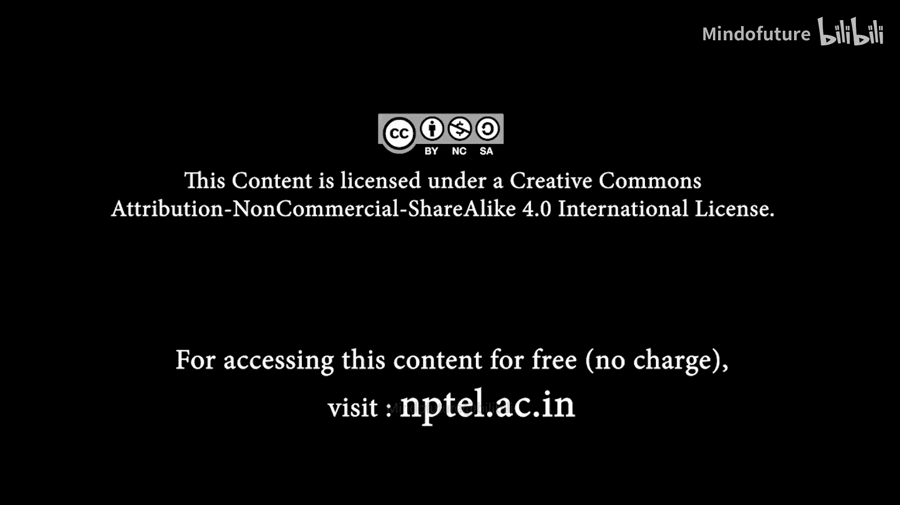
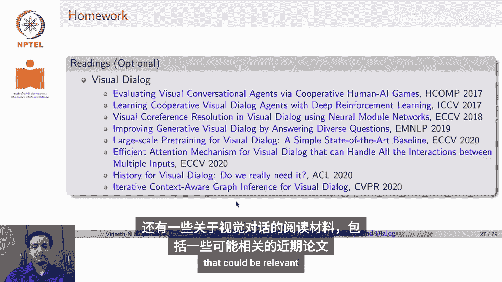

# 108：超越字幕 - 视觉问答与对话

在本节课中，我们将学习计算机视觉与自然语言处理相结合的两个高级任务：视觉问答和视觉对话。我们将了解这些任务的定义、所需的数据集、解决问题的基本模型架构，以及如何评估这些系统的性能。

## 概述

循环神经网络和注意力模型在计算机视觉中的重要性，在处理视觉与语言结合的问题时变得尤为突出。这种结合产生了许多序列学习问题。我们在上一讲中看到了图像字幕生成。现在，我们将更进一步，讨论视觉问答和视觉对话等任务。

## 从字幕到图像生成

一个遗留的问题是：我们能否进行与图像字幕生成相反的任务，即从字幕生成图像？使用我们目前见过的模型，我们无法做到。但很快我们将看到生成模型，并了解如何使用它们来完成从字幕到图像的生成。

## 视觉问答任务概述

视觉问答任务可以看作是图像字幕生成任务的扩展。任务概述如下：给定一张图像和一个问题，目标是让深度学习模型给出合理的答案。

以下是该任务的一个演示：给定一张图像和问题“孩子坐在哪里？”，一个训练良好的模型会以99%的置信度回答“水槽”，这与图像内容相符。这个演示来自佐治亚理工学院的Cloud CV网站。

在讨论解决VQA问题的模型之前，我们先了解所需的数据集类型。

## 视觉问答数据集

解决VQA问题需要复杂的数据集。以下是几个重要的数据集：

**VQA数据集**：于2015年发布，是首个VQA数据集。它包含图像和开放式问题，答案以多项选择形式提供。该任务对模型而言变成了分类问题。数据集包含约25万张图像（来自MS COCO数据集）和5万张抽象图像，总计约75万个问题和1000万个答案。

**COCO-QA数据集**：同样于2015年发布，利用MS COCO图像字幕数据集自动生成问答对。答案均为单个单词。数据集包含约11.8万个问答对和12.3万张图像，问题类型包括“什么物体？”、“多少？”、“什么颜色？”和“在哪里？”。

**Visual 7W数据集**：于2016年发布。名称中的“7W”代表七类问题：什么、哪里、何时、谁、为什么、如何以及哪一个。该数据集包含“讲述”和“指向”两种任务。共有约32.8万个问答对和4.7万张图像。

**CLEVR数据集**：于2017年发布，是一个半合成数据集，旨在回答复杂的推理问题。问题可能非常复杂，需要仔细解析。数据集包含约10万张渲染图像和100万个自动生成的问题，答案均为单个单词。

了解了用于视觉问答的数据集后，我们现在来看看为解决VQA问题而开发的一些模型。

## 视觉问答模型

一个显而易见的基线模型是结合LSTM和CNN图像特征。

给定一张图像，通过CNN（例如VGGNet）得到全连接层表示（例如1024维）。同时，将问题的每个单词输入LSTM的不同时间步，LSTM的输出也是一个向量（例如1024维）。将这两个向量连接起来，通过几个全连接层，最终预测答案。如果答案在一组选项中，则使用交叉熵损失，并通过反向传播学习网络所有权重。

2015年开发的另一个基线模型更简单：从CNN某一层提取图像特征，对问题使用简单的词袋频率直方图作为文本输入。将两者连接后，通过一个简单的神经网络预测正确答案。

在了解了这些简单的基线模型后，我们来看看如何通过更复杂的模型进行改进。

2016年CVPR上提出的**堆叠注意力网络**是一个方向。在该模型中，给定图像，从CNN获取表示。类似于之前讨论的注意力模型，我们取某个卷积层的特征图，将其映射到原始图像的空间位置。现在，图像的每个部分都有对应的特征向量。将问题输入LSTM，LSTM的输出给出问题的表示。该问题表示与图像不同部分的特征向量相结合，通过注意力机制生成图像不同部分的注意力图。基于此注意力图和问题表示，在图像特征向量上执行另一层注意力，得到最终表示，并通过输出层的softmax在答案选项中给出最终结果。

可视化显示，第一层注意力关注问题中提到的所有概念，第二层注意力则缩小范围，只关注包含答案的图像部分，从而预测出答案。

这引出了一个后续问题：在我们刚才看到的模型中，我们只对图像执行了注意力。我们原样使用了问题表示，并尝试基于注意力建立问题表示与图像不同部分之间的关系。那么，我们能否在问题中也引入注意力呢？

2016年ECCV上提出的**分层协同注意力模型**实现了这一点。在该模型中，我们同时关注图像的部分和问题的部分。“分层”体现在我们首先获取问题的词级嵌入，然后是短语级嵌入，最后是整个问题级别的嵌入。

具体来说，给定一个问题，我们提取其词级、短语级和问题级嵌入。在每一级，我们都应用协同注意力，即同时关注问题本身和对应的图像。最终答案基于所有协同注意后的图像和问题特征。

例如，对于问题“红绿灯上亮着的是什么颜色？”，模型在词级关注“stop”，在图像上关注交通灯区域；在短语级关注“the stop light”，图像关注更集中在红绿灯上；在问题级关注“light”，图像则只关注交通信号灯内的灯光，从而得出答案“绿色”。

为了获得短语级嵌入，可以对字幕中每个单词的嵌入执行具有不同宽度滤波器的卷积，得到向量表示。然后对卷积层输出执行最大池化，并将该最大池化输出输入LSTM，从而获得问题级表示。

## 视觉对话任务概述

现在，我们转向本节课计划讨论的第二个任务，可视作视觉问答的扩展，即**视觉对话**。

任务概述如下：给定一张图像和一个初始字幕，视觉对话类似于聊天机器人，但这是一个针对图像进行问答的聊天机器人，而非简单的自由文本聊天。

例如，给定图像和字幕“一只猫正在用咖啡杯喝水”，对话可能如下：问“杯子是什么颜色？”，答“白色和红色”。问“杯子上有图案吗？”，答“没有，好像有什么，但看不清”。问“杯子和猫在桌子上吗？”，答“是的”。问“桌子上还有其他物品吗？”，答“有，杂志、书、烤面包机、篮子和一个盘子”。

这是一个演示：给定图像，机器人说“一个男人和一个女人拿着伞”。人类问“他的伞是什么颜色？”，机器人答“黑色”。人类问“她的呢？”，这是一个棘手的问题，因为模型需要理解问题指向伞，并且是“她的”伞，这意味着模型需要知道有两个人，一男一女，然后才能回答。机器人答“她的伞是彩色的”。人类问“图像中还有其他人吗？”，机器人答“我想有三个，他们被遮挡了”。

## 视觉对话任务的形式化定义与评估

如何形式化并解决这个任务？给定图像 I，对话历史（一系列问答对 Q1 A1, Q2 A2, …, Q_{t-1} A_{t-1}），以及当前的后续问题 Q_t，任务是生成一个自由形式的自然语言答案 A_t 来回答当前问题 Q_t。

评估答案可能很棘手。自然语言处理中常用的评估指标（如BLEU、METEOR、ROUGE）与人类判断的相关性往往不高。因为一个问题可能有多种不同表述的正确回答。

一种评估方法是进行**人类图灵测试**，即给出生成的句子，让一组人类评估其质量，并判断答案是由机器还是人生成的。但这种评估可能成本高昂且主观。

在视觉对话数据集中，常见的评估方法是：给定图像、对话历史和当前问题，提供大约100个候选答案选项（可能来自50个最相似问题的答案、30个热门答案和20个随机答案）。模型的任务是对这些答案选项进行排序。模型可以输出一个在100个选项上的softmax概率向量，并据此排序。

评估性能的指标可以是：
*   **平均排名**：在所有测试样本中，正确答案的平均排名。排名越靠前越好。
*   **平均倒数排名**：对于每个测试问题，计算正确答案排名的倒数，然后对所有问题取平均值。如果正确答案总是排名第一，MRR为1；如果排名靠后，MRR接近0。

## 视觉对话模型

视觉对话模型通常采用编码器-解码器框架。编码器可以是：
1.  **晚期融合编码器**：分别用CNN处理图像，用LSTM处理当前问题和对话历史，然后将它们的输出表示连接起来。
2.  **分层循环编码器**：图像通过CNN，当前问题通过一个LSTM（该LSTM也接收图像表示）。对话历史的每一轮通过一个LSTM实例，得到不同表示。然后用另一个LSTM结合历史表示、当前问题表示和图像表示，输出给解码器。
3.  **记忆网络编码器**：使用注意力机制。将当前图像-问题表示与对话历史中每一轮的表示进行对齐（例如通过内积计算注意力权重），得到一个加权的历史表示，再与当前特征结合后传递给解码器。

解码器可以是生成式或判别式：
*   **生成式解码器**：在训练时，最大化生成真实答案序列的对数似然（通常通过多时间步的LSTM和交叉熵损失实现）。在测试时，使用模型在词汇表上的对数似然分数对候选答案进行排序。
*   **判别式解码器**：计算输入编码与每个候选答案编码（例如通过词嵌入获得）的点积相似度，然后通过softmax计算每个选项的后验概率。在训练时，最大化正确选项的对数似然。在测试时，根据后验概率对选项进行排序。

## 总结

本节课我们一起学习了计算机视觉与自然语言处理交叉领域的两个高级任务：视觉问答和视觉对话。

我们首先了解了视觉问答的任务定义，并回顾了用于训练和评估的多个重要数据集，如VQA、COCO-QA、Visual 7W和CLEVR。接着，我们探讨了解决VQA问题的模型演进，从简单的CNN-LSTM基线模型，到引入图像注意力的堆叠注意力网络，再到同时关注图像和问题不同层次的分层协同注意力模型。

随后，我们将讨论扩展到视觉对话任务。我们学习了如何形式化定义该任务，并了解了其独特的评估挑战和方法，如基于排序的平均排名和平均倒数排名。最后，我们介绍了用于视觉对话的编码器-解码器框架，涵盖了晚期融合、分层循环和记忆网络等编码器类型，以及生成式和判别式解码器。

这些任务展示了如何将我们已学的CNN、RNN和注意力机制等组件灵活组合，以解决更复杂、更接近人类认知的跨模态问题。