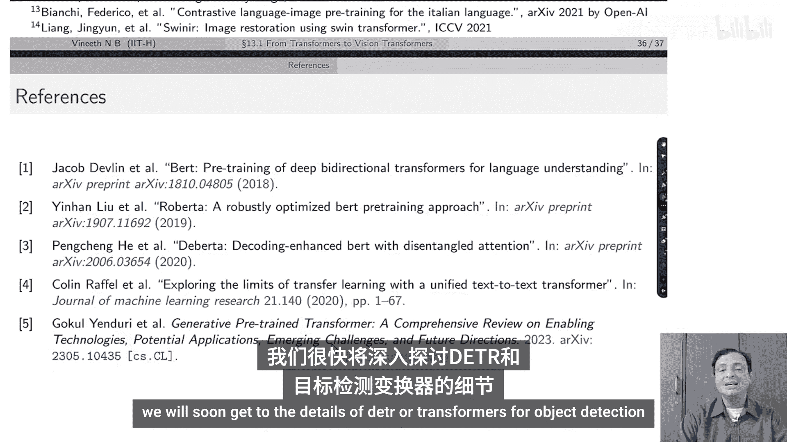

# 110：从Transformer到视觉Transformer 🧠

在本节课中，我们将学习Transformer架构如何从自然语言处理领域扩展到计算机视觉领域，并演变为视觉Transformer。我们将探讨其核心思想、架构设计、与卷积神经网络的对比，以及后续的重要改进模型。

## 概述

在之前的课程中，我们讨论了自注意力机制和Transformer架构。该架构彻底革新了处理文本模态的NLP任务。此后，Transformer架构已成为处理文本、视觉、语音甚至图数据等多种模态数据的默认选择。在本模块中，我们将重点讨论计算机视觉中的Transformer。在这第一讲中，我们将从Transformer出发，探讨其如何演变为视觉Transformer。

## 从NLP Transformer到视觉Transformer

上一节我们介绍了Transformer在NLP中的革命性作用，本节中我们来看看如何将其应用于图像数据。

Transformer通过引入基于自注意力机制的新颖架构，革新了NLP任务。这有助于机器翻译、语言理解、文本生成、问答、命名实体识别等多项任务。在最初的Transformer工作之后，又出现了如BERT、RoBERTa、DeBERTa、T5以及整个流行的GPT系列等架构，它们代表了为NLP任务开发的基于Transformer模型的主要贡献。

当我们谈论计算机视觉中的Transformer时，需要注意一点：Transformer编码器通常需要一个向量序列作为输入。在语言应用中，这个序列就是对应于输入中标记的有序词嵌入集合。然而，当输入是图像时，你该怎么做？每个像素都是一个标记吗？如果这样做，内存使用量和计算量会急剧增加。

以下是具体分析：
*   如果你有一张224x224的彩色图像，最终需要存储 `3 * 224 * 224` 的平方个参数，因为对于每个像素，你都需要评估其与所有其他像素的自注意力。
*   这总计约为220亿个参数用于每次自注意力计算。这显然是不可持续的。

那么，我们如何使Transformer适应计算机视觉？这是我们要讨论的第一个核心问题。

## 视觉Transformer的核心思想 🖼️

上一节我们提出了将Transformer用于图像的核心挑战，本节将介绍其解决方案。

这个问题首次在ICCV 2021的一篇题为《一张图像值16x16个词：大规模图像识别的Transformer》的论文中被提出。他们提出的方案如下：
假设有一张大小为 `224 x 224 x 3` 的RGB彩色图像。他们建议将图像分割成 `14 x 14` 个块（即小图像），每个块的大小为 `16 x 16`。这意味着现在你的图像总共有 `196` 个块。

现在，每个输入块可以被视为独立的“块标记”，形状为 `3 x 16 x 16`。然后，他们将每个块投影到一个 `D` 维向量（我们很快会讨论这个投影涉及什么）。一旦投影到D维向量，他们就添加位置编码，这类似于我们在Transformer中看到的位置编码，但也有一些不同，我们稍后会讨论。

当我们把这些块标记嵌入到一个D维向量并附加位置编码后，它被送入一个与NLP Transformer非常相似的Transformer编码器。其余过程与NLP Transformer在机器翻译等任务中几乎相同。

然而，当你试图使视觉Transformer适应图像分类任务时，你只需要一个输出，而不需要从Transformer解码器输出196个输出标记。如何处理这个问题？他们提出了使用一个额外的、可学习的“分类标记”，它在反向传播过程中也会被更新。这个分类标记也称为 `[CLS]` 标记。

在输出端，解码器输出一个类似的分类标记。这个分类标记通过一个线性层投影到一个C维的预测类别分数向量，再经过Softmax操作（类似于标准神经网络的最后一层）。然后，取线性投影输出的argmax，通过视觉Transformer给出最终的类别预测。

综上所述，你的视觉Transformer看起来大致是这样的。

## 位置编码与参数效率

上一节我们概述了视觉Transformer的流程，现在让我们深入一个细节：位置编码。

在NLP Transformer中，位置嵌入是固定的，编码了句子中单词的相对位置。然而，在视觉Transformer中，他们建议将这些块编号为0, 1, 2, 3……但他们发现，简单地将这些数字作为额外的位置编码并没有真正帮助或显著提高性能。因此，他们提出了一种类似表格的结构。

以下是具体实现：
*   对于图像中每个块的位置，都有一个对应的D维向量。
*   这个向量被附加到196个块集合中对应的块上。
*   这些对应于每个位置的D维嵌入也是可学习的，并在反向传播过程中更新。

现在，让我们尝试与之前的情况进行比较。我们说过，如果我们将一个像素作为一个标记，对于大小为 `3 x 224 x 224` 的图像，我们有220亿个参数。而现在，我们有 `14 x 14 = 196` 个块标记。由于对于每个块标记，你需要计算它与其他所有块标记的注意力，这总计大约为 `196 * 196 ≈ 38,416` 个参数，这大约是每个Transformer层150KB。可以看到从220亿到仅约3.8万的显著减少。

## 视觉Transformer与卷积的关系 🔄

现在你脑海中可能有一个问题：我们现在是在没有卷积的情况下解决计算机视觉问题吗？计算机视觉的历史在很大程度上一直依赖于卷积操作。那么，我们现在是否已经设法在没有卷积的情况下处理计算机视觉任务了？并非完全如此。

以下是卷积在视觉Transformer中的体现：
*   输入层中的线性投影实际上是一个2D卷积，其步长就是块大小本身。
*   此外，Transformer中的MLP层严格来说实际上是 `1x1` 卷积。
因此，卷积正在被使用，只是在Transformer架构中以不同的方式使用。

## 视觉Transformer的性能与改进

在这项工作中，他们通过实验将视觉Transformer与残差网络进行了比较。事实上，他们提出了几种不同的视觉Transformer变体：`Base` 变体有12层，`Large` 变体有24层，`Huge` 变体有32层。在此范围内，他们还可以将块大小从 `14x14` 变化到 `16x16` 或 `32x32`。请记住，块尺寸越小，模型越大，因为在给定图像内你将拥有更多的块。

他们通过决定在什么数据集上预训练这些模型来与ResNet进行比较。左边的第一个结果显示了在ImageNet数据集上训练这些模型的比较（如你所知，ImageNet有1000个类别，120万张图像）。他们实际上发现，在这种特定情况下，残差网络的表现优于所有这些ViT模型。

然而，当改进预训练时，他们发现：
*   当模型在ImageNet-21K数据集上训练时，ResNet和ViT几乎不相上下。
*   当预训练改进到JFT数据集（JFT-3亿是谷歌内部的一个包含3亿张标注图像的数据集）时，他们发现ViT在ImageNet上的性能超过了ResNet。

因此，结论是：ViT确实需要大量的预训练才能超过ResNet。然而，当你这样做时，ViT需要的训练时间显著减少，并且比ResNet更高效地利用计算资源。人们可以假设，与在前馈网络、MLP或自注意力计算中使用的简单矩阵乘法相比，卷积的成本相当高。这有助于ViT更高效地利用GPU。

## 视觉Transformer的后续改进

自视觉Transformer首次提出以来，还有其他工作以不同方式改进了ViT的性能。

以下是两项重要的改进工作：
1.  **《如何训练你的ViT》**：这项早期改进提出了在Transformer的前馈层中使用正则化方法，如权重衰减、随机深度或Dropout；或者使用数据增强策略，如MixUp或RandAugment（在一组预定义增强中提供随机增强）。这些有助于提高视觉Transformer的性能。
2.  **《DeiT：数据高效的图像Transformer》**：这项改进提出了使用知识蒸馏。其中，一个通常较大的教师CNN模型被用作训练学生ViT模型的教师。这是使用学生模型的标准交叉熵损失以及学生模型输出与教师模型输出之间的KL散度损失来完成的。KL散度衡量两个概率分布之间的差异。因此，你可以将教师模型和学生模型的输出视为两个不同的概率分布，并计算它们之间的KL散度。为了实现这一点，这项工作还引入了一个“蒸馏标记”，这同样是一个作为输入提供的可学习标记。输出端对应的蒸馏标记用于通过KL散度匹配教师。这项名为DeiT的工作表明，这个想法将ImageNet top-1准确率从77.9%提高到了83.4%。事实上，当他们使用更多的训练周期或更高的图像分辨率时，效果甚至更好。

## 层次化视觉Transformer：Swin Transformer

如果我们现在比较ViT和标准卷积神经网络（以残差网络为例），我们在课程中观察到的一个现象是：在CNN中，分辨率通常随着你在神经网络中越来越深而降低，而通道数通常会增加。这导致了一种层次化架构。直觉是，这种方法是有用的，因为对象可以出现在多个尺度上，你希望在这种架构的不同层中发现这些不同尺度的对象。

然而，对于ViT，它遵循所谓的“各向同性架构”，这意味着视觉Transformer的每个块都具有几乎相同的架构、相同的分辨率和相同的通道数。那么你可能会问：我们是否因此失去了层次化信息？我们能使ViT具有层次性吗？

这正是后续工作 **《Swin Transformer》**（发表于CVPR 2021）所做的事情。Swin Transformer试图在视觉Transformer的表征学习中引入不同尺度或层次的概念。

他们是如何做到这一点的？给定一个输入图像，假设为 `3 x H x W`（3是颜色的通道数，H x W是实际分辨率）。这经过一个块分割和线性嵌入，与我们目前看到的视觉Transformer非常相似。但在此之前，他们将图像分成 `4x4` 的块并投影到C维。

具体过程如下：
*   如果你的图像是 `3 x H x W`，他们建议将图像分成 `3 x 4 x 4` 的块，即48维（`4x4=16, 16x3=48`）。
*   现在你的图像变成了 `48 x (H/4) x (W/4)`，因为你将整个图像分成了 `4x4` 的块。
*   现在，他们取这个 `48 x (H/4) x (W/4)` 的张量，并线性投影到C维，所以这个48现在变成了C，类似于我们在普通视觉Transformer中看到的线性投影。

现在，这是如何构建的？一旦他们在第一层完成这个操作，他们现在合并 `2x2` 的邻域，现在块的有效感受野变成了 `8x8`，这导致了 `(H/8) x (W/8)` 的总体分辨率。这是如何工作的？你原来有 `C x (H/4) x (W/4)`。当你合并 `2x2` 邻域时，现在变成了 `(H/8) x (W/8)`。但由于合并，每个 `2x2` 现在被累积，所以这里的每个位置现在有 `4C` 个通道。然后，`2x2` 的合并导致 `4C`，这现在被线性投影到 `2C` 维，这就是你得到 `2C x (H/8) x (W/8)` 的方式。

现在，这被逐步实施以再次合并 `2x2` 邻域，现在块或其原始感受野有效地变成了 `16x16`，并且你在这一阶段的维度变成了 `4C x (H/16) x (W/16)`。这个过程进一步重复以获得 `8C x (H/32) x (W/32)`。现在，这产生了在不同尺度上学习图像的效果，从而获得输入的层次化表征。

## Swin Transformer的窗口注意力与移位窗口

现在出现了几个问题。视觉Transformer的原始目标是通过使用 `H x W` 的标记网格来使自注意力计算高效，但现在你的注意力矩阵将再次大约是 `(H*W)^2`，这在图像大小上是二次的。如何处理这个问题？为了处理这个问题，Swin Transformer建议将图像分解成 `M x M` 个标记，并且仅在每个窗口内计算自注意力。

这有什么帮助？现在因为你的图像被分成了 `M x M` 个标记，所以你总共有 `M x M` 个窗口。这意味着参数总数将是 `M^2`。但是，对于每个块，你需要计算它与其他每个块的自注意力，所以你这里将有一个 `M^2`。然而，每个标记内部的大小由 `(H/M) x (W/M)` 给出。因此，这总共变成了 `M^2 * H * W`，这对于自注意力计算来说是图像大小的线性。Swin Transformer在他们的工作中使用 `M=7`。

你可能问的另一个问题是：因为我们限制自注意力仅在每个 `M x M` 窗口内，那么你如何捕获图像内的长距离关系？毕竟，自注意力的目的是捕获特定对象相对于图像任何其他部分的上下文。如何处理这个问题？为此，他们引入了“移位窗口注意力”的概念，其中注意力窗口以层次化的方式逐步改变或移动。这使得不同抽象层次的块之间能够进行交互，从而在保持计算可处理性的同时捕获长距离依赖关系。这在图像分类、目标检测和语义分割等应用中至关重要。

他们是如何做到的？在任何一个特定层中，你有这些 `M x M` 标记或 `M x M` 部分，你只在每个部分内计算注意力。他们现在在视觉Transformer的连续层之间轮换这些局部窗口的计算方式。在一层中，如果你的自注意力窗口是这样的，那么在下一层，它变成了那样，然后这个过程不断重复。

更全面地看，你在特定的Transformer层中开始，使用层归一化，然后在这里应用你的窗口自注意力，然后进入层归一化模块，接着是MLP模块，然后在下一个Transformer层中，你使用移位窗口自注意力，这个过程在你的整体架构的连续块之间再次重复。

那么，你这里可能再次问一个问题：你的位置编码或嵌入会发生什么？Swin Transformer不像视觉Transformer那样使用绝对位置编码，而是使用学习的偏置（包含在你的自注意力计算中）来编码块之间的相对位置。这个 `B` 是一个维度为 `(M^2) x (M^2)` 的学习偏置矩阵，对应于你的块，它给出了你在图像中研究的不同块的相对位置。

通过这一点，他们实际上表明，他们可以在比DeiT等其他视觉Transformer架构更少的时间内（在V100 GPU上每张图像的毫秒数），获得比使用蒸馏的视觉Transformer更高的准确率。

## 总结与应用展望

本节课中我们一起学习了视觉Transformer及其重要变体Swin Transformer。

虽然我们在这节课中讨论了视觉Transformer和Swin Transformer，但在过去几年中，这两种架构已成为图像分类、目标检测、语义分割等多种视觉任务的通用骨干网络。

以下是具体应用方向：
*   在目标检测方面，我们有一个名为 **DETR** 的架构，我们将在下一讲中看到。
*   对于分割，我们有非常流行的 **Segment Anything** 模型，我们也将在本模块中讨论。
*   除此之外，用于视觉语言任务的 **CLIP** 也使用视觉Transformer。
*   还有其他架构，如用于图像恢复的 **SwinIR**。

如果你对此更感兴趣，我强烈建议你也查看这些主题的相应参考文献。我们很快将深入探讨用于目标检测的DETR或Transformer的细节。