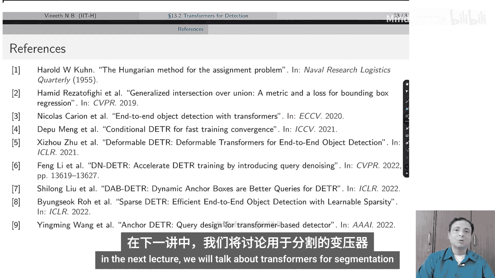

# 112：用于检测的Transformer 🎯

在本节课中，我们将要学习Transformer架构如何被应用于目标检测任务。我们将从回顾Transformer在自然语言处理和视觉任务中的成功应用开始，然后深入探讨一个名为DETR的端到端目标检测框架。我们将了解其核心组件、工作原理，以及后续的改进版本如何解决其计算效率等问题。最后，我们会简要介绍当前最先进的检测方法DINO。

## 概述

在上一节中，我们介绍了Transformer如何通过自注意力机制革新了序列数据建模，以及Vision Transformers如何将这一架构成功应用于图像分类任务。本节中，我们来看看如何将Transformer应用于计算机视觉的另一项核心任务——目标检测。

## 从传统检测到DETR

我们知道，目标检测任务需要处理大量数据，并为图像中的每个物体预测精细的边界框。现有的方法，如Faster R-CNN和FCN系列，依赖于许多手工设计的组件，例如锚框、非极大值抑制和一些阈值设定。这使得整体架构和框架变得复杂，甚至在某些情况下效率低下。

那么，Transformer能为此做些什么呢？DETR于2020年被提出，它是一个使用Transformer架构的端到端目标检测框架，使得整个检测流程比之前的框架（如Faster R-CNN）简单得多。

以下是DETR用于目标检测的整体架构图：

如图所示，输入图像首先通过一个CNN来提取一组特征图。这些特征图被展平，并添加位置编码，然后送入Transformer编码器，这与我们在ViT中看到的过程非常相似。编码器输出一组嵌入向量。

这些编码表示与一组称为“对象查询”的输入一起，被提供给Transformer解码器。解码器为每个对象查询输出一个编码，每个编码再被送入一个前馈神经网络，最终预测该位置是否存在物体（类别）以及边界框的坐标偏移。

请注意，模型也可以预测“无物体”这个类别标签，特别是在对象查询对应背景区域时。这就是DETR的整体思路，我们将在接下来的幻灯片中讨论更多具体细节。

## DETR的核心：集合预测与匹配

在深入之前，这种方法的另一个重要表述是：由于Transformer解码器输出一组编码，任务现在变成了一个集合匹配问题——将一组解码器输出与训练数据中的一组真实边界框和标签进行匹配。我们如何使用损失函数来匹配这两个集合，是接下来要讨论的内容之一。

因此，DETR的主要组成部分包括：
*   **一个基于集合的全局损失**：通过两个集合之间的二分匹配来强制进行唯一预测。
*   **一个Transformer编码器-解码器架构**。

### 编码器流程

输入图像通过卷积神经网络，提取出一组维度为 `C x H x W` 的特征图。这些特征图经过CNN处理，在不同空间尺度上捕获了图像的视觉信息。

与Vision Transformers类似，这些特征图被展平，得到一个 `C x HW` 的矩阵。根据这些特征图在原图中的位置，为每个位置添加位置编码。这使得模型能够追踪特定边界框或图像块在原图中的位置。

添加位置编码后，这些令牌被送入Transformer编码器。编码器由多个Transformer编码器层组成，每层都包含自注意力机制和前馈网络。自注意力机制允许模型捕获图像的全局上下文和不同部分之间的关系。

### 解码器与对象查询

现在，这些编码表示与一组可学习的查询一起被送入Transformer解码器。在DETR论文中，这些可学习的查询也被称为位置编码或可学习的位置编码。它们代表了可能的物体位置和类别信息。

解码器同样由带有自注意力和前馈网络的Transformer层组成，并且它还接收编码器的输出作为额外输入。因此，解码器同时关注编码后的图像特征和这些对象查询，以最终预测物体的存在、位置和类别。

解码器的输出嵌入每个都通过一个前馈神经网络，以获得最终的类别标签预测和对应的边界框坐标。这就是DETR框架的整体流程。

你可能会问，这些可学习的查询是什么？我们向里面输入什么？顾名思义，它们是可学习的，初始化为随机向量，并通过训练中的反向传播进行更新。

那么，我们为什么要将它们作为输入？我们想通过它们得到什么？请记住，在Transformer中，输出编码的数量取决于提供给Transformer的输入令牌的数量。因此，这些可学习的查询在某种意义上允许解码器将它们转换为一组输出嵌入，这些嵌入随后映射到图像中的边界框。这就是这些可学习查询的主要目的。

论文还尝试对它们进行可视化，以理解每个可学习查询关注图像的哪个方面或部分。例如，其中一个可能只关注图像的左侧部分，另一个可能关注图像中心的大片区域等。更多关于这些可视化的细节，请参阅DETR论文。

另一个问题是，我们如何知道图像中有多少个物体，从而知道需要多少个输出嵌入？为此，论文简单地建议将 `N` 设置为任何测试或训练图像中可能出现的物体数量的上限。因此，解码器预测一个上限数量的编码，每个编码可能对应也可能不对应一个带有物体的边界框。

如果其中一个编码不对应任何物体会怎样？模型只需将其匹配到“无物体”类别，且没有特定的边界框坐标。这使得模型可以将这些解码器嵌入映射到真实标注中的一组边界框和类别预测，并在两者之间进行集合匹配，其中对应背景或没有物体的边界框被简单地替换为“无物体”类别。

这种方法的一个优点是，Transformer解码器或整个模型并行地为所有对象查询预测所有这些输出，这允许进行端到端训练，无需任何后处理步骤或两阶段网络，而这在早期目标检测框架中非常流行。

## DETR的损失函数：匈牙利匹配

现在，我们来看看输出端如何进行关键的集合匹配。DETR在每次解码过程中预测 `N` 个物体，其中 `N` 大于典型的物体数量，它是给定图像中可能看到的物体实例数量的上限。

与现有的目标检测方法（如Faster R-CNN或FPN）不同，DETR不依赖阈值或启发式分配规则来匹配提议或锚框与真实标注。那么，它是如何进行最终分配的呢？如前所述，它使用一个损失函数，在预测集合和用于训练的真实标注图像的边界框集合之间实现最优的二分匹配。

这是如何做到的？如果 `y` 表示真实标注物体的集合，并额外添加一个“无物体”标签以匹配预测集合 `ŷ`（大小为 `N`）的大小，那么通过考虑一个在这两组预测匹配中损失最小的排列，可以找到这两个集合之间的二分匹配。

作为一个例子，如果你的Transformer解码器或DETR预测了，比如说，五个边界框，每个都有特定的类别标签和对应的边界框坐标，你需要用你的真实标注来检查。在特定图像中，你可能只有两个物体。所以，如果你有两个具有特定类别标签（比如 `C1` 和 `C2`）的物体，其余的只需用“无物体”或空集填充，以表示除了这两个之外没有其他物体。

现在，在这两个集合之间进行集合匹配，其方式是你考虑一种映射，该映射在所有可能的排列中给出最小的误差。因此，现在每个真实标注元素 `yi` 可以看作是 `(c, b)`，其中 `c` 是类别标签，`b` 是边界框信息。对于索引为 `σ(i)` 的预测（请记住，`σ` 是所考虑的预测边界框和类别标签的排列），`p̂_σ(i)(c_i)` 是类别 `c` 的概率，`b̂_σ(i)` 是预测的边界框。

因此，这两个集合之间的匹配损失由以下公式给出：

**L_match(y_i, ŷ_σ(i)) = -1_{c_i ≠ ∅} p̂_σ(i)(c_i) + 1_{c_i ≠ ∅} L_box(b_i, b̂_σ(i))**

你理想情况下希望最小化损失，所以你希望最小化预测边界框和真实边界框之间的误差，同时希望最大化在该边界框中找到该特定类别的概率，这就是你在这里看到负号的原因，因为你理想情况下希望最大化这个概率。

这种匹配遵循一个非常著名的匹配算法，称为匈牙利匹配算法。因为它使用了匈牙利匹配算法，所以该损失也被称为**匈牙利损失**，你试图最大化正确类别的概率，并最小化预测边界框和真实边界框之间的测量误差。

请记住，你现在尝试采用一个考虑所有这些排列中最小损失的匹配损失。当你匹配两个集合时，集合一的某种顺序可能与集合二匹配得最好。你考虑所有可能的排列，并选择误差最小的那个。这就是匈牙利损失试图做的事情。

除此之外，DETR还对目标检测框架中使用的另一种典型损失——L1损失（用于测量边界框坐标的误差）进行了创新。因为L1损失对于大物体和非常小的物体，如果它们的相对误差相似，可能会有不同的尺度。因此，他们提出使用L1损失和广义IoU损失的线性组合作为训练DETR的边界框损失（IoU代表交并比，请回忆我们在语义分割中的讨论以理解IoU的含义）。

通过这种方法，他们表明，在遵循非常简单的整体架构（主要在集合预测方面进行创新）的同时，其性能显著优于Faster R-CNN及其各种变体（包括FPN变体）。

## DETR的局限性与改进：Deformable DETR

虽然DETR是在目标检测中使用Transformer的重要一步，但它也有局限性。主要原因是自注意力机制的二次方计算复杂度。请记住，DETR几乎在像素级别处理信息，并且必须计算图像中所有其他像素的自注意力，这具有二次方复杂度。这可能使处理速度非常慢。

由于初始化注意力权重为 `1/N_k`（即对所有初始像素或所有输入块令牌给予均匀注意力，其中 `N_k` 是键元素的数量），它需要很长的训练时间。在图像领域，`N_k` 可能非常大（几乎是图像像素或小块），这种通过均匀分布初始化注意力权重的方法可能使训练非常繁琐，收敛需要很长时间。此外，还发现由于自注意力机制的工作方式，DETR在处理小物体方面存在局限性。

那么，如何解决这些问题呢？有几种方法可以处理这些挑战，让我们来看看。

### 降低计算复杂度

如何降低自注意力的二次方计算复杂度？有一个后续方法称为**Deformable DETR**，它试图解决这个问题。

他们是如何做到的呢？他们考虑了早期一些尝试以不同方式处理自注意力或注意力概念的方法。一种方法是仅在相邻窗口内进行稀疏的局部注意力，而不是与图像的每个其他部分进行自注意力。也有关于所谓“可变形卷积”的尝试。

可变形卷积是一种与Transformer无关的方法，它试图以略有不同的方式定义或重新定义卷积。通常，在卷积中，你将一个滤波器放置在中心像素位置，并与该像素周围的 `3x3` 或 `5x5` 邻域进行卷积。可变形卷积的建议是，与其预先固定这个邻域为 `3x3` 或 `5x5`，为什么不将这个邻域设为可学习的偏移量呢？这样，你就可以对，比如说，这个邻居、这个邻居和这个邻居等进行卷积，这些偏移量实际上是作为可变形卷积的一部分学习的，一旦你得到这些偏移量，你就可以使用标准程序执行卷积。

受这种方法的启发，Deformable DETR建议，在计算自注意力时，不是计算与图像中所有其他输入令牌的注意力，而是学习一些偏移量，并且只计算与那些其他输入令牌的注意力。由于这种与可变形卷积的相似性或受其启发，该方法被称为Deformable DETR。

现在，回想一下，Transformer中的多头注意力可以用幻灯片上看到的这个方程来表示：

**MultiHeadAttn(z_q, x) = Σ_{m=1}^{M} W_m [ Σ_{k∈Ω_k} A_{mqk} · W‘_m x_k ]**

如果 `q` 是一个查询元素，其特征为 `z_q`；`k` 是一个键元素，对应特征为 `x_k`；`m` 表示注意力头；`c` 是特征维度；`Ω_q` 和 `Ω_k` 是查询和键元素的集合。那么，多头注意力特征可以按上述公式计算。

这里有几个含义。一是如果你的注意力权重 `A_{mqk}` 被统一初始化为 `1/N_k`，会导致训练和收敛缓慢。其次，多头自注意力的计算复杂度可以写为 `O(N_q N_k C + N_q C^2 + N_k C^2)`。现在，如果 `N_q` 和 `N_k` 是你的查询和键的数量，通常与 `HW`（图像的分辨率或下采样分辨率）同阶。由于 `N_q` 乘以 `N_k`，这将与你原始特征图或图像大小的平方成正比。

我们能做些什么呢？受可变形卷积启发的Deformable DETR提出了一个**可变形注意力模块**，它只关注参考点附近的一组令牌或采样点。它在计算自注意力时，将特征图的大小从方程中移除。

这是如何实现的？可变形注意力特征的计算公式为：

**DeformableAttn(z_q, p_q, x) = Σ_{m=1}^{M} W_m [ Σ_{k=1}^{K} A_{mqk} · W‘_m x(p_q + Δp_{mqk}) ]**

你的注意力（查询 `q` 的注意力头）乘以你的权重矩阵，但现在你的 `x` 不是完整的 `x`，而只是少数几个 `x` 位置，这些位置相对于当前位置 `p_q` 的偏移量也是你的可变形DETR学习的一部分。

你有多少个这样的位置？`k` 从 `1` 到 `K`。Deformable DETR在其实现中使用 `K=4`，这意味着Deformable DETR不是与图像中所有其他输入令牌计算自注意力，而是只与另外四个位置进行计算，这显著减少了计算量。其余注意力计算与我们在上一张幻灯片上看到的类似。

由于 `K`（可变形注意力采样点的数量）明显小于 `HW`，这带来了一个很好的影响。你的可变形注意力模块的复杂度由 `O(2N_q C^2 + min(HW C^2, N_q K C^2))` 给出。对于编码器，其中元素数量为 `HW`，这将变为 `O(HW C^2)`；对于解码器，你只给出一定数量的对象查询，复杂度变为 `O(N K C^2)`。对于编码器，`HW` 对应于特征图，这意味着它只是特征图的线性复杂度，而对于解码器，它甚至与输入的空间大小无关。与DETR相比，这显著加快了计算速度。

### 多尺度特征与迭代优化

他们还提出了使用多尺度特征来提高Deformable DETR的性能。在这种情况下，与许多其他CNN方法中使用多尺度的方式非常相似。给定特定图像，他们获取CNN不同层的特征图。请记住，DETR或Deformable DETR首先将图像通过CNN，并仅将该CNN的输出特征图作为其Transformer编码器的输入。现在，你可以考虑不同层的特征图，每个特征图将代表不同尺度的信息。一旦获得这些，Deformable DETR只需连接或展平所有这些图像特征图，然后像在基本模块中那样计算自注意力。因此，在某种意义上，你可以假设尺度的概念在输入Transformer编码器之前，通过简单地展平整个特征图集而被移除。其余部分与我们在 earlier slides 上看到的非常相似。

它还有其他一些改进，一是迭代边界框细化，其中Deformable DETR使用了一种机制，每个解码器层基于前一层的预测来细化边界框。因此，每个解码器块输出一组边界框预测，这些预测作为输入提供给下一个解码器块，下一个块再细化这些边界框预测，依此类推。这也导致了Deformable DETR的一个变体，称为**两阶段Deformable DETR**。可以说，他们受到了像Faster R-CNN这样的两阶段检测框架的启发，其中编码器的输出也被作为输入提供给Deformable DETR，而不仅仅是在特定阶段被通知。这使他们能够将Transformer的编码输出视为物体可能所在的区域提议，这些成为你的对象查询，然后通过Transformer解码器来获得最终的输出嵌入。

通过这些方法，他们表明，在显著更短的时间内，其性能可以显著优于DETR。

## 更先进的检测器：DINO

虽然DETR是目标检测中使用Transformer的重要一步，但后续还有更多改进。例如，**Dynamic Anchor Boxes DETR** 将DETR查询公式化为动态锚框。还有另一种改进称为 **Denoising DETR**，它试图通过引入去噪技术来改进DETR中的集合匹配。他们让Transformer的解码器在一个任务中进行去噪，在另一个任务中进行集合匹配，并表明这样做有助于提高DETR的集合匹配性能。

还有其他一些方法，如Cascade DETR、DINO以及最近的Grounding DINO。在本模块中，我们将在转向下一个分割任务之前，再讨论一种方法。这种方法叫做**DINO**，它是一种非常流行的方法，并且是当今检测的默认选择方法，这也是我们选择讨论它的原因。

DINO代表**带有改进去噪锚框的DETR**。顾名思义，它的许多改进都围绕着那些作为输入提供给Transformer解码器块的可学习查询。它也融入了一些其他新颖之处。它融入了DN-DETR的元素以引入去噪训练，引入了“向前看两次”方案以进行更好的边界框预测，还引入了混合查询选择以进行锚框初始化。

让我们在接下来的幻灯片中详细看看这些。

DINO中的一些贡献借鉴了我们提到的其他方法。他们遵循去噪DETR，在Transformer解码器层中添加噪声以执行去噪任务。他们还遵循Deformable DETR，使用可变形注意力以获得更好的计算效率。遵循Dynamic Anchor Boxes DETR，他们还将查询公式化为动态锚框，这些锚框在解码器层中逐步细化。

除了从先前工作中借鉴的这些改进之外，他们还引入了**对比去噪训练**以改进DETR的集合匹配步骤。他们还引入了**混合查询选择**，以更好地初始化提供给解码器的可学习查询。他们还提出了一种称为**向前看两次**的策略，以改进不同解码器块之间的边界框预测。

### 对比去噪训练

DINO中提出的改进之一是**对比去噪训练**，主要在解码器块中进行。他们引入了两组对比去噪组：一组正令牌和一组负令牌（或嵌入），其中正令牌组应该很好地重建去噪输入（因此每个查询都带有一些噪声，重建必须给出一个去噪后的输出），而在负令牌组中，解码器必须预测“无物体”。他们在这里有两个这样的组。

他们对去噪DETR的另一个改进是使用了两个超参数 `λ1` 和 `λ2`。如果添加的噪声小于超参数 `λ1`，则将其视为正查询，解码器应重建相应的真实边界框（即这里的黄金框）；当噪声介于 `λ1` 和 `λ2` 之间时，解码器应预测对应查询为“无物体”。这就是他们所谓的对比去噪训练。

这有什么帮助呢？当有多个锚框非常接近一个物体时，模型通常可能会混淆使用哪个锚框来预测其输出中的物体。这可能导致两个问题：一是重复预测，二是不正确的锚框选择。他们表明，通过对比去噪训练，DINO可以区分锚框之间的微小差异，从而避免这些问题。

### 混合查询选择

他们带来的第二个贡献是**混合查询选择**。通常，DETR中的查询（即提供给解码器的可学习查询）有两个部分：**内容部分**和**位置部分**。DETR和DN-DETR的做法是，他们只考虑位置查询（这些是可学习和更新的），而内容查询都被视为零向量。因此，提供给解码器的这些可学习查询只是位置信息（如 `x, y, h, w`：边界框位于哪里，它的宽度和高度是多少），这显然是解码器块学习的一部分，而内容查询则作为零向量给出。所以，没有为框内内容提供可学习查询，只有位置信息。这就是DETR和DN-DETR向解码器块提供查询的方式。

Deformable DETR的做法略有不同，在其一个变体（如果你还记得两阶段变体）中，他们将编码器的输出作为区域提议提供给解码器。在这种情况下，你的锚框（即你的位置信息）和内容信息都作为可学习查询提供给解码器，两者都是可学习的，这就是为什么我们称之为动态。

那么，DINO做了什么？它提供了一种混合查询选择策略。他们说，在Deformable DETR中，你的编码器特征是初步的内容特征，可能不一定真正帮助解码器，甚至可能误导解码器。因此，他们做的是使这些内容查询成为可学习的和静态的（我稍后会解释静态的含义）。而这里的位置查询是你的Transformer编码器块中前K个编码器输出的位置查询。因此，你有一组来自Transformer的边界框编码器输出，你有这些边界框可能位于的位置信息，这被用来初始化输入解码器的位置查询。而内容查询保持可学习和静态（这里的“静态”是指在推理时对于不同的图像保持相同，在训练时它们是可学习的）。这就是他们在DINO框架中所谓的混合查询选择。

### 向前看两次

最后，如前所述，他们还引入了一种称为“向前看两次”的策略。他们观察到，在Deformable DETR中，每个解码器块（这里的每个块都是解码器层或解码器块）都会预测一个边界框，并且在该解码器块本身有一个辅助损失，用于告知该边界框是否正确以及它离真实标注有多远，而该损失实际上用于训练每个解码器块中的边界框。事实上，他们阻止了梯度从后面的块反向传播到前面的块以进行边界框预测。

DINO发现这种方法是一种“向前看一次”的方法，相反，它提出了一种“向前看两次”的方法，其中第 `i` 层的参数受到第 `i` 层以及第 `i+1` 层边界框损失的影响。你可以在这里看到，这个和这个的梯度都会传播以更新给定层中的边界框偏移。他们称这种方法为“向前看两次”方法。

通过这些改进，他们表明其性能显著优于大多数其他检测方法，而且模型尺寸比许多其他框架（尤其是那些使用Swin Transformer的框架）更小。

## 总结

本节课中，我们一起学习了Transformer如何应用于目标检测任务。我们从传统的两阶段检测方法面临的挑战出发，深入探讨了DETR这一端到端的集合预测检测框架，理解了其编码器-解码器架构、可学习的对象查询以及基于匈牙利匹配的集合损失函数。接着，我们分析了DETR在计算效率和训练速度上的局限性，并介绍了Deformable DETR如何通过可变形注意力机制和多尺度特征显著提升了性能。最后，我们了解了当前最先进的检测器DINO，它通过对比去噪训练、混合查询选择和向前看两次等策略，进一步优化了检测精度和效率。这些工作展示了Transformer在目标检测领域的强大潜力和持续演进。