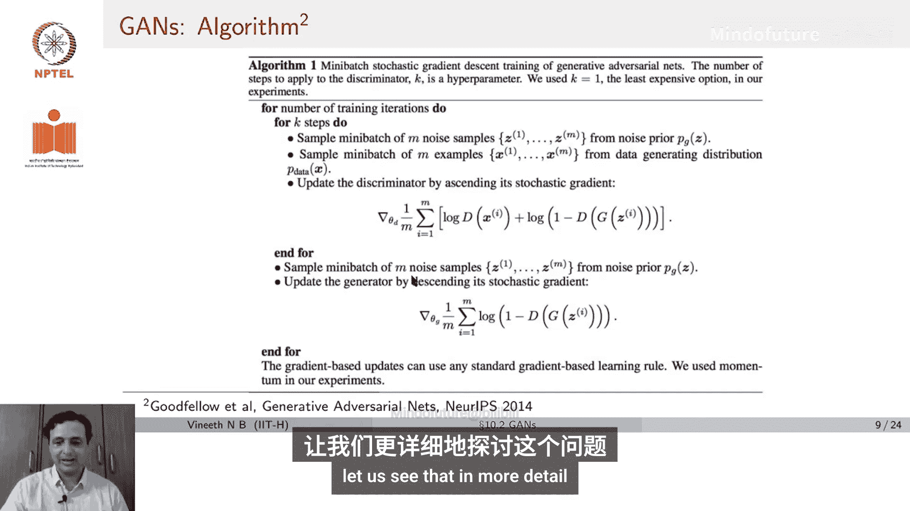

# 114：生成对抗网络 - 第一部分

## 概述
在本节课中，我们将要学习一种非常流行的深度生成模型——生成对抗网络。我们将从回顾上一讲的内容开始，逐步理解GANs的核心思想、目标函数、训练策略以及其背后的工作原理。

## 从KL散度到最大似然估计
上一讲我们遗留了一个问题：为什么在寻找生成模型时使用KL散度会简化为最大似然估计？

让我们回顾一下问题。最优参数θ*被定义为在所有可能的θ中，使模型分布Pθ与真实数据分布Pd之间的某种距离函数最小化的那个参数。如果这个距离函数是KL散度，那么问题就简化为最大似然估计。

KL散度的定义是：对于两个概率分布P和Q，其KL散度为 **KL(P||Q) = Σ P(x) log(P(x)/Q(x))**。在我们的场景中，就是计算 **KL(Pd||Pθ)**。

展开后得到：**KL(Pd||Pθ) = Σ Pd(x) log Pd(x) - Σ Pd(x) log Pθ(x)**。第一项与θ无关，因此在优化时可以忽略。我们只剩下最小化 **- Σ Pd(x) log Pθ(x)**，这等价于最大化 **Σ Pd(x) log Pθ(x)**，也就是**最大似然估计**。这证明了我们的结论。

## 生成模型概念回顾
在深入GANs之前，让我们简要回顾上一讲的核心概念。

生成模型的目标是学习一个在给定训练图像数据集X上的概率密度函数P(x)。如果我们知道这个分布（例如参数化为高斯分布），那么P(x)会为每一张可能的图像分配一个正数，表示该图像由该分布生成的可能性。

生成模型的应用包括：
*   **采样与生成新数据**：从学习到的分布中生成新的图像样本。
*   **似然估计与异常检测**：计算一个数据点属于该分布的可能性。如果可能性很低，则该点很可能是异常值。
*   **特征学习**：我们将在本讲中更多地讨论这一点。

我们还讨论了密度估计的两种视角：
*   **显式密度估计**：尝试为概率分布P(x)写出一个明确的函数形式（例如，假设为高斯函数）。输入是图像x，输出是其似然值P(x)。这类方法擅长异常检测，但有时在生成高质量图像方面可能表现不佳或速度较慢。
*   **隐式密度估计**：不尝试为P(x)分配函数形式。其目标仅仅是确保给定一个模型，我们可以从中采样图像，而无需为每个样本分配明确的似然值。这类方法通常能实现更好的样本生成质量和更快的采样速度。

## 生成对抗网络简介
现在，让我们进入本讲的重点：生成对抗网络。GANs由Goodfellow等人在2014年提出。

GANs的目标是构建一个优秀的**采样器**，能够从模型分布P_model(x)中抽取高质量的样本。正如我们提到的，这里没有对P(x)进行显式的函数形式计算。我们唯一的目标是确保从模型中采样的图像，其样本分布P_model(x)看起来与原始数据分布P_data相似。我们不希望样本与训练数据完全相同，因为那意味着模型只是在记忆，而没有学到泛化能力，也无法生成新的、多样的样本。

那么，如何实现这个目标呢？GANs的关键思想是引入一个**潜变量z**。这个潜变量通常有一个简单的先验分布，例如高斯分布。我们从该分布中采样一个随机向量z，然后将其输入一个称为**生成器**的模块（通常是一个神经网络）。生成器输出一张图像X̂。我们将生成器输出的图像分布记为P_g。

我们的目标是：使生成器产生的分布P_g尽可能接近真实数据分布P_data。挑战在于，我们并没有对P_g或P_data施加任何特定的参数化形式（例如，假设它们是高斯分布）。因此，我们需要一种方法，在不知道分布具体形式的情况下，确保P_g接近P_data。

## 对抗训练的核心思想
为了解决上述挑战，GANs的提出者引入了一个巧妙的构思：一个称为**判别器**的分类器，记作D。

判别器的任务是区分“真实”样本（来自P_data）和“生成”样本（来自P_g）。如果样本来自P_data，判别器应输出1（“真”）；如果来自P_g，则应输出0（“假”）。

这个设计如何帮助我们呢？我们的目标是训练生成器G，使其能够“欺骗”判别器D，让判别器将生成的样本X̂错误地分类为“真”（即输出1）。如果生成器足够好，以至于判别器无法再可靠地区分真实样本和生成样本，那么我们就可以认为P_g已经非常接近P_data了。

这就像一个“警察与小偷”的游戏：判别器是警察，试图揪出假币（生成样本）；生成器是小偷，试图制造出以假乱真的假币来骗过警察。

## GANs的目标函数
如何形式化地训练这样的生成器和判别器呢？GANs的训练目标是一个**极小极大优化问题**：

**min_G max_D [ E_(x~P_data)[log D(x)] + E_(z~P_z)[log(1 - D(G(z)))] ]**

其中：
*   **G**：生成器，参数为θ_G。
*   **D**：判别器，参数为θ_D。我们假设其输出层使用Sigmoid激活函数，因为它是一个二分类器。
*   **z**：从先验分布P_z（如高斯分布）中采样的潜变量。
*   **G(z)**：生成器根据z生成的图像。
*   **D(x)**：判别器判断样本x为“真”的概率。

让我们来解析这个目标函数：
1.  对于判别器D（max_D部分）：
    *   第一项 **E[log D(x)]**：鼓励判别器为真实样本x赋予高概率（接近1），从而最大化log D(x)。
    *   第二项 **E[log(1 - D(G(z)))]**：鼓励判别器为生成样本G(z)赋予低概率（接近0），从而最大化log(1 - D(G(z)))。
    *   总之，判别器希望最大化这两项之和，即更好地区分真假。

2.  对于生成器G（min_G部分）：
    *   第一项与G无关，可以忽略。
    *   生成器通过最小化整体目标来影响第二项。注意，最小化 **E[log(1 - D(G(z)))]** 等价于让D(G(z))尽可能大，即让判别器认为生成样本是“真”的。
    *   因此，生成器的目标是最大化判别器对其输出误判的概率。

这种一方试图最大化、另一方试图最小化同一目标函数的形式，在博弈论中被称为**零和博弈**。

## GANs的训练算法
我们如何训练这两个网络呢？一个朴素的想法是先完全训练好判别器D，再训练生成器G。但这会带来问题：如果初始判别器过于强大，能准确识别所有生成样本为假（即D(G(z)) ≈ 0），那么第二项log(1 - D(G(z))) ≈ log(1) = 0，其梯度也会接近0。这将导致生成器G无法获得有效的梯度进行学习，训练停滞。

因此，GANs采用**交替训练**的策略。以下是原始论文推荐的算法步骤：

以下是训练GANs的迭代过程：

1.  **循环多次训练迭代：**
2.  **对于k个步骤（通常k=1）：**
    *   **采样**：从噪声先验P_z中采样一个小批量的M个噪声样本{z¹, ..., z^M}。同时，从真实数据分布P_data中采样一个小批量的M个真实样本{x¹, ..., x^M}。
    *   **更新判别器D（梯度上升）**：计算判别器的损失关于其参数的梯度，并执行梯度**上升**以最大化目标函数。
        *   梯度公式：**∇_θ_d (1/M) Σ [log D(xⁱ) + log(1 - D(G(zⁱ)))]**
3.  **更新生成器G（梯度下降）**：
    *   **采样**：从噪声先验P_z中采样一个新的小批量的M个噪声样本{z¹, ..., z^M}。
    *   计算生成器的损失关于其参数的梯度，并执行梯度**下降**以最小化目标函数的第二部分。
        *   梯度公式：**∇_θ_g (1/M) Σ [log(1 - D(G(zⁱ)))]**
        *   （注：实践中常使用最大化 **E[log D(G(z))]** 的替代目标来提供更稳定的梯度，但其效果与最小化原目标在理论上是等价的。）

在测试阶段，我们**丢弃判别器D**。要生成新图像，只需从高斯分布中采样一个噪声向量z，然后将其输入训练好的生成器G，得到的输出G(z)就是生成的图像。

## 关于收敛的思考
在传统的神经网络训练中，我们通过观察损失函数值下降来判断收敛。然而在GANs中，我们面临一个极小极大博弈：判别器试图提高目标函数值，而生成器试图降低它。

那么，GANs的收敛意味着什么？理想情况下，当生成器完美地模拟了真实数据分布（即P_g = P_data）时，判别器将无法区分真假，其对任何样本的预测概率都应是0.5（即随机猜测）。此时，目标函数的值会达到一个**纳什均衡**点。在实践中，我们通常观察生成样本的质量和多样性，以及判别器的准确率是否在50%左右波动，作为训练是否良好的经验指标。

## 总结
本节课我们一起学习了生成对抗网络的第一部分。我们首先回顾了KL散度与最大似然估计的关系，以及生成模型的两种密度估计方法。然后，我们重点介绍了GANs的核心思想：通过生成器和判别器之间的对抗博弈来学习数据分布。我们详细分析了GANs的极小极大目标函数，并讲解了其交替训练的策略和算法步骤。最后，我们讨论了GANs这种博弈框架下“收敛”的特殊含义。在接下来的课程中，我们将继续探讨GANs的变体、训练技巧以及实际应用。