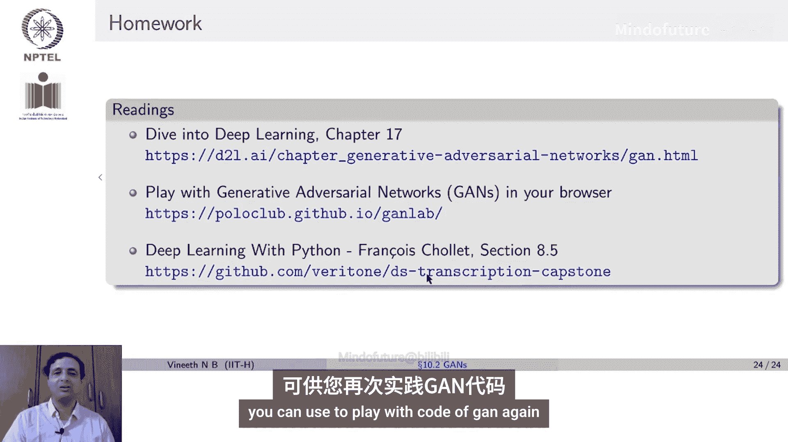

# 115：生成对抗网络 - 第二部分

## 概述
在本节课中，我们将深入探讨生成对抗网络的数学原理、一个重要的改进架构DCGAN，以及如何评估GAN模型的性能。我们将从理论推导开始，理解GAN的最优解，然后介绍DCGAN的关键训练技巧和有趣特性，最后学习评估生成模型质量的常用指标。

---

## 最优判别器与生成器的推导

上一节我们介绍了GAN的基本框架和训练过程。本节中，我们来看看如何从数学上推导出GAN的最优解。

首先，我们重新审视GAN的目标函数：

**Min_G Max_D V(D, G) = E_{x~p_data(x)}[log D(x)] + E_{z~p_z(z)}[log(1 - D(G(z)))]**

为了评估训练此类网络的最优性，让我们重新考虑这个目标。将期望展开为积分形式：

**Min_G Max_D ∫_x [p_data(x) log D(x) + p_g(x) log(1 - D(x))] dx**

这里，`p_g(x)` 是生成器定义的生成数据分布。

现在，我们将最大化操作移到积分内部。为了理解此类函数的最大值，我们使用变量替换进行分析。

令：
*   `y = D(x)`
*   `a = p_data(x)`
*   `b = p_g(x)`

则积分内部的函数为：**f(y) = a log y + b log(1 - y)**

为了找到函数的最大值，我们对其求导并令导数为零：

**f'(y) = a/y - b/(1 - y) = 0**

求解得到最大值点：**y* = a / (a + b)**

将变量替换回原式，这意味着对于给定的输入 `x`，最优判别器的输出为：

**D*(x) = p_data(x) / (p_data(x) + p_g(x))**

---

## 生成器的最优解

我们得到了最优判别器，但故事并未结束，因为我们还需要考虑生成器的最优性。

现在，我们来看生成器一侧的最优性。假设我们已经评估了判别器的最大值，并将最优判别器 `D*` 代入目标函数中关于生成器 `G` 的最小化部分：

**Min_G ∫_x [p_data(x) log D*(x) + p_g(x) log(1 - D*(x))] dx**

将 `D*(x)` 的表达式代入，并进行代数运算，我们可以将此表达式重写为期望形式：

**Min_G { E_{x~p_data} [log( p_data / (p_data+p_g) )] + E_{x~p_g} [log( p_g / (p_data+p_g) )] }**

经过一系列变换（包括乘以并除以2，以及引入KL散度），最终可以将目标函数表示为：

**Min_G { 2 * JSD(p_data || p_g) - log 4 }**

其中，`JSD` 是 **Jensen-Shannon散度**，它是衡量两个概率分布之间距离的另一种度量，其定义为：

**JSD(P||Q) = 1/2 KL(P || M) + 1/2 KL(Q || M)**，其中 **M = (P+Q)/2**

与KL散度一样，Jensen-Shannon散度也是一个非负值。

---

## 全局最优解的结论

现在，让我们将所有结论汇总。

由于Jensen-Shannon散度是非负的，当且仅当 `p_data = p_g` 时，`JSD(p_data || p_g) = 0`，此时目标函数达到最小值 `-log 4`。

因此，生成器 `G` 达到最优时，其数据分布 `p_g` 等于真实数据分布 `p_data`。这符合我们的直观理解。

此时，最优判别器变为：

**D*(x) = p_data(x) / (p_data(x) + p_data(x)) = 1/2**

这意味着在全局最优状态下，对于任何输入样本，判别器的输出都应为 `0.5`。它无法区分真实样本和生成样本，达到了纳什均衡。

---

## DCGAN：深度卷积生成对抗网络

理解了GAN的理论基础后，我们来看一个重要的实践改进。2016年，Radford等人提出了**深度卷积生成对抗网络**。

DCGAN是一个里程碑，它显著提升了使用GAN生成图像的质量。其主要思想是将CNN在监督学习中的成功经验与无监督生成模型相结合，将训练CNN的最佳实践引入到深度GAN架构的训练中。

以下是DCGAN引入的关键训练策略：

*   **卷积替代池化**：使用**步幅卷积（strided convolution）** 替代确定性的空间池化函数（如最大池化），以学习空间下采样。
*   **去除全连接层**：在深层架构中移除全连接隐藏层，主要使用卷积层。
*   **引入批量归一化**：在生成器和判别器中都使用**批量归一化（Batch Normalization）**，这有助于防止梯度问题，但不在生成器的输出层和判别器的输入层使用。
*   **激活函数选择**：生成器使用**ReLU**激活函数，判别器使用**Leaky ReLU**激活函数。
*   **输出层激活**：生成器的输出层使用**Tanh**激活函数，判别器的输出层使用**Sigmoid**激活函数来输出真假概率。

---

## 潜在空间的操作与向量算术

DCGAN展示了如何操作潜在空间以生成不同类型的图像，这是一个有趣的实验。

如果你从高斯分布中采样两个潜在向量 `z1` 和 `z2`，并通过生成器得到两个不同的输出图像 `G(z1)` 和 `G(z2)`。现在，如果你在潜在空间中对它们进行线性插值：

**z' = α * z1 + (1 - α) * z2**，其中 **0 ≤ α ≤ 1**

然后将 `z'` 输入生成器，你会得到从 `G(z1)` 到 `G(z2)` 的平滑过渡图像。

这可以看作是在潜在空间中进行**向量算术**。例如：
1.  计算戴眼镜男性的平均潜在向量 `z_man_with_glasses`。
2.  计算不戴眼镜男性的平均潜在向量 `z_man_without_glasses`。
3.  计算不戴眼镜女性的平均潜在向量 `z_woman_without_glasses`。

然后进行运算：**z_result = z_man_with_glasses - z_man_without_glasses + z_woman_without_glasses**

将 `z_result` 输入生成器，可以得到戴眼镜女性的图像。这说明了生成器如何学习将潜在空间的语义操作映射到图像空间。

---

## GAN的特征学习能力

DCGAN的工作还展示了GAN如何学习到可用于分类的良好特征。

实验方法如下：
1.  在ImageNet数据集上训练DCGAN。
2.  使用另一个数据集（如CIFAR-10）的图像，将其输入到已训练好的GAN的**判别器**中。
3.  提取判别器某一卷积层的特征。
4.  使用这些特征训练一个SVM分类器，对CIFAR-10图像进行分类。

实验结果表明，使用GAN判别器学到的特征进行分类，其性能与2016年当时的许多其他方法具有竞争力。这证明了判别器所学特征的鲁棒性。

---

## 如何评估生成对抗网络？

对于监督学习，我们可以使用准确率等指标。但对于GAN，如何评估其模型性能呢？

以下是几种评估方式：

**1. 人工评估**
一种直接的方法是依赖人类判断。一个好的生成器应能生成具有清晰可辨物体的图像，并且生成的样本在语义上具有多样性。
*   **可识别性**：一个独立的分类器能够以高置信度预测生成图像的类别。
*   **语义多样性**：生成器能生成训练集中各种不同类别的样本。

**2. 初始分数**
这是一个旨在与人类判断相关联的流行指标。它使用一个在ImageNet上预训练的Inception-v3网络。
*   `p(y|x)`：给定生成图像 `x`，Inception模型输出的类别标签概率分布。我们希望这个分布是尖锐的（即某一类概率很高）。
*   `p(y)`：所有生成样本的边际类别分布。我们希望生成样本覆盖所有类别，即 `p(y)` 接近均匀分布。

**初始分数（IS）** 定义为 `p(y|x)` 和 `p(y)` 之间的KL散度：
**IS = exp( E_{x~p_g} [ KL( p(y|x) || p(y) ) ] )**
更高的初始分数意味着更好的生成质量。它也可以理解为 **H(y) - H(y|x)**，即希望类别熵 `H(y)` 高（多样性好），条件熵 `H(y|x)` 低（每个图像分类明确）。

**初始分数的局限性**：它完全不考虑真实数据分布，仅基于生成分布本身进行评估。

---

## FID分数：弗雷歇初始距离

为了弥补初始分数的不足，研究者提出了**弗雷歇初始距离**。

FID旨在直接衡量生成分布与真实分布之间的距离。计算方法如下：
1.  将真实图像和生成图像分别输入Inception-v3网络。
2.  提取**池化层（pool3）** 的激活值作为特征。
3.  假设这两组特征均服从多元高斯分布，分别计算它们的均值（`m`, `m_w`）和协方差矩阵（`C`, `C_w`）。
4.  计算这两个高斯分布之间的弗雷歇距离：

**FID = ||m - m_w||^2 + Tr(C + C_w - 2*(C*C_w)^{1/2})**

其中 `Tr` 表示矩阵的迹。**FID分数越低，表示生成分布与真实分布越接近，生成质量越好。**

FID对噪声和扰动更敏感。例如，向图像添加高斯噪声、高斯模糊或椒盐噪声都会导致FID分数显著上升（变差），而初始分数对这些变化的敏感性则相对较低。

---

## 总结

本节课中，我们一起学习了生成对抗网络更深层次的内容。

首先，我们从数学上推导了GAN的全局最优解，证明了在最优状态下，生成器的数据分布会收敛到真实数据分布，而判别器的输出将始终为0.5。

接着，我们介绍了DCGAN这一重要架构，它通过引入卷积网络的最佳实践（如步幅卷积、批量归一化、特定的激活函数）显著提升了训练稳定性和生成质量。我们还探索了在潜在空间中进行向量算术的有趣应用，以及GAN判别器所具备的强大的特征学习能力。

最后，我们讨论了评估GAN模型的挑战和方法，包括依赖人类判断、初始分数和弗雷歇初始距离。我们了解到，虽然这些指标被广泛使用，但生成模型的评估仍然是一个开放的研究问题。

通过本课的学习，你应该对GAN的工作原理、改进方法以及如何衡量其成功有了更全面的认识。