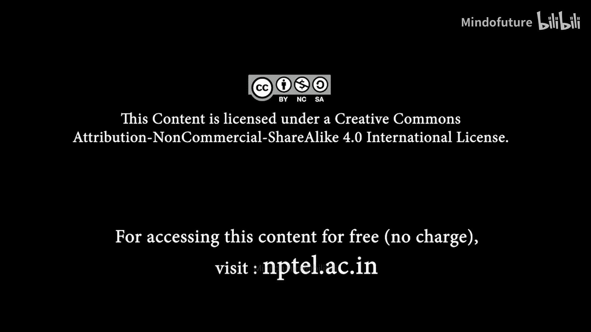
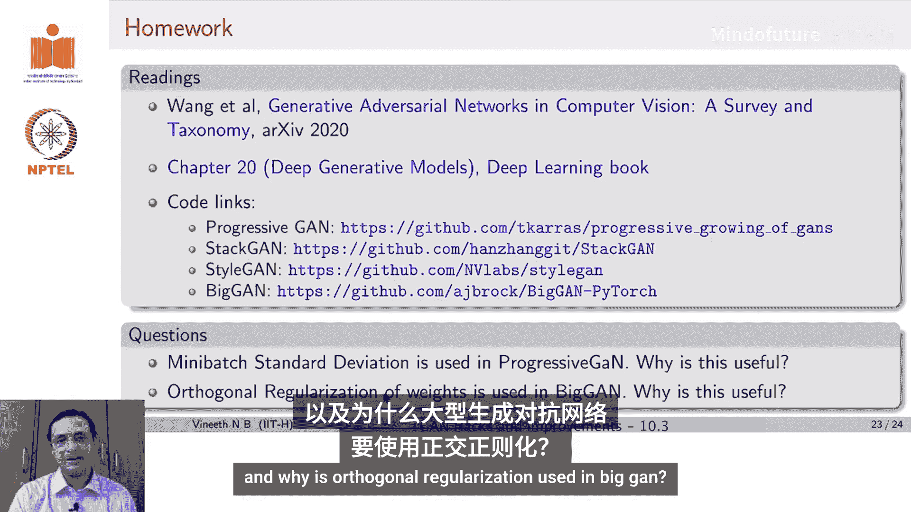

# 116：GAN技巧与改进

在本节课中，我们将学习生成对抗网络（GAN）在过去几年中的多种改进方法。我们将从几种基础GAN的改进方案开始，简要探讨潜在空间解耦的概念，并了解GAN在图像和视频生成中的应用。

## 基础GAN的改进方法

上一节我们介绍了GAN的基本原理，本节中我们来看看几种旨在提升生成质量和稳定性的改进型GAN架构。

### StackGAN：生成高分辨率文本条件图像

第一个要讨论的方法是StackGAN，发表于2017年ICCV会议。该工作的目标是生成**256x256**分辨率、具有照片级真实感的图像，并且这些图像以文本描述为条件。

整个生成器模型以一个文本描述（例如一段标题）为条件。使用Word2Vec、GloVe、BERT等标准NLP方法获取该文本描述的嵌入向量，并将其作为生成器的输入。

以下是StackGAN的两阶段流程：

1.  **第一阶段**：生成器接收文本嵌入向量和标准高斯噪声，生成一个**64x64**的图像。该图像包含一些高级或低频细节。
2.  **第二阶段**：第一阶段的输出图像与相同的文本嵌入向量一起，输入到第二个生成器阶段，最终生成**256x256**的高细节、照片级真实感图像。

现在让我们看看整个架构。文本描述（例如“这只鸟是灰色的，胸部白色，喙很短”）被编码为嵌入向量。该嵌入向量通过一个全连接层生成均值和标准差，用于对标准正态分布的噪声样本进行变换，然后与另一个标准正态样本拼接，共同作为第一阶段生成器的输入。

第一阶段生成器输出64x64图像。判别器接收生成的图像和真实图像批次，并对它们进行下采样。在最终分类为“真”或“假”之前，判别器还会将文本嵌入向量与下采样后的特征表示相结合。因此，判别器的任务是判断（图像特征，文本嵌入）这个组合是真实的还是伪造的。

第二阶段，第一阶段的输出图像再次与文本嵌入向量一起，输入到第二阶段生成器。图像先被下采样，然后与文本嵌入拼接，经过一系列残差块，最后上采样得到256x256图像。该图像随后输入到第二个判别器，判别器同样需要结合文本嵌入来判断（图像，文本）组合的真伪。

为了完成这个任务，判别器需要提供三种分数：
*   **S_R**：真实图像 + 正确文本 -> 判别器希望输出高分（接近1）。
*   **S_W**：真实图像 + 错误文本 -> 判别器希望输出低分。
*   **S_F**：伪造图像 + 正确文本 -> 判别器希望输出低分，但生成器希望提高此分数。

StackGAN的优化过程与标准GAN类似，交替最大化判别器损失和最小化生成器损失。判别器损失函数试图最大化log(S_R)，同时最小化log(S_W)和log(S_F)。生成器损失函数则试图最大化log(1 - S_F)，并最小化文本嵌入层输出的均值/方差与标准正态分布之间的KL散度。

以下是StackGAN的一些生成结果。顶行是2016年发表的基线方法GAN-INT-CLS的结果，底行是StackGAN的结果。可以看到，在文本描述（如“这朵花的花瓣是白色的，带有粉色阴影”）条件下，StackGAN生成的图像质量远高于早期方法，更加逼真。

### Progressive GAN：渐进式生成高分辨率图像

接下来介绍2018年提出的Progressive GAN（渐进式GAN），它旨在生成高达**1024x1024**分辨率的高清图像。其核心思想体现在名称中：**渐进式地增长**生成器和判别器。

Progressive GAN的整体思路如下图所示。生成器首先从一个标准正态分布的潜在向量开始，通过一个非常简单的网络生成一个**4x4**的图像。该图像与真实样本一起提供给判别器D进行真伪判断。

在接下来的训练迭代中，分辨率逐渐增加到**8x8**。与4x4设置相比，8x8的图像虽然仍然模糊，但包含了更多细节。可以注意到，当生成更高分辨率时，生成器和判别器中都会添加新的层。这个过程不断重复，直到最终生成**1024x1024**的图像。这种方法的核心优势在于能够稳定地训练生成高分辨率图像的GAN。

当Progressive GAN从某个分辨率升级到下一个更高分辨率时，会引入新的层。引入方式与残差网络（ResNet）非常相似。例如，从16x16升级到32x32时，16x16层的输出会通过最近邻插值上采样到32x32。这个上采样后的“投影层”通过一个跳跃连接，与新的32x32层的输出以加权和的方式结合。最终输出由公式 `alpha * 新层输出 + (1 - alpha) * 投影层输出` 给出。这允许Progressive GAN以有机的方式“淡入”新层，从而生成更好的图像。

除了渐进式增长，Progressive GAN还引入了其他几项设计决策：

1.  **小批量标准差（Mini-batch Standard Deviation）**：在此步骤中，计算一个小批量内，每个空间位置（即每个像素）上每个特征的标准差，然后进行平均。这个计算出的标准差被拼接到判别器后续层的所有空间位置上。**思考：为什么这样做？（本节课后作业之一）**

2.  **均衡学习率（Equalized Learning Rate）**：生成器网络每一层的权重都用一个每层特定的常数 **C** 进行归一化。这允许我们在每一层调整C，从而帮助在训练期间保持权重处于相似的尺度。之所以称为“均衡学习率”，是因为权重的值实际上会影响梯度，从而影响学习率。虽然像Adam这样的优化器会自适应调整学习率，但在权重本身非常低或非常高的情况下，学习率可能仍然很低。通过常数归一化，可以使所有层的权重在训练期间保持相似的尺度，从而实现更好的学习。

3.  **生成器中的逐像素特征向量归一化（Pixel-wise Feature Vector Normalization in Generator）**：对于生成器中的每个卷积层，归一化定义为：
    `b_{x,y} = a_{x,y} / sqrt( (1/N) * sum_{j=0}^{N-1} (a_{x,y}^j)^2 + epsilon )`
    其中，`a_{x,y}` 是特征图中(x, y)位置的像素值，`N` 是特征图的数量，`epsilon` 是为了数值稳定性而添加的小常数，避免除零错误。分母考虑了所有特征图在同一位置上的像素值，并用此分母对第i个特征图的值进行归一化。输出 `b_{x,y}` 是归一化后的值。

凭借这些贡献，Progressive GAN报告了令人印象深刻的结果。与Mao等人和Gulrajani等人的早期工作相比，采用渐进式GAN方法生成的结果具有更高的照片真实感和分辨率，细节也更加丰富。

### StyleGAN：基于风格控制的高质量图像生成

第三个更近期的GAN改进是2019年CVPR会议上发表的StyleGAN。它着眼于Progressive GAN（也称为ProGAN），后者能生成高质量图像，但难以控制生成过程中的特定特征。例如，很难使用ProGAN来指定为图像添加某种颜色或改变特定属性。

StyleGAN的目标是能够使用预定义的特定**风格**来控制图像的生成。它能够**无监督地自动学习高级属性的分离**，例如人脸图像中的姿态和身份、随机变化（如具有很大随机性的头发）以及特定尺度的属性控制。

StyleGAN的直觉是：在图像中，**粗糙分辨率**（例如4² - 8²）影响姿态、整体发型、脸型等属性；**中等分辨率**（例如16² - 32²）影响更精细的属性，如面部特征、更具体的发型、眼睛开合等；**精细分辨率**（例如64² - 1024²）则影响色彩方案（眼睛、头发、皮肤）并引入面部的微观特征。StyleGAN试图在这些分辨率级别上分别引入风格特定的组件，以达到其预期效果。

它是如何做到的呢？给定一个输入随机向量（与原始GAN相同），StyleGAN首先对该向量进行归一化，然后通过**8个全连接层**（不改变输入维度）进行处理，得到一个512x1的向量 **w**。这个变换后的向量 **w** 被输入到生成器（或称为合成网络）。

现在，让我们看看向量 **w** 如何影响生成过程中的不同分辨率。这是通过引入一个矩阵 **A** 来实现的，该矩阵在不同分辨率下学习一种仿射变换。合成网络（生成器）包含上采样模块，然后是**自适应实例归一化（Adaptive Instance Normalization, AdaIN）**，接着是卷积层，然后是另一个AdaIN层，这个过程在多个块中重复。

让我们看一下这些卷积层和自适应实例归一化层组合中的一个。对于一个卷积层，其特定通道的特征图通过其均值和方差进行归一化，以实现自适应实例归一化。在此之前，通过 **A** 映射对权重向量 **w** 进行变换，得到一组值 **ys_i** 和 **yb_i**，用于改变卷积层输出的尺度和偏置。这就是“自适应”归一化的来源。

具体操作如下：首先进行归一化 `(x - μ(x_i)) / σ(x_i)`，然后乘以从 **A** 变换得到的缩放值 **ys_i**，再加上偏置值 **yb_i**。注意，**ys_i** 和 **yb_i** 在合成网络的不同块中可能不同。每个这样的变换从而定义了该层级特征的视觉表达，这使得输入潜在向量能够在生成的不同分辨率上产生不同的影响。

### SPADE：基于空间自适应归一化的语义图像合成

另一个于2019年CVPR发表的方法是**SPADE**（Spatially Adaptive Normalization，空间自适应归一化）。其核心思想是：先前的方法直接将语义布局图作为网络的输入。而在SPADE中，输入布局通过这种空间自适应的学习变换来调制归一化层中的激活。

让我们看看这是如何发生的。在标准的批归一化层中，你可以将输出视为经过一个仿射变换：缩放值并加上一个常数（即 `γ * x + β`）。然而，在SPADE中，一个语义分割图被作为输入。这个语义分割图经过一个卷积层，该卷积层输出一个 **γ** 图和一个 **β** 图，用于对生成器的前一层进行归一化。

与盲目归一化特定层的输出特征图不同，在这种情况下，归一化是以空间自适应的方式进行的，其中 **γ** 和 **β** 来自语义分割图中的空间关系。语义分割图具有像素级的类别标签关联（例如，树、天空、山、草、路）。这用于定义归一化的 **γ** 和 **β**。

一个随机潜在向量也可以用来操纵生成图像的风格，但语义分割图提供了一种利用每个像素的空间内容进行归一化的方法。可以注意到，现在的归一化是在每个像素上定义的，**γ** 和 **β** 是在像素级别定义的（由逐元素相乘 `*` 和相加 `+` 表示），这允许每个像素根据语义分割掩码以不同的方式进行归一化。

以下是一些有趣的结果。可以看到，语义分割输出作为SPADE的输入（这些是像素级类别标注的掩码），第三列和第四列对应其他方法，而SPADE生成了相当逼真的输出，接近真实情况。图中展示的是SPADE中生成器的架构，它与许多其他GAN架构相似，但区别在于每个层都有语义分割掩码的输入。

### BigGAN：大规模GAN用于类别条件图像生成

最后，我们将讨论本讲座中最后一个方法，即目前非常流行的**BigGAN**，发表于2019年ICLR。BigGAN的重点是**扩大GAN的规模**以实现更好的高分辨率生成。它专为**类别条件图像生成**而设计，这意味着输入既包括类似于原始GAN的噪声向量，也包括一些类别信息（例如一个one-hot向量），它们共同提供给生成器以生成对应类别的图像。

BigGAN也引入了一些不同的设计决策。一个重要决策是使用**自注意力GAN（SAGAN）** 的思想。SAGAN是一项较早的工作（2018年底提出，2019年ICML发表），它引入了自注意力的概念。这与我们一周前在Transformer中看到的自注意力是相同的想法。

在生成器中某一特定层的卷积特征图输出上，通过多个1x1卷积进行处理。其中一些1x1卷积经过变换和转置以获得注意力图。这三个分支类似于Transformer架构中的查询、键和值。其中两个分支生成一个注意力图，用于聚焦卷积图的特定部分，以便在下一层生成图像的该部分。之所以需要这个，是因为通常的GAN在生成清晰图像时，可能会遗漏更精细的细节（例如，在狗的图像中可能生成了狗的毛发但遗漏了腿）。使用自注意力的思想是聚焦图像的特定部分，并更恰当地生成每个局部细节。

在BigGAN中，与自注意力GAN一起使用的损失函数是**铰链损失（Hinge Loss）**。这个铰链损失类似于支持向量机中使用的铰链损失，由公式 `max(0, 1 - t*y)` 给出，其中 `t` 是目标输出，`y` 是预测输出。这是因为GAN是类别条件的，所以你希望输出图像属于特定类别，这个类别信息在判别器阶段被使用，因为判别器现在不仅判断真伪，还可以给出一个类别标签，其损失在这种情况下由铰链损失给出。

此外，BigGAN还以略有不同的方式引入了类别条件潜在变量。不是将类别条件潜在变量（例如one-hot向量）直接提供给生成器的输入，而是将其作为**单独的输入**在生成的多个阶段提供，在那里它与某些输入拼接，然后提供给每个残差块。

在每个残差块内部，拼接后的类别标签向量通过线性变换（实际上是两个不同的线性变换），然后提供给该残差块内的两个批归一化层。

BigGAN还有其他有助于其性能的设计决策：
1.  **谱归一化（Spectral Normalization）**：对每一层的权重矩阵进行归一化，以确保其谱范数保持不变，并满足Lipschitz约束 `σ(W) = 1`。其主要思想类似于批归一化，即约束权重具有某些特性，以确保学习可以更好、更快地进行。在这种情况下，我们试图约束权重矩阵的最大奇异值。
2.  **正交权重初始化（Orthogonal Weight Initialization）**：一种众所周知的权重初始化方法，其中每一层的权重被初始化为确保 `W^T W = I`，即权重矩阵是正交的。
3.  **跳跃-Z连接（Skip-Z Connections）**：输入潜在向量 **Z** 连接到网络深处的特定层。
4.  **正交正则化（Orthogonal Regularization）**：鼓励权重在每次训练迭代中保持正交。这是通过一个正则器项 `β * ||W^T W - I||_F^2` 来实现的，其中 `β` 是一个系数。这个正则器试图确保 `W^T W` 接近单位矩阵，从而使矩阵接近正交。**思考：为什么我们需要正交正则化？（本节课后作业之二）**

BigGAN中采用的其他技巧包括：在每次迭代中，判别器模型更新两次后才更新生成器模型；使用移动平均方法对几次训练迭代的模型权重进行平均，作为最终模型（这在ProGAN中也做过）。

BigGAN还观察到，在使用小批量SGD时，使用非常大的批量大小（如256、512、1024和2048）效果更好，实际上他们在最大的2048批量大小时观察到了最佳性能。他们还使每层的通道数（即模型参数）翻倍，并采用了称为**截断技巧（Truncation Trick）** 的方法。在训练时，生成器从高斯分布接收潜在向量；在测试时，从高斯分布采样一个潜在向量，如果该值小于某个阈值，则丢弃它并重新采样。这被称为截断高斯分布。其主要思想是，你不会使用这些潜在向量得到异常的生成结果，而是得到属于该分布核心部分的生成结果。

## 总结与作业

本节课中，我们一起学习了生成对抗网络（GAN）的多种重要改进技巧。我们从**StackGAN**开始，了解了如何通过两阶段结构和文本条件生成高分辨率图像。接着探讨了**Progressive GAN**，它通过渐进式增长生成器和判别器来稳定地生成极高分辨率的图像，并引入了小批量标准差、均衡学习率等技巧。然后，我们学习了**StyleGAN**，它通过分离和控制不同分辨率级别的风格属性，实现了对生成图像特征的高度可控性。之后，我们介绍了**SPADE**，它利用语义分割图进行空间自适应的归一化，实现了高质量的语义图像合成。最后，我们讨论了**BigGAN**，它通过扩大模型规模、使用自注意力、谱归一化、正交初始化与正则化等一系列技术，在类别条件图像生成上取得了突破性进展。

你的课后作业是：
1.  思考并回答：为什么在Progressive GAN中使用**小批量标准差**？
2.  思考并回答：为什么在BigGAN中使用**正交正则化**？
3.  阅读这篇优秀的GAN综述（深度学习书第20章）以及本讲座中讨论的大多数GAN的代码链接（如果你想查看并尝试运行它们）。

我们留下的问题是：为什么在Progressive GAN中使用小批量标准差？为什么在BigGAN中使用正交正则化？思考一下，我们下次课讨论。