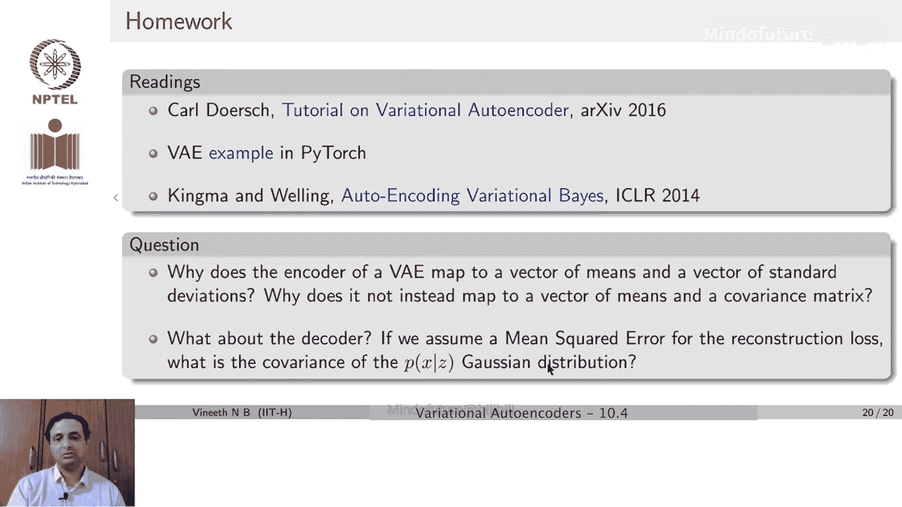

# 117：变分自编码器 🧠

在本节课中，我们将学习一种重要的深度生成模型——变分自编码器。我们将从回顾自编码器开始，逐步理解变分自编码器的核心思想、数学原理、网络结构以及训练方法。

## 从自编码器到生成模型 🔄

上一节我们介绍了生成对抗网络，本节中我们来看看另一种深度生成模型，称为变分自编码器，通常简称为 VAE。

在讨论变分自编码器之前，让我们先简要回顾一下上周学过的自编码器。自编码器是一种用于无监督学习的神经网络，其目标是重构输入数据本身。

自编码器的架构通常包含一个将输入压缩到瓶颈层的编码器，该瓶颈层包含输入的某种表示，也称为**潜在编码**。随后，解码器使用这个潜在编码来重构输出，理想情况下输出应尽可能接近输入。

在本周主题的背景下，我们想问的问题是：如何利用这种方法来自动生成图像？回想一下，当我们讨论自编码器时曾提到，训练完成后，我们通常会丢弃解码器。给定一个输入，我们仅使用编码器来获取数据的低维表示。

现在，让我们尝试反转这个思路。在训练结束时，我们能否丢弃编码器而非解码器？如果我们能使用某个向量作为代码，生成接近训练数据分布的图像，那么这个目标就与 GAN 试图实现的目标相似，但实现视角不同。

## 变分自编码器的诞生 📜

变分自编码器的思想大约在同一时间由两组研究人员提出：
*   Kingma 和 Welling 在 2014 年 ICLR 上发表的论文《Auto-Encoding Variational Bayes》。
*   Rezende、Mohamed 和 Wierstra 在 2014 年 ICML 上发表的论文《Stochastic Backpropagation and Variational Inference in Deep Latent Gaussian Models》。

现在，让我们尝试理解变分自编码器。

## 核心：潜在变量模型 🎯

VAE 的核心在于学习所谓的**潜在变量模型**。在潜在变量模型中，我们的目标是学习从某个潜在随机变量 **Z** 到一个可能很复杂的分布 **X** 的映射。我们假设 **X** 是训练数据的真实世界分布，我们希望生成与之相似的数据。

从数学上讲，可以写作：
`p(x) = ∫ p(x, z) dz`
其中 `p(x, z) = p(x|z) * p(z)`。

我们在这里假设，潜在变量 **Z** 的先验或边缘分布是简单的。那么如何得到 `p(x|z)` 呢？我们假设 `p(x|z)` 是输入向量 **z** 的某个函数。这就是这里简单的数学构造。

我们提出的问题是：在给定训练数据（这里假设是无监督学习，只有 **X**）的情况下，我们能否学会解耦数据分布背后真正的解释因子或潜在变量？这些潜在变量可能正在生成数据。

例如，在人脸图像中，你可能想假设存在一个名为“身份”的潜在随机变量和一个名为“表情”的潜在随机变量。因此，如果说人物 A 是快乐的，你应该能够生成人物 A 的快乐表情人脸图像。在这种情况下，身份和表情就是潜在变量。这些潜在变量可能取不同的值，身份可能取不同的人如 A、B、C，表情可能取快乐、悲伤、愤怒等不同值，组合起来就生成了特定类型的图像。

所以，我们讨论的是一组潜在变量（在此例中表示为 z1, z2）和一个函数 **G**，该函数将我们从这个潜在空间带到原始数据空间。我们如何学习这样一个从 **Z** 到 **X** 的函数 **G**？

我们将假设使用神经网络来学习这样一个从 **Z** 到 **X** 的函数。因此，这里的条件分布 `p(x|z)`，给定一个向量 **z**，理想情况下我们应该能够使用神经网络来给出一个向量 **x**。

现在剩下的问题是：**Z** 从何而来？计算后验概率 `p(z|x)` 是难以处理的，因为我们不知道 **Z** 是什么样子，不幸的是，我们需要它来训练 `G(z)` 模型。没有 **Z** 的值，我们也无法训练 `G(z)` 模型。那么，我们如何解决这个问题？

## VAE 的贝叶斯视角与直觉 🤔

到目前为止，你可以看到变分自编码器为自编码器提供了贝叶斯视角。

如果我们假设数据是通过这个生成过程产生的：**Z** 是一组潜在随机变量，我们假设它们属于某个先验分布，我们从真实的条件分布中采样，从而得到 **X**，也就是我们看到的训练数据分布。

这里的直觉是：**X** 可以是一张图像，它是由一些潜在属性生成的，例如类别标签、方向属性等。因此，我们可以说类别标签是人脸，方向是他/她看的方向，属性可以是肤色、眼睛颜色、头发颜色等。现在对我们来说，问题是在不知道这些 **z** 是什么的情况下，我们需要估计这个条件分布 `p(x|z)` 的参数 **θ**，而我们无法访问 **Z**。

如何做到这一点是 VAE 的核心思想。

## VAE 的架构构建 🏗️

为了启动这个过程，我们现在假设随机变量 **Z** 上有一个先验分布，为了方便起见，我们假设它是一个单位高斯分布。一旦你有了 **Z**，你现在可以构建一个神经网络，我们称之为**解码器网络**，它具有某些参数 **θ**，即解码器网络中那些层的权重。解码器输出一组均值和方差，然后可以用来采样并获得类似于 **X** 的数据。

因此，这里的条件分布 `p_θ(x|z)` 被假设为对角高斯分布。这是为了简化，可以假设是具有某个协方差矩阵的多元高斯分布，但过程会变得有点复杂，我们将其保持为简单的对角高斯分布，其每个维度的均值和方差由解码器网络预测。

根据贝叶斯规则，我们知道后验概率 `p_θ(z|x)` 由 `p_θ(x|z) * p_θ(z) / p_θ(x)` 给出。

现在，如果我们观察右边的项：
*   `p_θ(x|z)`：我们刚刚讨论了如何获得它。假设你的 **z** 是单位高斯分布，并学习一个可以给你输出 **x** 的解码器网络，这就给了你 `p_θ(x|z)`。
*   `p_θ(z)` 呢？我们刚刚说我们假设它是高斯分布，所以这是一个假设。
*   分母 `p_θ(x)` 呢？不幸的是，这是一个难以处理的积分。目前我们还不知道 **x** 来自什么分布及其参数化。

那么，我们该如何解决这个问题？我们现在将假设存在另一个分布 `q_φ(z|x)`，我们现在称之为**近似后验分布**。这是使用一个**编码器网络**获得的。

编码器网络的作用是：它接收你的训练数据分布（即神经网络从训练数据中接收所有输入），它有一组由某些权重参数化的层，我们用 **φ** 表示这些权重。它再次输出一组多元对角高斯分布的均值和方差，该分布由近似后验 `q_φ(z|x)` 给出。

## 编码器-解码器结构 🔗

如果你把所有这些部分放在一起，我们现在就有了下面的编码器和顶部的解码器。

编码器接收 **x**，并为这个近似后验分布 `q_φ(z|x)` 输出一组均值和方差。一旦你有了那个分布，你就可以从中采样一个 **z**。然后将该样本 **z** 作为输入给你的解码器网络，解码器网络输出一组均值和方差，对应于 `p_θ(x|z)`。给定这些均值和方差，你可以从 `p_θ(x|z)` 中采样以获得你的输出图像或重构。

我们在这里假设 `q_φ` 和 `p_θ` 都是具有特定均值和对角协方差的多元高斯分布，因此每个维度是独立的。

## 训练目标与证据下界 📉

我们如何训练这样的网络？让我们试着理解一下。

我们希望训练解码器网络，就像普通的自编码器一样。因为它将构建并给我们一个输出 **x**。理想情况下，我们希望使用像重构损失这样的东西，比如均方误差损失，以确保这里的重构尽可能接近 **x** 本身，这肯定是我们损失函数的一项。我们还需要做什么？

我们还想确保这个近似后验 `q_φ(z|x)` 应该接近我们假设的 **Z** 的先验。我们为解码器网络假设 **Z** 来自单位高斯先验。因此，理想情况下，我们希望 `q_φ(z|x)` 接近分布 `p_θ(z)`，在我们的例子中，我们假设它是一个均值为 0、协方差矩阵为单位矩阵的高斯分布。

让我们试着把这些放在一起，得到训练这种变分自编码器的正式损失函数。

请记住，这里的目标是进行最大似然估计。我们有一个由 {x_i} 给出的训练数据，理想情况下，我们希望学习参数 **θ**（即解码器的参数），以最大化该分布生成训练数据点的可能性，这就是数据集的最大似然估计。

我们将把它转换为最大对数似然估计，其中乘积转换为和，然后你有 `log p_θ`，这在数学上使事情变得简单一些。

现在，`p_θ(x)` 可以定义为 `∫ p_θ(x, z) dz`。这可以展开为 `∫ p_θ(x|z) * p_θ(z) dz`。不幸的是，在这种情况下，我们再次留下了一个难以处理的积分。

因此，让我们尝试看看如何解决这个最大似然估计问题，我们将用一个技巧来解决它。

让我们重写最大对数似然估计问题。我们有对数似然 `log p_θ(x)`，它可以表示为从近似后验中采样的 **Z** 向量对 `log p_θ(x)` 的期望。如果我们从你的近似后验中采样 **Z** 向量并作为输入给解码器，那么生成类似于训练分布的样本的可能性必须很高。这就是第一句话的含义。

现在，`log p_θ(x)` 可以使用贝叶斯定理写成：`log p_θ(x) = log [ p_θ(x|z) * p_θ(z) / p_θ(z|x) ]`，这只是贝叶斯定理的不同写法。对于这个特定表达式，我们将乘以并除以近似后验 `q_φ(z|x)`，这只是一个简单的乘以和除以一个常数。

一旦我们有了这个等价于该问题最大似然估计设置的表达式，我们可以以不同的方式分组项来书写它。

第一项 `log p_θ(x|z)` 保持不变，我们将其写为对 **Z** 的期望：`E_z[log p_θ(x|z)]`。

然后你有另一项 `q_φ(z|x)` 和 `p_θ(z)`。理想情况下，你可以将其写为加上对 **Z** 的期望：`E_z[log (p_θ(z) / q_φ(z|x))]`。现在，我们不加上它，而是减去它并这样写：`- E_z[log (q_φ(z|x) / p_θ(z))]`，这只是取倒数并在开头改变符号。

然后剩下的项是这两项：分母中的 `p_θ(z|x)` 和分子中的 `q_φ(z|x)`，这就是第三项给我们的。这只是分组项并以不同方式书写。

现在，如果你观察这里的第二项和第三项，你会注意到第二项是近似后验 `q_φ(z|x)` 和 **Z** 的先验 `p_θ(z)` 之间的 KL 散度。第三项是真实后验 `p_θ(z|x)` 和近似后验 `q_φ(z|x)` 之间的 KL 散度。

现在，如果你在这里观察，KL 散度是一个非负量，所以这里的第三项将大于或等于 0。因为这是一个对数似然估计问题，我们理想情况下希望最大化这个量。

因此，要最大化由这三项组成的量（其中第三项大于等于 0），可以通过最大化前两项本身来实现。

所以我们现在说的是，我们有一个下界，由前两项给出。记住第三项是非负的并且加在它上面，所以整个对数似然将以下面这两项为下界。

因此，如果我们想最大化对数似然，我们可以最大化这个下界。这个下界也被称为**证据下界**或 **ELBO**。这整个优化过程被称为**变分推断**的方法，其中我们引入了一个变分分布（在本例中，变分分布是近似后验 `q_φ`），并利用它来学习分布的参数化。

所以，我们现在的目标是找到 **θ*** 和 **φ***，以最大化这个证据下界。

## 训练挑战与重参数化技巧 ⚙️

让我们把这些放在一起。我们现在说，我们引入了一个推理模型 `q_φ(z|x)`（近似后验），它试图通过优化变分下界来近似原始后验。我们使用编码器网络对 `q_φ(z|x)` 进行参数化。

所以，我们现在有了一个编码器和一个解码器网络。在将它们放在这个上下文中之前，让我们单独看看它们。给定训练数据 **X**，我们将其作为输入提供给编码器。编码器输出近似后验分布的均值和方差，我们希望它接近 **Z** 的先验。然后我们从 **Z** 采样，并使用解码器生成 **x**，我们希望它接近训练数据分布。

那么，我们将如何训练这个网络？

如果你看目标函数本身，这是我们要最大化的总体目标，但在这个训练过程中存在一个问题。

如果我们注意到我们所说的：我们将输入分布给编码器，编码器给出近似后验的参数化，然后我们从先验中采样，再给解码器，然后你得到最终输出。这意味着我们现在有一个编码器-解码器模型，一个自编码器，其中在中间步骤或瓶颈层步骤，我们将采样一个向量，而不是前向传播一个向量。

为什么这是一个问题？那个样本可能不是确定性的，我们不知道如何通过那个瓶颈层将梯度传递到编码器。这是一个挑战。我们该怎么办？

理想情况下，我们必须以某种方式确保我们得到的那个样本变得独立于编码器的输出，因为如果它变得独立于编码器的输出，你可以简单地通过解码器和编码器反向传播梯度，并假设随机性来自某个外部量。

我们如何将随机性与编码器输出分离？这是通过一个称为**重参数化技巧**的技巧完成的。这是变分自编码器方法的主要贡献之一，一个简单的技巧，但解决了通过网络反向传播的问题。

请记住，我们将从某个近似后验分布中采样 **Z**，该分布由具有均值 `μ_z(x)` 和方差/标准差 `σ_z(x)` 的高斯分布给出。

现在，从这样的分布中抽取的样本可以稍微不同地重写。我们可以将该样本 **Z** 参数化为：
`z = μ_z(x) + σ_z(x) * ε`
其中 `ε` 是从单位标准正态分布中随机采样的向量。

这如何解决了真正的问题？请记住，在之前的步骤中，到目前为止，你现在可以将其视为类似这样的东西：你在神经网络中有一组层。在变分自编码器的早期版本中，其中一层变成了随机的，你必须采样一个向量，而不是像我们迄今为止所见的那样通过神经网络前向传播的向量。

因为有一个样本，我们不知道如何通过该层反向传播到更早的层（在我们的例子中是编码器）。因此，重参数化技巧建议，让我们将该层固定为前一层的输出。相反，从外部引入这个随机性，而不是该层输出本身。

如果你在这里看到，现在的新样本由 `μ_z`（编码器的输出）、`σ_z`（也是编码器的输出）乘以 `ε` 给出。你现在几乎可以将 `ε` 视为一个偏置向量，它来自噪声。它实际上并不影响反向传播到更早的层，它只是在该特定层中给出的外部输入，现在你可以像以前一样使用梯度下降通过整个网络反向传播。

因此，你现在在编码器中给定 **x**，生成 `μ_z` 和 `σ_z`，然后使用重参数化技巧采样 **z**，通过解码器并生成输出端的 `μ_x` 和 `σ_x`，你可以从中采样并获得任何生成。

通过重参数化技巧，整个变分自编码器变得可微分，你可以使用梯度下降和反向传播来更新 VAE 中的权重并训练网络。

## 损失函数与训练 🧮

如前所述，这里的目标函数由下式给出：
`L(θ, φ; x) = -D_KL(q_φ(z|x) || p_θ(z)) + E_{z~q_φ(z|x)}[log p_θ(x|z)]`

现在，`log p_θ(x|z)` 结果是一个简单的重构损失，我们希望它接近你的训练分布，因此你甚至可以使用均方误差来最大化这个似然项。

那么第一项呢？我们如何对其微分以进行反向传播？关键点在于，我们假设 `q_φ` 是一个具有编码器提供的特定均值和方差的高斯分布。我们还假设 `p_θ(z)` 是单位高斯分布。高斯分布之间的 KL 散度是一个定义明确且可微分的公式，这有助于我们确保可以计算梯度并端到端地反向传播和训练这个网络。

## 总结与应用 🎓

这就完成了我们对 VAE 如何学习的讨论。

总结并与自编码器区分：
*   **传统自编码器**通过学习重构输入来训练，通常用于学习特征（低维表示），然后可用于训练另一个神经网络、SVM 或任何其他监督模型。
*   **变分自编码器**在概念上是贝叶斯学习和深度学习的结合。在训练变分自编码器之后，你可以丢弃编码器，只需从你的先验 `p_θ(z)`（单位高斯分布）中采样，现在你的解码器已经学会了生成图像，它将单位高斯分布作为输入来生成看起来接近输入数据分布的图像。这就是使 VAE 成为生成模型的原因。

VAE 能做什么？以下是几个例子，其中 VAE 在 MNIST 数据和 Frey Face 数据集上进行了训练。你可以看到，当潜在变量（即 VAE 中的 **z**）被微小值修改时，生成的图像（即解码器的输出）随着 **Z** 值的变化而逐渐变化。这表明变分自编码器确实学会了能够在其所在的流形上平滑生成数据的潜在变量值。

类似地，就像我们在 Frey Face 数据集上对 GAN 所做的那样，你可以学习诸如表情和姿势之类的潜在变量。当你改变这些对应的潜在随机变量的值时，最终会得到具有不同姿势和不同表情的人脸图像生成。

VAE 还能用于什么？它们有很多应用，我们将在下周详细讨论其中一些，但这里有几个例子：图像和视频生成、超分辨率、从静态图像进行预测、图像修复等等，我们将在下周看到其中一些。

在过去的几年里，VAE 也以多种方式得到了扩展。虽然我们可能没有在本课程中涵盖所有这些的范围，但如果你想知道更多，这里有一些提示：
*   原始作者扩展了 VAE 以获得半监督变体，其中可以使用标记和未标记数据来学习 VAE。
*   另一个流行且强大的扩展是**条件 VAE**，你可以在给定特定类别标签的情况下生成数据。
*   还有一种变体称为**重要性加权 VAE**，它对潜在随机变量进行不同的加权以获得更强大的生成。
*   然后是**去噪 VAE**，你可以将其视为去噪自编码器到 VAE 设置的扩展。
*   VAE 也已用于图形学，一个流行的网络称为**逆图形网络**，它使用类似 VAE 的策略来学习潜在变量，使你能控制生成各种类型的对象、3D 对象等。
*   最后，另一种网络称为**对抗自编码器**，它结合了 GAN 和 VAE，这将是我们下一讲立即讨论的主题。

## 课后思考与作业 📚

你本次的作业是阅读关于变分自编码器的教程，以及 PyTorch 中的 VAE 示例。如果你有兴趣，可能也值得阅读关于变分自编码器的原始论文。

这里有几个问题供你思考：
1.  为什么 VAE 的编码器映射到均值向量和标准差向量？为什么编码器不映射到均值向量和协方差矩阵？（记住，编码器为你提供近似后验。）
2.  类似的问题，解码器呢？如果我们假设重构损失（VAE 目标中的第二项）使用均方误差，那么 `p(x|z)` 高斯分布的协方差是什么？你认为它看起来像什么？思考一下，我们很快会讨论。

---

**本节课中，我们一起学习了变分自编码器的基本原理、数学推导、网络架构、训练技巧（特别是重参数化技巧）以及其作为生成模型的应用和扩展。VAE 通过结合深度学习和贝叶斯推断，提供了一种强大且可解释的生成数据方式。**