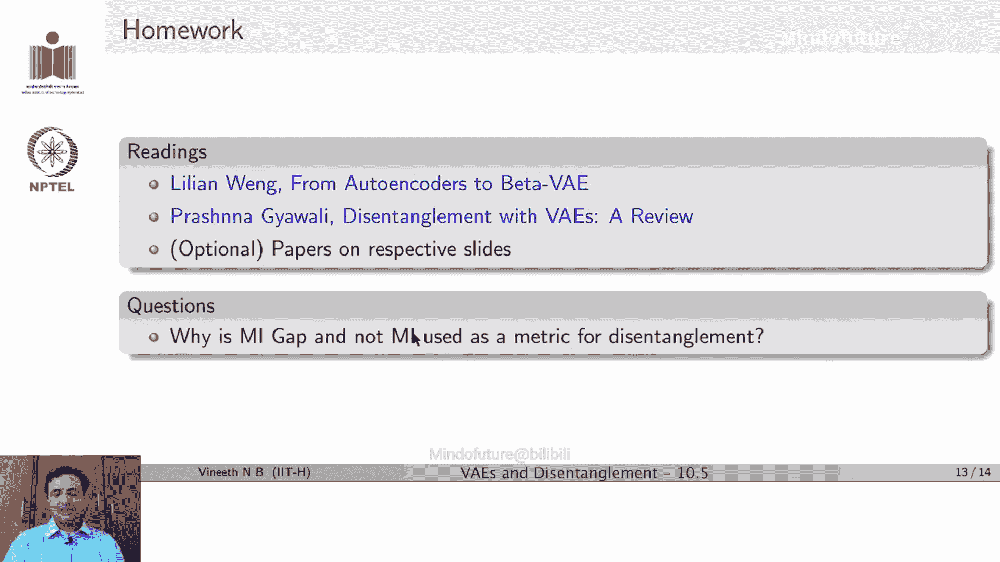

# 118：VAE与解耦 🧩

在本节课中，我们将学习生成模型中的一个重要概念——解耦。这个概念与变分自编码器密切相关，我们将探讨其原因，并介绍实现和评估解耦的方法。

## 什么是解耦？

解耦旨在分离观测数据中的变化来源。例如，给定一张“大红色苹果”的图片，我们能否将其生成因素分离为：尺寸（大）、颜色（红）和物体（苹果）？我们能否在训练深度生成模型时，强制模型将这些因素隔离开来学习？

## 为什么需要解耦？

如果能够解耦生成因素，我们就能生成训练数据集中可能不存在的全新图像。例如，如果训练数据包含“小黑葡萄”和“大红苹果”的图片，通过解耦模型，我们可以通过设定颜色、尺寸和物体为特定值，生成“小黑苹果”的图片。这只有在生成模型的潜在变量能够隔离图像的这些组成部分时才能可靠实现。

以人脸图像为例，潜在变量可能对应性别、年龄、发型、种族等因素。如果我们知道哪个潜在变量对应性别，就可以单独操纵该变量，生成从女性到男性等不同变化的图像。

## 为什么是变分自编码器？

与生成对抗网络不同，GAN的潜在向量是来自高斯分布的噪声，本身不进行学习。而在变分自编码器中，潜在变量是学习得到的。如果能确保这些潜在变量是解耦的，我们就能对VAE生成的图像类型进行大量控制。

VAE的整体架构和公式如下：输入数据 **x**，编码器提供近似后验分布的均值和方差，该分布在训练过程中试图接近预设的先验分布。然后从先验中采样一个向量，解码器根据该采样向量重建数据。这里的潜在变量是一个多维向量，如果它们是解耦的，就能生成更可控的数据。

显然，像对抗自编码器这样的VAE-GAN框架也能从解耦潜在变量中受益。

## Beta-VAE：实现解耦的方法

第一个将解耦概念引入社区并开发出实现方法的工作是Beta-VAE，发表于2017年的ICLR会议。它本质上是VAE的一个变体。

回顾VAE的损失函数，其证据下界包含两项：一项是最小化负对数似然（即最大化生成训练集中数据的对数似然），另一项是最小化近似后验与真实后验之间的KL散度。经过推导，我们最终在训练VAE时使用的是近似后验 **Q_φ(z|x)** 与先验 **P_θ(z)** 之间的KL散度。

我们可以将整个目标函数以另一种方式表述：我们希望最大化从 **z** 生成 **x** 的对数似然，同时约束近似后验 **Q_φ** 与先验 **P_θ(z)** 之间的KL散度尽可能小（小于某个正常数 **δ**）。这相当于在保持真实分布与近似后验分布之间距离小的同时，最大化生成真实数据的概率。

利用拉格朗日乘子法处理这个约束优化问题（类似于支持向量机的推导），我们可以得到Beta-VAE的损失函数：

**L(θ, φ; x, z) = -E_{z∼Q_φ}[log P_θ(x|z)] + β * D_{KL}(Q_φ(z|x) || P_θ(z))**

当 **β = 1** 时，即为标准VAE的损失。当 **β > 1** 时，它会在生成模型中引入更强的解耦能力。原因在于，损失函数的第一项旨在提高解码器的重建能力，而第二项则负责学习VAE的潜在表示。通过赋予第二项更大的权重，我们试图让潜在变量以更解耦的方式被更好地学习。

然而，这可能导致潜在变量 **z** 的表征能力受限，从而影响整个VAE的重建性能。这引出了一个权衡：在Beta-VAE中，增加 **β** 能获得更好的解耦，但重建能力会下降。

## Beta-TCVAE：平衡解耦与重建

为了解决这个问题，在2018年的ICLR会议上，Chen等人提出了Beta-TCVAE方法。

Beta-TCVAE的关键在于对近似后验与先验之间的KL散度项进行分解。该KL散度可以分解为两部分：一项是潜在变量 **z** 与数据索引 **n** 之间的互信息，另一项是边际KL散度。进一步地，边际KL散度可以分解为总相关项和维度级KL散度项之和。

*   **总相关**：衡量潜在变量 **z** 的各维度之间的独立性。它是互信息在多随机变量情况下的推广。
*   **维度级KL散度**：衡量每个潜在维度与先验的差异。

在解耦表示中，我们希望每个维度都有独立的存在。分解表明，**总相关项对解耦表示最为重要**。因此，Beta-TCVAE的最终损失函数为：

**L = -E[log P(x|z)] + I(z; n) + β * TC(z) + Σ_j D_{KL}(q(z_j) || p(z_j))**

其中，**TC(z)** 是总相关项。注意，**β** 系数**仅作用于总相关项**，而不是整个KL散度项。这允许我们专注于使用 **β** 来促进解耦，同时不影响VAE的重建能力。

## 如何评估解耦效果？

评估生成模型是否有效学习了解耦表示，除了定性地生成不同图像进行检查，还有一些定量的评估指标。

### 互信息间隙

MIG使用生成因子 **G**（数据中已知的变化因素，如尺寸、颜色）与学习到的潜在维度 **Z** 之间的互信息进行计算。

以下是计算步骤：
1.  计算每个生成因子 **G_i** 与每个潜在维度 **Z_j** 之间的互信息，得到一个矩阵。
2.  对于每个生成因子 **G_i**，找出与其互信息值最高的两个潜在维度 **Z_j** 和 **Z_l**。
3.  定义该生成因子的MIG为这两个互信息值之差，并进行归一化（除以该生成因子的熵，再对所有生成因子取平均）。

**MIG(G_i) = (I(G_i; Z_j) - I(G_i; Z_l)) / H(G_i)**

MIG值在0到1之间。如果MIG为0，意味着两个潜在维度都高度关联同一个生成因子，解耦效果差。如果MIG为1，则表示解耦效果好。

### DCI指标

DCI代表解耦性、完备性和信息量。计算步骤如下：
1.  使用待评估模型（如Beta-VAE）获取数据集中所有图像的潜在表示 **z**。
2.  训练 **K** 个线性回归器 **f_1 到 f_K**，每个回归器使用整个潜在向量 **z** 来预测一个生成因子 **G**。
3.  从这些回归器中得到一个相对重要性矩阵 **R**，其中元素 **R_ij** 表示潜在维度 **Z_i** 对预测生成因子 **G_j** 的重要性。

基于矩阵 **R**，定义三个指标：
*   **解耦性**：衡量表示解耦底层变化因素的程度。理想情况下，一个潜在维度应只对应一个生成因子。
*   **完备性**：衡量每个底层生成因子是否由单个潜在变量捕获。理想情况下，一个生成因子应只由一个潜在维度解释。
*   **信息量**：衡量解耦的潜在表示在捕获底层因素方面的有用性，通常通过预测生成因子的误差来衡量。

## 总结

本节课我们一起学习了生成模型中的解耦概念。我们了解到，解耦旨在分离数据中的独立变化源，这对于实现可控的图像生成至关重要。我们重点介绍了两种在VAE框架中实现解耦的方法：Beta-VAE通过增加KL散度项的权重来促进解耦，但可能牺牲重建质量；Beta-TCVAE则通过分解KL散度，将权重专注于总相关项，从而更好地平衡解耦与重建。最后，我们探讨了评估解耦效果的定量指标，包括互信息间隙和DCI指标。

作为课后作业，建议阅读关于从自编码器到Beta-VAE的优秀博客文章，以及关于VAE解耦的综述，并思考在MIG指标中为什么使用互信息差值而不是互信息本身。