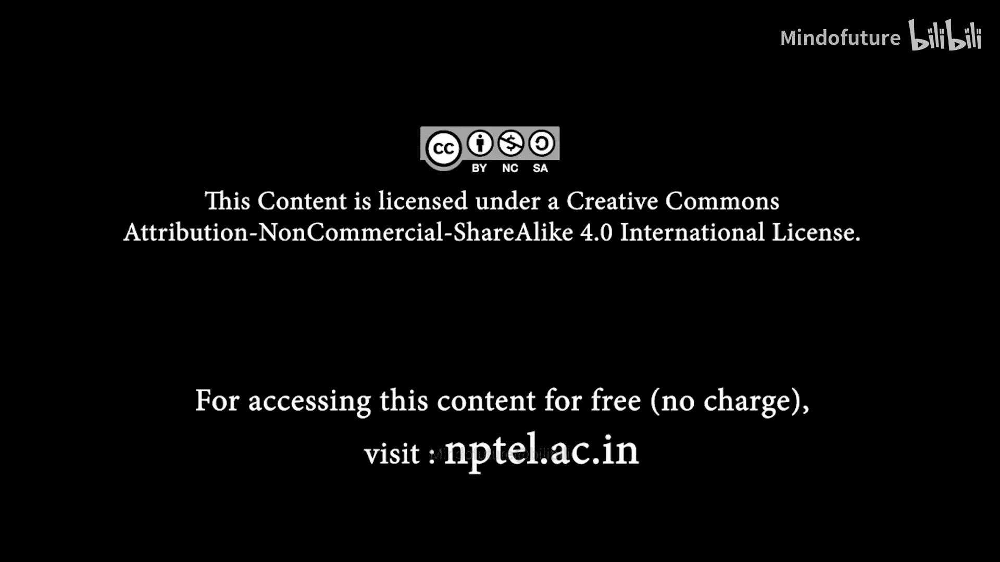
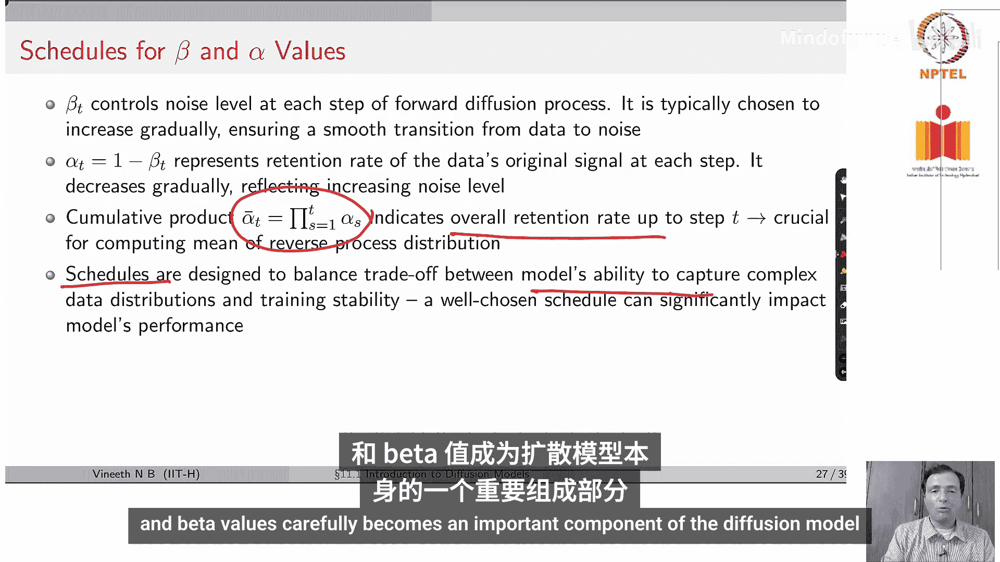

# 119：扩散模型与DDPM介绍 - 第一部分

## 概述
在本节课中，我们将学习一种新的深度生成模型——扩散模型，特别是去噪扩散概率模型。我们将从回顾上周的内容开始，然后深入探讨扩散模型的基本原理、数学基础以及其核心组成部分。

## 课程内容

### 回顾与引言
上一节我们讨论了生成对抗网络和变分自编码器等深度生成模型。本节中，我们将转向另一类深度生成模型，这类模型近年来改变了图像和视频生成的格局，它们就是扩散模型。

在深入讨论扩散模型之前，我们先快速回顾一下上节课留下的关于变分自编码器和解耦表示的问题。问题是：为什么我们使用互信息间隙，而不是互信息本身，作为解耦的度量标准？

原因在于，如果某个生成因子G1与两个潜在变量L1和L2的互信息都很高，这表明L1和L2没有充分解耦，它们都在捕获同一个生成因子。互信息间隙度量了L1与G1的互信息和L2与G1的互信息之间的差异，这有助于惩罚未对齐的潜在变量，从而成为一个良好的解耦度量标准。

### 生成模型概览
生成模型的目标是学习数据的底层分布，以便模型能够生成与原始数据分布相似的新样本。

我们见过生成对抗网络，它包含生成器和判别器之间的竞争过程。我们也见过变分自编码器，它是一种带有编码器和解码器的概率方法，其中间的潜在层具有概率模型，从中采样并由解码器生成新样本。

归一化流是另一类生成模型，本质上是可逆变换，用于建模数据分布。但本周的主题是扩散模型，它通过逆转一个加噪过程来生成数据。

### 扩散模型高层介绍
深度学习中的扩散模型灵感来源于物理扩散过程本身，即粒子因随机运动随时间扩散开来。

扩散模型包含一个前向过程，该过程逐渐向数据添加噪声，最终导致图像看起来就像高斯噪声。你从一个想要复制和生成更多样本的起始图像开始，在多个时间步长上不断添加噪声，直到达到纯高斯噪声。

扩散模型中的反向过程则完全相反，它从噪声开始，尝试去噪，最终得到原始数据，这就是生成的部分。训练模型以准确逆转扩散过程，可以从噪声分布本身恢复原始数据分布，这是扩散模型的核心思想。

去噪扩散概率模型是扩散模型的一种特定类型，它对反向扩散过程使用概率方法。这个反向扩散过程被建模为一序列学习的条件分布。

整个扩散模型由一个马尔可夫前向过程（其中每一步添加少量噪声）和一个学习的反向过程（我们用神经网络参数化，在每一步对数据进行去噪）来表征。

DDPM在图像、视频甚至分子结构的生成方面都显示出令人印象深刻的结果。流行的图像生成工具，如DALL-E和Stable Diffusion，都是扩散模型实现的例子。

### 预备知识
在深入探讨扩散模型或DDPM的工作原理之前，我们需要先了解一些预备知识。

**高斯分布**
高斯分布，也称为正态分布，是一种概率分布，通常以其钟形曲线为特征。其概率密度函数由以下公式给出：
$$
p(x) = \frac{1}{\sqrt{2\pi\sigma^2}} \exp\left(-\frac{(x-\mu)^2}{2\sigma^2}\right)
$$
其中，$\mu$ 是均值，$\sigma^2$ 是方差。这在DDPM的实现中至关重要。

**随机过程**
随机过程可以看作是随时间变化的随机变量。它是一个由时间 $t$ 索引的随机变量集合 $\{X_t\}$，表示概率系统随时间的演化。随机过程的每个实现都是系统可能遵循的一条路径或轨迹。

随机过程的一些关键属性包括：
*   **平稳性**：随着时间的推移，该随机过程在期望中保持相同的分布。
*   **独立性**：任何给定时间发生的事件不依赖于其他任何时间步的结果。
*   **马尔可夫性质**：当前状态仅依赖于前一个状态，而不依赖于更早的历史。

一个简单的理解方式是：如果你从A地随机走到B地，在每一步，你都可以自由地走向任何方向（独立性），而你在任何一步的行动只取决于你到达上一步时的坐标（马尔可夫性质）。

**马尔可夫链**
马尔可夫链是具有马尔可夫性质的随机过程，这意味着未来状态仅取决于当前状态。马尔可夫链通常使用转移矩阵来定义，该矩阵给出了从一个状态转移到另一个状态的概率矩阵。

**维纳过程**
维纳过程是一个连续时间随机过程，具有以下性质：
1.  $W_0 = 0$，过程从0开始。
2.  对于任意两个时间步 $s$ 和 $t$（$0 \le s < t$），$W_t - W_s$ 的差值服从均值为0、标准差为 $\sqrt{t-s}$ 的高斯分布。
3.  增量在非重叠时间区间内是独立的。
4.  过程的路径以概率1连续。

维纳过程是金融、物理和工程中许多应用的基础构建块，例如金融市场的布莱克-斯科尔斯期权定价模型。

**随机微分方程**
随机微分方程通常用于对具有随机行为的系统进行建模，这些系统可能同时受到确定性成分和随机成分的影响。SDE的一般形式是：
$$
dX_t = \mu(X_t, t) dt + \sigma(X_t, t) dW_t
$$
其中：
*   $X_t$ 是时间 $t$ 的状态变量。
*   $\mu(X_t, t)$ 被称为漂移系数，代表确定性趋势。
*   $\sigma(X_t, t)$ 是扩散系数，代表每个时间步的随机波动或噪声。
*   $dW_t$ 是维纳过程的增量。

SDE用于描述通常具有噪声的系统的动态，例如金融市场、物理过程和生物系统。

### DDPM的基础
DDPM基于随机微分方程，用于对具有随机扰动的系统进行建模。

如前所述，扩散模型具有前向扩散过程，该过程在马尔可夫链中向数据添加噪声，这意味着当前步骤的噪声被添加到前一步骤刚刚产生的数据本身。因此，在后续时间步向数据添加噪声会逐渐降低作为前向扩散过程输入的信号或图像的质量。

它还具有反向扩散过程，这是一个可学习的马尔可夫链，用于对数据进行去噪，从而从噪声中重建原始信号。通常使用的训练目标是最大化反向过程仅从噪声生成原始数据的似然。

简单来说，你可以这样看待DDPM：你从一个给定的数据点 $x_0$ 开始，不断添加噪声，经过 $x_1$，一直加到 $x_T$，此时 $x_T$ 就只是高斯噪声。然后在反向过程中，你从高斯噪声中采样一个样本开始，不断向后进行，直到仅从噪声中重建出你的原始样本。

DDPM的成功取决于我们如何设计这个前向扩散过程和反向扩散过程。

### 前向扩散过程
前向扩散过程通常由一系列高斯转移定义。这意味着从给定的数据点 $x_0$（一张图像）开始，你在每个时间步添加高斯噪声。

这可以参数化为一个条件分布 $q(x_t | x_{t-1})$，它是一个正态分布：
$$
q(x_t | x_{t-1}) = \mathcal{N}(x_t; \sqrt{1-\beta_t} x_{t-1}, \beta_t I)
$$
其中 $\beta_t$ 是在给定步骤 $t$ 添加的噪声的方差。

你可能会好奇为什么会有 $\sqrt{1-\beta_t}$ 和 $\beta_t$ 这样的项。这相当直接：经过多个时间步后，我们希望最终得到一个以0为中心、方差为 $I$ 的标准正态分布。为了达到这个目的，我们理想地希望 $\beta_t$ 趋近于1，并且 $x_{t-1}$ 的系数在多个时间步后趋近于0。以这种方式选择系数会自动导致数据成分在后续时间步中减少，而噪声成分增加，直到最终得到高斯噪声本身。

这个条件分布可以共同写成一个联合分布 $q(x_1, x_2, ..., x_T | x_0)$，记作 $q(x_{1:T} | x_0)$，它可以写成各个条件分布 $q(x_t | x_{t-1})$ 的乘积，其中 $t$ 从1到大写的 $T$。这就是我们正式定义前向扩散过程的方式。

在扩散过程中（不限于深度学习），通常由扩散核定义，它给出了你在给定时间步测量的实体与该实体演化中任何其他时间步之间的联系。在这种情况下，扩散核由 $q(x_t | x_0)$ 给出，可以写成一个高斯分布：
$$
q(x_t | x_0) = \mathcal{N}(x_t; \sqrt{\bar{\alpha}_t} x_0, (1-\bar{\alpha}_t)I)
$$
其中：
*   $\alpha_t = 1 - \beta_t$。
*   $\bar{\alpha}_t = \prod_{s=1}^{t} \alpha_s = \prod_{s=1}^{t} (1-\beta_s)$。

$\beta_t$ 可以看作是我们添加到数据中的噪声的度量，而 $\alpha_t$ 可以看作是保留因子，即保留了多少原始图像。当你在顶部看到一条横线时，那就是 $\bar{\alpha}_t$，指的是多个 $\alpha_t$ 的乘积。

我们这样写出 $\alpha$ 的原因如下：你可以写出 $x_t = \sqrt{\alpha_t} x_{t-1} + \sqrt{1-\alpha_t} \epsilon_{t-1}$，其中 $\epsilon_{t-1}$ 是从高斯分布中采样的噪声。如果递归地代入，最终会得到 $x_t = \sqrt{\bar{\alpha}_t} x_0 + \sqrt{1-\bar{\alpha}_t} \epsilon$，其中 $\epsilon$ 是第一个时间步添加的噪声。这是因为合并两个高斯分布时，方差会相加。

这意味着当你从扩散核采样时，你有 $x_t = \sqrt{\bar{\alpha}_t} x_0 + \sqrt{1-\bar{\alpha}_t} \epsilon$，其中 $\epsilon$ 来自标准正态分布。当 $t$ 趋近于 $T$ 时，$\bar{\alpha}_t$ 趋近于0，这意味着 $x_t$ 变成了来自标准正态或高斯分布本身的样本。

现在，让我们看看分布在前向扩散过程中是如何演化的。时间 $t$ 的分布 $q(x_t)$ 可以表示为联合分布 $q(x_0, x_t)$ 在 $x_0$ 上的积分。这个联合分布可以进一步分解为 $q(x_t | x_0) q(x_0)$。这个分解反映了通过 $q(x_0)$ 的输入数据分布和扩散核 $q(x_t | x_0)$ 的组合。

因此，你可以将整个前向过程视为通过扩散核的单个步骤，你可以使用这个扩散核条件概率表达式从原始数据访问你在任何给定时间步的 $x_t$。

### 反向扩散过程
反向扩散过程定义为 $p_\theta(x_{t-1} | x_t)$，它也是一个高斯分布，均值为 $\mu_\theta(x_t, t)$，方差为 $\sigma_\theta^2(x_t, t)$。当我们使用 $\mu_\theta$ 和 $\sigma_\theta$ 时，这暗示了这两者都是由某些权重或系数 $\theta$ 参数化的学习函数。

这意味着这个反向过程通过去噪从 $x_t$ 重建 $x_{t-1}$，在其步骤中使用一些学习到的模型。有了这个设置，你的反向过程的联合分布 $p_\theta(x_{0:T})$ 可以写成 $p(x_T)$（你开始的地方）乘以所有可能条件概率 $p_\theta(x_{t-1} | x_t)$ 的乘积。

在反向过程中，你从噪声开始，在每个时间步不断去噪一点，重复大约50到1000次，最终得到你开始时的数据。这就成为了生成过程。

当我们谈论反向扩散时，我们所说的去噪函数指的是 $\mu_\theta$，它是你反向过程中条件分布的高斯均值。这个 $\mu_\theta$ 由下式给出：
$$
\mu_\theta(x_t, t) = \frac{1}{\sqrt{1-\beta_t}} \left( x_t - \frac{\beta_t}{\sqrt{1-\bar{\alpha}_t}} \epsilon_\theta(x_t, t) \right)
$$
这里 $\epsilon_\theta$ 是反向过程中神经网络的输出。

这个去噪函数旨在从噪声观察中重建原始数据。你可以将反向过程视为：在每一步，你估计在前向过程中该时间步可能添加了什么噪声，然后减去该噪声。通过迭代重复的减法，从噪声开始，最终去噪并走向干净的数据 $x_0$。

因此，准确的噪声预测变得非常关键。这意味着反向过程中神经网络的工作就是预测噪声本身。一旦获得噪声，你只需在每个时间步从数据中减去它，并继续在反向过程中向后进行，直到生成图像。

让我们看看这个去噪函数 $\mu_\theta$ 是如何得出的。从前向扩散过程开始：$x_t = \sqrt{\bar{\alpha}_t} x_0 + \sqrt{1-\bar{\alpha}_t} \epsilon$。重新排列项以用其他变量表示 $x_0$，你会得到 $x_0 = \frac{1}{\sqrt{\bar{\alpha}_t}} (x_t - \sqrt{1-\bar{\alpha}_t} \epsilon)$。

对于反向过程，我们理想地希望从 $x_t$ 预测 $x_{t-1}$。$x_{t-1}$ 的前向过程由 $x_{t-1} = \sqrt{\bar{\alpha}_{t-1}} x_0 + \sqrt{1-\bar{\alpha}_{t-1}} \epsilon'$ 给出。将 $x_0$ 的表达式代入 $x_{t-1}$ 的表达式，经过推导，最终得到去噪函数 $\mu_\theta(x_t, t)$ 的形式，其中 $\epsilon_\theta$ 是神经网络对噪声的估计。

### 训练神经网络
现在，如何训练反向过程中的这个神经网络？在讨论这个问题之前，你可能会问：为什么在DDPM中需要所有这些神经网络？

原因是，从前向过程来看，从 $x_{t-1}$ 到 $x_t$ 由条件分布 $q(x_t | x_{t-1})$ 给出，一旦你有了 $\beta_t$ 或 $\alpha_t$，这部分就是明确定义的。然而，反向过程 $q(x_{t-1} | x_t)$ 对我们来说是未知的。我们无法得到它，所以我们将用 $p_\theta(x_{t-1} | x_t)$ 来表示它，并尝试通过神经网络来近似，从而使用反向过程从噪声中生成样本。

训练整个DDPM的目标显然应该是最大化数据在反向扩散过程下的对数似然。这意味着你理想地希望最大化关于参数 $\theta$ 的期望：$\mathbb{E}_{q(x_{0:T})} [\log p_\theta(x_{0:T})]$。

目标函数应该鼓励模型从噪声中准确重建原始数据，这将是你的对数似然本身。在这种情况下，你的对数似然可以分解为条件对数似然之和。这个目标的负对数似然通常被最小化，你可以使用随机梯度下降来最大化你的对数似然或最小化你的负对数似然。

在反向过程中，它由一个参数为 $\theta$ 的神经网络参数化，该网络也通过随机梯度下降进行优化。神经网络在每个时间步试图预测在前向过程中对应图像在该时间步添加的噪声是什么。一旦神经网络预测出噪声，你就可以从高斯分布的样本中减去该噪声，并通过反向过程继续前进，直到生成你的数据点。

使用的损失函数如下：训练损失是加权平方误差和。平方误差表示你的 $\mu_\theta$（特定时间步的均值）减去应该是数据点或过程本身开始的总体均值。

由于 $\mu_\theta$ 的定义，这个表达式可以简化。因为 $\mu_\theta$ 可以用 $\beta$、$\alpha$ 和 $\epsilon_\theta$ 来表示，而 $\beta$ 是我们在前向和反向过程的每个时间步添加特定噪声时选择的，所以你最终真正训练神经网络的是你的 $\epsilon_\theta$，而不是 $\mu_\theta$ 本身。

因此，训练神经网络的最终损失变成了这样：$L = \mathbb{E}_{t, x_0, \epsilon} [\|\epsilon - \epsilon_\theta(x_t, t)\|^2]$，其中 $\epsilon$ 是在等效前向过程中前向时间步会添加的噪声，$\epsilon_\theta$ 是由参数为 $\theta$ 的神经网络预测的 $\epsilon$。你还会看到权重 $w_t$，它定义了你想在每个时间步如何加权这个特定的误差项。预测每个时间步 $\epsilon$ 的神经网络在扩散过程的每一步都是相同的，所以你可以选择改变这个权重，以决定在任何给定时间步你想如何加权平方误差和。

### 从DDPM中采样
在训练完扩散模型后，当你想生成新样本时，你只需从标准正态分布中采样一个样本 $x_T$。然后你得到 $x_{t-1}$，它由一个正态分布给出，均值为 $\mu_\theta(x_t, t)$，方差为 $\sigma_\theta^2(x_t, t)$，这两者都来自神经网络对 $\epsilon_\theta$ 的预测。参数 $\mu_\theta$ 和 $\sigma_\theta$ 在训练阶段根据我们刚刚讨论过的 $\epsilon$ 学习得到。你代入这些值，得到 $x_{t-1}$ 的表达式，并不断重复这个过程，直到得到你的原始 $x_0$。因此，你迭代地去噪，直到达到 $x_0$。

生成样本的质量取决于你的反向过程学习得如何，即神经网络学习预测噪声以建模数据分布的能力如何。方差调度也可以在采样过程中进行调整，以控制多样性和保真度之间的权衡。如果你有很高的方差，你可能能够从单个噪声样本中生成多样化的样本集，但也可能导致你真正想要捕获的内容的保真度下降。因此，更高的方差可能会增加多样性但降低保真度，必须谨慎选择。

采样过程本质上是随机的，因为由于从高斯分布中采样，在每个时间步都引入了随机性。这可以导致生成各种样本，捕捉到雷达分布的多样性。

### 参数 $\beta$ 和 $\alpha$ 的选择
DDPM和扩散模型的一个重要组成部分是如何选择 $\beta$ 和 $\alpha$ 的值。

$\beta_t$ 控制前向扩散过程每个步骤的噪声水平。它通常被选择为逐渐增加：在开始时你不添加太多噪声，但随着你进入后面的时间步，你采用更高的噪声值。

$\alpha_t$ 如前所述，可以设置为捕获保留率，即 $\beta_t$ 的补数，它通常逐渐减少，反映了噪声水平的增加。

$\alpha$ 的累积乘积表示前向过程中 $x_0$ 和任何随机样本 $x_t$ 之间的总体保留率。这意味着你的 $\beta$ 和 $\alpha$ 值的调度可以捕捉模型捕获复杂数据分布的能力与训练稳定性之间的权衡。因此，仔细选择 $\alpha$ 和 $\beta$ 值成为扩散模型本身的一个重要组成部分。

## 总结
本节课我们一起学习了扩散模型，特别是去噪扩散概率模型的基本原理。我们从生成模型的背景出发，介绍了扩散模型的前向和反向过程，深入探讨了其数学基础，包括高斯分布、随机过程、马尔可夫链、维纳过程和随机微分方程。我们详细解释了前向扩散过程如何通过逐步添加噪声将数据转化为纯高斯噪声，以及反向过程如何通过学习去噪来从噪声生成数据。我们还讨论了训练DDPM的目标函数和采样过程。理解这些基础是掌握现代强大图像生成模型的关键。