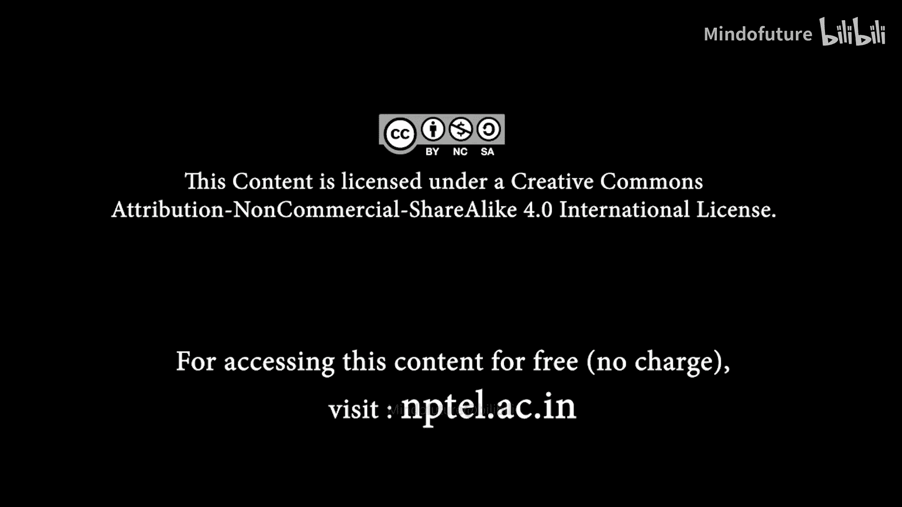
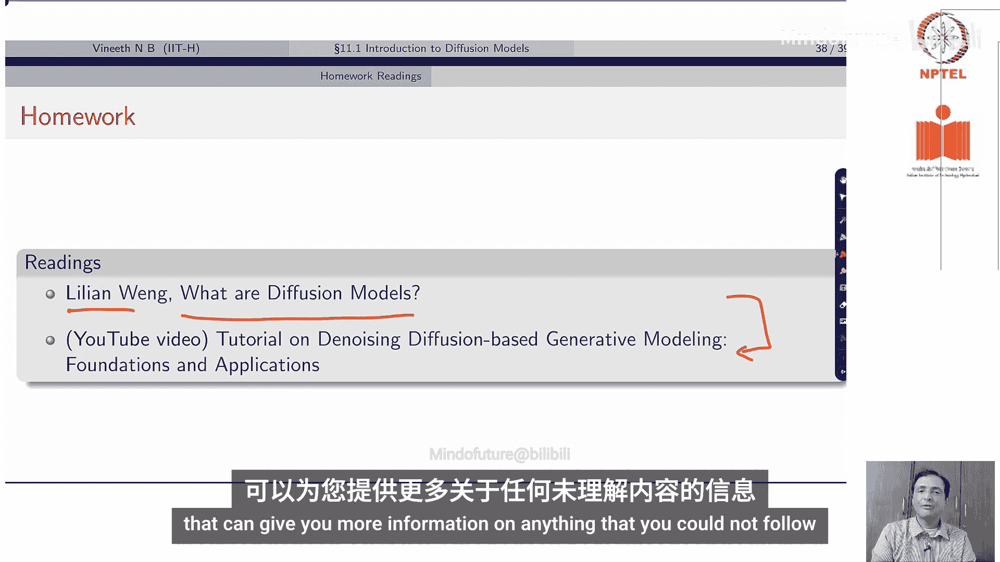

# 120：扩散模型和DDPM介绍 - 第二部分

在本节课中，我们将继续学习扩散模型和去噪扩散概率模型。我们将深入探讨DDPM的概率建模方法、其与变分推断的联系，并介绍另一种生成模型——基于分数的模型。最后，我们将比较不同生成模型的优劣，并讨论DDPM的实际应用与挑战。

## 🧠 DDPM的变分推断视角

上一节我们介绍了DDPM的基本概念。本节中我们来看看DDPM如何通过变分推断来建模反向扩散过程。

DDPM通过变分推断来公式化并实现损失函数。这部分推导与变分自编码器类似。我们的目标是近似后验分布 **p(xₜ | x₀)** 或联合分布 **p(x₁:T | x₀)**。我们用一个易于处理的分布 **q(x₁:T | x₀)** 来近似它。

在这种情况下，变分下界由以下期望给出：
**ELBO = E_q[log p_θ(x₀:T) / q(x₁:T | x₀)]**

这个下界可以分解为数据似然、先验和一个KL散度项。KL散度项通常被用作训练模型的损失函数。

以下是其推导过程：

1.  从证据下界开始：**ELBO = E_q[log p_θ(x₀:T) / q(x₁:T | x₀)]**。
2.  将 **p_θ(x₀:T)** 展开为各条件概率的乘积：**p(x_T) ∏ p_θ(x_{t-1} | x_t)**。
3.  将其代入ELBO项，并利用对数的性质分离各项。
4.  最终可以得到一个包含 **E_q[log p(x_T)]** 和一系列KL散度项的和式。

具体而言，第二项可以写成 **q(x_t | x_{t-1})** 与 **p_θ(x_{t-1} | x_t)** 之间的KL散度。

变分推断的核心思想是：为了最大化某个函数 **f(x)**，我们转而最大化另一个始终小于等于 **f(x)** 的函数 **g(x)**。通过最大化 **g(x)**，**f(x)** 也会在此过程中被最大化。这就是我们在此处使用的关键思想。

我们最终通过最大化负KL散度（或最小化KL散度）来最大化ELBO。直观地说，我们正在尝试匹配前向过程和反向过程。训练扩散模型的目标是让反向过程猜测前向过程中添加的噪声，并从样本中减去该噪声，并迭代进行此操作。这个KL散度试图对齐前向和反向过程。

为了最大化ELBO，我们最小化KL散度项，这有助于实现这种对齐。这种学习通常使用随机梯度下降法进行，SGD是处理KL散度的常用方法。

## 🔗 与基于分数的模型的联系

理解扩散模型或DDPM的另一种方式是通过基于分数的模型这一替代生成方法。

基于分数的模型在过去被用于学习一个分数函数。该函数是数据分布对数密度的梯度。例如，分数 **s(x)** 可以写为：
**s(x) = ∇_x log p(x)**

这个分数函数告诉我们距离原始数据分布有多近。它捕获了数据密度最陡上升的方向和幅度。这些基于分数的模型被用于训练生成模型，它们给出一个由神经网络参数化的分数函数，记为 **s_θ(x)**。

基于分数的模型很有用，因为它允许我们捕获复杂的数据分布，而无需显式建模数据是如何生成的密度函数。你只需检查生成的数据是否保持特定的分数，这有助于你理解模型生成的数据是否与原始分布相似。

另一个例子是生成对抗网络。GAN并不显式建模原始数据的概率密度函数。你只需生成数据并检查它们是否足够好以匹配原始数据。虽然GAN不是分数函数，但你可以以类似的精神来考虑基于分数的生成模型，它们也不显式建模原始分布的密度。

基于分数的模型通常通过最小化神经网络估计的分数与真实分数之间的差异来训练。使用的损失函数通常基于这两个分数函数之间的费舍尔散度。在实践中，真实分数是未知的，因此用一些扰动样本来替代，这些样本用于估计或学习分数函数 **s_θ(x)**。这种使用损失函数的训练策略最终利用了分数函数通过其对数密度的梯度来表征数据分布的能力。

## 🤝 DDPM与基于分数的模型的关系

那么，这与DDPM有何联系？DDPM和基于分数的模型都试图通过扩散过程对数据进行去噪。

在DDPM中，我们在前几页看到的每个扩散步骤的去噪函数 **μ_θ**，可以被解释为该时间步下噪声分布的扰动数据分布的分数函数。可以说，反向过程中每个时间步的 **μ_θ** 都在试图给出一个分数，以衡量你在该特定时间步捕获等效前向过程分布的程度。

这种联系表明，训练DDPM也可以被视为在每个时间步学习一个隐式的分数函数，该函数指导反向扩散过程。因此，DDPM和基于分数模型之间的这种联系常被用来强调分数函数在捕获数据分布底层结构从而生成新样本方面的重要性。

在基于分数的模型中，你最终需要积分一个由学习到的分数函数驱动的随机微分方程：
**dx = s_θ(x) dt + √2 dw**
其中 **w** 是维纳过程。

这个SDE是一个连续时间的扩散过程，它逐渐将噪声转化为来自目标分布的样本。人们可以将我们的DDPM视为此类SDE或基于分数模型的离散时间对应物。

重申一下，这种基于分数模型的方法可以被视为一个连续时间的扩散过程。而在DDPM中，我们有一个离散时间的对应物，我们在离散的时间步上观察噪声分布在反向过程中如何演化。与基于分数的模型非常相似，无论是基于分数的模型还是DDPM，其有效性都取决于学习到的分数函数在捕获数据分布方面的准确性。

## 🚀 DDPM的应用与挑战

DDPM在过去几年中已成功应用于各个领域。例如图像生成，你可能见过DALL-E 2或Stable Diffusion等流行示例，扩散模型已显示出生成非常高质量样本的能力。DDPM也被用于通过训练适当的数据来合成音频甚至分子结构。

那么，扩散模型是深度生成模型的最佳解决方案吗？并非如此，它们确实存在局限性。你能想到DDPM可能有哪些局限性吗？

以下是几个挑战：

1.  **训练和采样的计算成本**：反向过程必须经过多个时间步骤才能生成最终的输出图像。这本质上是一个缓慢的过程，并且计算量可能很大。
2.  **对噪声调度敏感**：正如我们之前提到的，噪声调度 **β_t**、**α_t** 的选择会显著影响模型性能。这意味着模型对这些值的选择非常敏感，这是另一个局限性。
3.  **模式崩溃**：有时，在高维空间中确保生成样本的多样性并避免模式崩溃也可能很困难。

什么是模式崩溃？回想一下我们在GAN中讨论的内容，如果你有一个具有多个模式的原始数据分布，理想情况下，你希望你的扩散模型或任何其他生成模型能够生成来自任何这些模式的样本。然而，一些生成模型存在崩溃到特定模式的局限性，只生成与该特定模式对应的一般图像或数据样本，这是一个局限性。

## ⚖️ 生成模型对比

一般来说，如果我们要将DDPM/扩散模型与其他生成模型进行比较，可以从三个因素来评估：

1.  **采样速度**：生成速度要快。
2.  **模式覆盖**：确保收敛并代表不同的模式。
3.  **生成质量**：生成样本质量要高。

你能想到GAN、VAE和扩散模型在这三个方面的表现如何吗？分析这一点很有趣。

*   **GAN**：生成高质量样本，但受模式崩溃困扰。
*   **VAE**：由于其概率性质，提供更好的模式覆盖，但不能提供高质量的生成样本。
*   **DDPM**：提供高质量样本和良好的模式覆盖，但其去噪过程本质上很慢。

因此，可以说DDPM和扩散过程具有高质量样本和良好的模式覆盖。GAN具有高质量样本和快速采样。变分自编码器具有快速采样和模式覆盖，但没有高质量样本。因此，它们各自都有其局限性作为权衡的一部分。

## 💡 训练扩散模型的实用考虑

总结一下训练扩散模型时的实际考虑因素：

*   需要仔细调整超参数，尤其是噪声调度和学习率。
*   用于预测每一步噪声的神经网络架构选择也至关重要。更大的模型通常能带来更好的性能，但也会导致更大的内存占用和计算开销。
*   从DDPM中采样本质上可能是计算密集型的，因为你必须从噪声中采样，并在多次迭代中不断去噪，才能得到原始数据分布的样本。这可能很耗时。可以使用子采样或从粗到细的采样等技术来加速此过程。
*   最终，DDPM的实现应受益于并行化和硬件加速，以改善其计算效率。

## 📚 推荐阅读

本节课推荐的作业是Lillian Weng关于扩散模型的博客，以及YouTube上一个关于CPR的教程讲座，它可以为你提供更多关于任何你可能没有理解的内容的信息。

本节课中，我们一起学习了DDPM的变分推断推导，理解了其与基于分数的生成模型的深刻联系，并比较了DDPM与其他主流生成模型（如GAN和VAE）在采样速度、模式覆盖和生成质量等方面的优劣。我们还探讨了DDPM的实际应用、面临的挑战以及训练时的注意事项。