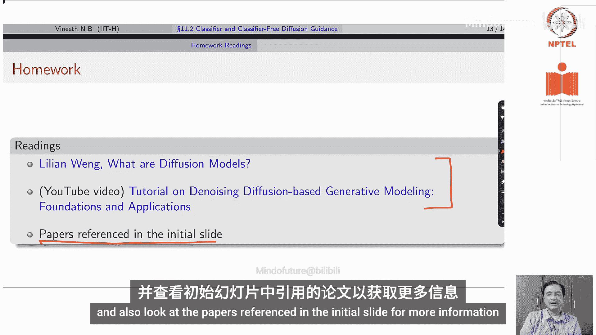

# 121：分类器与无分类器扩散指导

## 概述

在本节课中，我们将学习如何控制扩散模型，使其生成特定类别的图像。我们将探讨两种主要方法：**分类器指导**和**无分类器指导**。这两种技术允许我们引导原本随机的生成过程，朝着我们期望的类别方向进行。

---

## 从无条件生成到条件生成

上一节我们介绍了标准的扩散模型，它们专注于**无条件生成**。这意味着模型从噪声开始，逐步生成一张来自原始数据分布的图像。这种方法适合生成多样化的图像，但无法保证输出属于某个特定类别，因为扩散过程本身具有固有的随机性。

因此，我们提出的问题是：能否引导生成过程朝向一个特定的类别？这正是本课要解决的问题。

---

## 分类器指导生成

为了引导生成，一种在2021年提出的方法称为**分类器指导生成**。其核心思想是：在反向去噪过程中，利用一个分类器的梯度信息来扰动轨迹，使其偏向某个特定类别。

以下是实现步骤：

1.  **训练一个噪声图像分类器**：首先，你需要训练一个能够对带噪图像进行分类的模型。输入是图像及其多个加噪版本，目标是预测图像的类别标签。
2.  **在采样时使用分类器**：假设你的DDPM模型已经训练好。在采样生成时，你从一个噪声样本开始，逐步预测并移除前向过程中添加的噪声。关键的一步是，在每一步，你利用**冻结的**分类器输出的梯度来调整预测的噪声。

具体来说，分类器输出的是条件概率的对数 `log p(y | x_t)`。我们计算这个量对输入 `x_t` 的梯度，并乘以一个常数 `γ`（称为**指导尺度**）。这个梯度项被用来调整神经网络预测的噪声，使其更符合目标类别。

### 核心公式推导

在反向扩散过程中，我们原本学习的是 `p_θ(x_{t-1} | x_t)`。现在，我们希望学习的是 `p_θ(x_{t-1} | x_t, y)`。

根据贝叶斯定理和对数运算，我们可以得到用于指导的梯度更新公式：

**新噪声 = 旧噪声 - γ * σ_t * ∇_{x_t} log p_φ(y | x_t)**

其中：
*   **旧噪声**：标准DDPM模型预测的噪声 `ε_θ(x_t, t)`。
*   **γ**：指导尺度，控制类别引导的强度。
*   **σ_t**：与时间步 `t` 相关的噪声标准差。
*   **∇_{x_t} log p_φ(y | x_t)**：分类器 `φ` 输出的条件概率对带噪图像 `x_t` 的梯度。

### 指导尺度 `γ` 的作用

从概率角度理解，`γ` 的作用类似于对条件分布 `p(y | x_t)` 进行**温度调节**。当 `γ > 1` 时，我们放大了条件信号，使得生成过程更倾向于选择最可能的类别，从而将概率质量从不太可能的类别转移到目标类别。

### 算法流程

以下是结合了分类器指导的DDPM采样过程：

1.  从标准正态分布采样初始噪声 `x_T`。
2.  对于 `t = T, ..., 1`：
    *   使用DDPM网络预测噪声：`ε_θ(x_t, t)`。
    *   计算分类器梯度：`g = ∇_{x_t} log p_φ(y | x_t)`。
    *   计算指导后的噪声：`ε̂ = ε_θ(x_t, t) - γ * σ_t * g`。
    *   使用 `ε̂` 按照DDPM的更新规则计算 `x_{t-1}`。
3.  得到最终生成图像 `x_0`。

### 效果示例

研究表明，这种方法能显著提升目标类别的生成质量。例如，在生成“彭布罗克威尔士柯基犬”类别的图像时，设置 `γ=10`（强引导）比 `γ=1`（弱引导）能产生更多、更清晰的该类图像。

---

## 分类器指导的局限性

尽管分类器指导方法有效，但它存在一些局限性：

*   **需要额外的分类器**：必须单独训练一个能够处理**不同噪声水平图像**的分类器网络，这增加了训练成本和复杂度。
*   **梯度可能不完美**：分类器产生的梯度信号可能不准确，尤其是在高噪声水平下，这可能导致生成过程偏离正确方向。
*   **推理依赖分类器**：在生成（推理）阶段仍然需要运行分类器来计算梯度，增加了计算开销。

---

## 无分类器指导生成

为了克服上述限制，2021年提出了**无分类器指导生成**。其核心思想是：**让扩散模型自身具备指导能力**，从而无需外部分类器。

### 实现原理

该方法通过训练一个**条件扩散模型**来实现，并在训练中引入**条件丢弃**。

1.  **训练阶段**：
    *   大部分时间，模型以类别标签 `y` 为条件进行训练（即学习 `ε_θ(x_t, t, y)`）。
    *   以一定概率（例如10%），随机将条件信息 `y` 替换为一个特殊的“空”标签（如 `∅`），此时模型学习的是无条件生成 `ε_θ(x_t, t, ∅)`。
    *   这样，**一个单一的神经网络**同时学会了条件生成和无条件生成。

2.  **推导与公式**：
    根据贝叶斯规则，可以推导出条件噪声预测与无条件噪声预测之间的关系。最终，用于指导的噪声更新公式变为：

    **ε̂ = ε_θ(x_t, t, ∅) + γ * (ε_θ(x_t, t, y) - ε_θ(x_t, t, ∅))**

    或者等价地：

    **ε̂ = ε_θ(x_t, t, y) + (γ - 1) * (ε_θ(x_t, t, y) - ε_θ(x_t, t, ∅))**

    其中：
    *   `ε_θ(x_t, t, y)`：以类别 `y` 为条件预测的噪声。
    *   `ε_θ(x_t, t, ∅)`：无条件（“空”条件）预测的噪声。
    *   `γ`：指导尺度。当 `γ=1` 时，退化为普通条件生成；`γ>1` 时，增强类别特性。

### 算法优势

无分类器指导具有明显优势：

*   **无需外部分类器**：指导信号来自生成模型自身，消除了训练和运行额外分类器的需求。
*   **梯度更鲁棒**：扩散模型本身在训练时已经接触了各种噪声水平的图像，因此其提供的梯度可能比专门分类器更稳定。
*   **实现简单**：仅需在训练时引入简单的条件丢弃，即可用一个模型实现两种功能。
*   **效果更好**：实验表明，即使 `γ=1`，无分类器指导也能生成符合目标类别的图像，而分类器指导在 `γ=1` 时效果不佳。

---

## 总结

本节课我们一起学习了控制扩散模型生成特定类别图像的两种指导技术。

*   **分类器指导**：利用一个预先训练的噪声图像分类器的梯度，在采样过程中扰动噪声预测，引导生成方向。其核心公式为 `ε̂ = ε_θ(x_t, t) - γ * σ_t * ∇ log p_φ(y | x_t)`。
*   **无分类器指导**：通过条件丢弃技术训练一个同时掌握条件生成和无条件生成的扩散模型，在采样时通过组合两者的输出来实现引导。其核心公式为 `ε̂ = ε_θ(x_t, t, ∅) + γ * (ε_θ(x_t, t, y) - ε_θ(x_t, t, ∅))`。

无分类器指导因其无需额外模型、实现简单且效果出色，已成为当前更主流和实用的方法。这两种技术为我们提供了强大的工具，使扩散模型从纯粹的无条件生成器，变成了可控的图像合成系统。