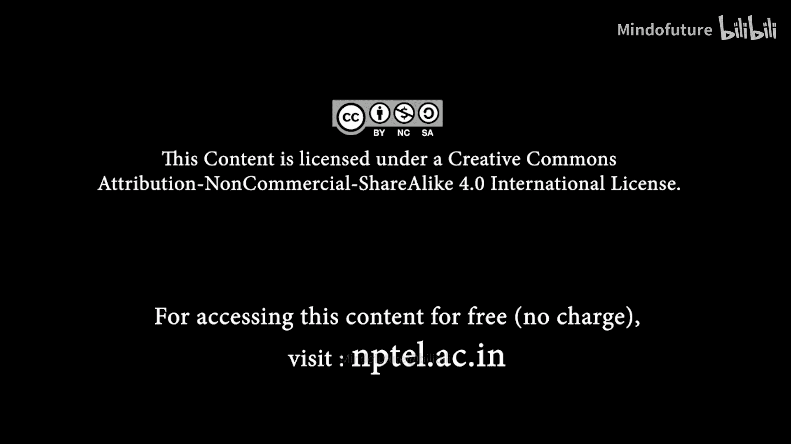
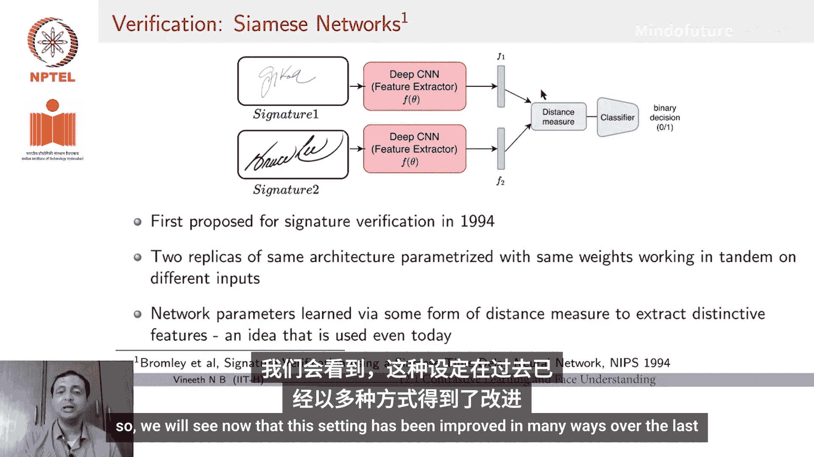

# 122：对比学习和面部理解历史 - 第一部分

在本节课中，我们将学习人脸识别这一计算机视觉核心任务的发展历史，特别是深度学习时代之前的算法演进和基础概念。我们将了解人脸识别的基本流程、关键挑战以及两种主要的应用任务：验证与识别。

人脸识别作为生物识别技术的一部分，几十年来一直是极其重要的计算机视觉任务。它在安全、金融、医疗保健以及社会和金融的各个方面都有应用。

无约束人脸识别，即在自然场景中识别人脸，是一个非常具有挑战性的问题。这是因为存在光照变化、遮挡、姿态或对齐差异、表情变化等诸多因素。

人脸识别并非新话题，由于其重要性，它已经存在了几十年。从算法角度看，最早的人脸识别研究始于20世纪60年代Woodrow Bledsoe的工作。随后在70年代出现了Takeo Kanade的方法。90年代出现了早期人脸识别中最流行的算法之一——特征脸，它以略有不同的方式重新利用了主成分分析来进行人脸识别。之后出现了各种使用局部特征分析进行人脸识别的方法，以及弹性束图匹配。当然，还有Viola-Jones的人脸检测器，它是人脸识别系统的重要组成部分。我们之前讨论过的局部二值模式等手工特征被广泛用于人脸分析任务。在21世纪第一个十年的末期，出现了用于人脸分析任务的稀疏特征表示。当然，自2014年起，基于深度神经网络的人脸识别方法开始兴起，这也将是本讲座的重点。

从硬件角度看，相机始于1915年，数码相机在90年代出现。随后，人脸识别转向了监控摄像头、智能手机摄像头。在21世纪第一个十年的末期，出现了基于Kinect的设备（如Xbox上的微软Kinect）和Google Glass这类设备。2011年，三星Galaxy在智能手机上实现了面部解锁功能。之后出现了RGBD相机，以及最近能够进行人脸识别的随身相机。所有这些发展都在一篇名为《50年生物识别研究：成就、挑战与机遇》的近期文章中得到了很好的记录。如果有时间，建议阅读。

当深度学习被用于人脸识别时，一个标准的流程如下图所示。首先从输入图像开始。第一步是进行人脸检测，因为需要从图像中分离出人脸。人脸检测完成后，在将裁剪后的人脸用于识别任务之前，需要进行一些预处理。第一个任务是将人脸对齐到一组预定义的几何标准上。第二个任务是可选的，取决于具体应用，即检查图像是欺骗性的（如照片）还是真实的活体。如果检查结果是欺骗性的，则流程在此结束；如果不是，则进入下一阶段。下一阶段可以看作是面部处理，有两种类型：一对多和一对一，具体取决于应用需求。当然，预处理任务也是可选的，取决于特定应用是否需要。在所有处理步骤之后获得训练数据，将其提供给卷积神经网络进行特征提取。最后，使用不同类型的损失函数（如欧几里得距离或角度距离等）来训练CNN。在测试时，测试图像经过类似的处理流程。处理后的测试数据被提取特征，最后通过各种方法（如与阈值匹配、进行最近邻匹配，或如我们将看到的进行度量学习或稀疏表示）来匹配该人脸的最终嵌入表示。我们将在接下来的几张幻灯片中看到其中一些方法。

广义上说，要在自然场景中部署人脸识别系统，它是检测、对齐和匹配的结合。正如我们将看到的，匹配也有多种类型。谈到人脸，关键组成部分包括面部处理（可以进行一对多的数据增强或一对一的归一化）、通过网络架构进行的深度特征提取及相应的损失函数，以及最后使用各种不同方法匹配这些嵌入、特征或表示。

我们刚才提到的预处理步骤是什么？可以执行一对多的数据增强，这是我们之前讨论过的标准数据增强。通过以不同方式改变人脸图像，可以生成许多图像块或图像。例如，通过以不同方式旋转人脸图像，可以在一定程度上模拟人的不同姿态。这种增强可以帮助人脸识别系统更加鲁棒。另一方面，也可能希望通过将多张人脸图像归一化到一个标准模型上来获得一个人的单一规范视图。例如，你可能有一个人的所有这些不同图像，从光照角度看有变化，从姿态角度看也有变化。如何获得这些图像？这些可能是在不同时间点获得的，或者是在单个视频序列中作为帧获得的（比如一个人说话时头部在移动，你捕获了所有这些帧），然后将所有这些帧归一化为一个单一的正面视图，用于进一步处理。这个领域的许多工作（本课程可能无法深入探讨）也涉及使用3D模型进行人脸识别的思想。这种归一化方法有助于在姿态、光照、表情和背景变化的情况下保持身份不变性，因为一旦对这些因素进行了归一化，你就可能得到一个CNN在执行识别任务时表现更好的规范图像。

那么，多年来用于人脸识别的网络架构有哪些？在本讲座中，我们将重点关注深度学习时代的人脸识别。在过去几年中，每个阶段用于人脸识别的架构都反映了当时CNN的发展。如果你看下面的时间线，2012年是AlexNet。因此，DeepFace（这是使用新一代CNN进行人脸识别的首批全面努力之一）使用AlexNet作为其主要骨干架构。随后是2015年的FaceNet，它使用了GoogleNet。2015年的VGG Face使用了VGGNet。2017年一个名为SphereFace的网络使用了ResNet。2017年一个名为VGGFace2的网络使用了Squeeze-and-Excitation Net。更全面的列表可以在这里看到，这张表格来自一篇名为《深度人脸识别：综述》的论文。你可以看到，所有这些不同方法的主干架构主要是过去几年中成功的流行架构。虽然有一些偏差，研究人员对架构进行了轻微修改，但在很大程度上，近年来人脸识别架构的主干一直是AlexNet、VGG、ResNet等等。

整个人脸识别领域从应用角度可以大致分为两种所需的任务：验证和识别。在这两种情况下，通常是架构的最后阶段发生变化。你有一张图像，进行检测和对齐，得到一个裁剪良好且对齐的图像。然后使用一个深度CNN特征提取网络，获得特征表示，然后将其传递给验证系统或识别系统。

什么是人脸识别？人脸识别是将给定的输入图像分配给数据库中的人名或身份的任务。这是一对多的匹配，因此你有一张给定的图像，必须将此图像与数据库中的多个身份进行匹配以找到最接近的匹配。所以这个任务与我们迄今为止一直在讨论的分类任务（如ImageNet）非常相似，即给定一张图像，与一千个不同的类别进行匹配，找出应该分配给该图像的类别。这通常被表述为一个K+1多类分类问题，其中如果人脸来自数据库外部，则有一个额外的类别。所以输入是人脸图像，输出是身份类别或人脸ID。在这种情况下使用的损失函数是什么？是我们一直使用的标准softmax和交叉熵损失。因此，你有一个最后的线性层，其参数是主体的表示，交叉熵可以由这个公式给出，其中这里的x是倒数第二层的表示，在其之上有一些权重，这些权重在最后一层给出最终输出，然后应用softmax激活函数和交叉熵损失。这里提醒一下，这些值也被称为逻辑值。在应用softmax激活函数之前，神经网络的输出集也被称为神经网络的逻辑值。通常，当你使用softmax和交叉熵损失时，在应用softmax之前获得的嵌入看起来像椭圆，其中类间方差很大，因为这不是交叉熵损失的重点，但你有良好的类内方差，可以使用此损失分离这些类别。

现在来看验证任务。验证任务是验证两张图像是否属于同一身份。这是一个一对一的匹配任务。给定一张输入图像和一个人声称拥有的身份，此任务必须确定输入图像是否属于该身份。你可以想象这个场景在移民环境中，一个人向移民官员出示护照，官员查看你的脸以检查脸部是否与护照上的图像和身份匹配。这是一对一的匹配。移民官员不是将你的图像与身份数据库进行比较，而只是验证你是否是你声称的那个人。所以，在这种情况下，你的输入是一张人脸图像和人脸ID，这与识别设置不同。输出是一个二元分类问题，状态是匹配或不匹配。从图示上讲，你有一张图像。你有一个卷积神经网络，得到一个特征表示。你有一个面部数据库，根据该人声称的身份从中挑选出一个身份，然后使用一个相似性度量来检查这两个图像之间的相似性，并做出匹配或不匹配的二元决策。

也可以将识别作为验证任务来执行。这是如何完成的？现在你可以取一张测试图像。通过卷积神经网络获取特征表示，然后对于数据库中的每个身份，检查是否匹配或不匹配。这将使识别任务成为一个验证任务。为什么要讨论这个，为什么这有用？这消除了在向数据库添加新人脸类别时需要重新训练模型的需求。因此，如果你的数据库中有一千人并且已经训练了CNN，如果添加了一个新人，你必须重新训练你的CNN，因为最后一层的神经元数量现在会增加一个。然而，如果我们将其视为验证问题，我们只需要神经网络的表示，并且可以使用其他相似性度量来完成与每个新身份的匹配，这使得这种方法具有可扩展性。然而，识别可能涉及多个验证步骤，这意味着如果管道中的任何地方存在错误，现在可能会被放大，因为你现在要经过多个验证步骤进行比较。在这种情况下，目标是开发一个非常准确和高效的验证系统，以便它也可以有效地用于识别。

最早的验证努力之一是1994年的孪生网络。这最初是为签名验证任务提出的。因此，某家银行在其记录中有一个人的签名，如果一个人在特定日期访问银行并再次签名，银行必须检查签名是否与记录上的签名匹配，这个任务就是签名验证。因此，孪生网络（顾名思义，它来自连体双胞胎）中提出的架构是让相同的CNN架构复制两次，其中当前给定的签名通过相同的CNN，记录上的签名也通过相同的CNN。你得到两个不同的表示F1和F2。必须有一个距离度量来检查这两个表示有多接近，然后将其传递给二元分类器以给出匹配或不匹配的决策。因此，这种方法的一个重要启示是：必须以尊重用于比较这两个特征的距离度量的方式来学习表示。我们现在将看到，这种设置在过去的几年里已经在许多方面得到了改进。

本节课中，我们一起学习了人脸识别的基本概念、发展历史以及核心任务（验证与识别）的定义和区别。我们了解了从早期算法到深度学习方法的演进，以及标准人脸识别流程中的关键步骤，如检测、对齐、预处理和匹配。我们还探讨了将识别任务转化为验证任务的思路及其优势。下一节，我们将深入探讨用于人脸识别的具体深度学习架构和损失函数。