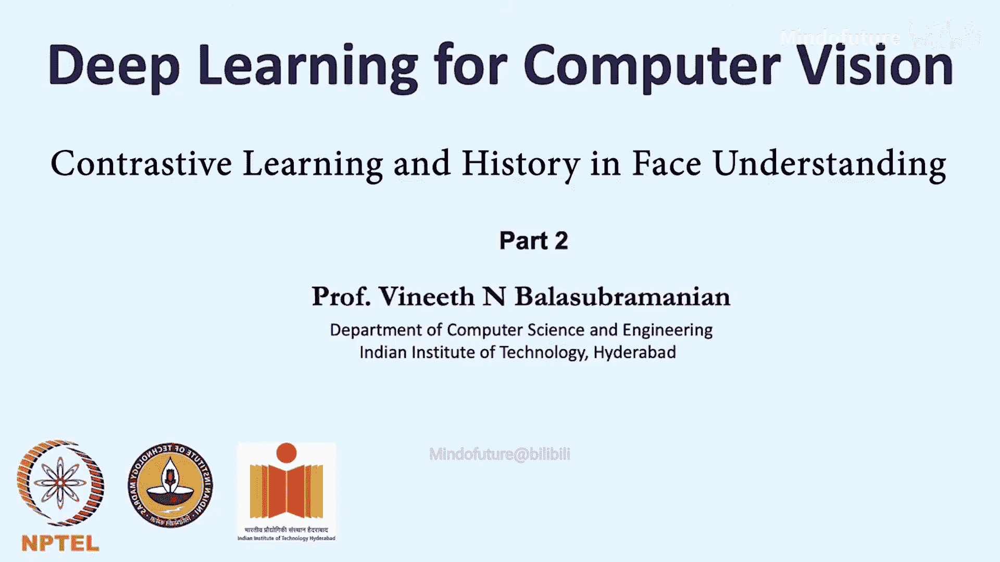
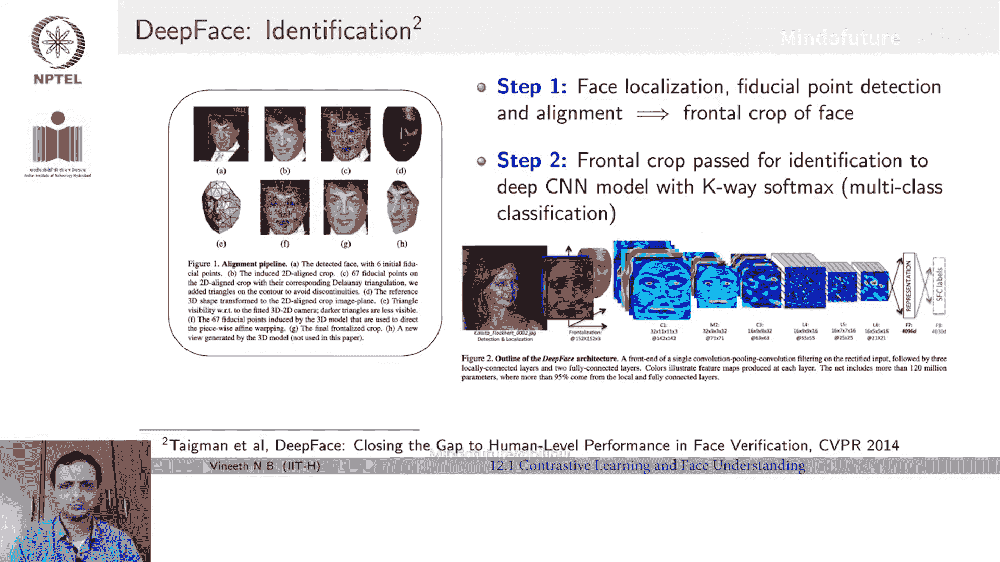
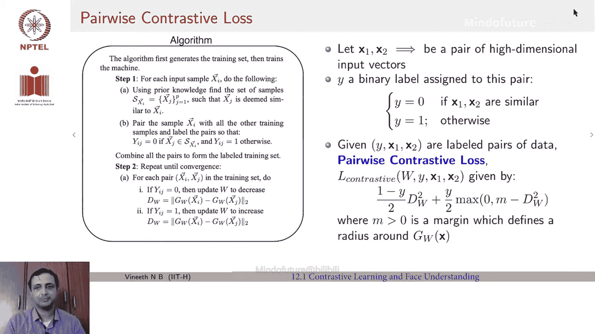
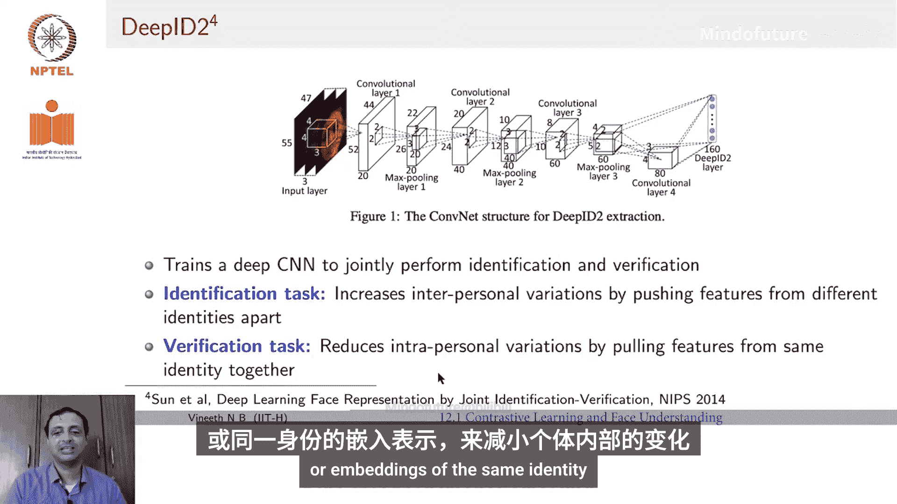
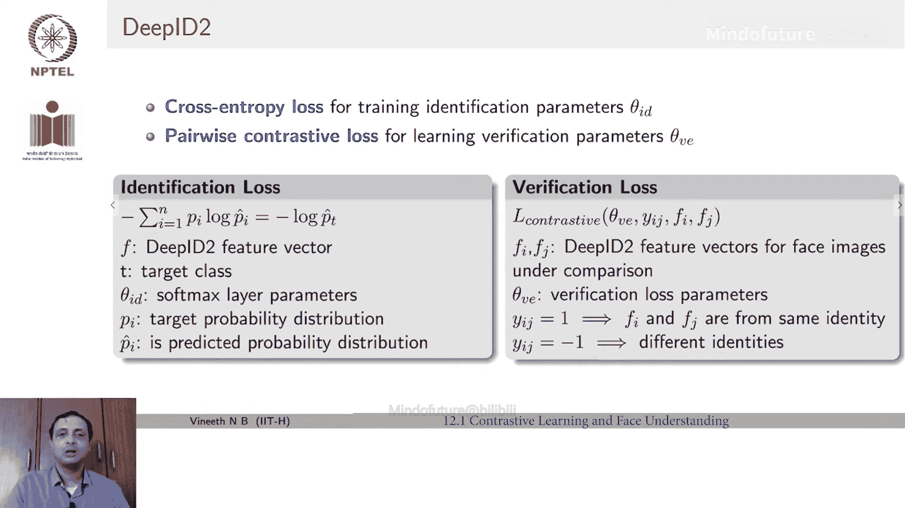
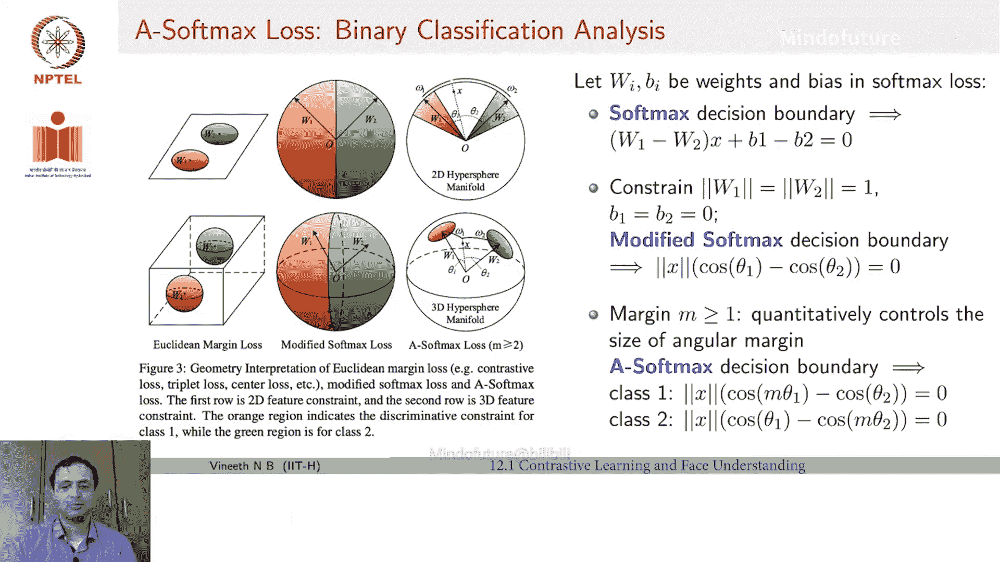
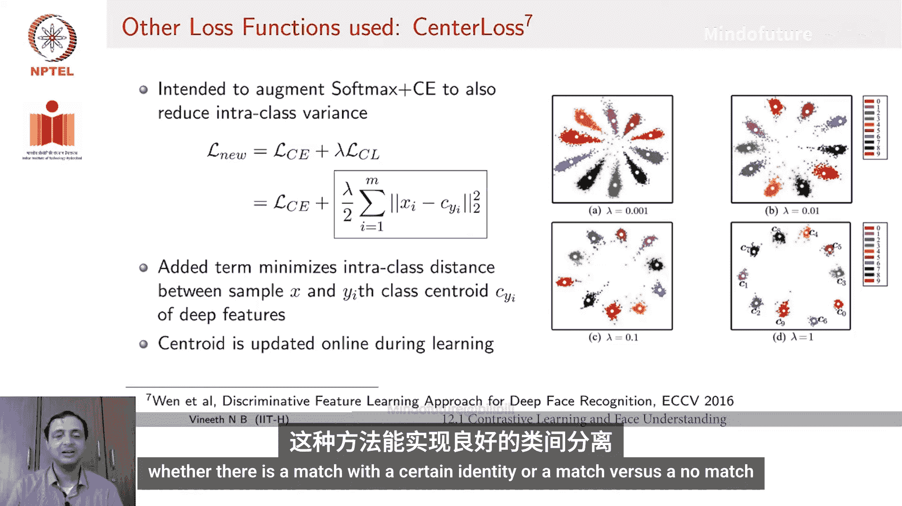
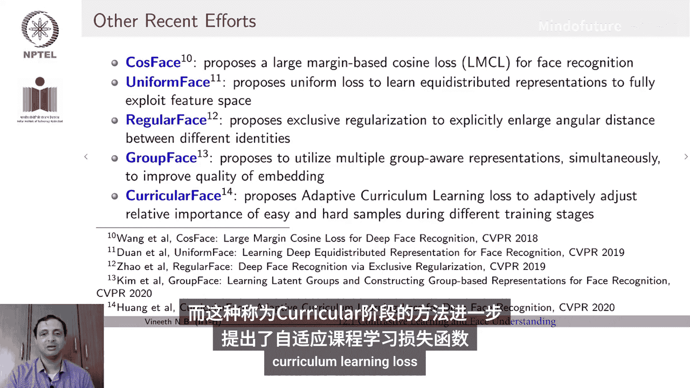
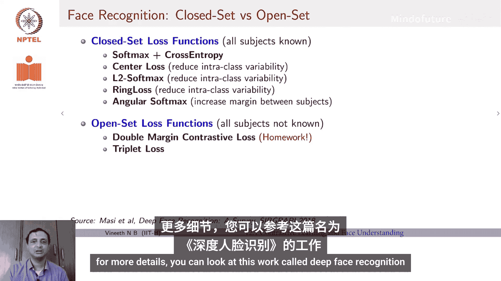
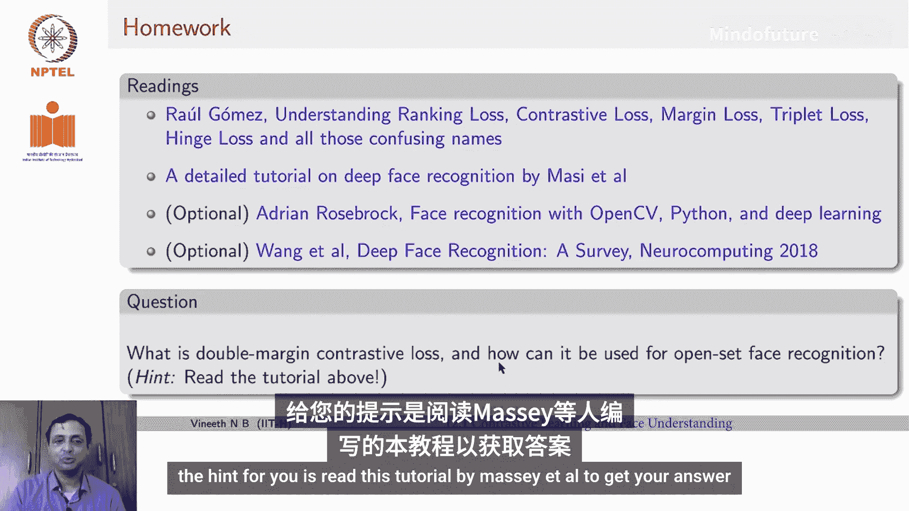

# 123：对比学习与人脸理解历史 - 第二部分

## 概述
在本节课中，我们将学习人脸识别领域在深度学习时代早期的一些关键方法，特别是围绕**对比学习**和**度量学习**思想发展出的各种损失函数。我们将从DeepFace开始，逐步了解如何通过设计特定的损失函数来学习更具判别性的人脸特征表示。

## DeepFace：早期的人脸识别系统

在AlexNet取得成功后，近年来最早的努力之一是2014年CVPR上发表的DeepFace。

DeepFace首先执行了一个预处理步骤，包括人脸定位、关键点检测和对齐，以获得人脸的正面裁剪图像。左侧的图像展示了获得正面裁剪所涉及的步骤。

给定输入图像，第一步是检测人脸并从图像中裁剪出人脸区域。

然后在2D裁剪图上检测大约67个面部关键点，并对它们进行三角剖分。

这67个关键点是面部不同的标记点，例如鼻尖、眼角、嘴角等。已有方法可以完成此任务。

完成此步骤后，这些点被投射到一个3D模型上，该特定的人脸图像被投影到这个3D模型上。

然后，该3D模型被归一化为一个带有对应关键点的2D人脸图像，最终转换为图像的正面裁剪。

最后，由于我们现在有了同一个人脸的3D模型，我们还可以生成同一个人的其他姿态图像。

因此，我们在步骤1中讨论的正面裁剪就是图像G。与图像B相比，可以看到图像G的归一化效果相当好。

这个正面裁剪被传递给深度CNN模型，即深度CNN架构，使用标准的softmax和交叉熵损失，通过K路softmax来区分K个不同的类别。

## DeepFace的验证部分

对于验证部分，DeepFace使用了一种类似孪生网络的方法。

从识别任务中学到的表示被冻结用于验证，因此这些架构参数是固定的。

给定一张人脸图像I和记录中该人声称对应的图像，我们得到两个表示F1和F2，即G(I1)和G(I2)。

然后训练网络的其余部分，方法是取F1和F2之间的绝对差值，接着是一个全连接层，最后通过sigmoid激活函数得到最终的二元决策。

因此，在这种特定场景中引入的距离是 `|F1 - F2| * α`，其中α是在该特定层中学到的权重。

最终输出是匹配或不匹配，即相同或不同。

DeepFace提出的这种方法，源自90年代的孪生网络思想，后来在多个方面得到了扩展。其中一个主要思想是使用所谓的**对比损失**。

## 对比损失与度量学习

对比损失是一种基于机器学习中度量学习范式来训练神经网络的损失函数。

机器学习中的度量学习方法试图学习一个距离度量，而不是使用欧几里得距离度量或余弦距离度量。

因此，同样的思想现在被用来为你想使用这些表示的任务学习具有区分性的特征表示。

在人脸验证场景中，我们的目标是将输入映射到一个嵌入空间，其中点之间的距离对应于语义相似性。

欧几里得距离可以做到这一点，但如果我们能学习一个更有效地做到这一点的距离，那将更有用，这也是大多数这些方法试图做的。已有各种公式，如成对对比损失、排序损失、三元组损失等。我们将在本讲座的剩余部分看到其中一些。

成对对比损失来自Hadsell等人2006年的一项工作，其中引入了一种学习对复杂变换不变的映射的方法。

正如我们刚才所说，其思想是让相似的点在嵌入流形上彼此靠近，因此你从CNN输出得到的这种表示也被称为**嵌入**。

如果我们现在假设这些是低维嵌入，通常这些嵌入的维度低于图像本身。图像可能是200x200，而嵌入可能只是一个1000维或4000维的向量。

我们理想地希望，对于相似的实体，这些位于例如1000维或4000维流形上的嵌入彼此相似；对于不相似的实体，则彼此远离。

因此，我们的目标是以这样的方式学习神经网络权重W：给定输入x1和x2，距离 `Gw(x1) - Gw(x2)` 近似于输入的语义相似性。让我们看看这是如何完成的。

以下是该算法的总体思想：

给定训练数据，首先识别彼此相似的样本集，并将它们放入一个集合中，例如给定输入X的S(X)。我们识别与Xi相似的样本Xj。

在人脸验证上下文中，这可能是同一个人的其他照片。

我们还设定Yij，给定Xi和Xj，如果这些点相似，则Yij为0；同样地，识别不相似的点，这可能是两个不同人的图像，此时设定标签Yij等于1。

现在，训练时我们想做什么？对于训练集中的每一对(Xi, Xj)：
*   如果Yij等于0，意味着它们是相似的图像，我们则更新W以减小距离 `Gw(Xi) - Gw(Xj)`。
*   如果Yij等于1，即不相似的图像，我们则希望增加这个距离Dw。

现在让我们看看如何使用单个损失函数来实现这一点。

给定x1和x2为一对高维输入向量。
令y为一个二元标签，如果x1和x2相似则为0，否则为1。
那么成对对比损失 `L_contrastive` 定义为：

`L_contrastive = (1 - y)/2 * Dw^2 + y/2 * max(0, m - Dw)^2`

第一项，如你所见，仅在y等于0时激活；第二项仅在y等于1时激活。

当y等于0时，图像相似。因此你最小化Dw^2，这正是我们想要做的。
当y等于1时，输入是不相似的图像。那么你最小化 `max(0, m - Dw)^2`。

让我们分析一下：m是一个用户定义的边界，你希望不相似的图像在流形中至少被这个数值（例如10个单位或20个单位）隔开。

这个公式表明，如果Dw^2大于m，那么第二项将变为负数，max函数将取0，这意味着无需操作，因为不相似图像之间的距离已经大于用户定义的边界m，所以这一项会消失。
然而，如果Dw^2小于m，在这种情况下，你将最小化 `m - Dw^2`，这相当于最大化Dw^2，即这些不相似图像之间的距离。

## DeepID2：结合识别与验证

这个思想被用于后续的网络DeepID2，该网络于2014年在NIPS上提出。

DeepID2类似于DeepFace，训练一个深度CNN来联合执行识别和验证。可以认为，识别任务增加了人际差异（试图将不同身份的图像或嵌入分开），而验证任务通过将同一身份的特征或嵌入聚集在一起来减少个人内部差异。

以下是其实现方式：

在DeepID2中，交叉熵损失用于识别参数，成对对比损失用于学习验证参数。因此，你有对应于识别模块权重的θ_ID，以及对应于验证模块的θ_verification。

识别损失由交叉熵给出，其中θ_ID是softmax层的参数，即用于识别的最后一层参数。类似地，成对对比损失中，验证损失参数由θ_ver给出。

但DeepID2使用了一种略有不同的方式来学习整个流程，让我们看看这个算法：

假设从训练数据中采样两个训练样本Xi和Xj。现在，你有F，它是Xi经过基础骨干CNN的输出；Fj是Xj经过同一骨干CNN的输出。这个骨干CNN由权重θ_C参数化。

现在，识别参数θ_ID的梯度由以下给出：`∂L_identification(F, Li; θ_ID)/∂θ_ID + ∂L_identification(Fj, Lj; θ_ID)/∂θ_ID`。在这种情况下，你对F和Fj都使用交叉熵损失。

类似地，验证参数的梯度由某个用于加权的系数λ乘以 `∂L_verification(Fi, Fj, Yij; θ_verification)/∂θ_verification` 给出，其中验证损失由成对对比损失给出。我们知道，在这种特定情况下，如果身份相同，则Yij设为1；如果身份不同，则Yij设为-1。

然后，类似地，关于嵌入Fi和Fj（CNN的输出）的梯度由以下给出：`∂Fi = ∂L_identification/∂Fi + ∂L_verification/∂Fi`，`∂Fj` 同理。

最终，整个CNN参数θ_C的梯度由以下给出：`∂Fi * ∂CNN(Xi)/∂θ_C + ∂Fj * ∂CNN(Xj)/∂θ_C`。

你确保CNN的权重更新首先使用Xi和Xj输出的梯度进行更新，然后相同的权重在应用于Xi和Xj的两个CNN架构之间共享。

总结一下，θ_ID和θ_verification通过各自的目标分别更新，但θ_C（在分支到验证和识别之前的基础骨干CNN的权重）则通过识别和验证目标的加权贡献进行训练。这使得骨干网络能够同时学习良好的人际特征和个人内部特征。

## FaceNet与三元组损失

随后出现了FaceNet，于2015年CVPR上开发。它基于一个前提：现有的人脸识别架构，包括DeepFace和DeepID2，通常学习整个神经网络，然后使用其中一个倒数第二层（称为瓶颈层）的嵌入来进行最终的匹配决策。

这种方法有问题吗？FaceNet声称有，它存在间接性问题。

因为我们不知道来自中间层或倒数第二层（即瓶颈层）的那些嵌入在后续任务中能用于什么。并且因为它没有针对这些嵌入将用于的后续任务进行明确训练，所以可能效率低下。

因此，FaceNet试图确保其目标是输出一个好的表示，而没有基于学习到的表示进行单独考虑的分类等进一步目标。

事实上，FaceNet使用一种称为**三元组损失函数**的新损失函数来学习128维的嵌入，该函数如今在深度学习的多个设置中被广泛使用。

以下是三元组损失的思想：它是对比损失的扩展。对比损失使用相似和不相似的样本，而三元组损失使用一个三元组。

三元组由什么组成？一个锚点、一个正样本点和一个负样本点。

给定任何输入（现在对我们来说是锚点），我们有一个与锚点身份相同的正样本点，以及一个与锚点身份不同的负样本点。

我们现在尝试在通过损失函数学习时使用所有这三个点，我们的目标显然是确保锚点与负样本之间的距离至少比锚点与正样本之间的距离多出某个边界。

我们如何使用损失函数来实现这一点？我们有一个三元组约束，规定：`||f(x_a) - f(x_p)||^2 + α < ||f(x_a) - f(x_n)||^2`。

我们是在说，锚点到负样本的距离必须至少比锚点到正样本Xp的距离多出一个边界α（α是一个正数）。

你可以这样可视化：你有一个作为输入给CNN模型的锚点图像，在你的数据集中有该锚点图像的正例，也有该锚点图像的负例。

首先确保在通过CNN架构获得表示后（所有这三个输入使用相同的CNN架构，与之前非常相似），你对这些表示进行归一化，使得每个表示的 `||f(x)|| = 1`，即归一化你得到的向量表示。

现在，这相当于这些点中的每一个都位于一个单位超球面或单位球上，在你所考虑的128维空间中。

你现在的目标是构建θ或神经网络的权重，给定所有这些三元组，以确保 `||f(x_a) - f(x_p)||^2 + α < ||f(x_a) - f(x_n)||^2`，其中α是边界。

这是通过使用三元组损失来实现的，其定义为：`L_triplet = max(0, ||f(x_a) - f(x_p)||^2 - ||f(x_a) - f(x_n)||^2 + α)`。

很容易看出，这将试图确保在锚点到负样本的距离与锚点到正样本的距离之间至少存在一个边界α。

这里的一个问题是，给定一个锚点图像，如何选择这些三元组？你可能有所谓的简单三元组，其中正样本和负样本非常明确。然而，简单三元组可能并不真正促进学习，它们可能无法让网络学习到有区分性的特征。

因此，选择最初违反三元组约束的三元组可能很重要，这样网络才能学习，并最终可能随着时间的推移改变三元组的性质。

你可以首先选择所谓的困难三元组。给定你将要用于训练神经网络的一小批三元组样本，你可以只选择困难正样本和困难负样本。

什么是困难正样本？即 `||f(X_a) - f(X_p)||` 最大化的那些样本，到正样本距离最大的样本就是困难正样本。
而锚点到负样本距离最小的样本就是困难负样本。

因此，我们在给定的小批量中选择这类样本作为困难三元组来训练网络。

FaceNet实际上使用在线三元组采样，从每个小批量中采样困难正样本和负样本。

不过这里有一个问题：如果你在早期选择非常困难的负样本，可能会出现坏的局部最小值，训练可能会崩溃。因此，想法是在初始阶段选择半困难负样本，然后在训练后期转向更困难的负样本。

如何选择半困难负样本？我们理想地希望选择位于边界α内的负样本。因此，我们想从这类样本开始，它不一定是最小距离，但我们想选择一个在边界内的负样本。

你如何选择这样的半困难样本？你可以选择满足 `||f(x_a) - f(x_p)||^2 < ||f(x_a) - f(x_n)||^2` 的样本（忽略我们之前提到的α），这样你最终可能会选择在初始训练时位于边界内的样本。

## 角Softmax损失及其他改进

进一步讨论三元组损失。2017年，有一种称为角Softmax损失的方法，旨在提高人脸识别和验证的性能，它也可以用于其他领域。

以下图表说明了其总体思想：

如果你有一个原始的softmax损失，并考虑在应用softmax损失之前神经网络的嵌入（即应用softmax激活函数和之后的交叉熵损失之前的倒数第二层的嵌入），你可能得到类似这样的嵌入，其中所有黄色点属于一个类别，所有粉红色或紫色点属于另一个类别。

可以看到，如果你现在对这些向量进行归一化并获得单位范数，使用这两个类别之间的余弦距离来区分身份可能会有点困难，因为有些地方黄色和紫色点几乎重叠。

这可以通过使用改进的softmax损失来改善，即在获得这些嵌入之前对权重向量进行归一化。我们很快就会看到正式的定义。

这项特定工作提出了角softmax，它增强了正类嵌入和负类嵌入之间的区别，这样你就可以使用余弦距离度量来有效地区分身份或获得身份之间的相似性。

为什么这在上下文中很重要？请记住，对于大多数这些识别或验证方法，最后一步是使用距离度量进行匹配，而一个可用于匹配的距离度量是余弦相似度或这些表示之间的角度。

现在我们看看这些改进的softmax损失的不同定义。

原始的softmax损失可以写成：`L = -log(e^{z_{yi}} / Σ_j e^{z_j})`，其中 `z_{yi}` 本应是神经网络的逻辑值，但这些逻辑值可以写成 `W_{yi} * x_i + b_{yi}`，其中x是应用softmax之前层的激活值。

这就是你对softmax的定义。现在，你可以将这里的点积 `W * x` 写成 `||W|| * ||x|| * cos(θ_{yi})`（这是点积的定义）加上偏置 `b_{yi}`。记住我们看的是Y标签，所以下标是 `b_{yi}`。

这是你的标准softmax损失。

改进的softmax损失定义如下：在神经网络的倒数第二层之后，应用softmax之前，对你获得的权重进行归一化。因此，在这种情况下，权重W1、W2（连接到最后层的每个神经元都有不同的权重）的范数现在都归一化为1。你的softmax损失变成这里的第一项，`||W||` 变为1，并且它还确保偏置变为0，这也是操作的一部分。因此，你的新改进损失看起来像这样，其中 `||W||` 变为1，偏置变为0，这些都是在应用softmax之前执行的操作。

角softmax损失扩展了这一点。它扩展了这个概念，使对应于正类的角度按因子M缩放，而对应于所有其他类的角度不按相同的M值缩放（M是一个正常数）。

这确保了正类与其余类之间的角度进一步分离。请记住，最终的匹配（检查一个特征是否属于一个类别而非另一个类别）将由 `cos(θ_i) > cos(θ_j)` 给出，此时你会说这个点属于第i个标签而不是第j个标签。

通过进行角softmax，我们确保现在有 `cos(m * θ_i)`，它可能大于 `cos(θ_j)`。我们试图确保对于正类，余弦值可以进一步远离与其他类角度的余弦值。这就是角softmax的主要思想。

以下是来自同一论文的另一可视化：softmax决策边界可以由 `(W1 - W2) * x + (b1 - b2)` 给出，取两个不同类别的激活值（记住在最后一层你会有多个类别，我们考虑两个类别W1和W2，这是你的softmax决策边界）。

在这里你可以看到，当你有softmax决策边界时，你以这种方式分离这两个类别。在改进的softmax边界中，你对权重进行归一化，因此所有点都位于一个单位球上。你现在试图确保得到这样的分离：属于正类的点位于球的一侧，属于负类的点位于球的另一侧。

这稍微好一点，因为在之前的softmax方法中，你不知道这两个球可能在哪里重叠。你现在试图确保它们位于同一个球的不同侧。

但改进的Softmax在球上类别相遇的点附近仍然存在问题。角Softmax试图通过让W1位于球一侧的更远弧上，而W2位于球另一侧的更远弧上，来确保这种分离进一步最大化。这种进一步的分离有助于在最后一步实现更好的分类。

## 其他损失函数：中心损失、L2 Softmax、环损失等

过去几年，还有其他改进这些损失函数的想法，其中许多已用于人脸分析领域。

中心损失是2016年提出的另一种方法。它是添加到交叉熵损失中的一个损失项，除了标准的交叉熵损失外，我们还为每个类别标签获得一个质心。对于一个属于特定类别的点，我们还最小化该表示到该数据点所属特定类别的质心的距离。

这些质心也在学习过程中在线更新。随着你在不同的迭代中持续训练，你根据每次训练迭代中的表示获得这些质心，在该迭代中，我们试图确保表示接近该特定类别的质心。

右侧的图表显示，当你改变系数λ（它加权你到质心的距离程度）时，你可以看到，最初当λ值很小时，你得到相对于质心的某种分离；随着你给λ越来越多的权重，你会看到特定类别的所有嵌入最终都接近质心（这些质心由每个类别中的白点表示）。当你想最终决定是否与某个身份匹配或匹配与不匹配时，这允许类别之间有良好的分离。

L2 Softmax是另一项改进。它试图确保在Softmax之前的特征的L2范数位于固定半径α的某个超球面上。这种方法不是将特征归一化以确保它们具有单位范数，而是试图确保它们具有特定的范数α。

这种方法背后的直觉来自他们的观察：具有高L2范数的特征容易分类，而具有低L2范数的特征（因为它们可能接近原点）可能更难分类。当点更接近原点时，它们可能看起来更接近彼此；当点具有高L2范数时，它们离原点更远，因此可能更容易分离。

在这种情况下，优化结果变成：你最小化交叉熵损失，使得在应用softmax之前得到的表示确保 `||f(x_i)|| =` 预定义的α。

这在2018年的环损失中得到了进一步改进。这是一个与L2 Softmax非常相似的想法，然而，即使在这种情况下，你也是最小化交叉熵损失，使得 `||f(X)|| =` 某个范数R。

但与L2 Softmax的区别在于，在这种特定情况下，你还将R作为训练过程的一部分来学习。因此，除了学习神经网络的权重外，神经网络还决定L2范数值应该是多少。这被称为环损失，因为你试图将Softmax层之前的特征表示投影到一个环上，该环的半径也由神经网络决定。

基于这些方法，出现了一系列努力：
*   **CosFace**（2018年提出）为人脸识别提出了基于大边界的余弦损失。
*   **UniformFace**（2019年提出）提出了均匀损失来学习均匀分布的表示，以便充分利用整个特征空间，而不是只关注原点周围的一个球。
*   **RegFace**（2019年再次提出）提出了显式正则化来显式增大不同实体之间的角度距离。
*   **GroupFace**（2020年最近提出）使用多个组感知表示来提高嵌入质量。
*   **CurricularFace**（同样是2020年的近期工作）提出了自适应课程学习，以调整不同训练阶段中简单和困难样本的相对重要性。

课程学习是训练深度神经网络的一个方面，最初你让模型接触简单的训练样本，然后逐渐增加训练样本的难度，以帮助神经网络更好地学习。我们在三元组挖掘中看到了这一点，我们说让我们从半困难负样本开始，然后再处理困难负样本。这种称为CurricularFace的方法进一步提出了自适应课程学习损失。

## 闭集与开集人脸识别

总结本讲座，人脸识别也有所谓的闭集和开集设置。

在闭集设置中，你有一组预先给定的身份，你必须将输入图像与之匹配。可以使用Softmax加交叉熵损失、中心损失、L2损失、环损失、角Softmax损失等来实现闭集人脸识别。

另一方面，在开集人脸识别中，可能会遇到不在你数据库中的人，神经网络必须至少能说这个人不属于数据库，是当前系统未知的。

你使用什么样的损失函数来训练这样的网络？有一种称为双边界对比损失的方法可以重新用于实现这一点，甚至三元组损失也可以用于实现开集人脸识别。更多细节，你可以查看名为《Deep Face Recognition: A Survey》的著作。

## 总结

本节课中，我们一起学习了人脸识别中对比学习和度量学习的发展历程。我们从DeepFace的预处理和孪生网络结构开始，深入探讨了成对对比损失的核心思想及其数学形式。接着，我们了解了DeepID2如何结合识别与验证任务。然后，重点学习了FaceNet引入的三元组损失，以及如何通过困难样本挖掘来提升性能。之后，我们探讨了角Softmax、中心损失、L2 Softmax、环损失等一系列改进的损失函数，它们旨在学习在嵌入空间中更具判别性和良好几何特性的特征表示。最后，我们简要区分了闭集与开集人脸识别设置。这些损失函数的设计是推动深度学习人脸识别性能不断提升的关键因素之一。